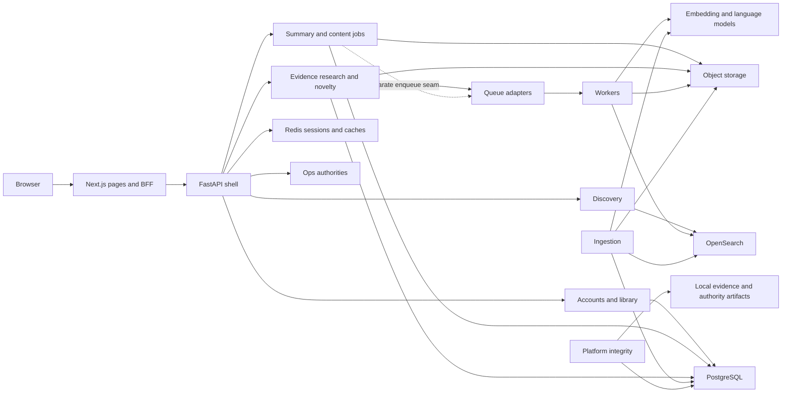
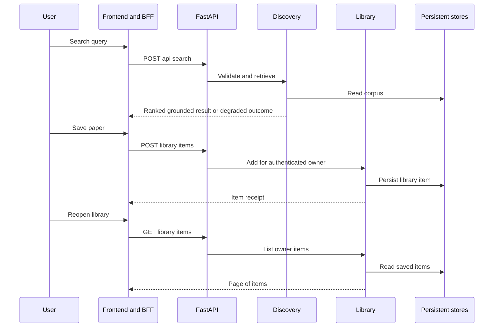

# DocSuri Architecture

## Architecture Analysis

### System Overview

The application is a Python modular backend plus a Next.js frontend/BFF, asynchronous ingestion and analysis workers, shared contracts, reliability operations and a separate local platform-integrity subsystem. Source contains both AWS-oriented adapters/infrastructure and local deployment material. It does not establish which environment is authoritative today.

### Architectural Style

The serving backend is a **modular monolith with ports/adapters**, not fourteen independently deployed microservices: `backend/app.py:85` builds one FastAPI app; `backend/wiring.py:108` mounts fourteen module groups. Discovery and summarization also have independently packaged domain/service/adapter trees. Ingestion and long-running analysis use workers and queues. The platform evidence API is a separate restricted read surface, not a public product API.

### Component Relationships



Text fallback: browser calls same-origin BFF; BFF forwards to the backend. Backend modules share configured stores and ops authorities. Ingestion writes corpus objects/index and control state. Analysis workers use queues, objects and model adapters. Platform integrity separately observes operational evidence. The dotted content-job edge is an integration gap, not a verified dispatch path. Diagram syntax was manually checked using flowchart conventions; no renderer was installed.

### Data Flow

**Discovery and history.** `discovery/service/orchestrator.py:154` (under the module's `src/discovery/`) validates/expands, retrieves, ranks, optionally reranks, applies boosts and grounding, then finalizes/publishes. Embedding failure can fall back to lexical retrieval; index failure differs from empty/no-match results. Backend wiring can publish authenticated history directly to SQL when EventBridge is absent. This is an in-process event seam, not proof of distributed delivery guarantees.

**Ingestion.** `ingestion/src/docsuri_ingestion/application.py:287–550` handles arXiv or source-record jobs. Metadata/full text is parsed, open-access eligibility checked on source records, document models built, canonical/dedup state checked, full text stored, chunks embedded and bulk indexed. Stale chunks are deleted; successful indexing advances dedup/watermark state. Optional second-index writes and assets degrade separately. Withdrawal invokes a tombstone path. Dependency failures are classified; permanent ingestion errors can enter the DLQ. Remaining provider implementations and complete rebuild/transaction semantics are shallow coverage.

**Paper understanding.** The mounted summary router exposes synchronous summary, glossary, public/private document models and assets alongside newer durable job routes. The durable job route is mounted with a job service, but its enqueue and response contracts do not yet form a complete browser-to-worker-to-result path (Q-01–Q-04). Domain preparation helpers do not prove they are connected to those routes.

**Research/evidence.** `backend/modules/evidence/orchestrator.py:65` resolves explicit/automatic scope, searches, loads document models, extracts grounded claims and assembles results; no corpus/model/claims can yield abstention. Literal-quote search is a separate path. Research sessions persist owner-scoped jobs and messages around this orchestrator; SSE or pending JSON depends on request negotiation and queue eligibility. Private PDFs are uploaded and queued through the shared coordinator.

**Novelty/export.** `backend/modules/novelty/service.py:89` creates jobs/events/messages; later state/artifacts, cancellation and export records are owner scoped. Preview → approve → execute is explicit. The full worker/provider algorithm was inventoried, not exhaustively verified.

### Persistence and authority candidates

| Data boundary | Source-owned data | Continuity implications |
|---|---|---|
| Accounts / Redis | accounts, verification/reset/email-change/social identities, withdrawal backup references; sessions/MFA-related state | determine active users, account lifecycle/retention and secret handling before migration |
| Library | saved_searches, library_items, search_history | preserve owner and paper/query identity, pagination and rerun behavior |
| Preferences / plans | consents/subscription presentation, behavior events/profiles/settings, onboarding state, followed topics/digest state, plan assignments/daily usage | distinguish user preferences from reconstructible projections and quota counters |
| Research / novelty | evidence_sessions/turns, research_jobs/messages, novelty jobs/events/messages/artifacts/exports/connections | preserve private attachment links and export approval state; encrypted tokens need key continuity |
| Summarization | content job state/events/effect records, glossary, cached/prepared content | durable acceptance, progress, ownership, result identity/expiry and worker recovery must agree |
| Ingestion | dedup/canonical/version state, watermarks, jobs/generations, paper assets | replay/index rebuild requires authoritative source/object/control state, not only search index |
| Object storage | full text, document models, figures, uploaded PDFs, novelty artifacts | do not treat all objects as disposable cache; classify before retention/deletion |
| Platform integrity | control/audit/run/evidence/head/outbox/authority/target-effect schemas plus local receipts/artifacts | operational evidence and credentials have separate lifecycle from paper corpus |

Table names were checked from repository models and SQL declarations; SQL procedures, privileges, deployed migrations and existing rows were not exhaustively validated. `backend/app.py:127` performs read-only startup schema inspection; DDL reconciliation is a separate operational responsibility.

### Key Design Decisions

- BFF confines upstream configuration and forwards cookies/Set-Cookie, streams selected routes, and proxies assets. It has explicit mock mode and production configuration failure. Source: `frontend/app/bff/[...path]/route.ts:66`.
- Owner checks and private namespace refusal are implemented at service/controller boundaries. `user_docmodel/coordinator.py` binds private IDs to owner/scope/attachment and caps PDF payloads at 10 MiB.
- Shared JSON schemas, generated bindings, authz and vector specifications reduce duplicated contracts, but handwritten browser/job contracts still drift.
- Mock/in-memory implementations aid isolation; broad mount exception handling and omitted readiness requirements can mask partial functionality.
- Separate platform integrity gates use verified peer identity, bounded reads and exact release observations; they are not evidence that the serving application is healthy.
- Local Docker/Colima and old AWS/CDK surfaces coexist. `backend/docker-compose.yml` and `ops/local-stack/colima-stack.compose.yaml` explicitly serve different purposes. Do not run them interchangeably or infer authority from a runbook.

### Improvement Opportunities

First close the proven paper-job boundary defects and establish one executable mounted contract. Then reconcile capability-aware readiness, configuration authority and data/restore evidence. Preserve adapter seams, owner isolation and explicit degraded states while simplifying responsibility boundaries. These are assessment directions, not selected v2 architecture or permission to change providers.

## Interaction Diagrams

### Find, save and revisit



Text fallback: search returns corpus results; saving writes an authenticated library item; revisiting reads that owner's saved items. Authentication, storage and adapters are prerequisites; this diagram is source flow, not an executed journey.

### Current durable paper-job boundary

```mermaid
sequenceDiagram
  participant F as Browser job client
  participant B as BFF
  participant R as Mounted job router
  participant J as ContentJobService
  participant S as Job store
  F->>B: Submit task and idempotency key
  B->>R: Forward submit
  R->>J: submit
  J->>S: accept
  J->>J: Invoke configured no-op enqueue
  J->>S: Mark accepted
  R-->>F: jobId and state
  F->>R: State or event read through BFF
  R-->>F: State lacks seq; event delimiters escaped
  F->>R: Result read through BFF
  R-->>F: resultRef only when completed
  Note over F,R: Client requires seq and preparedResult
```

Text fallback: the job is accepted durably or in memory depending on configuration, but the mounted callback dispatches no work; state/events/results disagree with browser expectations. A separate orchestrator queue adapter and domain serializers exist, but are not repairs to this mounted flow. Exact evidence and the isolated failed SSE regression are in Q-01–Q-04. Sequence syntax manually checked.
