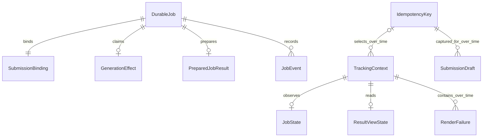

# Functional Specification — U1 Integrated Job Skeleton

## Sources, Authority and Delivery Boundary

The human-confirmed `functional-design-questions.md`, entity YAML in `entities.md`, and rule YAML in `rules.md` govern this Unit. Upstream approved artifacts are beneath `../../../inception/`: requirements, stories, refined mockups, components/ADRs, unit definitions/story map, C1–C8 contracts and the delivery plan. This document is authoritative for ordered workflows and state machines; entity/rule views below are derived.

U1 delivers real summarize submission → authenticated relay → durable dispatch/worker → SSE progress → COMPLETED → exact authorized result. Shared backend outcome/result guarantees and negative fixtures apply to both supported tasks. U2 adds translation UI, broader reload/replay/copy scenarios and complete release evidence; U3 adds secure assets. Cross-cutting criteria here apply to U1-delivered surfaces, not a claim that entire spanning stories are finished.

Physical placement selected in Q1 is a separate prepared-result record in the existing relational authority. No second blob store participates in job completion. Existing shared generation caches remain generation dependencies, not the immutable job-result read source. No application implementation or runtime correctness is claimed by this specification.

## Transaction and Authority Model

All backend commands serialize on the authoritative existing job, then its binding/effect records in a fixed lock order. Recheck owner existence, expected lifecycle, fence and server-time lease **inside** the write transaction. An in-memory precheck followed by an unconditional write is insufficient. Reads use an authorized consistent snapshot and cannot invoke enqueue, generation or current-settings rendering.

| Boundary | Committed together | Failure/ambiguity behavior |
|---|---|---|
| T1 accept | New-protocol authority marker, durable job, immutable input and retained owner/key binding with dispatch identity | Concurrent identical keys return the winner. Retained input cannot change; legacy keyless callers receive their own new job/dispatch record |
| T2 dispatch claim | NOT_STARTED → SENDING, monotonic dispatch fence and send-start evidence | Exactly one actor receives the send permission. Repeated claims after SENDING/UNKNOWN never grant another send |
| T3 settle dispatch | Confirmed acceptance and SUBMITTED → ACCEPTED event; or proven rejection, SUBMITTED → FAILED event and binding release | Confirmation cannot regress an already advanced state. Rejection cannot release a binding after confirmed receipt/effect evidence |
| T4 execution claim | Legal QUEUED/RUNNING transitions and events, unique effect INTENT and publication fence/lease | Only the first new INTENT claimant may invoke the pipeline. Existing intent, even for the same worker, does not grant a fresh invocation |
| T5 prepare | Valid final payload, immutable prepared-result identity/digest, internal job/effect binding and PREPARED marker | Current unexpired fence and job/owner rechecked; commit precedes readable completion; uncertain transaction response is reconciled by exact stored identity |
| T6 terminal publication | Legal terminal job state, corresponding event, effect TERMINAL; for COMPLETED, public resultRef and fixed expiry on job/result | COMPLETED requires T5's committed binding. Idempotent repeat does not change content/expiry or append another transition |
| T7 reconcile | Rechecked expired authority, atomic fence revocation and terminal publication from T5, or safe uncertain failure | Renewed live authority wins its serialization order. Reconciliation never invokes generation or releases an ambiguous-effect binding |
| T8 owner/job deletion | Job invalidation/deletion and dependent bindings/effects/prepared results/history removal | A late writer sees no valid owner/job and cannot upsert it back |

T5 and T6 intentionally have separate commits to support the approved prepared-before-publication window. A staged internal preparedResultId does not populate public resultRef while the job is non-COMPLETED, preserving the existing terminal-result constraint. Expiry starts once at T6 using the configured result TTL; T5's preparedAt remains its preparation timestamp. Prepared content/identity never changes; expiry metadata has a single initialization, not a read-time renewal. Cleanup may later purge expired payloads but must retain expiry information while their owning job remains.

Backend migrations extend existing records and readers compatibly. Legacy rows lacking exact prepared bindings are unavailable under C2, never guessed or regenerated. Existing intentionally supported keyless/legacy task callers need compatibility fixtures and their own normalization; the new browser profile must not silently remove them. No legacy worker may write coarse results for new-protocol jobs during the mixed-version window.

## WF1 — Prepare, Submit and Capture the Actual Job

1. The reader opens the initial submission surface. Preserve the supported initial summary-level default/choices; selection and mount perform no POST.
2. On explicit Submit, validate current owner/paper context and C1 input. Normalize initial choices once; summary uses full scope, supported target language is ko, and the actual paper revision is preserved.
3. Before asynchronous capture/hash work, synchronously reserve the next preparation revision for current owner/paper/task/context. Deliberate new preparation revokes older attempt action authority at that point. Capture immutable input/serialization and derive the digest outside the publication section.
4. On completion, enter a serialized local publication section and recheck owner/context/revision before any memory or storage write. A stale completion writes nothing. The current candidate attempts its synchronous persisted-record write and publishes memory/handle in that guarded section with no intervening async yield. Storage failure reports memory-only; hashing/identity failure does not revive superseded authority.
5. Return the handle before POST. Submit rechecks context/attempt and excludes concurrent activation. Returned job metadata also uses the current-attempt persistence guard. An older preparation or receipt cannot overwrite a newer saved attempt before being rejected.
6. The backend authenticates, validates the applicable caller profile and executes T1. Retained binding returns its original job/state. New acceptance enters the authoritative dispatch workflow below.
7. Validate the actual receipt. The parent accepts it only for the current context/attempt, creates TrackingContext and starts read/stream tracking. Do not infer RUNNING, asset identity, new execution or dispatch-failure cause from a receipt or recovery click.
8. A lost response leaves the attempt intact and the submission surface uncertain. Its recovery availability can be queried without a job ID. Denial clears protected context; safe failures remain inline. Closing the surface does not cancel server work.

**Example:** Request A is prepared; submit loses its response; visible draft changes to B. Recover same request uses attempt A's exact input/key. A deliberate new preparation B supersedes A; subsequent A availability/action/receipt cannot POST or select the view. No changed-parameter retry action is added by this bookkeeping rule.

## WF2 — Authoritative Dispatch and Send Reconciliation

**T1-to-T2 recovery:** If a creator dies after T1 but before T2, the original creator, explicit same-key replay or existing recovery actor may contend for the new-protocol NOT_STARTED binding's first send claim. T2 rechecks the marker/state/no-effect under the same lock and grants permission to exactly one actor. Recovery scans include NOT_STARTED records; this is first dispatch, never replay of SENDING/UNKNOWN work. If a bounded pre-dispatch policy concludes no dispatch can be attempted, terminal failure/release is allowed only while still NOT_STARTED with no send/effect, rechecked atomically against competing T2 claims. Operational scan/bounds are pinned in NFR Design.

1. A new NOT_STARTED binding is atomically claimed by T2. Release the database lock before the external send; carry only recorded jobId/dispatchId in the new C6 payload.
2. Perform the one authorized send through the real queue adapter. The assembled no-op callback and recursive legacy submit-then-send path must not be used as evidence of dispatch.
3. Positive queue acknowledgement settles CONFIRMED through T3, records accepted state/event when still SUBMITTED, and returns the latest real job state. Concurrent early worker receipt may already have settled it; completion of the send call must not reset that state.
4. Proven queue rejection before message/effect acceptance settles REJECTED through T3, records safe dispatch failure and releases the binding in the same commit. An explicit later same-key request can create a replacement; the old FAILED job remains terminal.
5. Timeout, lost send response or process death after T2 is UNKNOWN, not REJECTED. Retain the binding and never authorize another send merely because its response was lost. A later same-key browser request reads/reconciles that same job.
6. A trusted receipt on the configured queue, validated against the recorded dispatchId and job, supplies evidence that this dispatch reached the queue. If the job is still SUBMITTED, the service may settle acceptance atomically from that evidence but returns **defer** for that early execution request. Generation begins only on a subsequent claim against durably settled acceptance. Duplicated payload owner fields never establish authority.
7. Without confirmation, a bounded dispatch reconciliation policy may end the still-SUBMITTED job as safe FAILED `dispatch_outcome_uncertain` while **retaining** its binding and invalidating execution eligibility. The bound and trusted evidence source are pinned in U1 NFR Design before implementation; silence alone is never proven rejection/key release. Later queue delivery for that terminal job is acknowledgement-only.

Serialize positive receipt, definite rejection and reconciliation on the same binding/job authority. If acceptance/effect evidence wins, a late rejection cannot free the key. If conservative terminal reconciliation wins, an old delayed message cannot reopen the job. This resolves an ambiguous dispatch honestly, not an exactly-once queue-send guarantee.

## Legacy Compatibility Bridge

New calls in intentionally supported legacy request shapes are normalized by the new service before T1: preserve established supported defaults and validated paper revision, map summary/translate task values, and drop deprecated untrusted source text. A keyless caller receives a new job per explicit submission, with a dispatch record whose key is absent; no synthetic key silently merges requests. Legacy supplied keys retain their established server representation and owner scoping. The mandated hex digest remains the new browser profile. Every such new record has authorityVersion 1 and the same dispatch/effect protocol.

The older ContentJobQueue entry becomes a compatibility adapter to that one authoritative service operation: normalize request and report its actual receipt/pending outcome, but do not submit recursively or independently send after the service dispatches. Its new output uses the same C6 message. No sender with the old second-send behavior may operate on new-protocol jobs.

Pre-existing records/messages are different from newly normalized callers. Do not manufacture NOT_STARTED, dispatchId or a fresh invocation grant from missing legacy fields. An absent old ledger entry cannot prove that generation never occurred, especially if old code could delete its claim on failure.

| Legacy condition | Guarded behavior |
|---|---|
| Terminal job/message | Validate durable owner/job identity; acknowledge duplicate without generation. Preserve authorized state and expiry metadata; coarse unresolvable completed content remains 422, or owned expired result 410 |
| Active job with old sender/worker authority | Block new-protocol cutover for that work; stop new legacy dispatch, drain it to durable terminal outcome under the old runtime, or isolate it for explicit reconciliation. New worker cannot automatically adopt or execute it |
| Unversioned message referencing a proven authorityVersion 1 record | Verify every supplied identity/input field against the durable normalized job and resolve recorded dispatch identity. If all evidence matches, use existing recorded authority under C6/C7; no fresh identity or duplicate effect grant |
| Missing/mismatched record, unverifiable active legacy authority or unknown major version | Quarantine/defer without generation; retain evidence and the binding rather than treating absence as permission to run |

The rollout prerequisite is concrete: before v1 emission/worker activation, verify that old independent senders and workers cannot consume or mutate new-protocol jobs, and active old work is terminally drained or isolated from this queue/authority. Preserve the old runtime's records/readability while isolating it; do not blindly copy pending rows into new claim eligibility. Environment-specific drain/isolation and rollback proof belong to infrastructure/deployment work and block affected exposure until verified. Isolation alone does not resolve an old job's user outcome; unresolved legacy work stays an explicit blocker for its reconciliation, never claimed migrated. Fixtures cover keyless/omitted-field calls, terminal legacy duplicates, active legacy ambiguity and attempted old-worker consumption of new jobs.

## WF3 — Worker Execution and Truthful Preparation

1. Decode the versioned or explicitly supported legacy queue message. Reject unknown versions, absent job, mismatched recorded identity/task/input and unsupported task type without generation. Load authoritative owner/input from the job; ignored deprecated source text cannot override verified server content.
2. Check job/owner/dispatch validity. Terminal records require no work. Early unsettled acceptance defers as WF2. A valid ACCEPTED job advances QUEUED and RUNNING through legal committed edges with their events.
3. T4 commits the first effect INTENT and fresh publication authority before granting one whole-pipeline invocation. Losing T4's response does not justify repeating it for another invocation. A repeat claim observes existing intent and defers/reconciles. Worker code must consume its original invocation grant once; renewal is not an invocation grant.
4. Start renewable server-authoritative ownership and queue visibility maintenance through independent bounded operational mechanisms. A valid renewal compares current fence and unexpired lease in the same lock order. Visibility is delivery control, never publication authority.
5. Invoke the existing pipeline with re-enqueue disabled and authoritative input. Its internal chunking/validated retries remain existing pipeline behavior; no whole-job automatic replay occurs after an ambiguous effect.
6. Inspect the actual returned outcome. Successful task-matching final safe content is schema/semantically validated, including bare DocModel translation and prepared rendered personalization. Capture the returned final payload rather than the shared translation base or rerendering current glossary settings.
7. Execute T5. If the commit response is lost, read/reconcile this exact result identity and digest: the same payload may be retried for persistence only while authority remains valid; never invoke generation again to repair it. Conflicting prepared content cannot overwrite the stored snapshot.
8. Execute T6. Valid success publishes COMPLETED only from T5; explicit abstain publishes ABSTAINED; degraded/source-unavailable/unexpected pending/malformed/thrown execution outcomes map to safe FAILED as C7 specifies. Do not retain raw exceptions or falsely report that transient cause implies a terminal job can restart.
9. Acknowledge the queue only once a durable terminal outcome is known. Duplicate terminal messages perform no generation, state regression or expiry extension. A failed terminal write or store outage stays unresolved until authority/reconciliation settles it; it is not a claimed completed result.

## WF4 — Fencing and Interrupted-Execution Reconciliation

1. The recovery actor observes an apparently expired lease. That observation alone grants no publication right.
2. T7 locks the existing job/effect and checks live server time, observed/current fence and current lease. A current renewed active worker stays active; terminal work is a no-op. Do not act on a stale expiry observation.
3. If expired authority remains current, revoke it by increasing the publication fence atomically. Reconciliation authority may complete/fail the record but never invoke generation.
4. If an exact T5 snapshot exists and validates for this job/owner, publish completion from that snapshot through T6 semantics, preserving preparedAt and initializing expiry once. Otherwise publish safe FAILED `generation_outcome_uncertain`, retryable false, retaining the job/key binding.
5. Old workers cannot renew, bind content or publish with the revoked fence even if their remote call finishes later. A stale writer's error does not delete a valid new snapshot or reset terminal state.

| Crash point | Durable evidence | Safe continuation |
|---|---|---|
| Before T4 effect intent | No recorded pipeline invocation grant | A fresh valid initial claim may invoke |
| T4 committed, before invocation or during ambiguous remote work | Intent exists, exact result absent | Wait for valid authority; after expiry/fencing fail safely, no second invocation |
| Pipeline returned, before T5 commit | Memory-only output may be lost | Same conservative policy; no cache/current-settings reconstruction |
| T5 committed, before T6 | Exact immutable snapshot exists | Reconcile/publish from it, no generation |
| T6 committed, before acknowledgement | Durable terminal state/event | No-op acknowledgement |

Numeric lease/heartbeat/visibility settings are not invented here. NFR Design must specify renewal budget, communication/persistence timeout allowance, queue visibility behavior, reconciliation frequency and legitimate execution conditions together. Without validated values, worker implementation approval remains blocked. At-most-one whole-pipeline invocation is conservative; remote provider exactly-once completion is not asserted.

## WF5 — Query the Exact Prepared Result

1. Accept only a trusted authenticated request through the restricted query capability. No generation/dispatch/command port is part of the result-controller operation.
2. Resolve the job under its owner. Unknown and other-owner records produce identical generic 404; unauthenticated yields 401 before access.
3. In the consistent authorized snapshot, non-COMPLETED yields 409. For COMPLETED, known expiry at or before current server time yields 410, including after expired payload cleanup.
4. Validate exact binding, result version/job/task identity and final content. Permanent legacy/missing/unsupported binding yields 422; temporary store failure yields 503. No guessed storage URL, coarse-reference reconstruction or pipeline cache miss handling is allowed.
5. Deliver retained opaque resultRef and preparedResult v1 with preparedAt/fixed expiresAt, recorded level if known, actual supplied asset identity if present, and exact safe content. Do not apply current settings or return server-only identity metadata.
6. No-store/private delivery and client owner/job/context cache keys prevent cross-context reuse. Repeated reads, transient retries, expiry and denial cause zero enqueue/generation/key rotation. A result read failure after real COMPLETED changes only result availability UI.

## WF6 — Observe, Reconcile and Stop Tracking

1. Tracking receives actual job identity/current context. Use state read and native stream through the authenticated relay. Initial cursor is absent; recreated streams use last accepted **history** event identity, not a poll watermark.
2. Authenticate/authorize stream before cursor processing. Resolve opaque ID inside this job's history; header takes precedence over query. Invalid/unknown cursor yields 400; never parse a database event ID as seq. Use actual message delimiters and preserve incremental relay.
3. State polls and events carry per-job seq. Validate envelope/job/context. Newer/equal consistent data advances state watermark; equal conflicting data is a controlled protocol failure. Earlier events may fill received-history gaps but cannot regress displayed state. Deduplicate history by event ID and order by seq, preserving server timestamps.
4. SSE failure activates fixed two-second nonoverlapping state polling and degraded text. Keep native reconnection so live restoration can stop fallback; do not infer status codes from onerror. If both fail temporarily, show clearly stale last authorized state.
5. A received terminal state stops active polling/stream reconnect. Existing received history remains visible; a lower-watermark history frame received before cleanup may fill a gap. Do not claim polling reconstructed complete event history. If the browser lost terminal history during outage, U2's wider replay matrix may use an explicit read-only history replay, not reset state or resubmit.
6. Terminal stream reconnect already beyond its last event yields 204, with current state supplied by authorized read. Account/context/job change, navigation or unmount aborts old reads, closes streams and ignores late completions. Known access loss clears protected observations/content and invalidates recovery capabilities.
7. Hide status stops its active UI subscription and makes Show job status available, retaining only authorized parent context; showing uses a fresh read/reconnect. It does not cancel, clear keys or automatically submit work.

Polling state watermark and replay cursor are deliberately separate. A newer poll does not invent an event ID or suppress missing older history. No percentage/ETA is inferred from state names; numeric ETA remains absent unless future supported progress observations meet the explicit NFR/functional validity policy. Current contract supplies no guaranteed numeric progress field.

## WF7 — Frontend Composition and Recovery

| Surface / owner | Required inputs/capabilities | Local state and absence behavior |
|---|---|---|
| PaperDetailIsland | Current owner/paper and actual-job callbacks | Stable TrackingContext, selected surface, visibility and focus references; obsolete callbacks cannot select a job |
| JobSubmissionForm | Initial verified selections, prepare/submit/availability/recover capabilities, dismissal | Editable draft separate from attempt; no identity means no command; original unavailable means persistent explanation |
| JobStatus | Actual selected context, validated observations, state read/stream and explicit contextual recovery | Separate connection/job state, history and watermark; absent progress indeterminate; no jobId means do not mount |
| SummaryModal | Selected context, query-only result operation, dismissal and invoking control | Read status and exact content; submitted-level metadata read-only or unavailable; no editable command toggle |
| ErrorBoundary | Selected status subtree and safe containment callback | RenderFailure notification; async transport errors handled by their own owner |
| ErrorBoundaryFallback | Safe message, authorized surviving job context if any, recovery/return callbacks | Full-page same-route presentation; no context disables tracking recovery with explanation |

The initial expert/beginner summary choice is explicit before submission. The dialog visual shell can be shared without sharing command effects. Existing generation-on-mount/persona-change effects are removed from the **durable completed-result path**; other intentionally unrelated consumers require compatibility handling rather than silent workflow removal.

On uncertain pre-job recovery, the submission surface uses the original attempt reference; the parent receives actual returned job/state before status mounts. A permitted replacement changes selected job context and invalidates old-job reads/history/results even for the same owner/paper. Unknown recovery cause uses neutral feedback. If the focused recovery action disappears, focus the resulting named status heading; preserve a surviving focus target if the user moved elsewhere while waiting.

Result opening focuses its heading and contains keyboard navigation in the active dialog. Close/dismissal restores the invoking result control, otherwise corresponding paper action, otherwise surviving paper heading. Keep Close usable in loading/unavailable states. A transient-only result read retry is query-only; when its focused action disappears, focus the result heading, not the body. Static status updates never steal focus. Copy UI completion remains U2 scope; absent supplied identity cannot produce invented content.

Rendering failure closes result surfaces and presents the full-page fallback from the stable parent. Focus its heading and announce a safe message once. Recover tracking resets only status display/query/stream for the existing job; Return restores the paper with failed tracking hidden so it does not immediately crash-loop. No network failure automatically triggers the render-error surface.

U1 preserves sticky status with reserved layout clearance and constrained in-flow fallback, existing semantic light/dark tokens, reduced-motion choices, meaningful deduplicated live announcements, visible keyboard focus, 200% text resize and 320 CSS-pixel reflow. Apply the refined-mockup specification rather than introducing new visual choices.

JobStatus supplies immutable received-history/cursor checkpoints to the stable parent while authorized tracking is active. This is recovery evidence, not a second mutable JobState owner. On status-only rendering reset, remount from the current checkpoint and then reconcile fresh state/events; otherwise resuming from a saved cursor with an empty history would discard previously displayed history. Owner/job/context invalidation clears the checkpoint. The current snapshot's watermark remains separate from the history cursor, and neither checkpoint is an authorization credential.

## State Machines

| Current job state | Allowed successor | Guard |
|---|---|---|
| SUBMITTED | ACCEPTED | Confirmed authoritative dispatch acceptance |
| SUBMITTED | FAILED | Proven rejection/release or conservative unknown-dispatch failure with retained binding |
| ACCEPTED | QUEUED or FAILED | Valid authorized receipt or safe pre-execution failure |
| QUEUED | RUNNING or FAILED | Initial execution claim or safe failure |
| RUNNING | COMPLETED, FAILED or ABSTAINED | Current fence/lease and truthful C7 outcome; success additionally requires exact T5 binding |
| COMPLETED, FAILED, ABSTAINED | None | Reads/replays cannot restart or regress terminal state |

There is no new backend cancellation/retry state. Publication recovery from a staged result is RUNNING → COMPLETED, not a new generation attempt.

| State machine | Allowed behavior |
|---|---|
| Dispatch | NOT_STARTED → SENDING → CONFIRMED / REJECTED / UNKNOWN; UNKNOWN may be settled from authoritative evidence, never automatically sent again |
| Effect | INTENT → PREPARED → TERMINAL for success, or INTENT → TERMINAL for mapped abstention/failure; fence can advance only for revocation/reconciliation, not another invocation |
| Submission surface | idle → preparing → submitting → received or uncertain; uncertain → recovering → received/uncertain/unavailable using the same captured attempt |
| Connection | connecting → live or polling/offline; restored live stops polling; terminal/access-unavailable stops active work |
| Result surface | loading → available / authentication-required / not-ready / unavailable / expired / transient-failure; only transient-failure has read retry → loading |

## Derived Entity Relationships

Text fallback: a durable job owns its binding/dispatch record, optional effect and prepared result, and ordered events. Client original-request identity may select successive tracking contexts over time; each active context has an observed status and optional result view/failure notification. Cardinalities and exact attribute constraints remain in `entities.md`.

This uses only the restricted ER grammar of named entities, valid cardinality edges and simple relationship labels; it is derived from the catalogue, not a claim of rendered diagram validation.

## Derived Rules Summary

| Rule IDs | Behavioural location |
|---|---|
| BR1.1–BR1.8 | WF1/WF2; owner/current context, original identity and authenticated dispatch |
| BR2.1–BR2.5 | T4–T7 and WF3/WF4; durable intent/fencing/binding and outcomes |
| BR3.1–BR3.3 | T8 and WF5; owner-first read precedence, no generation and fixed expiry |
| BR4.1–BR4.4 | WF6 and recovery selection; replay, watermark, connectivity and truthful state |
| BR5.1–BR5.5 | WF7 and instrumentation; query-only result, focus, containment, diagnostics and fixed acceptance targets |

## Scenarios and Verification Handoff

Static validation parsed both authoritative YAML catalogues and the JSON map: 11 entity shapes, 25 rules and 124 acceptance rows with valid references, existing rule targets and no unexplained rule orphans. Five rows explicitly retain later-unit responsibility (four translation-UI criteria and asset timing), while the remaining mappings refer to U1 backend guarantees or U1 contributions to spanning stories. An OK design mapping is not whole-story or runtime completion evidence. The traceability sensor returned pass with zero findings. Restricted ER syntax and relationship parity were checked; full diagram rendering and application tests were not run.

| Scenario | Expected evidence |
|---|---|
| Concurrent same-key submit and duplicate queue delivery | One retained job and one first invocation grant; legal consistent state/events |
| Definite rejection versus ambiguous send | Only proved rejection releases key; timeout retains original binding and cannot dispatch again |
| Receipt before acceptance commit | First early execution request defers; only settled acceptance grants subsequent valid claim |
| Pipeline success, abstention, unavailable, unexpected pending or thrown failure | Valid exact successful content required for completion; actual safe non-success mapping otherwise |
| Crash and renewal/reconciliation race at T4/T5/T6 | Current fence wins; staged exact result recovered without generation; renewed worker not falsely failed from stale observation |
| Same job read after changed glossary/model/source | Exact committed final payload, not a rerendered base; all negative/positive reads have zero generation/enqueue |
| Owner-known expiry / other-owner known expiry / unknown job | 410 for owner; indistinguishable 404 for others/unknown; no content or oracle |
| Lost response, edited draft, later recovery/supersession | Original A sent, never edited B; stale attempt/context rejected without POST |
| Corrupt/quota-limited metadata and missing originals | Honest stored/memory-only/unavailable outcome, no page crash or guessed resend |
| Poll ahead of replay, duplicate/older events, replacement job | State watermark nonregressing; history deduplicated/ordered; old-job data cannot overwrite selection |
| Render crash versus asynchronous failure | Separate containment/inline handling; command-free tracking recovery and usable focus |

The Code Generation plan must include tests for every U1-delivered criterion, both backend tasks, current suite baseline and ≥80% new-code coverage under test-after ordering. This design does not run application tests. NFR Design owns worker timing, database snapshot-volume/performance evidence and operational health/error metrics; Infrastructure/deployment work owns exact migrations/exposure/rollback before live actions. The human-authorized real integrated verification command is still deferred, as recorded in Delivery Planning.

No later Unit is required for the first real summarize result. Wider translation UI, copy and asset obligations are not silently claimed complete; `traceability.json` and the approved Unit story map distinguish the slices. Additional backend scope or infeasible invariants must be surfaced before implementation rather than hidden in a placeholder.
