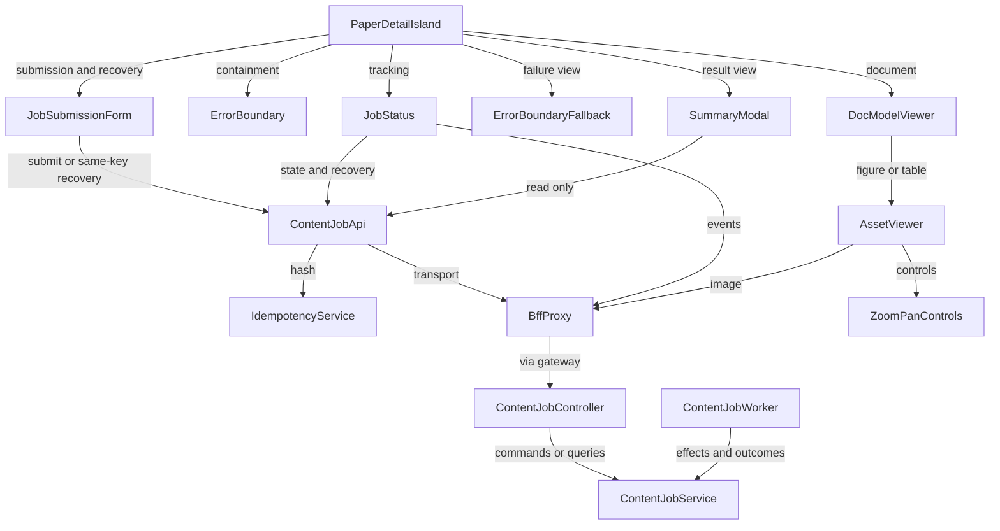

# Component Catalogue — Phase 7 Frontend Wiring

## Sources

- [desc] Initial description: "Phase 7 frontend wiring for durable content jobs: wire JobStatus component with SSE, replace AssetViewer presigned redirect with same-origin delivery, route contentJobApi through BFF, mount components in detail page"
- [scope] Workflow-selected scope: `feature`.
- [Q1–Q12] `domain-design-questions.md`, including the confirmed backend amendment and ContentJobService result-ownership choice. Requirements Q15/Q16 and FR2.5/FR3.5 authorize the bounded backend work and preserved dispatch-failure exception.
- `../requirements-analysis/requirements.md`, `../user-stories/stories.md`, and `../refined-mockups/{mockups,interaction-spec,design-system-mapping,accessibility-checklist}.md` are the approved baseline.
- `aidlc/spaces/default/codekb/DocSuri/{architecture,component-inventory}.md` is historical context, not evidence of current compatibility. Source seams are identified below.
- `aidlc/spaces/default/memory/{org,team,project}.md` supplies affirmed implementation and verification constraints.

## Component Catalogue

These are fifteen logical code boundaries, not fifteen deployable units. Entities describe ownership and attribute names, not full schemas. Client projections remain distinct from authoritative backend records. `depends_on` describes invocation or rendering composition; responses and supplied UI callbacks return along the same interaction, not a second reverse dependency. Each callback is supplied by the caller and does not import its parent. Queue delivery starts the worker independently; no synchronous service-to-worker call is implied.

```yaml
components:
  - name: PaperDetailIsland
    summary: Coordinate the paper job journey and stable recovery context.
    behaviour: >
      Mount submission, tracking, result, and document surfaces for the selected owner and paper.
      Retain selected job and resume context outside the failing status subtree. On owner or access
      loss clear protected views and invalidate obsolete callbacks and requests. Coordinate full-page
      render fallback, safe return, and tracking-only remount without calling submit. Adopt actual
      recovery identity including a permitted replacement; old-job responses cannot overwrite it.
      Preserve surviving focus or focus the resulting status heading when its active control disappears.
    responsibilities: [journey composition, stable recovery context, focus restoration, context invalidation]
    depends_on:
      - {component: JobSubmissionForm, interaction: render initial submission and pre-job recovery and receive the actual backend job, style: sync}
      - {component: ErrorBoundary, interaction: wrap the status subtree and receive render-failure notification, style: sync}
      - {component: JobStatus, interaction: supply selected job and receive resume-context updates and result actions, style: sync}
      - {component: ErrorBoundaryFallback, interaction: render full-page failure and handle tracking recovery or safe return, style: sync}
      - {component: SummaryModal, interaction: open read-only result and restore invoking focus on close, style: sync}
      - {component: DocModelViewer, interaction: render the existing document surface, style: sync}
    dependents: []
    external_dependencies:
      - {name: Existing authenticated session context, kind: other, purpose: owner changes and access-loss signals without trusting a client principal}
    entities:
      - name: TrackingContext
        identifier: contextId
        attributes: [contextId, ownerId, paperId, jobId, taskType, submittedLevel, lastEventId, contextGeneration, returnFocusTarget]
        references: []
  - name: JobSubmissionForm
    summary: Own initial submission and uncertain-outcome recovery before a job ID is known.
    behaviour: >
      Offer summarize and translate only for this integration. Preserve initial summary-level choice
      and supported translation parameters. Submit only on explicit activation, contain input and
      submission failures, and return the actual backend job. Share the visual dialog shell if useful;
      neither opening a form nor changing a choice submits. Unrelated existing workflows remain intact.
      When the submit response is lost before a job ID is known, own the inline uncertain-outcome surface.
      Obtain recovery availability and a reference to the captured immutable request from ContentJobApi.
      On explicit recovery activation resend that original request with its same key, never the current
      editable draft. Missing original parameters or identity and changed ownership disable recovery
      with an explanation. Handle recovery failures inline without automatic resend loops.
      Pass the actual recovered backend job and state through the existing completion callback to
      PaperDetailIsland before JobStatus mounts. Reject obsolete owner or paper-context responses;
      retain returned terminal states rather than resetting them to SUBMITTED. A failed-dispatch key
      release may yield a replacement job; never infer that cause solely from a lost response or
      unexplained changed ID. Use neutral feedback when cause is unknown and do not restart the old job.
    responsibilities: [initial request draft, explicit submit action, submission feedback, pre-job recovery surface, recovered job handoff]
    depends_on:
      - {component: ContentJobApi, interaction: submit request or obtain recovery availability and explicitly recover its immutable original identity, style: async}
    dependents:
      - {component: PaperDetailIsland, interaction: compose submission and pre-job recovery and receive the actual backend job}
    entities:
      - name: SubmissionDraft
        identifier: draftId
        attributes: [draftId, ownerId, paperId, taskType, params, submissionStatus, safeError]
        references: []
  - name: ContentJobApi
    summary: Own authenticated job transport and unchanged-request recovery identity.
    behaviour: >
      Use native fetch through the custom Transport and the BFF job base. Own key storage under
      idempotency:{paperId}:{taskType}; reconcile derived identity with the authenticated owner and
      exact original serialized request before reuse. Surface hashing and storage failures without
      random fallback or false persistence claims. Capture the immutable original request and owner-bound
      identity before sending. Expose recovery availability and a reference to that identity even without
      a job ID. Recovery validates current ownership and resolves the captured request rather than a
      subsequently edited draft. Resend only the unchanged recoverable request;
      terminal responses remain terminal. Read state and result through their established routes.
      Read exact prepared content through the remediated authorized job result contract; never resolve
      identity from current settings or treat resultRef as an arbitrary URL or asset ID. Preserve actual
      replacement-job identity when failed dispatch released the backend binding. Reject obsolete responses
      including old-job replies within the same owner and paper. Instrument safe submission and
      recovery events; result reads cannot rotate keys or submit work.
    responsibilities: [job transport, recovery identity lifecycle, authorized result resolution, safe transport errors]
    depends_on:
      - {component: IdempotencyService, interaction: derive deterministic digest, style: async}
      - {component: BffProxy, interaction: forward authenticated submit state and result operations, style: async}
    dependents:
      - {component: JobSubmissionForm, interaction: submit initial request and recover uncertain outcomes before a job ID is known}
      - {component: JobStatus, interaction: read state and explicitly recover unchanged submission}
      - {component: SummaryModal, interaction: read result and authorized content only}
    external_dependencies:
      - {name: Native fetch and existing Transport, kind: other, purpose: cancellable job and authorized content reads}
      - {name: localStorage, kind: other, purpose: recovery identity persistence with controlled unavailable or corrupt outcomes}
      - {name: Sentry, kind: third-party-api, purpose: scrubbed submission recovery and failure diagnostics}
    entities:
      - name: IdempotencyKey
        identifier: key
        attributes: [key, ownerId, paperId, taskType, serializedRequest, originalRequestAvailable, persistenceStatus, jobId]
        references: []
  - name: IdempotencyService
    summary: Compute the deterministic submission digest without owning persistence.
    behaviour: >
      Hash userId:paperId:taskType:JSON.stringify(params) using native crypto.subtle SHA-256.
      Return controlled failure when hashing cannot run. Never store keys or substitute random identity.
    responsibilities: [deterministic asynchronous hashing]
    depends_on: []
    dependents:
      - {component: ContentJobApi, interaction: derive digest for submit and recovery reconciliation}
    external_dependencies:
      - {name: crypto.subtle, kind: other, purpose: native SHA-256}
    entities: []
  - name: JobStatus
    summary: Own the current client job projection and tracking lifecycle.
    behaviour: >
      Consume native EventSource directly and reconcile ordered event IDs without stale-state regression.
      Distinguish all backend states from connecting live polling and offline connectivity. Use SWR
      state polling at a fixed two-second interval after SSE failure. Stop obsolete subscriptions and
      polling on terminal state unmount selection change or access loss, and stop polling when live
      service resumes. Preserve stale data only within unchanged authorized context. Handle async
      errors explicitly. Announce meaningful changes without duplicate announcements, show actual
      progress only, and show ETA only with supporting samples. Inline recovery calls the explicit
      unchanged-request operation; unavailable original parameters disable it with an explanation.
      Emit result-open actions to the parent without submitting. Measure construction-to-open latency.
    responsibilities: [client job state, connection lifecycle, history deduplication, inline recovery feedback, accessible status]
    depends_on:
      - {component: ContentJobApi, interaction: poll state and explicitly recover the original submission, style: async}
      - {component: BffProxy, interaction: receive and resume native SSE through the events route, style: event}
    dependents:
      - {component: PaperDetailIsland, interaction: compose tracking with stable selected context}
    external_dependencies:
      - {name: EventSource, kind: other, purpose: native event stream with verified resume contract}
      - {name: SWR, kind: other, purpose: owner and job scoped server state with two-second fallback polling}
      - {name: Sentry, kind: third-party-api, purpose: scrubbed connection latency drops recovery and observed job outcomes}
    entities:
      - name: JobState
        identifier: contextId
        attributes: [contextId, jobId, backendState, progress, safeError, history, lastEventId, connectionStatus, observedAt, eta]
        references:
          - {entity: TrackingContext, owned_by: PaperDetailIsland, relationship: projection for the selected tracking context}
  - name: SummaryModal
    summary: Display completed summary or translation results without submission capability.
    behaviour: >
      Read results using SWR and the read-only ContentJobApi operation. Render submitted summary level
      as metadata without an editable submission toggle. Preserve safe formatting and centered modal
      focus semantics. Distinguish loading available missing expired denied transient failure and
      unsupported reference outcomes; transient retry repeats reads only. Show and copy an asset ID
      only when supplied by an authorized result, announce success only after clipboard completion,
      and report copy failure or missing identity honestly. Clear protected content on access loss.
      Render the exact prepared personalization rather than applying current preferences. Use generic
      unavailable wording for unknown or not-owned jobs and expired wording only for owner-verified expiry.
      Preserve surviving focus during read retry; if its focused action disappears use the result heading.
    responsibilities: [result presentation, read-only retries, authorized asset identifier copy, modal focus]
    depends_on:
      - {component: ContentJobApi, interaction: read completed result and resolve authorized content, style: async}
    dependents:
      - {component: PaperDetailIsland, interaction: open result view and receive close or access-loss outcome}
    external_dependencies:
      - {name: SWR, kind: other, purpose: owner scoped result-read server state}
      - {name: Clipboard API, kind: other, purpose: copy authorized supplied identifiers with real completion feedback}
    entities:
      - name: ResultViewState
        identifier: contextId
        attributes: [contextId, resultRef, content, submittedLevel, suppliedAssetId, readStatus, copyStatus, safeError]
        references:
          - {entity: TrackingContext, owned_by: PaperDetailIsland, relationship: result view belongs to selected job context}
  - name: DocModelViewer
    summary: Integrate secure figures and tables into the existing document view.
    behaviour: >
      Supply existing paper and asset identifiers and authorized captions or text equivalents to
      AssetViewer. Preserve surrounding document semantics and report missing equivalents as gaps.
      Do not fabricate OCR or a new content service.
    responsibilities: [document asset composition, existing semantic context]
    depends_on:
      - {component: AssetViewer, interaction: display an authorized document figure or table, style: sync}
    dependents:
      - {component: PaperDetailIsland, interaction: compose document viewing}
    entities: []
  - name: AssetViewer
    summary: Display secure same-origin assets and own their visual navigation state.
    behaviour: >
      Render the same-origin paper asset image route without presigned redirects. Show skeleton loading
      and controlled load errors, preserve supplied text equivalents, and clear obsolete protected
      views on context loss. Use the same authorized image for a noninteractive minimap. Own zoom pan
      and reset transforms, with keyboard controls and focus that can leave the viewer. Observe image
      decode readiness. Image error events alone do not reveal HTTP denial status; accurate denial
      messages require a verified server or session signal, otherwise show a generic load failure.
    responsibilities: [asset load lifecycle, view transform, accessible image context, decoded-readiness timing]
    depends_on:
      - {component: BffProxy, interaction: load same-origin authorized image bytes, style: async}
      - {component: ZoomPanControls, interaction: render accessible transform controls and receive actions, style: sync}
    dependents:
      - {component: DocModelViewer, interaction: render document assets}
    external_dependencies:
      - {name: Browser image loading and performance APIs, kind: other, purpose: same-origin delivery and decode timing}
    entities:
      - name: AssetViewState
        identifier: viewId
        attributes: [viewId, ownerId, paperId, assetId, loadStatus, scale, offsetX, offsetY, caption, textEquivalent, safeError]
        references: []
  - name: ZoomPanControls
    summary: Provide keyboard and pointer actions for the parent-owned asset transform.
    behaviour: >
      Expose zoom in zoom out pan and reset-to-fit with names and visible focus. Reflect disabled
      controls for unavailable assets. Actions return through supplied callbacks; no duplicate transform
      store, alternate delivery URL, or keyboard trap.
    responsibilities: [accessible transform actions]
    depends_on: []
    dependents:
      - {component: AssetViewer, interaction: supply transform state and action callbacks}
    entities: []
  - name: ErrorBoundary
    summary: Contain status-subtree rendering failures.
    behaviour: >
      Catch descendant render failures, report safe diagnostics, and notify the stable parent to
      replace the page presentation. Reset only with parent-provided tracking context. Async network
      and EventSource callback errors remain explicitly handled by their owners.
    responsibilities: [render failure containment, boundary reset, scrubbed exception reporting]
    depends_on: []
    dependents:
      - {component: PaperDetailIsland, interaction: wrap status subtree and handle containment callback}
    external_dependencies:
      - {name: Sentry, kind: third-party-api, purpose: scrubbed render exception diagnostics without recursive failure}
    entities:
      - name: RenderFailure
        identifier: failureId
        attributes: [failureId, contextId, safeMessage, occurredAt]
        references:
          - {entity: TrackingContext, owned_by: PaperDetailIsland, relationship: identifies the failed tracking context}
  - name: ErrorBoundaryFallback
    summary: Present the full-page failure surface outside the failed subtree.
    behaviour: >
      Show a safe explanation, safe-return action, and tracking-only recovery when context survives.
      Accept callbacks rather than importing the parent or API. Focus the failure heading on entry
      and keep controls keyboard accessible. Do not promise job re-execution.
    responsibilities: [full-page failure presentation, recovery and return affordances]
    depends_on: []
    dependents:
      - {component: PaperDetailIsland, interaction: supply failure state and recovery or return callbacks}
    entities: []
  - name: BffProxy
    summary: Relay authenticated job streams results and asset bytes to the gateway.
    behaviour: >
      Forward session Cookie and relay separate Set-Cookie values. Preserve streaming framing IDs
      incremental delivery and verified resume cursors; never parse content-job SSE as ordinary JSON.
      Preserve cancellation and safe error responses. Use configured gateway destinations and reject
      client principal spoofing or arbitrary proxy targets. Gateway and asset services enforce trusted
      identity authorization and license checks. Preserve private asset caching and existing CSP.
    responsibilities: [authenticated proxying, streaming and cursor relay, asset byte delivery, response fidelity]
    depends_on:
      - {component: ContentJobController, interaction: relay job HTTP and SSE through the trusted gateway, style: async}
    dependents:
      - {component: ContentJobApi, interaction: proxy job commands and reads}
      - {component: JobStatus, interaction: proxy native event stream}
      - {component: AssetViewer, interaction: proxy authorized asset bytes}
    external_dependencies:
      - {name: Existing gateway and asset services, kind: other, purpose: trusted principal derivation routing and licensed asset delivery}
    entities: []
  - name: ContentJobController
    summary: Expose authenticated job HTTP and correctly framed event delivery.
    behaviour: >
      Validate requests and consume only gateway-derived authentication. Serialize service outcomes
      without leaking internals. Emit actual SSE line and event delimiters with job event IDs and
      supported replay cursors. For result reads call only the restricted query interface, never
      generation or submission. Map unauthenticated to 401 and unknown or not-owned jobs to the same
      404; disclose 410 expiry only after ownership is established. Preserve compatible response
      fields while adding authorized exact-content delivery through the approved result path.
    responsibilities: [job HTTP boundary, event framing, safe error serialization, restricted result-read entry]
    depends_on:
      - {component: ContentJobService, interaction: invoke explicit commands or restricted authorized queries and obtain events, style: sync}
    dependents:
      - {component: BffProxy, interaction: forward authenticated job requests through gateway routing}
    external_dependencies:
      - {name: Existing gateway authentication context, kind: other, purpose: trusted caller identity rather than client principal fields}
    entities: []
  - name: ContentJobService
    summary: Own authoritative job lifecycle and exact prepared-result binding and reads.
    behaviour: >
      Own durable jobs, owner-scoped submission bindings, generation effects and immutable prepared
      results. Accept and dispatch explicitly; retained bindings return the existing job, while failed
      dispatch can release the binding so later explicit same-key submission may return a replacement.
      Never restart the old terminal job. Coordinate durable binding before completion publication,
      legal transitions and effect reconciliation for worker crash and redelivery windows. Bind exact
      prepared content including personalized overlays and generation/source identity rather than
      recomputing it during reads. The restricted query interface performs owner checks before
      availability or expiry disclosure, returns exact unexpired content or controlled unavailable
      outcomes, and has no generation or enqueue operation. Both references and content obey TTL;
      legacy references cannot become guessed storage paths or regeneration triggers. These are
      design obligations; transaction and effect guarantees require detailed design and tests.
    responsibilities: [durable job authority, backend idempotency binding, generation effect reconciliation, prepared-result ownership, authorized read-only delivery]
    depends_on: []
    dependents:
      - {component: ContentJobController, interaction: execute job commands and restricted queries}
      - {component: ContentJobWorker, interaction: claim or reconcile effects and persist actual outcome with exact result binding}
    external_dependencies:
      - {name: Existing job persistence adapters, kind: database, purpose: durable jobs submission bindings effects and lifecycle transitions}
      - {name: Prepared-result persistence adapter, kind: other, purpose: immutable prepared content and exact binding with TTL; physical storage decided later}
      - {name: Existing job queue, kind: queue, purpose: explicit dispatch only; query paths never enqueue}
    entities:
      - name: DurableJob
        identifier: jobId
        attributes: [jobId, ownerId, taskType, inputIdentity, state, safeError, abstainReason, eventSequence, preparedResultId, createdAt, updatedAt]
        references: []
      - name: SubmissionBinding
        identifier: bindingId
        attributes: [bindingId, ownerId, idempotencyKey, originalRequestIdentity, jobId, dispatchOutcome, releasedAt]
        references: []
      - name: GenerationEffect
        identifier: effectId
        attributes: [effectId, jobId, attempt, effectName, effectStatus, preparedResultId, reconciliationEvidence]
        references: []
      - name: PreparedJobResult
        identifier: preparedResultId
        attributes: [preparedResultId, jobId, ownerId, taskType, preparedContent, personalizationIdentity, generationIdentity, sourceIdentity, createdAt, expiresAt]
        references: []
  - name: ContentJobWorker
    summary: Coordinate generation and truthful durable outcome publication.
    behaviour: >
      Consume dispatched job identity and recheck its authorized owner context before work. Obtain
      effect eligibility or reconciliation from ContentJobService before invoking the existing pipeline.
      Inspect actual successful abstained or unavailable/failed outcomes; a returned DTO alone does
      not mean successful content. Provide exact final prepared content including personalization
      to the service for durable binding before publishing COMPLETED. Reconcile interruptions before
      generation, after generation before binding, after binding before publication and before queue
      acknowledgement. Never release an effect blindly and regenerate after ambiguous completion.
      Unprovable safe recovery must surface a controlled outcome instead of fabricating completion
      or assuming duplicate-generation protection. Contract Design must settle feasible reconciliation.
    responsibilities: [worker execution coordination, truthful outcome mapping, exact prepared-content capture, crash and redelivery handling]
    depends_on:
      - {component: ContentJobService, interaction: authorize work reconcile effects and publish durable result or non-success outcome, style: sync}
    dependents: []
    external_dependencies:
      - {name: Existing job queue, kind: queue, purpose: receive and acknowledge work under verified redelivery semantics}
      - {name: Existing summarization and translation pipeline, kind: other, purpose: generate prepared content and return actual outcomes; no replacement pipeline}
    entities: []
```

## Component Diagram

Syntax checked against the Mermaid flowchart grammar: unique simple node identifiers, quoted labels, and one directed edge per catalogue dependency. Text fallback is the Component Summary below.



## Component Summary

| Component | Purpose | Depends On | Dependents | Entities Owned |
|---|---|---|---|---|
| PaperDetailIsland | Stable journey coordinator | JobSubmissionForm, ErrorBoundary, JobStatus, ErrorBoundaryFallback, SummaryModal, DocModelViewer | None | TrackingContext |
| JobSubmissionForm | Initial selection, explicit command, and pre-job recovery | ContentJobApi | PaperDetailIsland | SubmissionDraft |
| ContentJobApi | Job transport and unchanged recovery | IdempotencyService, BffProxy | JobSubmissionForm, JobStatus, SummaryModal | IdempotencyKey |
| IdempotencyService | Stateless digest | None | ContentJobApi | None |
| JobStatus | Client job projection and connection | ContentJobApi, BffProxy | PaperDetailIsland | JobState |
| SummaryModal | Read-only completed result | ContentJobApi | PaperDetailIsland | ResultViewState |
| DocModelViewer | Existing document integration | AssetViewer | PaperDetailIsland | None |
| AssetViewer | Asset loading and transform | BffProxy, ZoomPanControls | DocModelViewer | AssetViewState |
| ZoomPanControls | Accessible transform actions | None | AssetViewer | None |
| ErrorBoundary | Render containment | None | PaperDetailIsland | RenderFailure |
| ErrorBoundaryFallback | Full-page failure controls | None | PaperDetailIsland | None |
| BffProxy | Authenticated streaming and byte relay | ContentJobController | ContentJobApi, JobStatus, AssetViewer | None |
| ContentJobController | Job HTTP and event boundary | ContentJobService | BffProxy | None |
| ContentJobService | Durable lifecycle and exact result authority | None | ContentJobController, ContentJobWorker | DurableJob, SubmissionBinding, GenerationEffect, PreparedJobResult |
| ContentJobWorker | Generation/outcome coordination | ContentJobService | None | None |

## Entity Ownership

| Entity | Owning Component | Identifier | Attributes | References |
|---|---|---|---|---|
| TrackingContext | PaperDetailIsland | contextId | contextId, ownerId, paperId, jobId, taskType, submittedLevel, lastEventId, contextGeneration, returnFocusTarget | None |
| SubmissionDraft | JobSubmissionForm | draftId | draftId, ownerId, paperId, taskType, params, submissionStatus, safeError | None |
| IdempotencyKey | ContentJobApi | key | key, ownerId, paperId, taskType, serializedRequest, originalRequestAvailable, persistenceStatus, jobId | None |
| JobState | JobStatus | contextId | contextId, jobId, backendState, progress, safeError, history, lastEventId, connectionStatus, observedAt, eta | TrackingContext / PaperDetailIsland |
| ResultViewState | SummaryModal | contextId | contextId, resultRef, content, submittedLevel, suppliedAssetId, readStatus, copyStatus, safeError | TrackingContext / PaperDetailIsland |
| AssetViewState | AssetViewer | viewId | viewId, ownerId, paperId, assetId, loadStatus, scale, offsetX, offsetY, caption, textEquivalent, safeError | None |
| RenderFailure | ErrorBoundary | failureId | failureId, contextId, safeMessage, occurredAt | TrackingContext / PaperDetailIsland |
| DurableJob | ContentJobService | jobId | jobId, ownerId, taskType, inputIdentity, state, safeError, abstainReason, eventSequence, preparedResultId, createdAt, updatedAt | None across components |
| SubmissionBinding | ContentJobService | bindingId | bindingId, ownerId, idempotencyKey, originalRequestIdentity, jobId, dispatchOutcome, releasedAt | None across components |
| GenerationEffect | ContentJobService | effectId | effectId, jobId, attempt, effectName, effectStatus, preparedResultId, reconciliationEvidence | None across components |
| PreparedJobResult | ContentJobService | preparedResultId | preparedResultId, jobId, ownerId, taskType, preparedContent, personalizationIdentity, generationIdentity, sourceIdentity, createdAt, expiresAt | None across components |

Owner/paper/asset IDs refer to existing external resources. Backend job/result authority now belongs explicitly to ContentJobService; the four backend entities' job/result attributes link within that single owner. Browser IdempotencyKey is not backend SubmissionBinding. The client recovery shape does not mandate storing full request/protected content in localStorage. Backend immutable prepared content has separate authorized persistence. JobState is a client projection, not DurableJob ownership; the parent cursor is a recovery checkpoint. Entity references do not imply cyclic calls. Types, keys, validation and relationship cardinality belong to Functional Design.

## External Dependencies

| Component | Dependency | Kind | Purpose |
|---|---|---|---|
| PaperDetailIsland | Existing authenticated session context | other | Owner/access change signals |
| ContentJobApi | Native fetch and existing Transport | other | Cancellable operations |
| ContentJobApi | localStorage | other | Recovery identity |
| ContentJobApi | Sentry | third-party-api | Scrubbed submission/recovery diagnostics |
| IdempotencyService | crypto.subtle | other | SHA-256 |
| JobStatus | EventSource | other | Native SSE |
| JobStatus | SWR | other | Owner/job-scoped polling |
| JobStatus | Sentry | third-party-api | Connection and observed lifecycle telemetry |
| SummaryModal | SWR | other | Owner-scoped result reads |
| SummaryModal | Clipboard API | other | Truthful copy feedback |
| AssetViewer | Browser image loading and performance APIs | other | Bytes and decoded readiness |
| ErrorBoundary | Sentry | third-party-api | Render diagnostics |
| BffProxy | Existing gateway and asset services | other | Trusted identity, routing and licensed assets |
| ContentJobController | Existing gateway authentication context | other | Trusted caller identity |
| ContentJobService | Existing job persistence adapters | database | Jobs, bindings, effects and transitions |
| ContentJobService | Prepared-result persistence adapter | other | Immutable prepared content and TTL; physical design later |
| ContentJobService | Existing job queue | queue | Explicit dispatch only |
| ContentJobWorker | Existing job queue | queue | Receive/acknowledge work |
| ContentJobWorker | Existing summarization and translation pipeline | other | Actual generation outcomes and prepared content |

All telemetry call sites must scrub cookies, credentials, document/result content, and sensitive request parameters before emission. Failed telemetry must not recursively report itself or break the user journey. Shared instrumentation utilities may implement this policy within these boundaries; no new telemetry service is implied.

## Rationale

| Component | Separate-boundary rationale |
|---|---|
| PaperDetailIsland | Stable lifetime survives status rendering failure and coordinates context/focus |
| JobSubmissionForm | Initial command and uncertain response share a surface before tracking has a job ID; result reads have a separate lifecycle |
| ContentJobApi | Single owner of transport and recovery identity |
| IdempotencyService | Independently testable stateless asynchronous computation |
| JobStatus | Connection lifecycle and observed state have coupled cleanup |
| SummaryModal | Read-only surface must not inherit submission-on-mount effects |
| DocModelViewer | Preserve existing document semantics while substituting asset delivery |
| AssetViewer | Image loading and transform share one visual lifetime |
| ZoomPanControls | Accessible controls are reusable presentation, not another transform store |
| ErrorBoundary | React render containment differs from async network handling |
| ErrorBoundaryFallback | Full-page presentation survives the failed subtree |
| BffProxy | Local transport code has stream/cookie responsibilities distinct from gateway authorization |
| ContentJobController | Wire validation, SSE framing and error serialization differ from durable business rules |
| ContentJobService | One owner can coordinate job completion with immutable result binding and authorized reads |
| ContentJobWorker | Queue execution and crash reconciliation differ from HTTP request lifetime |

**Alternatives Rejected:** A single wiring component or combined API/UI block would couple unrelated lifecycles. A single SummaryModal with exclusive submission/result modes is viable and involves fewer components, but the human chose separate components for independently enforceable read-only behavior. Sharing the visual shell keeps that decomposition reversible. Moving key ownership to IdempotencyService would contradict the affirmed ContentJobApi ownership; duplicating ownership is rejected. A centralized job store or separate subscription service was not selected; native tracking stays with JobStatus. Call dependencies are acyclic and callback returns are not additional imports. See `decisions.md` for durable alternatives and security implications.

## Integration and Downstream Handoff

- **Uncertain submission without a job ID:** JobSubmissionForm owns inline recovery, including on reopen/reload if ContentJobApi can safely reconstruct the same owner's original request. The API owns captured identity; the form owns accessible feedback and explicit activation. A surviving hash alone cannot enable recovery. The existing completion callback carries the actual recovered backend job and state to PaperDetailIsland, which establishes TrackingContext and mounts JobStatus only once the job identity is known. Both form and parent reject obsolete owner/paper-context callbacks. No fabricated ID or terminal-state reset is allowed. JobStatus retains recovery for identified jobs. Functional Design specifies recovery-reference types and storage/reconstruction; verification covers lost response, same-key handoff, unavailable originals, owner change, and terminal recovered jobs.
- Existing source anchors: `frontend/components/{PaperDetailIsland,SummaryModal,JobStatus,AssetViewer}.tsx`, the existing DocModelViewer integration, `frontend/lib/api/contentJobApi.ts`, and `frontend/app/bff/[...path]/route.ts`. JobSubmissionForm is a proposed logical name; final module locations and precise props belong to Functional Design.
- Apply the revised Refined Mockups' separate initial selection and read-only result capability, explicit result states and conditional focus rules. Its prior R-01–R-03 design omissions are now resolved in its own review; runtime verification remains required. Preserve focus when the current target survives, and move it to the resulting heading only when needed after an action disappears.
- Backend source seams: `backend/modules/summarization/src/summarization/api/router.py` (controller), `service/job_service.py` (service) and `worker.py` (worker), with their existing persistence/queue adapters and generation pipeline. These are proposed logical responsibilities mapped to actual seams, not statements that current files already satisfy them.
- Contract Design must pin compatible exact-result delivery and owner-only expiry, actual worker DTO/state mapping, effect reconciliation at all four crash windows, and persistence/completion ordering. Validate final personalized content, not only cache-key identity. A separate JobResultReader was considered but not chosen: restricted query capabilities within ContentJobService keep one result owner with fewer boundaries, at the cost of explicit interface and zero-side-effect verification (ADR-014).
- Verify backend SSE delimiters and BFF incremental framing/cursor relay end to end, including native versus recreated EventSource. A source check found escaped newline text; browser-parseable frames require actual delimiters. Do not invent custom-header constructors. Verify asset text equivalents, denial signals and explicit redirect refusal/error-cookie relay rather than trusting comments or image/EventSource error status guesses.
- The dispatch-failure exception can replace selected job identity, not restart an old terminal job. Ensure old-job replies cannot overwrite a replacement in the same owner/paper context; unknown cause gets neutral feedback. Keep captured request identity immutable and ownership isolated.
- Functional Design must define owner-scoped SWR keys, late-response suppression, storage corruption/unavailability behavior, safe original-request reconstruction, command/read interface restrictions, focus destinations, and transform defaults. Preserve sticky-bottom status with constrained-layout fallback, semantic theme tokens, reduced motion, meaningful announcements, 200% text resize, and 320 CSS-pixel reflow.
- NFR9 stays binding: p95 EventSource construction-to-open under 300 ms; uncached 100 KiB asset request-to-decoded-readiness under 500 ms; status mount-request-to-first-commit under 200 ms. Use the approved production-build/real-staging profile and 100 sequential samples per metric, including network/gateway overhead and reporting failed samples. No runtime compliance is claimed here.
- Units Generation groups these boundaries into delivery units; first skeleton is submit → SSE progress → COMPLETED → result with containment. Delivery Planning names the Week 2 asset security review owner/date. Build and Test provides current-suite, lint/typecheck/E2E and ≥80% new-code coverage evidence; Construction needs its human-authorized verification command.

## Assumptions & Open Questions

No new product assumptions. Contract and implementation prerequisites above remain explicit unresolved verification work; approved behavior may not be weakened if a prerequisite fails. This document is a design, not evidence of compatible backend contracts, passing tests, measured performance, or shipped security/accessibility conformance.
