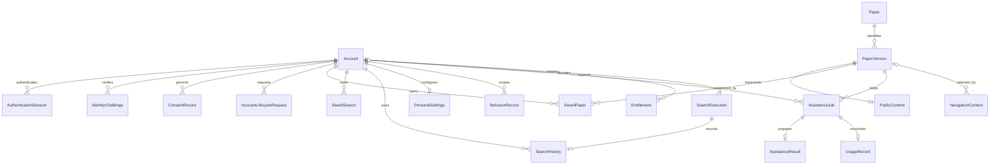

# DocSuri v2 — U1 Functional Specification

Date: 2026-10-11. Unit: `u1-integrated-paper-journey`. This is a logical design, not implementation or release evidence.

## Purpose, authority and boundaries

Deliver a real, bounded find → understand → save → revisit journey through the shared application. Public registration, synthetic verified accounts, eligible P1/P2 paper fixtures, useful model output, a supported translation, durable saves and authenticated return must work together. U1 contributes to 29 assigned FR rows (eight parent rollups and 21 subrequirements); U2/U3/U8 complete their full variants. It does not close the whole release or introduce a research composer. Durable research/manuscript drafts and their restart rediscovery remain U4.

The confirmed [questions](functional-design-questions.md) elaborate the [U1 definition](../../../inception/units-generation/unit-of-work.md#u1--integrated-paper-journey), [assignment map](../../../inception/units-generation/unit-of-work-story-map.md), [requirements](../../../inception/requirements-analysis/requirements.md), [components](../../../inception/domain-design/components.md), [contracts](../../../inception/contract-design/contract-summary.md) and [delivery plan](../../../inception/delivery-planning/bolt-plan.md). The [interaction specification](../../../inception/refined-mockups/interaction-spec.md) and [design mapping](../../../inception/refined-mockups/design-system-mapping.md) govern presentation.

[entities.md](entities.md) is authoritative for logical shapes; [rules.md](rules.md) for decisions. This file is authoritative for ordered behavior and lifecycle transitions. [frontend-components.md](frontend-components.md) maps these to screens. [traceability.json](traceability.json) maps requirements and local checks: 29 “OK” rows mean U1 design coverage, never whole-requirement or executed acceptance; 41 “N/A” rows identify retained requirements assigned outside U1 and name their downstream owners. User Stories was skipped; local WF/LC identifiers below are not upstream AC IDs.

The existing formal contracts have accepted gaps. [contract-revision-plan.md](contract-revision-plan.md) specifies the intended coordinated changes for Contract R-01/R-03. **Before any affected implementation, amend the canonical type/message/browser bindings together, validate them, inventory consumers and add executable contract checks.** The present approved wire specifications cannot already transmit the missing information; this design is not a parallel supported wire version. Required fields constitute a coordinated breaking revision. Contract R-02 remains U4 work. Document checks do not close the required executable findings.

## Composition and ownership

| Component | U1 responsibility | Boundary retained |
|---|---|---|
| WebWorkspace | Integrated navigation, forms, reading, progress and saved views | Presentation state; no alternative business database |
| AccountAccess | Real synthetic registration/verification/login/logout, current authority and lifecycle checks | Only identity owner; no caller-selected owner/admin tier |
| CorpusContent | Eligible pinned public fixtures, source/content/version and publication disposition | Sole content and retrieval projection writer/rebuilder; Discovery cannot publish |
| Discovery | Actual research-query execution, identified results, mode/degradation and cursor context | Queries only the eligible published representation |
| Library | Durable saved paper/query references and qualifying search history | No copy of corpus or account authority |
| Personalization | Explicit supported defaults, usable cold start and bounded activity contribution | No mandatory dependency on unavailable enrichment |
| PaperAssistance | Immutable accepted job, protected execution claim, prepared result | Shared dispatch/transport does not own business outcome |
| UsageEntitlements | Current allocation, admission reservation and one settlement per operation | Admin and monetary capabilities are not delegated to public callers |
| ServiceOperations | Actual capability observations, safe incident/repair evidence | Cannot mutate another domain through an observation route |

U1 registers only installed contributions through C01. Every installed data owner must participate in applicable account/consent/lifecycle processing before persisting its data. The manifest records missing/failed participants; it cannot certify deletion for a future module. Adding a module adds its real registrations and applicable checks. The core consumes declared ports, never imports future implementations. U7 remains independently controlled; full operator protocols are not added to U1.

## Access and effect matrix

| Actor/state | Permitted U1 action | Denied or conditional |
|---|---|---|
| Anonymous | Existing public anonymous search; entry/registration/verification | Private library/history, assistance jobs/results and operational data |
| Unverified account | Verification recovery and permitted public entry | Protected journey until required verification succeeds |
| Current verified owner | Eligible reading/assistance; own saved work/history/settings/usage | Another owner’s IDs, administrative changes, disallowed source use |
| Expired/revoked session | Public entry; explicit fresh authentication when allowed | No private read, mutation, event replay, asset or result from stale credentials |
| Account B | Same own-account rights | A’s lists, direct IDs, events, stored operations and private presentation state |
| Authorized maintainer | Declared service observation and owner-provided recovery procedures | No business-owner bypass; platform authority is separate |
| Trusted worker | Claim-bound payload/execution facts for current eligible work | Payload reference alone, expired/replaced claim, caller-supplied owner authority |

Authentication determines identity; individual owners check resource scope and current authority at reads, admission and effect commitment. Foreign and nonexistent private identifiers have the same safe disposition. Avoid account enumeration and reflect only the appropriate public status. U1 does not expand anonymous reading/processing; C13’s established access matrix governs endpoints. Policy-unknown rights deny the affected action explicitly.

## Ordered workflows

### WF1 — Enter and restore an authorized workspace

1. Read actual entry/session/capability state. Preserve public query context separately from private state.
2. Validate registration through AccountAccess, including malformed/duplicate input and bounded abuse controls. A verification challenge has a finite owner-policy lifetime, single intended use and recoverable delivery state.
3. Confirm verification only after its durable identity transition. A local email sink demonstrates a test path; public delivery fit remains an evidence requirement.
4. Authenticate and resolve current account, consent, settings and installed contributions. Missing enrichment gives the supported explicit default/manual path, not a redirect loop.
5. Restore an authorized paper/query/navigation destination after sign-in; re-read private data under the new session. A return destination carries no permission.
6. Never replay a pending save, clear or work submission merely because sign-in succeeded. Preserve only safe action context, reconcile an uncertain prior receipt and require an explicit new action where appropriate.
7. Logout/account switch invalidates protected access and clears private view/cache/subscriptions and request-generation identity. Late A responses cannot render in B’s session. Logout failure is visible: local hiding is not a claim that server revocation succeeded.
8. Account revocation invalidates affected sessions and execution authority at its owner-defined linearization point. Installed owners acknowledge lifecycle participation. Cleanup/reactivation waits for resolved retention/recovery policy; do not claim physical erasure from immediate access denial.

Rules: BR1.1–BR1.5, BR4.6, BR6.2, BR7.1. Checks: LC01, LC09, LC12.

### WF2 — Find an identified paper

1. Keep editable query/filter/order values distinct from the last submitted QueryContext. Validate empty/whitespace, Unicode, punctuation, unsupported filters and oversized input at the server’s declared policy boundary.
2. An explicit search captures immutable normalized query, filters, order, supported mode, caller context and request identity. Do not create a second search solely on render, preference fetch or return navigation.
3. Discovery uses CorpusContent’s published generation and current eligibility. The implemented mode must genuinely retrieve the fixture by research query; an identifier-only lookup or prefilled result is not a substitute.
4. Return stable paper/version identities, metadata, source disposition, ordering and snapshot-bound cursor. Disclose the actual mode/fallback; dependency failure is not successful zero matches.
5. Render only the response matching current session and submitted request identity. Older responses cannot overwrite a newer submitted search; editing without submitting does not relabel old results as new.
6. Pagination retains query/order/snapshot. An invalid or changed snapshot produces explicit refresh/restart disposition, not silent missing/duplicated results. Source withdrawal still overrides a cached search hit.
7. For qualifying authenticated searches, publish a deduplicated history fact with original occurrence identity and history generation. Library alone commits it. If search succeeds and history storage fails, show results with a truthful “history not saved” disposition and reconcile the same fact; never fail the actual search retroactively or invent saved history.
8. Preserve query/filter controls and committed context in loading, empty, degraded and error states. Explicit retry uses the documented search context and does not manufacture multiple history entries for the same completion fact.

Rules: BR2.1–BR2.4, BR3.1–BR3.5, BR6.1. Checks: LC02, LC03, LC08.

### WF3 — Read the selected source

1. Resolve the selected exact paper/version and current canonical disposition through CorpusContent; retain original reference identity. A canonical alias may identify the same work, never unrelated replacement text.
2. Check current read/use eligibility before material is displayed or sent to a model. Publicly accessible does not by itself mean permitted ingestion, translation, model processing or redistribution.
3. Render available structured text, section anchors, figures and source links with safe content/URL/path handling. Each belongs to the same version and permitted content representation.
4. Distinguish source-only, absent, building, unsupported, failed, withdrawn and restricted content. A bad figure or malformed section leaves bounded local failure with usable navigation; no invented text or infinite loading.
5. Preserve paper/version/anchor on navigation and recheck access on return. Withdrawn material is no longer served from a stale cache even if its metadata/saved reference remains visible under policy.

Rules: BR2.1–BR2.4, BR6.3–BR6.4. Checks: LC03, LC09, LC11.

### WF4 — Accept explicit summary or translation work

1. Read supported options and vocabulary revision from PaperAssistance. Validate chosen action, presentation and language against eligible current content and permitted model use.
2. Capture owner, paper/version, source-content hash, option/vocabulary revision and applicable glossary/settings snapshot into an immutable payload. Later preference edits do not mutate accepted intent.
3. Authenticate, validate limits and normalize intent. For a known same-owner operation identity, compare semantic input; changed input conflicts, same input reconciles the original authorized outcome. A terminal failed job is not restarted by replay.
4. UsageEntitlements reserves capacity under that operation identity with current allocation/reset-window and policy revision. Unknown usage/policy/capacity refuses new admission truthfully; no paid fallback or browser-supplied tier.
5. PaperAssistance durably records acceptance, reservation reference and recoverable execution obligation before acknowledging a JobReceipt. No-op dispatch is insufficient. Reservation without accepted work and acceptance with uncertain acknowledgement are recoverable states, not “success”.
6. If the reply is lost, recover using the same identity and immutable input before considering new work. If admission itself did not commit, reconcile/release the reservation through its owner; uncertain admission must not be released on a browser timeout.
7. Delivery retries the persisted obligation within approved finite policy. A crash before delivery cannot abandon acknowledged work. Exhausted recovery exposes an actionable owner-recorded failure and reconciles the associated reservation.
8. Current eligibility and authority are checked again at protected payload access and effect commitment. Queue membership never freezes permanent permission.

Rules: BR5.1–BR5.6, BR1.2, BR7.4–BR7.5. Checks: LC04, LC05, LC10.

### WF5 — Execute, fence replacement workers and settle effects

1. A trusted worker presents operation/input identity to the owning PaperAssistance claim boundary; a transport message or payload reference is not a credential.
2. The owner atomically grants at most one current claim with worker binding, lease identity, expiry and strictly advancing fence. Acquisition/replacement uses authoritative time and configured finite policy.
3. Fetch immutable payload only through the active claim, rechecking operation binding, content/owner eligibility and current worker authority. Do not trust a worker-supplied owner or input hash without comparison.
4. Renew only the active, unexpired claim using its separate lease revision. Heartbeats do not advance the business job revision or invalidate an otherwise valid progress precondition.
5. Publish progress/failure/completion through the same owner validator: verify job/input identity, active worker/lease/fence and expected job revision; allocate authoritative sequence/revision. Worker timestamps or attempt numbers do not order business state.
6. On lease loss, a replacement claims the same accepted operation with a higher fence. Late work from the old fence cannot publish results, progress, failure or accounting effects even if its computation completed first.
7. Validate output shape, selected operation/source binding and usefulness/grounding expectations. An unavailable model, malformed or unsupported output is an explicit failure/insufficient-result disposition, never fabricated success. Sources are untrusted evidence, not instructions granting tools or permissions.
8. Commit a valid immutable prepared result, succeeded job outcome and durable usage-settlement obligation coherently under PaperAssistance authority. If result materialization is staged, it is private/inaccessible until the committed binding exists; an inaccessible or mismatched result cannot produce success.
9. UsageEntitlements settles the unique reservation/effect idempotently. Cross-component recovery reconciles the durable obligation until acknowledged; a lost settlement response cannot debit twice. A pending settlement is explicit in authorized usage/operations views, not zero. Failed/aborted admission releases or refunds only under the resolved policy and authoritative owner outcome, never a client timeout.
10. Repeated already-committed facts return an authorized original receipt. This lookup does not grant a stale claim permission for a new transition. C14 delivery and C06 completion share this validation/commit path.
11. Revocation/withdrawal winning the effect race fences pending work and prevents later restricted publication; success already committed is subsequently hidden when current permissions forbid reading. A mere cancellation request does not assert cancellation, and U1 adds no paper-job cancel operation.

Rules: BR5.5–BR5.10, BR2.2, BR1.4. Checks: LC05, LC06, LC09, LC10.

### WF6 — Observe progress and read a prepared result

1. Bind the view to current owner, accepted job and immutable input. Read the authoritative snapshot before or together with progress subscription.
2. Consume complete valid frames and monotonic owner sequences. Ignore duplicates/older events; a gap/reset or interrupted connection triggers snapshot/replay recovery or supported polling.
3. Sleep, reconnect, page refresh and service restart resolve the same job. A closed stream, transport timeout or 100% display estimate does not establish a terminal outcome.
4. Distinguish accepted/running from succeeded/failed, then read the prepared result through C06 with current authorization. Check paper/version/source/options binding.
5. Distinguish pending, ready, expired, failed, inaccessible and dependency-failed reads. A successful job may have an expired retained result without changing its historical terminal state.
6. Retrying a result read only reads. Requesting a new analysis after expiry/failure is a separate explicit command/new intended identity, subject to current options, permissions and quota.
7. Status after revocation/account switch is cleared safely. Reconnecting a prior owner’s event cursor confers no access.

Rules: BR5.7–BR5.10, BR6.1–BR6.2. Checks: LC06, LC09.

### WF7 — Save, remove and revisit the owner’s library

1. Choose the currently identified paper/version or last submitted query/refinement context, not an unsent edited query. Obtain existing saved state/revision when mutating an existing reference.
2. An explicit save/remove carries an operation identity and the planned browser revision convention where required. Validate and derive trusted owner; reject missing/malformed preconditions. `null` means “must not exist” only on declared create/upsert contracts, never unconditional overwrite.
3. Reconcile a same-identity original effect before applying a new optimistic-concurrency decision, while still requiring current authorization. Changed intent conflicts. Another tab’s changed revision refuses a new stale mutation without overwriting data.
4. Commit a single owner/resource reference through Library. Display “saved” or “removed” only after durable acknowledgement. Pending/failed/unknown feedback remains distinct; prior committed state survives an uncommitted attempt.
5. On unknown response, reconcile the original receipt; do not allocate a new mutation identity blindly. On conflict, fetch current authorized state, show that it changed, preserve safe intended context and require a deliberate new action if still wanted. No `latestRevision` error field is assumed by the baseline.
6. List/read saved work under the current owner. Saved queries load exact context; rerun is a separate explicit search. Remove only the reference, never the public paper. A nonexistent/foreign record does not reveal another account.
7. Close the browser, log in afresh as A and rediscover saved papers/queries through the owned list, not by relying only on volatile URLs. For the exact saved paper/version, the planned C06 `readAssistanceHistory` returns a bounded, stable owner-bound list of retained jobs and their original action/options/source bindings and current result disposition. Explicitly choose a prior job, then use existing job/result reads; do not guess the latest result or generate another. This lookup is a required canonical contract amendment before code, not an existing endpoint or saved-paper field.
8. Canonicalization/withdrawal/unavailability changes the displayed disposition, not the identity or presence of the saved reference. A stale direct content link cannot bypass current eligibility.

Rules: BR4.1–BR4.5, BR1.2–BR1.5, BR6.1–BR6.2. Checks: LC07, LC09.

### WF8 — History, defaults and controlled lifecycle

1. Library lists and reruns confirmed history in stable owner order, with empty/error/pagination states separated. Qualifying activity records carry occurrence identity and generation, preventing duplicate append.
2. Clear only this owner’s history after deliberate confirmation of scope. Compare the clear-boundary token supplied by the planned `LibraryHistoryPage.clearBoundary` contract (not a pagination snapshot), commit its new clear-generation boundary, then acknowledge. A late pre-clear fact cannot recreate cleared history. A failed clear preserves the previous authoritative list.
3. History clear leaves saved papers/queries unchanged. Personalization uses only currently permitted activity and its own reset/consent boundary; history clearing does not silently assert a complete behavior-data erasure.
4. Supported search/summary defaults apply to subsequent explicit actions. A missing profile has a usable default/manual path. Show unavailable enrichment as such; do not fabricate recent items.
5. U1 defines this owner boundary and essential journey contribution. Full preference variants, recent-paper behavior, consent/reset controls, account cleanup/reactivation and remaining administrative quotas are U2 parity work under policy evidence.

Rules: BR3.5, BR4.4–BR4.6, BR1.4. Checks: LC08, LC10, LC12.

### WF9 — Observe, recover and reproduce a defect

1. Each installed capability reports present/ready/degraded/unavailable/unknown with observed time and dependency evidence. Missing store, model or executor prevents that capability’s ready claim; process liveness is separate.
2. Correlate a user-safe failure identifier through acceptance, claim, result and usage evidence using immutable operation identity and attempt/fence facts. Do not log secrets or unnecessary paper/private text.
3. An authorized maintainer diagnoses an injected incident and asks the authoritative domain to reconcile it. Operational observation never grants permission to rewrite domain state.
4. Record recovered owner/resource/outcome state and duplicate effects, not only a restarted process. If telemetry fails, preserve required durable business obligations and report observation gaps with bounded retry.
5. From a clean checkout, record setup and a reproducible defect, boundary diagnosis, repair, regression and affected integration verification. Capture effort/time and obstacles before agreeing numeric quality targets.
6. Later units extend capability/lifecycle manifests and cumulative checks; U8 consolidates all release and continuity evidence.

Rules: BR7.1–BR7.5. Checks: LC12, LC13, LC14.

## Authoritative state machines

| Lifecycle | States and allowed transitions | Failure/recovery invariant |
|---|---|---|
| Identity challenge | pending → consumed OR expired/revoked; delivery status is separate | One valid use; failed delivery does not verify an account; resend policy must bound reuse |
| Authentication | anonymous/unverified → authenticated when valid; authenticated → expired/revoked/logged-out | Browser visibility is not authentication; fresh login does not replay effects |
| Search view | idle → loading → normal/empty/degraded/error; explicit submit → loading | Current request/session identity selects visible result; old response cannot win |
| Mutation view | committed baseline → pending → acknowledged OR failed OR outcome-unknown; unknown → reconciled outcome | “Pending” is not persisted; conflict retains baseline until authorized refresh |
| AssistanceJob | accepted → running → succeeded OR failed; accepted → failed allowed | Terminal never regresses; retrying delivery keeps identity; explicit new work gets new identity |
| ExecutionClaim | absent/expired → active new fence; active → renewed same fence OR expired/revoked/replaced | Owner time governs lease; only active fence can mutate; replacement does not create a new job |
| Prepared result view | pending → ready when committed; ready → expired or inaccessible under current policy | Historical job success is separate; reads/reconnect never regenerate |
| Usage reservation | reserved → settled OR released under authoritative outcome/policy; reconciliation may be pending | Unique operation effect; no release on unknown acceptance; no repeated debit |
| Saved reference | absent → saved → removed, each acknowledged and revision controlled | Original paper/query binding survives changed source disposition |
| Capability observation | unknown → ready/degraded/unavailable after actual observation; stale evidence → unknown/stale | No healthy claim from a process check or missing participant |

Account deletion/reactivation and retention cleanup are not fully designed here. Their access-revocation boundary is necessary now; policy-dependent permanent effects remain blocked until U2/later owners resolve the required evidence. This table does not introduce new cancellation or lifecycle wire enums.

## Derived entity relationship view

This view summarizes the authoritative entity YAML. Cross-owner arrows mean references through contracts, never write permission. Supporting claims/receipts/policies are embedded logical values.

Text fallback: Account scopes sessions, verification, consent/lifecycle, settings/activity, library/history, jobs and usage. Paper identifies versions; versions bind content, saved references and assistance. Each job has at most one published prepared result and one intended usage effect. Search execution can create one qualifying history fact. Navigation is presentation state; capability/incident records are observations.

## Derived rule summary

| Rules | Decision represented |
|---|---|
| BR1.1–BR1.5 | Verified public entry, current access, lifecycle and safe return/switch |
| BR2.1–BR2.4 | Exact eligible sources, bounded reading and sole projection authority |
| BR3.1–BR3.5 | Validated search, real modes, stable context and history facts |
| BR4.1–BR4.6 | Acknowledged saves, revisions/reconciliation, history and defaults |
| BR5.1–BR5.10 | Source-bound work, durable admission, claims, ordered results and accounting |
| BR6.1–BR6.4 | Truthful integrated Korean UI, explicit effects, accessibility and safe rendering |
| BR7.1–BR7.5 | Real composition/readiness, repair evidence, prerequisites and contract consistency |

## Local acceptance design

LC identifiers are local checks, not invented upstream acceptance requirements. Each must later record environment, fixture/input identity, expected/observed result and retained evidence. “Designed” is not “passed”.

| Check | Normal, negative and recovery evidence required | Requirements |
|---|---|---|
| LC01 entry | Synthetic A/B registration, verification, login/logout; duplicate/malformed/used/expired token; failed email and session replay; distinguish local sink from public integration | FR6.1, FR6.4 |
| LC02 discovery | Both P1/P2 research queries locate intended version via the implemented real mode; declared filter/order/cursor; whitespace/Unicode/oversize; semantic failure truthful fallback/unavailable; slow old response cannot replace new | FR1.1–FR1.3 |
| LC03 reading | Correct text/anchor/figure/source, source-only and every supported availability disposition; malformed model/asset bounded; changed snapshot/withdrawal/canonical mapping preserves identity | FR2.1–FR2.2, FR5.3 |
| LC04 useful understanding | P1 sqrt(dk)/small gradients and positional signals; P2 BART vs retrieved index and Sequence vs Token rubric; supported translation meaning/terms checked by competent reviewer with language pair recorded; malformed/insufficient/unavailable output truthful | FR3.1 |
| LC05 durable execution | Duplicate acceptance, crash after acceptance before dispatch, restart, claim expiry/replacement, old-worker progress/failure/success, protected payload read, completion/ack crash; one job/result/intended accounting effect | FR3.2, FR17.2 |
| LC06 mounted progress/results | Actual browser/service/worker framing, ordering, replay gaps, polling, tab sleep/restart; pending/ready/failed/expired/unauthorized; read retry never starts work; all Q-01–Q-04 integration defects covered | FR3.3–FR3.4 |
| LC07 saved return | Save paper and submitted query, deduplicate, remove, failed/unknown write, missing/stale revision, concurrent tabs and same-key replay; fresh login/list rediscovery and same paper/version; unavailable/canonical source disposition | FR5.1, FR5.3 |
| LC08 history/defaults | Qualifying recorded search, rerun, empty/page/change snapshot; clear failure and late pre-clear event fence, saved library intact; supported defaults persist/use, cold-start/manual path and truthful recent activity | FR5.2, FR10.1 |
| LC09 access/effect races | Anonymous/B/revoked session against each applicable list/read/write/job/result/event/asset boundary; account-switch late response; revocation vs effect race and withdrawal vs cached read; no false cleanup claim | FR2.2, FR3.2–FR3.4, FR5.3, FR6.3–FR6.4 |
| LC10 allocation | Current own usage, forged admin tier denied, unknown distinct from zero, boundary/exhaustion/concurrent admission/reset-window; lost settlement/release response and reconciliation; finite policy configured before enabling | FR17.1–FR17.2 |
| LC11 presentation | Korean long text/math/tables; light/dark/system including OS changes and preference storage failure; keyboard/focus/announcements, reflow/zoom, targets/contrast, actionable errors; approved accessibility target tested later | FR1.3, FR2.1, FR3.3, FR5.1; NFR6 |
| LC12 host/lifecycle | Missing required registration/store/model/worker, incomplete participant and observation outage; current source/account revocation; new module cannot persist before joining applicable lifecycle contracts | FR6.3, FR19.1–FR19.2 |
| LC13 incident/repair | Safe correlation across accepted work, replaced worker and usage; authorized recovery proves correct retained state; reproducible defect diagnosis/repair and regression/affected integration evidence | FR19.1–FR19.3; NFR7, NFR9 |
| LC14 real demonstration/baseline | Clean reproducible setup, permitted fixtures/free/local execution, complete P1/P2 with restart/reauthentication, loss/duplicate counts and timing boundaries; no mocks substituted for normal paths | NFR1–NFR10; IB-01–IB-09 contributions |

For P1 pin arXiv 1706.03762v7 and query “self attention sequence transduction without recurrence”; check §3.2.1 equation (1) and §3.5. For P2 pin arXiv 2005.11401v4 and query “retrieval augmented generation parametric non parametric memory”; check Figure 1 and §2.1–§2.3. Use the upstream source rubrics exactly; no claim of executed model/source review is made here.

## Evidence prerequisites and downstream handoff

| Prerequisite | Responsible contribution and needed evidence | Blocks |
|---|---|---|
| E1 authority/continuity | U1 inventory provenance; owning units and U8 establish authoritative users/data/keys and isolated recoverable backups, then human continuity decision | Existing-data migration/reset/transition; synthetic demo must not modify real data |
| E2 permitted processing | Corpus/model owners document source/version/rights, data classification and allowed processing/storage/translation/location; dependencies verified against actual uses | Affected fixture loading, processing and hosting choice |
| E3 sustainable capacity | U1 measures hardware/runtime/storage/model/search; U2 email/public registration; later owners complete integrations; prove free limits, no paid fallback, exhaustion and effort | Stack/hosting and public operating-fit claims |
| E4 finite policy | Owners resolve input sizes, concurrency/admission, lease/timeout/retry bounds, quota/reset/refund rules and retention/cleanup/shared-device requirements where used | Enabling affected operation or claiming its implementation accepted |
| E5 contracts | Canonical R-01/R-03 changes, consumer inventory, typed validation and mounted negative/recovery checks; R-02 before U4 persistence | Affected browser and worker implementation; executable finding closure |
| E6 baseline/quality | U1 times useful search/content/feedback/save/reopen/jobs and recovery/repair with environment/sample sizes; label reconstruction limits; human agrees targets later | Numeric service quality and readiness claims |
| E7 cumulative verification | Define runnable v2 verification and obtain separate approval of its exact invocation before first completion verification | First unit completion verification; document/legacy CI checks cannot substitute |

All ten NFRs remain binding through applicable workflows; their exact U1 contributions and nine IB evidence obligations are recorded in traceability. New financial spending, a paid fallback, a feature cut, assumed source permission or an invented retention period cannot resolve a prerequisite. Missing evidence blocks the affected choice; independent logical design may continue.

No stack, framework, physical schema, hosting, migration or schedule is selected. Application implementation belongs at the workspace root in the approved composition; these documents belong to this unit’s record. Completed branches merge through PRs into develop under CONVENTIONS.md and the interim CI policy; release promotion to main remains separate.

