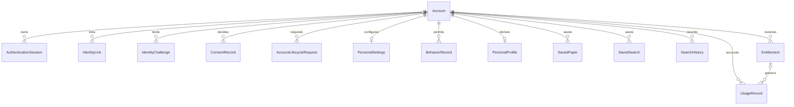

# U2 account and personal controls — functional specification

Date: 2026-10-13. Unit: `u2-account-personal-controls` (embedded library with required web contributions). This is the authoritative specification for ordered behavior and state transitions. [Entities](entities.md) and [rules](rules.md) own data shape and decision logic; [frontend components](frontend-components.md) owns the interaction decomposition. [Traceability](traceability.json) maps all 62 assigned functional rows and ten NFRs. “OK” there means the U2 design contribution exists, not that implementation or full-service parity has passed.

## Scope, ownership and inputs

The confirmed [summary](functional-design-questions.md) preserves all current capabilities, $0 free/local operation and the same application release. U2 completes account/personal controls around the existing paper journey. It does not create a second account store, a second app or a new service boundary. Its owners remain AccountAccess, Library, Personalization and UsageEntitlements. WebWorkspace composes their projections and commands; it owns neither business records nor authority.

Authoritative upstream inputs are the [unit catalogue](../../../inception/units-generation/unit-of-work.md), [assignment map](../../../inception/units-generation/unit-of-work-story-map.md), [requirements](../../../inception/requirements-analysis/requirements.md), [component catalogue](../../../inception/domain-design/components.md) and [canonical contracts](../../../inception/contract-design/contract-summary.md), especially C00–C03 and C13. The approved [interaction specification](../../../inception/refined-mockups/interaction-spec.md) and [design mapping](../../../inception/refined-mockups/design-system-mapping.md) constrain the Korean workspace, responsive behavior, inherited blue/neutral palette, Apple HIG adaptations, appearance modes and accessibility target.

| U2 responsibility | Integration boundary and release obligation |
|---|---|
| Account identity, verification, Google/ORCID, admin MFA, profile and consent | C02 supplies current authority; consuming owners still enforce it at read, admission and effect. Application admin gives no U7 operator rights. |
| Withdrawal/reactivation/erasure coordination | C01 supplies the complete registered owner/scope manifest; C02 owns requests and acknowledgements. Each feature owner owns its data, cancellation, external copies and restore enforcement. |
| Saved papers/searches and history | C03 Library owns references and history; CorpusContent owns eligibility/canonical disposition; Discovery owns query execution and admission checkpoints. |
| Settings, recent views, behavior/reset and onboarding | C03 Personalization owns explicit choices and derived activity separately. AccountAccess owns consent, PaperAssistance owns glossary entries. |
| Plan/quota display, grants/revocation and accounting | C03 UsageEntitlements is the sole ledger owner; each accepting operation owner supplies intended work and effect evidence. |
| Shared workspace and operations evidence | C13 binds browser requests; ServiceOperations consumes privacy-safe capability observations and invokes published owner recovery. |

U1's recorded normal-assistance, semantic-search and figure limitations remain open. U2 setting a preferred mode, permitting an action or rendering a result does not resolve those limitations. U3/U4/U5/U6 supply their full feature behavior; U8 verifies cumulative integration. Durable research draft allocation/rediscovery and retention remain U4 responsibilities, including the accepted contract finding. No search-projection writer moves to U2; no U2 account or quota action grants export approval.

## Shared command and read ordering

All workflows below apply BR1.1–BR1.5 and the applicable owner rule, in this order:

1. The trusted boundary validates bounded shape, origin/CSRF protection and the correct protected session or narrowly scoped pre-authentication flow. It derives the principal and registered operation context; a body-supplied owner, role, resource quantity or “verified” flag never provides authority.
2. Resolve the target safely, then check current account/session/owner/role/MFA/consent and source permissions required for this operation. A reference and an earlier permission snapshot cannot replace current checks. State-changing effects must be fenced against a concurrent revocation, not merely checked earlier in the request.
3. For commands, reconcile the owner/operation/key and normalized intent. A matching authorized receipt returns its original outcome; a changed intent conflicts. Required transport fields must still be well formed on a retry. Proof-based continuation retries must be bound to the same validated flow, never to a supplied account alone.
4. Only a genuinely new command compares the exact control revision and current policy. Missing required `expectedRevision` fails validation. A stale revision conflicts; the UI reads the designated current snapshot and asks the user to decide how to retry. It never copies a “latestRevision” from a generic error into a blind write.
5. Commit the intended domain effect and its recoverable receipt, or durable acceptance and owned continuation responsibility, before reporting success. External and participant effects use durable responsibility, idempotent delivery and evidence-based reconciliation; no distributed atomicity is assumed.
6. If the acknowledgement is lost, retain the command identity and reconcile that effect. Do not allocate a new key, repeat a secret effect, clear a newer history window or claim failure from silence. Definitive rejection, pending work and unknown outcome remain distinct.

Reads return bounded, owner-bound stable pages or truthful error/degraded states. They do not allocate domain work, execute saved queries, charge usage or mark a draft submitted. Cursor invalidation offers a fresh page with context preserved. A page snapshot token, an entity mutation revision and a clear/reset cutoff are never interchangeable.

Browser mutations use the canonical top-level revision fields. Protected cookies carry full sessions or limited continuations; secrets do not enter URL return context, ordinary JSON outcomes, persisted browser storage, logs or telemetry. The narrowly specified protected MFA material response is the sole enrollment-display exception. Public anonymous search remains as approved; this unit adds no wider guest access.

## Ordered workflows

### W1 — Registration, verification, login and logout (BR2.1–BR2.3)

1. Collect email/password under the finite credential/abuse policy. `access.register` preserves existence-neutral responses and one intended registration. `access.requestVerification` supports bounded resend without giving the browser account existence or verification authority.
2. Persist the purpose/recipient/flow/expiry-bound challenge and delivery responsibility before acknowledging its request. Delivery readiness/failure is surfaced without identifying whether a submitted email already exists. A local sink proves only synthetic local delivery.
3. `access.verifyEmail` validates and consumes the proof with the intended verification change. Expired, superseded or replayed links cannot verify another identity. A lost response reconciles the original verified effect.
4. `access.login` verifies current credentials, account state, verification and any required MFA. Primary success requiring MFA returns only a bound continuation. Full access is established only after all checks pass. Safe return context restores a view; it never replays the action that triggered sign-in.
5. `access.inspectSession` reestablishes current identity on return. `access.logout` revokes server authority, then clears local private state. If revocation is uncertain, clear local access immediately but label server logout unconfirmed and reconcile the original operation; do not show confirmed revocation.

### W2 — Password and email changes (BR2.1–BR2.3)

1. `access.requestPasswordReset` accepts a neutral, bounded request. `access.completePasswordReset` binds the proof to the current intended identity and atomically consumes it with the protected credential change and policy-required authority/session revocation.
2. Signed-in `access.changePassword` requires current proof and the same controlled revocation behavior. Neither path deletes saved references, committed messages or accepted jobs. Subsequent access uses fresh credentials and current source authority.
3. `access.requestEmailChange` binds old and proposed identity plus current proof. The current verified identity remains effective until `access.completeEmailChange` verifies the replacement and commits without collision.
4. Concurrent credential/email changes invalidate or conflict with stale proofs under the recorded policy. An uncertain write remains a recoverable original request, not permission to repeat an old proof or silently switch emails. Exact affected-session policy and delivery channels are prerequisites P1/P2 below.

### W3 — External sign-in, linking, unlinking and ORCID profile (BR2.4)

1. `access.beginIdentityFlow` accepts only Google/ORCID, retained `sign_in` or `link` intent and a registered safe return route. Link intent binds the current owner; sign-in begins a limited flow.
2. On callback, `access.completeIdentityFlow` checks the stored flow, single-use state, registered callback, issuer/audience and applicable nonce/PKCE requirements before trusting provider identity. Secrets remain protected throughout exchange. Denied consent, outage and uncertain exchange have explicit recoverable outcomes without switching account ownership.
3. Resolve the provider-subject pair under one uniqueness boundary. A collision cannot merge accounts or attach another owner's link. Provider authentication still goes through current account/lifecycle and administrator MFA checks.
4. `access.listIdentityLinks` shows safe link state. `access.unlinkIdentity` uses that link's revision and the approved surviving-access policy; it cannot remove the last usable sign-in/recovery route by accident.
5. `access.readOrcidProfile` exposes only permitted profile data with source revision/provenance and complete/partial/unavailable coverage. Reading a profile never changes interests or grants processing consent.

### W4 — Administrator MFA enrollment, sign-in and recovery (BR2.5–BR2.6)

1. A currently authorized account reauthenticates for `access.beginMfaEnrollment`. It creates an inactive enrollment and bounded delivery reference; ordinary output contains no seed or recovery code.
2. `access.retrieveMfaEnrollmentMaterial` validates bound, unused delivery and reauthentication and consumes delivery once. Its protected no-store response can display a locally rendered QR and recovery codes; they are excluded from generic receipts, caches, diagnostics, persisted browser state and external QR services.
3. A lost material response is not replayed. Start a new enrollment that invalidates old seed/codes. `access.confirmMfaEnrollment` activates only after a valid factor proof; exit, expiry, logout and account switch clear transient displayed material.
4. After primary sign-in, `access.verifyMfa` validates the protected primary-authentication continuation, challenge/flow and current account authority before consuming a factor. A factor alone cannot establish a session or role.
5. `access.recoverMfa` uses an approved controlled proof/audit procedure. Until that procedure and material custody are resolved, return policy-unresolved recovery readiness; there is no temporary admin bypass. Administrative actions recheck both role and current MFA assurance. U7 remains independently authorized.

### W5 — Profile and consent (BR3.1–BR3.2)

1. Read `access.readProfile` and its editable field vocabulary/revision. Submit distinct allowed fields via `access.updateProfile`, with the matching profile and vocabulary revisions. Identity, email and roles stay outside this generic editor.
2. Show saving only while in flight. Saved requires the acknowledged revision; validation, conflict and definite write failure preserve the local edit and old committed profile. A lost reply uses the original command identity.
3. `access.listConsents` and `access.updateConsent` show each registered purpose and policy. Only an acknowledged decision changes the displayed effective state; unsaved local toggles remain labelled pending/failed.
4. Publish/reconcile the resulting fact to consumers while making the new current authority available immediately. Every queued effect rechecks it at its effect boundary. `settings.applyConsentBoundary` consumes the trusted fact and never writes consent itself. Failed propagation keeps cleanup pending but cannot permit revoked processing. Regrant applies prospectively; it does not revive erased data or previously prohibited events.

### W6 — Withdrawal, erasure and owner acknowledgements (BR3.3–BR3.4)

1. Trusted composition calls `lifecycle.configureManifest` before affected persistence. It names every mounted data owner and required scope: live records, derived artifacts, pending work, caches, backups, restore enforcement and external copies as applicable. Missing/duplicate/incompatible participants or unresolved policy prevent a readiness claim.
2. Show the approved action-specific consequences and collect explicit confirmation plus recent reauthentication. `lifecycle.request` binds `withdraw` or `erase`, policy, manifest, owner, command identity and immutable acceptance time. It establishes the durable authority boundary before new protected effects can pass.
3. Each registered participant obtains only its tickets via `lifecycle.listPendingWork`. Library, Personalization and UsageEntitlements use `personalControls.applyLifecycle` separately for their owned scopes. Other owners use their own contract operations. AccountAccess never imports their writers or fabricates acknowledgements.
4. Participants stop or reconcile pending work, update/tombstone their own records and derived representations, and enforce policy on backups/external copies. Each returns `lifecycle.acknowledge` with request/policy/manifest/revision-bound evidence. Stale, wrong-owner or mismatched acknowledgements are rejected; duplicates converge.
5. `lifecycle.inspect` reports revocation and cleanup progress separately, through current authorized owner/auditor access or an explicitly permitted limited flow. No withdrawn full session remains valid merely to poll status. Completion requires evidence for every required scope. Retry resumes unresolved tickets; a timeout leaves a truthful blocked/failed state and recovery responsibility.

### W7 — Reactivation and restored snapshots (BR3.5–BR3.6)

1. `access.requestReactivation` gives a neutral response for unknown, active, withdrawn and erased identities. Only a currently eligible withdrawn account receives a single-use flow-bound proof through verified delivery, tied to the lifecycle revision and approved policy.
2. `lifecycle.reactivate` consumes that proof with one durable reactivation request after current-state checks. A verified limited continuation can inspect only that request; it is not a full session. The same key and validated flow reconcile a lost response without issuing a second request.
3. Participants demonstrate which permitted data actually remains, apply only allowed restoration, preserve erasure/reset tombstones and reconcile pending work. A newer erase or withdrawal revision defeats the old proof and stale restoration attempts. No discarded record is invented or restored from an inadmissible backup.
4. Only complete participant evidence yields `sign_in_required`. Fresh normal sign-in, including administrator MFA where applicable, establishes full access. Earlier state remains `reactivation_pending` or the relevant truthful failure/blocked outcome.
5. Separately authorized restore executors call `lifecycle.evaluateRestore` using current authority and the actual restore set. `allow`, `deny` or `requires_reconciliation` must be enforced at the restore effect with current revisions, not used as a permanent grant. A snapshot never rolls back current tombstones, consent or revocation.

### W8 — Save, revisit and remove papers/searches (BR4.1–BR4.2)

1. Explicit save uses `library.savePaper` with CorpusContent's eligible stable identity, or `library.saveSearch` with retained query vocabulary and optional bounded label. A citation-graph save uses the same Library path.
2. The owner receipt and durable reference precede saved feedback. Repeated clicks, tabs and lost replies reconcile one intended effect. No optimistic icon is proof of persistence.
3. `library.listSavedPapers`/`listSavedSearches` and `readSavedPaper`/`readSavedSearch` support a fresh authenticated return. Preserve original paper/version alongside current canonical resolution and source disposition. Changed licenses/access are checked now, not inferred from saved metadata.
4. Loading/error/partial/empty states retain navigation and query controls. Opening a saved search loads its context; an explicit rerun starts Discovery. It does not replay the historic result or charge for mere viewing.
5. `library.removeSavedPaper`/`removeSavedSearch` use the selected reference's revision. A conflict refreshes that reference for an explicit decision. Removal never deletes the public corpus, other owners' saves or history.

### W9 — History, clear and delayed completion (BR4.3)

1. Discovery produces an authorized `SearchCompletedFact` with immutable execution identity, admission sequence and completion sequence. `library.recordSearchCompletion` rechecks lifecycle/clear policy and deduplicates the execution.
2. `library.listHistory` returns a stable page plus a non-null `clearBoundary`, even when empty. `readHistory` loads query context; explicit rerun is a new Discovery action. Page snapshot revision is not the mutation token.
3. Confirm clear. `library.clearHistory` first replays a matching authorized command, then compares the expected clear boundary and obtains a trusted Discovery admission checkpoint. Persist logical clear, new boundary and receipt as one recoverable outcome. Browser input cannot choose the cutoff.
4. A pre-cutoff search completing after clear is suppressed; a post-cutoff search remains eligible. Replay after acknowledgement loss returns the original cutoff and never deletes newer searches. Old history links cannot resurrect cleared rows. Physical removal and restore treatment follow P3 and cannot be falsely reported complete.

### W10 — Settings, onboarding and recent activity (BR5.1–BR5.2, BR5.4)

1. `settings.read` supplies explicit defaults, appearance, interests and onboarding state with one control revision. `settings.update` changes at least one retained field using that revision; it cannot edit glossary data or imply an unavailable mode now works.
2. `settings.updateOnboarding` implements `save_interests`, `complete` and `skip` under the same revision. Persist intermediate selection so return resumes it; completed/skipped status prevents redirect loops. Skip preserves previous choices and normal workspace access.
3. `settings.listSuggestions` can use permitted ORCID enrichment and retained manual vocabulary, with attribution. Missing/denied/partial enrichment keeps manual selection and skip usable. Selecting a suggestion is explicit; linking ORCID alone does not adopt its suggestions.
4. `settings.listRecentPapers` and `readProjection` return only currently permitted activity, stable identity/order and current source disposition. Explicit defaults remain available during disabled/cold-start/unavailable enrichment. Displaying a recent list does not manufacture activity.

### W11 — Behavior deletion, profile reset and opt-out (BR3.2, BR5.3)

1. `settings.recordBehavior` accepts only trusted producer events; validate owner, event identity, current consent, authority and `inputBoundary`. Duplicate, stale-reset, revoked-consent and lifecycle-suppressed facts have distinct dispositions.
2. Show the exact scope of `delete_behavior` versus `reset_profile`; require explicit confirmation and approved deletion/restore policy. `settings.reset` shares the current SettingsSnapshot revision but advances a separate input boundary for affected activity/projections.
3. Persist the new boundary, control revision, receipt and cleanup responsibility before acknowledging reset acceptance. Late old-generation events and workers cannot restore erased behavior. A concurrent settings save conflicts through the shared control revision; a valid replay returns the original reset.
4. Clear/rebuild only the declared scope. Library saves, history and explicit defaults are independent; research committed work and drafts belong to their owner. Return complete/pending/blocked based on actual derived/cache/backup/restore evidence. Acknowledgement of the new boundary is not completion of cleanup.
5. Revocation through AccountAccess blocks future processing immediately; cleanup retries cannot re-enable it. A later regrant starts from eligible current-generation inputs and cannot reuse prohibited old events.

### W12 — Plan inspection and administrative allocation (BR6.1–BR6.2)

1. `usage.readPlan`, `usage.inspect` and `usage.listRecords` present owner-scoped allocation, current server period and known accounting state. Unknown is labelled unknown. Mock/administrative tiers are visible without purchase, payment collection or inferred charges.
2. An authorized administrator with current MFA uses `usage.readAssignment` for the independently selected target. An absent entitlement yields null entitlement plus a non-null initial assignment revision; this read does not allocate a plan.
3. `usage.grantEntitlement`/`revokeEntitlement` require an approved free/local tier, reason, current actor/target authorization and matching assignment revision. Commit allocation effect and audit evidence once. Changing target, tier or reason under the same command key conflicts.
4. Revocation changes future admissions according to P6. Already accepted work follows its recorded policy; it is neither silently cancelled nor recharged. Uncertain administration reconciles the original assignment command and keeps the visible outcome uncertain until evidence arrives.

### W13 — Reservations, settlement and period transitions (BR6.3–BR6.4)

1. A registered accepting owner derives the protected action, quantity and intended operation identity; browser quantities and period IDs are not authoritative. `usage.reserve` rechecks current entitlement and server period, then deduplicates or reserves against the finite allocation.
2. Admission must serialize competing claims on the same allocation: committed consumption plus outstanding reservations plus the requested quantity cannot exceed the approved limit. Released reservations no longer hold capacity; refunds alter consumption only when P6 explicitly allows and records them. Unknown balance blocks new acceptance.
3. The accepting owner binds the reservation to durable accepted work. A failure between reservation and work acceptance leaves discoverable responsibility that reconciliation can classify; it never loses the reservation or assumes the work exists. Before further effects it rechecks current authority and the reservation disposition.
4. `usage.settle` validates the bound operation owner, expected accounting revision and effect evidence. Apply the policy-defined commit, release or refund once; `usage.reconcile` inspects the original responsibility without reserving again. A late worker or duplicate event cannot settle twice.
5. Server period rollover creates a new admission window under the approved policy; existing records retain their acceptance-time period. Later completion/retry/refund reconciles that original period and evidence. Clock/period uncertainty and concurrent grant/revoke are explicit conflict/unavailable states, not extra quota.

### W14 — Integration, repair and restoration of workspace context (BR7.1–BR7.3)

1. WebWorkspace scopes private projections to the current identity and authorization generation. On expiry/logout/account switch, cancel or ignore earlier requests, clear private render caches/transient secrets and show sign-in state. Browser back and late responses must not reveal the former owner.
2. Restore only safe route/query context after authentication, then perform fresh authorized reads. No pending save, reset, quota grant or export is replayed automatically. Keep acknowledged business records durable; do not advertise restart recovery for unsaved account form text or credentials.
3. Each owner emits bounded safe operation references, failure categories, participant progress and capability readiness. ServiceOperations can distinguish unknown/stale/unavailable from a healthy capability and identify the responsible owner recovery operation without private payloads.
4. Demonstrate one reproducible interrupted command and repair, verifying both user-visible state and authoritative records. Later integration adds all participants and tests real consumer authority/consent/accounting behavior. Isolation fixtures and liveness are insufficient release evidence.

## State transitions

These are logical state machines; canonical wire unions and error vocabulary remain authoritative. Retry is always guarded by current authority and the original intended command.

| Subject | From → to | Trigger and invariant |
|---|---|---|
| Account access | unverified → active | Verified identity and approved access policy. A session still needs successful authentication. |
| Account access | active/unverified → withdrawn | Accepted approved withdrawal establishes revocation; participant cleanup can remain pending. |
| Account access | withdrawn → active | Only completed eligible reactivation followed by fresh sign-in for actual access. |
| Account access | retained state → erased | Approved erasure plus required evidence; access remains denied throughout cleanup. Erased cannot reactivate. |
| Challenge | issued → consumed / expired / invalidated | One bound proof succeeds, lifetime ends, or a superseding policy/identity/enrollment invalidates it. Terminal states never return to issued. |
| Session | active → revoked / expired | Current revocation/expiry denies full access immediately; MFA and reactivation continuations never become full sessions without required checks. |
| Lifecycle request | accepted → running → complete | All required participant/scoped evidence plus required revocation. |
| Lifecycle request | accepted/running → blocked/failed → running | Missing policy or failed participant remains visible; authorized retry resumes the same request only when its current evidence/policy permits. Superseding requests prevent stale effects. |
| Onboarding | not_started → in_progress → completed | Acknowledged interests/progress then explicit complete. |
| Onboarding | not_started/in_progress → skipped | Explicit skip; saved choices remain. Return to settings permits deliberate retained edits without forcing a new gate. |
| Projection | ready/cold_start → disabled or unavailable | Current consent or evidence changes. Read cannot return stale ready data. |
| Reset cleanup | pending/blocked → complete | Boundary already durable; all required scope/restore evidence now exists. |
| Usage responsibility | reserved → committed or released | Bound effect evidence and approved policy. |
| Usage responsibility | committed → refunded | Only an explicit policy-permitted evidenced refund, once. Unknown observation is not a ledger state transition. |

## Derived entity relationship view

The diagram is a readable subset of [entities](entities.md); protected owner-local value records and external references are described there.

Text fallback: one Account owns many sessions, links, challenges, consents, lifecycle requests, saved references, history, entitlement and usage records. Settings and derived profile each have at most one authoritative record per account. A challenge can precede account resolution. Usage references its applicable entitlement; public paper/version and Discovery execution identities remain foreign owner references.

## Derived rules summary

| Rules | Required result |
|---|---|
| BR1.1–BR1.5 | Current authority, same-intent reconciliation, exact revisions, finite validation and truthful outcomes. |
| BR2.1–BR2.6 | Neutral challenge initiation, single proof effects, complete authentication, bound identities and controlled MFA/admin authority. |
| BR3.1–BR3.6 | Editable profile boundaries, current consent, complete lifecycle evidence, permissible reactivation and restore enforcement. |
| BR4.1–BR4.3 | Stable explicit saves, truthful source disposition and a history clear that resists delayed completion. |
| BR5.1–BR5.4 | Durable explicit choices, optional onboarding, protected reset generations and permitted recent/derived views. |
| BR6.1–BR6.4 | Truthful mock plans, auditable assignment and one intended quota effect across retries/periods. |
| BR7.1–BR7.3 | Owner-isolated context recovery, accessible interaction and reproducible safe recovery evidence. |

## Evidence prerequisites and affected implementation

These are required closure conditions, not permission to omit retained features. Logical behavior is specified now; unresolved values block affected implementation or readiness claims. User choices remain with the sole maintainer. No deadline, paid fallback or numeric service target is selected.

| ID | Required decision/evidence | Earliest affected work and closure evidence |
|---|---|---|
| P1 | Finite credential, proof, abuse, session/revocation and MFA recovery/custody policy; retained unlink/last-access policy | U2 NFR/infrastructure before account implementation: approved policy inputs, proof/replay/expiry/revocation tests, controlled recovery demonstration. |
| P2 | Sustainable $0 verification/reset/reactivation email and Google/ORCID permissions, terms, callbacks and limits | U2 affected adapter decisions: authorized provider configuration, denied/outage/unknown-send checks and real public delivery evidence. Synthetic sink remains labelled local-only. |
| P3 | Authoritative existing users/data, recovery backups, permitted processing, withdrawal/reactivation/erasure/behavior retention, backup/external-copy/restore treatment | Before lifecycle or destructive-data implementation: inventory, approved purpose-specific policy, participant completeness and isolated restore evidence. Legacy 30-day behavior is evidence, not an adopted default. |
| P4 | Retained field/choice vocabularies, source dispositions and exact anonymous/private/admin access matrix | Before browser binding: canonical contract validation plus positive/negative role/owner/source tests. Include Unicode, duplicate/empty and stale-vocabulary cases. |
| P5 | Complete participant and scope bindings for mounted owners, including pending work and future modules | Before accepting lifecycle work: C01/C02 manifest completeness checks; later units register their real participants before mounting data; U8 verifies full-service completion. |
| P6 | Finite free/local tiers, protected-action quantities, server periods/resets, revocation of accepted work and release/refund policy | Before accounting implementation: approved policy and concurrency/unknown-outcome/period-transition evidence with no spending path. |
| P7 | Hardware envelope, public-service capacity, useful-output/task/recovery baseline and numeric quality targets | U2 NFR/infrastructure and cumulative validation: measured baseline, finite tested operating limits and human-agreed targets. No design document proves operating capacity. |
| P8 | Canonical contract coordination for any implementation-discovered mismatch | Before affected code: amend and validate the owning C02/C03/C13 contract with its consumers. U2 browser mutations must honor existing revision bindings; U4 still closes draft rediscovery. |

## Verification scenarios to carry into implementation

Each scenario has a user-visible assertion and an authoritative state/effect assertion. They are design acceptance obligations, not test results.

| Scenario | Observable outcome and evidence |
|---|---|
| Register/resend/verify/login; expired and replayed proof; failed delivery | Neutral initiation, one verification effect, no full session before all proofs, explicit delivery limitation. |
| Password/email change versus concurrent tabs and lost response | One identity change, old proof denied, recorded session revocation, committed work remains accessible only under fresh authority. |
| Google/ORCID denied callback, collision, replay and unlink last route | No owner merge, no reusable callback, permitted manual alternative and no accidental lockout. |
| MFA material response lost; factor-only request; recovery policy absent | Old material not redisplayed, new enrollment invalidates old, no factor-only full access and no bypass. |
| Foreign owner, ordinary user, stale administrator MFA, app-admin to U7 | Each inappropriate boundary denies; denial reveals no private content or operator authority. |
| Profile/settings conflict or failed/unknown write | Local input and old committed state remain truthful; retry reconciles same key; explicit conflict decision required. |
| Withdraw/erase with missing participant, failed cleanup or stale acknowledgement | Revocation separately visible; missing scopes prevent complete; repeat ticket does not delete twice or acknowledge another owner. |
| Reactivation after erase, expiry or newer request; old backup replay | No resurrection; eligible retained state only; restore effect respects current authority and tombstones. |
| Save from search/citations; duplicate save; source canonicalization/withdrawal | Stable original reference, one intended save and current source disposition on fresh authenticated return. |
| History clear while older search runs; newer search after clear; lost clear reply | Old admitted fact suppressed, newer fact retained, original clear replay does not widen cutoff. |
| Clear history versus reset behavior versus remove saved query | Each affects only its named scope; none silently clears Library, defaults or committed research. |
| Reset/opt-out versus delayed events, old projections and regrant | Old generation remains suppressed, acknowledged consent governs current effects, cleanup status matches evidence. |
| Onboarding skip, interrupted interests, absent ORCID and cold start | Resume acknowledged state, no loop/implicit overwrite, manual/skip alternatives and normal workspace usable. |
| Concurrent quota reserve/grant/revoke/period reset and uncertain settlement | Finite allocation respected, original period retained, one accounting effect and no guessed refund or paid tier. |
| Account switch, back-navigation, late response, session expiry during command | No former-owner render; safe context only; fresh reads and no automatic mutation replay. |
| Korean keyboard/mobile/zoom/light-dark-system/error flows | Labels, focus, announcements, target size, reflow and contrast checked against the accessibility target; no conformance claim from prose. |

Git delivery follows CONVENTIONS.md: appropriate validation, commit, PR into develop when this branch's purpose is fulfilled, then a fresh branch for the next work. Known legacy CI failures are investigated against base/head under the interim policy; main promotion remains separate.
