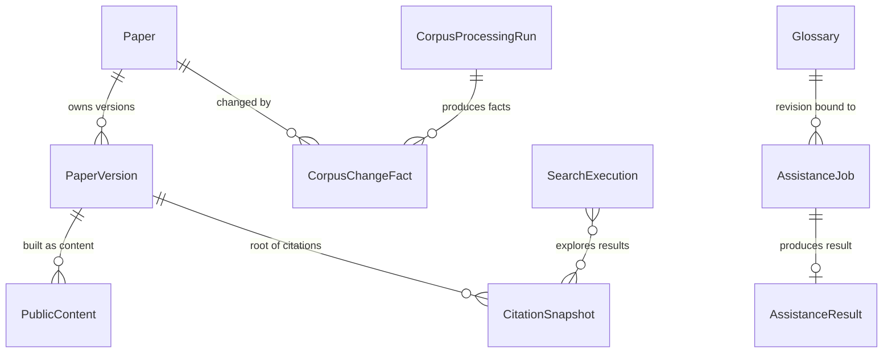

# U3 paper and corpus capabilities — functional specification

This is the source of truth for U3's workflows and state transitions, derived from the confirmed [questions](functional-design-questions.md), [requirements](../../../inception/requirements-analysis/requirements.md), the [component catalogue](../../../inception/domain-design/components.md) and canonical C04/C05/C06 contracts (with C13 browser binding and C14 accepted-work delivery). Entity shapes live in [entities.md](entities.md) and decision logic in [rules.md](rules.md); this file defines ordered behaviour. Operations here are logical domain operations; concrete routes, payloads and storage remain with the contracts and later design.

## W1 — Corpus ingestion, refresh and publication

1. An authorized corpus-maintenance actor submits an ingestion/refresh request with a declared source scope, operation and idempotency key; account membership alone is insufficient.
2. The operation validates the request bounds and current authority. An unresolved permission, capacity or continuity prerequisite returns `POLICY_UNRESOLVED` for affected effects.
3. On acceptance, the run records its input snapshot, source scope and dispatch responsibility durably; the same idempotency key and input return the same run, a changed input conflicts.
4. Execution resolves each source record to a canonical identity: duplicates and reordered records map to the same paper/version without duplicate searchable chunks; malformed or incomplete records are classified and quarantined, not silently dropped.
5. For each covered paper version the run evaluates eligibility; only eligible records proceed to parsing/embedding. Every stage records its individual object/control/projection outcome.
6. Projection batches are written only by CorpusContent-service writers under run/generation-scoped authority; duplicate batch id and hash acknowledge once, a changed hash conflicts.
7. Publication runs compare-and-swap on the published generation only after manifest completeness, all batch receipts, current source eligibility and compatibility verification succeed. Failure preserves the previous publication and does not advance the watermark.
8. The run read exposes the committed watermark and every individual effect outcome; unknown or missing effects cannot count as completed, and progress never advances past verified work.

## W2 — Rebuild, retry and recovery

1. A rebuild names its authoritative inputs and verifies durable control/content/index receipts; it never assumes the search index is the only data that matters.
2. A retry covers only reconciled retryable stages of the original intended run; committed stages and original authoritative inputs are preserved, and a rerun does not corrupt already committed records.
3. Interrupted effects between object, control and index writes remain individually inspectable with recovery evidence; dead-letter items are reprocessed through the same owner.
4. Rate limits and index/model incompatibility produce explicit, repeatable outcomes; compatibility failure refuses publication rather than degrading silently.
5. Restore into the quarantined target replays current withdrawal boundaries before serving anything.

## W3 — Source change, withdrawal and saved references

1. An authorized actor records a source change (withdrawal, license/access change, canonicalization or version change).
2. The change persists an authoritative eligibility revision and a recoverable, ordered source-change fact; duplicate delivery of the fact is harmless.
3. Every content, asset, search and model boundary checks current eligibility before serving or processing; stale caches, indexes and restored snapshots cannot restore prohibited content.
4. Domain consumers read source-change facts in order and apply their own dispositions: Library gives each saved reference an explicit disposition (unavailable, canonicalized-to, version-superseded) without U3 writing Library records.
5. A provider or dependency failure leaves the change explicitly pending; it is never reported as applied.

## W4 — Search and refinement

1. A guest or authenticated owner submits a query with mode, filters and ordering from the versioned vocabulary; server-side bounds reject invalid, empty, Unicode-edge and oversized inputs with defined outcomes.
2. The operation validates authority context (guest search accepts no owner identifier and creates no personal records) and resolves the current compatible published generation plus current eligibility.
3. Retrieval runs lexical and/or semantic paths. If semantic resources are unavailable or incompatible, the response carries a disclosed degradation (for example lexical-only) or an actionable unavailability — never a fabricated normal semantic result.
4. Results bind to an explicit source snapshot; pagination keeps stable ordering and page identity while the snapshot is unchanged. An expired or changed snapshot returns the explicit boundary instead of a silently rebased window.
5. Empty results appear only after successful retrieval; retrieval failures, timeouts and index outages are distinct error states.
6. A completed qualifying authenticated search produces a durable owner-scoped fact with producer-assigned admission/completion sequence. Library consumes facts with deduplication and suppresses facts at or before an acknowledged clear fence; replay executes no search and writes no Library record.
7. Rerun re-executes the recorded query context; a saved query is read by Library and the search runs through this same operation.

## W5 — Citation exploration

1. An authenticated owner requests cited/citing relationships for an exact root paper version.
2. Traversal honours resolved distinct-node/depth/request bounds; cycles and duplicate nodes cannot create unbounded traversal.
3. Provider freshness, partial coverage and unknown/stale data are labelled; edges are never fabricated and a provider failure permits recovery without erasing an already saved reference.
4. Saving an eligible referenced paper calls the Library save operation with stable paper/version identity; ineligible nodes explain their limitation.

## W6 — Reading a paper version

1. The browser requests a paper/version through resolve and read operations.
2. The operation resolves exact canonical identity and current eligibility; an obsolete identifier is never substituted with an unrelated paper.
3. Eligible content returns structured sections, figure/asset handles, anchors and source links for that exact version; navigating away and back resolves the same version.
4. Unavailable content yields its explicit disposition (absent, building, unsupported, failed, withdrawn, restricted) with permitted metadata/source links, bounded errors and usable navigation; malformed document models cannot trigger endless loading or invented text.
5. Asset reads resolve opaque handles only through the authorized delivery adapter under current eligibility; arbitrary paths, URLs or private identifiers are rejected.

## W7 — Assistance acceptance

1. An authenticated owner reads reconciled assistance options (actions, languages, presentation levels) with their vocabulary revision; unreconciled or unavailable options are absent or explicitly unavailable.
2. The owner submits an accept request bound to the exact paper/version, content hash, options and glossary revision.
3. The operation rechecks current authority, source eligibility and quota/accounting policy; missing or unresolved prerequisites return explicit refusal states.
4. Acceptance durably commits the immutable binding, original `acceptedAt`, a quota reservation and dispatch responsibility before acknowledging. Same idempotency key and input return the original job; changed input conflicts.
5. Acknowledgement is returned only after durable acceptance; a crash between acceptance and dispatch leaves recoverable responsibility — never a silent abandoned job.

## W8 — Assistance execution

1. A trusted executor acquires a single worker-bound claim (lease/fence) against the immutable accepted binding and eligible non-terminal state, under current owner/source authority.
2. The executor reads the immutable input and permitted sections; locator, owner id or an expired/replaced claim grants no access.
3. Progress events carry owner-allocated sequence/revision; stale, repeated or out-of-order events are rejected; terminal state never regresses; a replaced worker cannot publish late progress, failure or success.
4. Completion validates the prepared result against the accepted binding and commits result binding, terminal revision, receipt and settlement obligation in one owner transaction; UsageEntitlements settles separately and idempotently. Unknown settlement stays reconcilable.
5. Failure uses the same authenticated fence path and records a safe error with a policy-bound settlement obligation; retrying failed work is an explicit new intended command only when policy allows.

## W9 — Progress transport and recovery

1. The mounted browser transport reads the authoritative job snapshot and ordered progress through one executable state/event contract shared with the service (closing the recorded ordering-field defect).
2. Stream frames are valid and consumed through the real transport (closing the recorded escaped-newline defect); a reconnect after a known event recovers missed progress without regressing terminal state.
3. A sleeping tab, interrupted stream or polling fallback recovers the same authoritative state; polling and reconnects never execute work.
4. Progress is not proof of completion; `succeeded` appears only when a verified prepared result exists.

## W10 — Prepared-result read

1. The browser reads a prepared result for an accepted job under current owner authority.
2. The read verifies the result binding (owner, job, paper/version, content hash, operation/option/glossary revision) against the accepted immutable request and distinguishes pending, ready, expired, failed and unauthorized states.
3. A ready result returns its prepared content, coverage and provenance; partial coverage is disclosed.
4. Reads never regenerate work: an expired result remains expired and explains how to request again through an explicit new acceptance; refresh and revisit return the same retained result.

## W11 — Glossary

1. The owner reads their glossary; an absent glossary returns a side-effect-free virtual empty snapshot with a non-null policy-bound initial revision.
2. The owner submits a replace with expected revision and normalized terms.
3. The write validates empty/duplicate/conflicting/oversized inputs against the normalization policy and compare-and-swaps on revision; failed or conflicting writes preserve the previous committed glossary.
4. An accepted assistance request binds the accepted glossary revision; eligible output reflects those preferences, and later edits do not rewrite the accepted job's record.

## State machines

### CorpusPublication (owner: CorpusContent)

| From | To | Condition |
|---|---|---|
| building | verified | Manifest complete, every batch receipt present, current eligibility and compatibility verified |
| building | failed | Interrupted or incomplete stage effects; outstanding effects recorded |
| verified | published | Compare-and-swap publication succeeds |
| verified | failed | Publication conflict or eligibility revocation during publication |
| published | — | Terminal; eligibility revocation remains independently authoritative over reads |

A new generation is always distinct from the currently published generation; only complete verified manifests publish, and failure preserves the previous publication without advancing the watermark (BR2.2, BR2.3).

### AssistanceJob (owner: PaperAssistance)

| From | To | Condition |
|---|---|---|
| accepted | running | A trusted executor acquires the current claim; original job identity is preserved |
| accepted | failed | Explicit terminal failure while eligible (for example ineligible source discovered pre-execution) |
| running | succeeded | Verified prepared result committed against the accepted binding |
| running | failed | Safe terminal failure with settlement obligation; a replaced worker cannot fail a newer attempt |
| succeeded | — | Terminal; reads never regenerate work |
| failed | — | Terminal; retry is an explicit new intended command when policy allows |

### PaperVersion eligibility (owner: CorpusContent)

| From | To | Condition |
|---|---|---|
| unresolved | eligible | Permission evidence resolved for the intended use |
| unresolved | source-only | Only metadata/source links may be served |
| unresolved | restricted | Access/permission constraints forbid the intended use |
| eligible | source-only / restricted | License or access change recorded with a new eligibility revision |
| any | withdrawn | Withdrawal fact recorded; every boundary enforces it from that revision on |
| withdrawn | — | Terminal for serving; restore replays current boundaries and cannot resurrect prohibited content |

### SearchSnapshot (owner: Discovery)

| From | To | Condition |
|---|---|---|
| open | — | Pagination stays stable while the snapshot is unchanged |
| open | expired | Snapshot lifetime bound reached or underlying publication replaced; the next page returns the explicit boundary |

## Entity-relationship diagram (derived from entities.md)

<!-- Text fallback: Paper owns many PaperVersions; a PaperVersion is built as PublicContent and is the root of many CitationSnapshots; Source-change facts belong to a Paper and are produced by CorpusProcessingRuns; SearchExecutions explore CitationSnapshots; an AssistanceJob produces at most one AssistanceResult and may bind a Glossary revision. -->

Account, UsageRecord and SavedPaper are external references owned by AccountAccess, UsageEntitlements and Library.

## Disposition and error vocabulary (shared)

| Context | Values |
|---|---|
| Content/version availability | available, source-only, restricted, withdrawn, building, unsupported, failed |
| Search degradation | none, semantic-unavailable, partial, provider-limited |
| Citation freshness/coverage | fresh / stale / unknown; complete / partial / unavailable |
| Result availability | pending, ready, expired, failed, unauthorized |
| Common refusals | INVALID_ARGUMENT, UNAUTHENTICATED, FORBIDDEN, NOT_FOUND, CONFLICT, POLICY_UNRESOLVED, DEPENDENCY_UNAVAILABLE, SOURCE_INELIGIBLE, SNAPSHOT_EXPIRED, IDEMPOTENCY_CONFLICT, INCOMPATIBLE_VERSION, CAPACITY_EXHAUSTED, OUTCOME_UNKNOWN |

## Rules summary (derived from rules.md)

| Group | Coverage |
|---|---|
| BR1.x | Authority/ownership, guest anonymity, unknown-vs-zero and failure-vs-empty truthfulness |
| BR2.x | Canonical identity, verified completion/watermarks, complete compatible publication, authoritative rebuild/retry |
| BR3.x | Eligibility precedence over caches, ordered change facts, explicit saved-reference dispositions |
| BR4.x | Query validation, disclosed degradation, snapshot-bound pagination, history facts |
| BR5.x | Bounded labelled citation traversal, saves through Library |
| BR6.x | Exact-version reading, bounded truthful availability states, opaque authorized assets |
| BR7.x | Reconciled options, durable acceptance/dispatch, ordered progress, bound results, idempotent settlement, honest refusal |
| BR8.x | Glossary normalization/CAS/output binding |
| BR9.x | Distinct announced surface states; explicit scope and confirmation for effectful actions |

Every workflow and transition above re-checks current authority at its boundary; reads never mutate state, and every externally visible effect is either durably committed or explicitly unknown.
