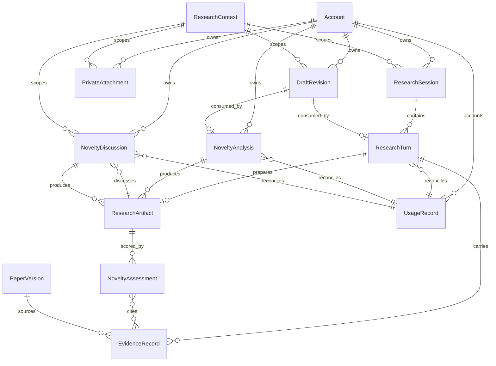

# U4 — Research and novelty · Functional specification

Unit: `u4-research-novelty`. Owner component: `ResearchWorkspace`.

This file is the **source of truth for ordered behaviour**: the numbered
workflows below and the state machines in "State machines". The entity-relationship
diagram and the rules summary are **derived views** (their sources of truth are
`entities.md` and `rules.md`).

Scope note: the contract `C07` already fixes this unit's operation surface and
invariants; these workflows make the ordered behaviour explicit without
contradicting it. `C12` governs the provider adapter envelope and `C14` governs
durable accepted-work delivery and completion facts.

## W1 — Establish a private research context

1. The owner authenticates; the server resolves the account from the request context (`BR1.1`).
2. `createResearchContext` allocates a server-assigned private context and returns its identity. The browser never supplies owner or context (`BR1.1`, `BR1.2`).
3. If the applicable file, storage, privacy or capacity policy is unresolved, dependent upload operations later refuse with a typed policy outcome, but context creation itself does not imply those permissions (`BR3.1`).
4. The context is a protocol resource: no user-visible product surface, subscription or job is created (`entities.md`, `ResearchContext`).

## W2 — Create, reopen, list and delete research sessions

1. `createResearchSession` commits one owner/context-bound session; scope references are authorized independently (`BR1.2`).
2. `readResearchSession` returns committed turn references and each turn's authoritative pending or terminal state. It never submits work (`BR5.1`).
3. `listResearchSessions` returns an owner-only snapshot page; past tombstones do not reappear through a stale snapshot (`BR5.5`).
4. `deleteResearchSessions` requires explicit confirmation of its scope and consequences (`BR9.2`), CASes the session boundary, writes a durable tombstone **before** cleanup (`BR5.4`), and applies the defined pending-work, draft, asset and derived-data dispositions. A commit failure is reported with remaining state recoverable (`BR5.4`).
5. After deletion, a stale direct link resolves NOT_FOUND (`BR5.5`) and late draft saves are rejected (`BR4.7`).

## W3 — Ask a grounded research question

1. The owner submits a question with an optional source scope and an optional submitted draft.
2. `acceptResearchTurn` verifies the owner and context, freezes one immutable input/scope snapshot, and records a recoverable dispatch obligation atomically with acceptance (`BR8.3`, `BR8.4`).
3. If a `submittedDraft` is supplied, owner, context, kind and text hash must match the acknowledged revision; only that exact revision is consumed and any concurrent newer acknowledged revision survives (`BR4.3`).
4. A repeated normalized intent does not create a second turn: the existing accepted identity is returned, or an idempotency conflict is refused when the same key carries different content (`BR5.2`).
5. Progress is read through `readResearchTurn`/`readResearchJob` as an authoritative ordered snapshot (`accepted → {running, failed}`, then `running → {succeeded, failed}`). Reads and reconnects never re-execute work (`BR5.1`).
6. On completion, the worker fact is validated against kind, context, the active unexpired lease and the input hash before the owner commits it (`BR5.3`, `BR8.4`).
7. Evidence is recorded per claim and quotation with the source identity, version and location actually read (`BR2.1`, `BR2.2`). Contradictions are presented explicitly and weak evidence is marked uncertain (`BR2.3`).
8. If supporting evidence is insufficient, if no eligible corpus exists, or if the model is unavailable, the turn returns a meaningful abstention or a partial result with disclosed coverage — never invented support (`BR2.4`). Malformed model output and truncation produce a typed failure or disclosed limitation, never a false success (`BR8.1`, `BR8.2`).
9. Each accepted turn reconciles exactly one usage record (`BR8.5`); current authority and consent are rechecked before publication (`BR8.7`).

## W4 — Support private attachments and optional web references

1. `beginPrivateAttachment` issues a bounded, context-specific upload permit only after the applicable policy is resolved; exhausted capacity refuses (`BR3.1`, `BR9.1`).
2. `finishPrivateAttachment` verifies bytes, hash and media against the allowlist and size cap before any extraction (`BR3.2`). Malformed, oversized, truncated, password-protected or unsupported input is refused with a usable explanation and no partial publication (`BR3.2`, `BR3.4`).
3. Extraction proceeds recoverably and its output is stored as untrusted evidence: embedded instructions cannot change permissions, request secrets or approve an external action (`BR2.5`).
4. `readPrivateAttachment` and `readPrivateAsset` authorize each read individually against account, context and current lifecycle, refusing arbitrary paths and cross-context reuse (`BR1.2`, `BR1.4`).
5. Private identifiers never resolve through a public corpus route (`BR1.3`), and no private content is published (`BR3.4`).
6. An owner-supplied web reference is stored with `readState: not-read` unless a permitted retrieval actually happened; an unread reference never counts as grounding evidence (`BR3.3`).

## W5 — Save a draft (conflict and consumption)

1. `saveDraft` compare-and-sets the base revision: `null` creates a new draft; a matching base records a new immutable acknowledged revision with its exact content hash (`BR4.2`).
2. A non-current base returns a conflict with the authorized current revision and the proposed text; neither side is silently overwritten (`BR4.2`).
3. Only the acknowledged revision is offered for later recovery; a failed or in-flight save promises nothing (`BR4.1`).
4. When an accepted operation submits a draft, exactly the submitted revision is consumed and bound to that operation (`BR4.3`).
5. While the retention, erasure, storage and shared-device policy is unresolved, durable draft operations refuse with a policy-unresolved outcome and no durability is implied (`BR4.6`).

## W6 — Recover or discard a draft

1. `restoreDraft` returns only the retained acknowledged **unconsumed** revision for the same owner after authentication; it creates no job and has no external effect (`BR4.4`).
2. `discardDraft` targets the exact acknowledged revision under compare-and-set; a stale discard cannot erase a newer edit (`BR4.5`).
3. A session tombstone rejects late saves and restores (`BR4.7`).
4. Discard and deletion state their scope and require deliberate confirmation (`BR9.2`).

## W7 — Analyze novelty (topic or manuscript) and manage its job

1. `acceptNoveltyAnalysis` freezes a distinct immutable input snapshot: topic mode freezes the topic and source scope; manuscript mode requires an eligible owner attachment and freezes its content reference (`BR6.1`).
2. Unsupported manuscript formats produce a truthful limitation rather than a fabricated result (`BR6.1`).
3. An optional submitted draft is consumed by the exact-revision rule (`BR4.3`).
4. Progress follows the **NoveltyAnalysis** state machine below; `readResearchJob` returns the authoritative ordered snapshot and checks job kind and context as well as owner (`BR5.1`).
5. `cancelNoveltyAnalysis` requests cancellation and may return `cancel_requested`. A request is not completion: compare-and-set decides the one winning terminal outcome, and a result that completed first stays `succeeded` (`BR6.4`).
6. After cancellation is acknowledged, late events neither resurrect the job nor start an unapproved export (`BR6.5`, `BR6.2`).
7. Any optional assessment uses the recorded method scale with `minimum <= score <= maximum` and existing evidence IDs; a score is never presented as proof of scientific novelty (`BR6.2`).

## W8 — Discuss a novelty result and read artifacts

1. `acceptNoveltyDiscussion` commits a `NoveltyDiscussion` job — its own durable acceptance, immutable input snapshot, progress and terminal outcome under the ResearchTurnOrDiscussion machine — bound to the same owner's eligible, immutable, ready novelty result. It neither reruns analysis nor approves export (`BR6.3`).
2. `readResearchArtifact` returns the exact immutable revision and hash with current eligibility; unavailable, expired or deleted reads disclose their availability and never regenerate work or start an export (`BR7.1`, `BR7.3`).
3. Artifacts and discussion remain owner-scoped; a reader without current owner authority is refused (`BR7.4`).
4. Any optional score is read with its recorded `NoveltyAssessment` method scale and evidence IDs; a score without its scale or outside `[minimum, maximum]` is not rendered, and a score is never presented as proof of scientific novelty (`BR6.2`).

## W9 — Export source read (U4's side of the identity contract)

1. The `ApprovedExport` consumer reads a source artifact through `readNoveltyArtifactForExport` as a trusted consumer acting for the current owner (`BR7.4`).
2. Only a **ready novelty result** is returned, at its exact `artifactId`/`revision`/`contentHash`, with current eligibility rechecked and the eligibility revision returned with the content (`BR7.2`).
3. New content never overwrites the tuple: changed bytes require a new revision (`BR7.1`). Eligibility revocation prevents a pending export (`BR7.2`).
4. This read approves nothing. Approval, destination binding and reconciliation stay in U6; a cancelled or failed analysis never reaches this read (`BR6.5`).

## W10 — Failure, interruption and recovery (cross-cutting)

1. Interrupted and retried requests preserve committed inputs and never duplicate accepted work (`BR8.3`).
2. Worker completion facts are proposals: the owner validates kind, context, lease and input hash and alone commits state, sequence and result visibility (`BR8.4`).
3. Late completion binds to the correct session and input or is rejected (`BR5.3`).
4. Account, consent and lifecycle changes are rechecked before publishing outcomes or effects (`BR8.7`).
5. Capacity bounds refuse with a bounded, honest outcome and never fall back to a paid provider (`BR9.1`).
6. Capability and health observations distinguish observed, unknown and stale evidence and never carry private text or credentials (`BR8.6`).

## State machines

These transitions are the source of truth for ordered state behaviour; the
`C07` contract declares the same machines for `ResearchTurnOrDiscussion`,
`NoveltyAnalysis` and `DraftRevision`.

### ResearchTurnOrDiscussion

`accepted → {running, failed}`; `running → {succeeded, failed}`; the terminal states
`succeeded | failed` have no transitions out.

This machine governs both `ResearchTurn` and `NoveltyDiscussion` jobs. A turn or
discussion can fail before it starts running (`accepted → failed`), matching C07.

**Rule:** distinct kind/context and immutable input per accepted turn or discussion;
a deleted context prevents late result publication (`BR5.3`, `BR5.5`).

### NoveltyAnalysis

`accepted → {running, cancel_requested, failed}`;
`running → {cancel_requested, succeeded, failed}`;
`cancel_requested → {cancelled, succeeded, failed}`;
terminal states `cancelled | succeeded | failed` have no transitions out.

**Rule:** a cancellation request is not cancellation completion; compare-and-set
determines the one winning terminal result and there is no terminal resurrection
(`BR6.4`, `BR6.5`).

### DraftRevision

`acknowledged → {consumed, discarded, expired, deleted}`; every terminal state has no transitions out.

**Rule:** editing creates another immutable acknowledged revision; consumption and
discard target the exact revision and cannot consume or erase newer edits; a
conflict does not commit an overwrite (`BR4.2`, `BR4.3`, `BR4.5`).

### PrivateAttachment (extraction disposition)

`pending → {extracted, unsupported, malformed, truncated, protected, failed}`; terminal dispositions have no transitions out.

**Rule:** verification precedes extraction and every refusal is typed and truthful
(`BR3.2`). `deleted` is reached from any state when the deletion boundary is set.

### ResearchArtifact (availability)

`ready → {expired, deleted, unavailable}`; terminal availability states have no transitions out.

**Rule:** expiry is disclosed and never regenerates work or triggers an export
(`BR7.3`); the `(artifactId, revision, contentHash)` tuple is immutable (`BR7.1`).

## Derived view — entity relationships

Derived from `entities.md`; the YAML there is the source of truth. `Account`,
`PaperVersion` and `UsageRecord` are owned by AccountAccess, CorpusContent and
UsageEntitlements respectively.

## Derived view — rules summary

| Group | Rules | Concern |
|---|---|---|
| BR1 | BR1.1–BR1.5 | Owner and context isolation; private identity; per-asset authorization; revoked sessions |
| BR2 | BR2.1–BR2.5 | Grounded claims and quotations; contradiction; abstention; untrusted content |
| BR3 | BR3.1–BR3.4 | Upload policy; verified bytes; unread references; no public publication |
| BR4 | BR4.1–BR4.7 | Acknowledged recovery; CAS; exact-revision consumption; restore; discard; policy suspension |
| BR5 | BR5.1–BR5.5 | Sessions and turns; idempotency; late-completion binding; deletion; tombstones |
| BR6 | BR6.1–BR6.5 | Novelty modes; no proof claims; discussion binding; cancellation CAS; no resurrection |
| BR7 | BR7.1–BR7.4 | Immutable tuple; export read binding; expiry; owner authority |
| BR8 | BR8.1–BR8.7 | Failure truthfulness; truncation; interruption; owner-committed state; usage; observability |
| BR9 | BR9.1–BR9.2 | Bounded capacity without paid fallback; confirmed destructive actions |

Derived from `rules.md`; the YAML there is the source of truth.

## Frontend contribution (WebWorkspace)

U4's screens are contributions to the shared `WebWorkspace` shell, not a separate
application. The research and novelty views:

1. show acknowledged, pending, unknown and failed work as distinct states, never
   presenting a pending item as a result (`BR5.1`, `BR8.4`);
2. clear account-bound rendering state on account switch or sign-out and restore
   only authenticated acknowledged drafts (`BR1.5`, `BR4.4`);
3. treat browser state as untrusted and let presentation reads create no job,
   turn or export (`BR5.1`, `BR9.2`);
4. present destructive actions with their exact scope and a deliberate
   confirmation (`BR9.2`), and meet the existing Korean responsive, appearance-mode
   and WCAG 2.2 AA interaction contract (NFR2, NFR6).
