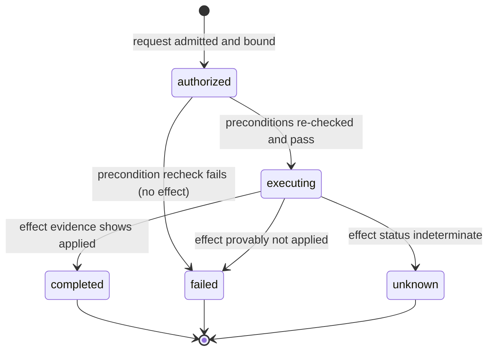
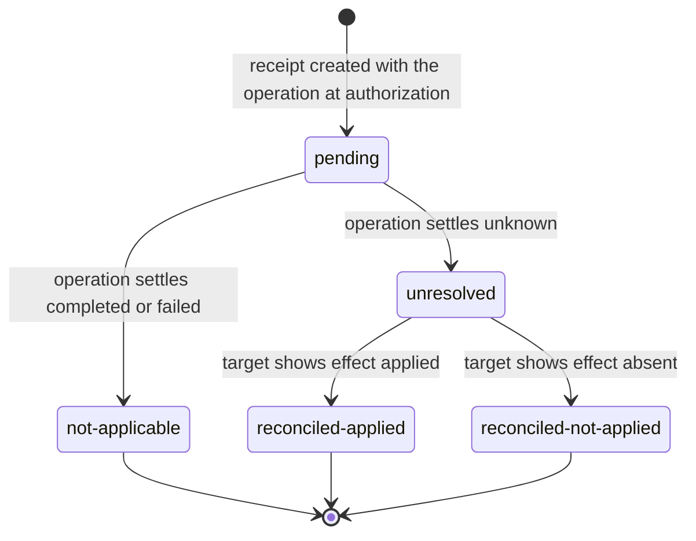
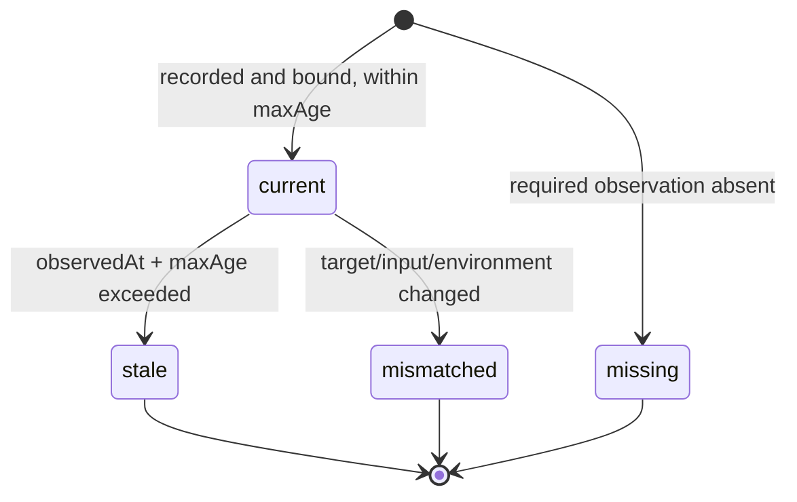
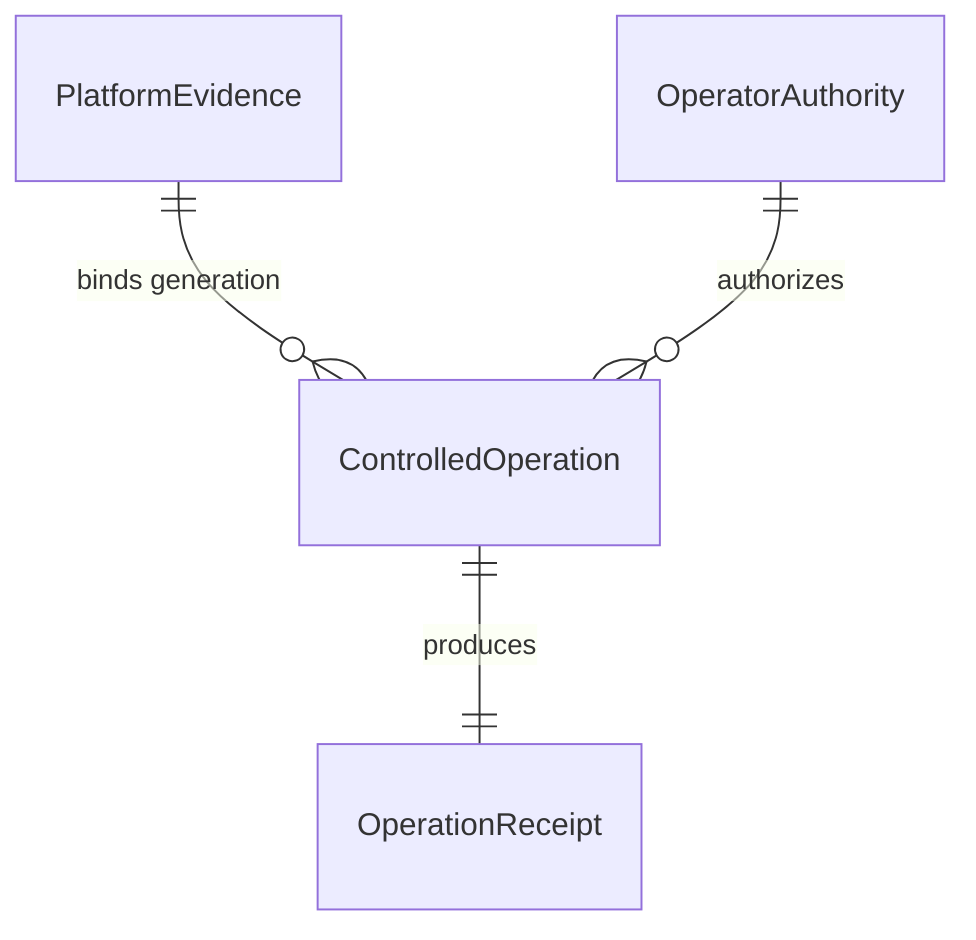

# U7 Functional Specification — Controlled platform protocols

## Purpose, authority and boundaries

This specification defines the behaviour of the `PlatformControl` component:
platform evidence and compatibility assessment, independent operator authority,
controlled-operation execution, and durable outcome receipts with interrupted
effect reconciliation. It is the source of truth for the ordered workflows and
the entity lifecycle state machines; the data shape lives in
[entities.md](entities.md) and the decision logic in [rules.md](rules.md).

Scope comes from the U7 unit boundary
([unit-of-work.md](../../../inception/units-generation/unit-of-work.md#u7--controlled-platform-protocols)),
the [requirement-to-unit map](../../../inception/units-generation/unit-of-work-story-map.md),
the acceptance statements FR20.1/FR20.2
([requirements.md](../../../inception/requirements-analysis/requirements.md)) and
contract C10
([contract-summary.md](../../../inception/contract-design/contract-summary.md)).
Decisions from the answered [questions](functional-design-questions.md) are
applied: complete inventory with dispositions (Q1), local OS identity with a
target-scoped grant (Q2), separate destructive-release grant (Q3), finite
evidence validity with read-only downstream access (Q4), explicit disposition of
cloud-dependent protocols (Q5), canonical v2 envelope (Q6), and the outcome
ladder with reconciliation (Q7).

Out of scope: storage/transport technology, native adapter mechanics, and any
authorization to run a real destructive or release operation. This design uses
synthetic targets only.

## Composition and ownership

- `PlatformControl` owns all four entities and is the only writer.
- It depends on no other domain component. `ServiceOperations` (U8) consumes a
  bounded, read-only evidence/receipt interface.
- The operator executable is independently runnable; its graph has no
  application prerequisite.

## Access and effect matrix

| Actor class | inspectEvidence | executeControlled (routine) | executeControlled (destructive-release) | readReceipt | provision authority |
|---|---|---|---|---|---|
| Anonymous / app user | denied | denied | denied | denied | denied |
| Application administrator (web) | denied | denied | denied | denied | denied |
| Platform operator (routine grant) | allowed for its scope | allowed for its scope | denied | allowed for its scope | denied |
| Platform operator (destructive-release grant) | allowed for its scope | allowed for its scope | allowed for its scope | allowed for its scope | denied |
| Bounded evidence reader (evidence-reader grant) | read-only for its scope | denied | denied | read-only for its scope | denied |
| Local provisioning procedure | n/a | n/a | n/a | n/a | allowed (local only) |

An application administrator is never a platform operator (BR2.2). Every
effect-bearing surface requires current, independent operator authority.

## Ordered workflows

### WF1 — Inspect platform evidence

1. Caller supplies an `OperatorEvidenceRequest` naming actor, operation, target, inputs and environment context.
2. Admit the request only if the caller holds operator authority for the exact target or a bounded evidence-reader grant (BR6.2).
3. Resolve the current `PlatformEvidence` generation for the target and assess compatibility against the request's target/input/environment and the protocol's finite `maxAge` (BR1.1–BR1.4): `current`, `stale`, `mismatched` or `missing`.
4. Return the evidence with its observed time and the explicit compatibility label; never upgrade an unknown/stale value (BR6.3).
5. A read creates no operation and no effect (BR6.1).

### WF2 — Execute a routine controlled operation

1. Caller submits `OperatorExecuteRequest` with actor, operation name, target, input, idempotency key and the evidence generation it relies on.
2. Admit the operation name only if it is a retained-inventory member; refuse raw command/path/shell input (BR3.1, BR3.2).
3. Bind actor, operation, target, input hash, evidence generation and policy atomically to a new `ControlledOperation` and its `OperationReceipt` in state `authorized`, before any effect (BR3.3).
4. Re-check current authority (BR2.1, BR2.4) and preconditions under the exclusive target lock immediately before the effect (BR3.4). A failed recheck yields no effect and settles the operation `failed`.
5. Apply the single effect; observe its result.
6. Settle the receipt: `completed` only with effect evidence, `failed` when the effect provably did not apply, otherwise `unknown` (BR4.2, BR4.3).

### WF3 — Execute a destructive/release controlled operation

As WF2, with these differences:

1. The operation's `authorityClass` is `destructive-release`; it requires a separately provisioned grant of that class (BR2.5). A routine grant is refused.
2. Design and tests exercise this workflow only against synthetic targets (BR3.7); a real destructive/release effect additionally requires the human operator present at a real terminal.
3. Everything else (binding, precondition recheck, single effect, receipt) is identical, so reconciliation and replay protections apply unchanged.

### WF4 — Read or reconcile an operation receipt

1. Caller supplies `OperatorReceiptRequest` with the operation key or receipt identity and current authority for the same target (BR6.2).
2. Return the recorded receipt as-is. A read never repeats the effect (BR3.6, BR6.1).
3. For a receipt whose outcome is `unknown`, perform a reconciliation read against the target's `targetEffectReference`:
   - evidence the effect applied → `reconciled-applied` (BR4.4);
   - evidence the effect is absent → `reconciled-not-applied`;
   - otherwise it stays `unresolved`.
4. Reconciliation never re-executes the operation and never auto-promotes the outcome (BR4.4).

### WF5 — Reject wrong actor/target, stale evidence or changed input

1. On any execute request, evaluate authority, target match, evidence compatibility and input binding before any effect.
2. Reject with no effect when: actor lacks authority (BR2.1/BR2.2/BR2.4), target is outside the grant (BR2.3), evidence is stale/mismatched/missing (BR1.2–BR1.4), the operation is outside the vocabulary (BR3.1), the input smuggles a command/path/shell (BR3.2), or the same key carries changed input (BR4.6).
3. Record the refusal; no `ControlledOperation` reaches `executing`.

### WF6 — Recover an interrupted or duplicate operation

1. On restart, the durable receipt restores the operation's binding and state (BR4.1).
2. A duplicate request with the same key and input returns the recorded receipt with no second effect (BR3.6, BR4.5).
3. A duplicate request with the same key and changed input is refused as a conflict (BR4.6).
4. An interrupted operation whose effect status is indeterminate settles `unknown` and enters WF4 reconciliation; it is never reported `completed` on liveness alone.

### WF7 — Handle permission, disk or connectivity failure

1. A filesystem permission failure, disk exhaustion or lost connectivity during execution settles the operation `failed` or `unknown` — never `completed` (BR4.3).
2. If the effect may have partially applied, `unknown` plus reconciliation (WF4) preserves the truth; the operator sees it in the unresolved list (BR4.7).
3. No retry silently repeats the effect; a retry uses the same replay identity (BR3.6).

### WF8 — Reconcile the retained protocol inventory and consumer matrix (parity)

1. Inspect the reference to enumerate the retained operator protocols.
2. Record each protocol with a disposition: a genuine free/local path → implement a local equivalent; a cloud/paid-dependent protocol → record it as compatibility-dependent or not-implemented under $0 with its consumer impact noted (BR5.1, BR5.2). No paid fallback is added.
3. Record the actual external-consumer matrix; preserve legacy command compatibility only where a real consumer is evidenced (BR5.3).
4. Admit each implemented protocol's operation name and finite `maxAge` into the controlled-operation vocabulary. Unverified native semantics fail closed (BR3.5).
5. Platform evidence and receipts never substitute for application journey readiness (BR1.5, BR5.5).

## Authoritative state machines

### Operation lifecycle (`ControlledOperation.state`)

States: `authorized`, `executing`, `completed`, `failed`, `unknown` — this entity
owns the in-flight lifecycle and its settlement only. Reconciliation states
belong to the receipt, not the operation.

Text fallback: an admitted, bound operation moves from `authorized` to
`executing` only after preconditions pass under the target lock; it then settles
`completed` (effect evidence), `failed` (no effect), or `unknown`
(indeterminate). All three settlement states are terminal for the operation.

### Receipt reconciliation lifecycle (`OperationReceipt.reconciliationState`)

States (enum values): `pending`, `not-applicable`, `unresolved`,
`reconciled-applied`, `reconciled-not-applied`.

Text fallback: a receipt is `pending` from authorization until the operation
settles; a `completed`/`failed` settlement makes reconciliation
`not-applicable`; an `unknown` settlement leaves it `unresolved` until a
reconciliation read establishes `reconciled-applied` or
`reconciled-not-applied`. Reconciliation never re-executes the operation.

### Evidence compatibility lifecycle (`PlatformEvidence.compatibility`)

States: `current`, `stale`, `mismatched`, `missing`.

Text fallback: newly recorded evidence is `current` while within its finite
window and its binding still matches; time turns it `stale`, a binding change
turns it `mismatched`, and an absent required observation is `missing`.
`stale`, `mismatched` and `missing` cannot authorize an effect.

### Authority lifecycle (`OperatorAuthority.revocation`)

States: `active`, `revoked`. A grant is provisioned locally `active` and becomes
`revoked` through the controlled local procedure; revocation takes effect
immediately at the next execution check.

## Derived entity-relationship view

Derived from the `yaml` in [entities.md](entities.md) (source of truth):

Text fallback: one `PlatformEvidence` generation may be bound by many
`ControlledOperation`s; one `OperatorAuthority` grant may authorize many
`ControlledOperation`s; each `ControlledOperation` produces exactly one
`OperationReceipt`.

## Derived rule summary

Workflow → rule groups: WF1 → BR1, BR6; WF2 → BR2, BR3, BR4; WF3 → BR2.5, BR3.7
plus WF2 rules; WF4/WF6/WF7 → BR4; WF5 → BR1.2–BR1.4, BR2, BR3.1/3.2, BR4.6;
WF8 → BR5. The full rule text is authoritative in [rules.md](rules.md).

## Local acceptance design

Design-level checks to be exercised (with synthetic targets only) during code
generation and build-and-test:

| Case | Workflow | Expected |
|---|---|---|
| Current, stale, mismatched and missing evidence are distinguishable | WF1 | each labelled explicitly; none authorizes an effect (FR20.1) |
| Wrong actor / wrong target rejected before effect | WF5 | no effect; FORBIDDEN (FR20.2) |
| Changed input under the same key rejected | WF5, WF6 | CONFLICT; recorded receipt untouched (FR20.2) |
| Interrupted effect with unknown outcome reconciled | WF4, WF6 | reconciled-applied/not-applied with no duplicate execution (FR20.2) |
| Duplicate execution replays the receipt | WF6 | one effect; recorded receipt returned (FR20.2) |
| Permission failure / disk exhaustion / lost connectivity | WF7 | failed or unknown; never completed (FR20.2) |
| Destructive/release requires the separate grant | WF3 | routine grant refused (FR20.2) |
| Bounded, authenticated restricted read; evidence ≠ readiness | WF1, WF8 | read-only; explicit unknown/stale labels (FR20.1) |

## Evidence prerequisites and downstream handoff

- The concrete protocol inventory, per-protocol `maxAge`, and the
  external-consumer matrix are populated during implementation from the
  reference reconciliation (WF8); this spec fixes the rules, not the final list.
- Storage technology, retention duration and the unresolved-unknown review
  cadence remain open and belong to NFR/infrastructure and operations design.
- `ServiceOperations` (U8) consumes the read-only evidence/receipt interface
  defined by BR6 and never invokes execution on U7's behalf.
