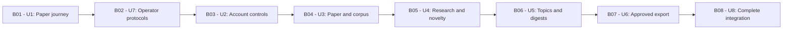

# DocSuri v2 — Construction delivery plan

Date: 2026-10-11 (Asia/Seoul). Basis: the human's
[confirmed answers](delivery-planning-questions.md), approved
[unit catalogue](../units-generation/unit-of-work.md),
[dependency graph](../units-generation/unit-of-work-dependency.md),
[requirements](../requirements-analysis/requirements.md),
[component ownership](../domain-design/components.md),
[contracts](../contract-design/contract-summary.md) and
[mockups](../refined-mockups/mockups.md).

## Work streams and release boundary

A **Bolt** is one build pass over a piece of work, ending in something that runs.
Here each Bolt completes one approved unit's bounded contribution. Eight Bolts
retain every current capability; the first paper demonstration does not reduce
the first v2 release to that journey. A pass includes its applicable designs,
implementation, real integration and completion evidence, rather than one coding
session or a document-only milestone.

U1 and U8 are successive assemblies of one shared application. U2–U6 are embedded
contributions with their required UI and actual host integration. U7 remains a
separately controlled operator executable. The 13 approved business components
retain authority over their entities throughout; unit completion transfers no
ownership and creates no duplicate account, library, job or artifact store.

All Bolts are executed by `aidlc-developer-agent` with supporting coding agents
from this session, coordinated by the delivery lead; the human maintainer remains
the sole approver. [Responsibility allocation](team-allocation.md) names component
and integration responsibilities. Relative complexity comes from the approved
catalogue and is not a duration estimate.

| Bolt | Unit | Construction directory | Kind / grouping | Complexity | Required completed units |
|---|---|---|---|---|---|
| B01 | U1 | u1-integrated-paper-journey | service / shared | XL | None |
| B02 | U7 | u7-controlled-platform-protocols | service / standalone | L | None |
| B03 | U2 | u2-account-personal-controls | library / embedded | L | U1 |
| B04 | U3 | u3-paper-corpus-capabilities | library / embedded | XL | U1, U2 |
| B05 | U4 | u4-research-novelty | library / embedded | XL | U1, U2, U3 |
| B06 | U5 | u5-topics-digests | library / embedded | M | U1, U2, U3 |
| B07 | U6 | u6-approved-export | library / embedded | M | U1, U2, U4 |
| B08 | U8 | u8-service-operations-integration | service / shared | XL | U1, U2, U3, U4, U5, U6, U7 |

## Implementation sequence and workflow visualization

Execute B01 → B02 → B03 → B04 → B05 → B06 → B07 → B08, serially. This is an
execution sequence, not a new dependency graph. In particular U7 does not depend
on U1 and U6 does not depend on U5. The approved YAML still defines all 19 edges.

Text fallback: first prove the integrated paper journey; then the independent
operator protocols; then account controls, full paper/corpus behavior, research
and novelty, topics/digests, approved export, and complete service integration.

The actual runtime parser returned dependency groups
`[[U1,U7],[U2],[U3],[U4,U5],[U6],[U8]]`; its unit-major walker flattens these groups
in that order and completes each unit's stage block and checkpoint before the
next. U4/U5 membership in one group does not enable concurrency. Existing
in-progress or explicitly set-aside work may affect resumption; changes to this
Markdown alone cannot reorder runtime execution. See the source evidence in
[the planning answers](delivery-planning-questions.md#answer-analysis-and-proposed-sequence).

No time-based critical path is claimed without duration estimates. The longest
dependency chain by unit count is U1 → U2 → U3 → U4 → U6 → U8; the serial schedule
also reserves B02 and B06. [Sequencing rationale](risk-and-sequencing-rationale.md)
explains the risk-first choices and what would trigger replanning.

## Common definition of done

Each Bolt must satisfy these conditions for its implemented scope:

- Its requirements are reconciled against the full current capability reference,
  including broken, disabled and disputed paths. Keep exact retained variants,
  evidence and future contributors in the parity ledger; omissions need a human
  scope decision. Use the authoritative [70-row map](../units-generation/unit-of-work-story-map.md).
- The contribution runs with actual applicable prerequisites and persistence,
  including its UI or operator interface. Isolated tests, mocks, screenshots and
  schema checks supplement a working demonstration; they do not replace it.
- Exercise success, denied access, failed/unknown writes, interruption, retry and
  duplicate outcomes relevant to the contribution. Distinguish acknowledged
  drafts, committed work, accepted jobs, prepared results and approved effects.
- Meet resolved policy and evidence prerequisites before affected decisions or
  effects. Record unresolved constraints and their exact impact. Never invent
  retention, migration, free-service limits, numeric quality targets or user data.
- Supply repeatable setup, fixtures, commands, observed results and limits, plus
  truthful resource and failure observations. Measure task success, responsiveness,
  interruption recovery and defect reproduction/repair; compare with human-agreed
  targets once available. No result implies those targets have already been agreed.
- Preserve the Korean, responsive shared workspace, inherited colors, Apple HIG
  web adaptations, light/dark/system appearance and WCAG 2.2 AA target where
  applicable. Operational CLI work retains its proper interface. Verify actual
  keyboard, focus, status and recovery behavior as the UI is implemented.
- Update affected producer/consumer contracts and executable checks coherently.
  An accepted review finding stays open until its defined closure evidence exists.
  Shared files have one editing owner per change; all component data writers keep
  their approved authority.
- Reach the existing human completion checkpoint with the approved verification
  command and evidence. Then merge the completed branch through a PR to develop
  under CONVENTIONS.md, remove it, and start a fresh branch for subsequent work.

Finishing a bounded unit does not close a cross-unit requirement prematurely.
For example, U2 can verify its lifecycle coordinator with installed participants;
U4–U6 must later add and test their participants, and U8 verifies completeness.
U2's changed-source library behavior needs U3's actual corpus changes for full
acceptance. These are recorded remaining contributions, not reverse dependencies.

## Bolt definitions

### B01 — U1 integrated paper journey

**Owner:** aidlc-developer-agent; initial component slices remain with their
approved domain owners. **Separate walking-skeleton ceremony:** not enabled.
**Prerequisites:** no unit prerequisite; relevant capability, content/model
permission, local capacity, initial persistence/authority and policy evidence
must precede affected choices. Existing users/data are not reset for the demo.

**Definition of done:** implement a real browser/server/store/executor path for
the approved public-paper tasks P1/P2. Demonstrate research-query discovery,
useful source-bound understanding, acknowledged save, fresh authenticated revisit
and prepared-result reading without starting another job. Exercise another
account's denial, lost save acknowledgement, progress reconnect, process/worker
restart and duplicate acceptance with one result/accounting effect. Record the
exact implemented subset, observations and remaining variants. Establish host
registration, owner context and only the participants actually present.

Resolve Contract R-01's browser revision convention and R-03's domain claim,
payload retrieval and worker fencing before their affected implementations.
Demonstrate a stale client conflict and rejection of late replaced-worker facts
through real boundaries. Detailed remaining bindings stay assigned to consumers.

**Confidence hypothesis:** an eligible paper journey can remain useful and
consistent across interruption within a measured free/local configuration.
**Expected demo:** P1/P2 query → read/understand → save → restart/login → revisit,
with an interrupted job recovered and an unauthorized account denied. Failure
falsifies the hypothesis; a mocked model or no-op dispatcher cannot pass it.

### B02 — U7 controlled platform protocols

**Owner:** aidlc-developer-agent; PlatformControl retains independent authority.
**Separate walking-skeleton ceremony:** not applicable. **Prerequisites:** none
in the application DAG; reconcile actual protocol membership, native platform
semantics, credentials, permitted fixtures and operator authority first.

**Definition of done:** run the retained operator protocol set with actor/target
and input/precondition binding, compatibility evidence and durable outcome
receipts. Test stale/wrong evidence, wrong actor/target, changed input, interruption,
duplicate effects, disk exhaustion and permission failures using safe fixtures.
Native filesystem/credential semantics require actual platform evidence; Linux
or mocked results cannot claim macOS equivalence. U8 receives bounded evidence
without gaining unrestricted operator privileges.

**Confidence hypothesis:** controlled operations can reject stale authority and
recover uncertain execution without duplicate or unauthorized effects.
**Expected demo:** a permitted fixture operation, interrupted recovery and
rejected stale/wrong-target attempt with inspectable receipts. Destructive or
release operations retain their separate explicit authority.

### B03 — U2 account and personal controls

**Owner:** aidlc-developer-agent; AccountAccess, Personalization, Library and
UsageEntitlements. **Separate walking-skeleton ceremony:** not applicable.
**Prerequisites:** U1; resolved affected account/lifecycle policy and verified
identity/email paths and sustainable terms before parity claims.

**Definition of done:** complete retained registration/recovery/credential/email
changes, Google/ORCID links, administrator MFA, profile/consent, withdrawal and
reactivation, onboarding, preferences/recent activity, saved work/history and
quota administration through the application. Preserve mock subscription display
without real billing. Test denied callbacks, challenge replay, revoked sessions,
cross-owner access, concurrent changes, delayed history facts and quota uncertainty.
Complete R-01's affected browser bindings with two-client stale-revision checks.
Lifecycle acknowledgements cover installed owners; future participants stay open.

**Confidence hypothesis:** personal controls consistently honor current authority
and acknowledged state through account changes and failures.
**Expected demo:** registration and return, a saved search and preference change,
credential/session revocation, conflicting tab updates and bounded lifecycle
completion. Local email sinks demonstrate local tests only; public delivery needs
its own real evidence.

### B04 — U3 complete paper and corpus capabilities

**Owner:** aidlc-developer-agent; CorpusContent, Discovery and PaperAssistance,
with WebWorkspace contributions. **Separate walking-skeleton ceremony:** not
applicable. **Prerequisites:** U1/U2 and permitted source/model/citation adapters,
retained variant inventory and measured compatible resource choices.

**Definition of done:** complete all retained search/refinement/ordering, citation,
reading/assets, assistance/language/level and glossary behavior. Implement
ingestion, deduplication, canonical/version changes, refresh/rebuild, withdrawal
and reprocessing with coherent object/control/index outcomes. Prove projection
write/publication/withdrawal ownership and actual Library integration. Recheck the
four discovered paper-job defects through mounted dispatch, progress framing,
result shapes and read-only result retrieval. Cover partial writes, incompatible
indexes/models, quota races, source changes and provider limits; extend worker
claim/fencing and browser-revision checks to every affected binding.

**Confidence hypothesis:** corpus and retrieval changes preserve identity,
eligibility and saved-work meaning while all retained paper modes remain usable.
**Expected demo:** ingest/refresh and query real eligible fixtures; change or
withdraw a source; revisit its saved reference; recover interrupted processing;
exercise the full supported paper-mode ledger, including degraded states.

### B05 — U4 research and novelty

**Owner:** aidlc-developer-agent; ResearchWorkspace with its UI contribution.
**Separate walking-skeleton ceremony:** not applicable. **Prerequisites:** U1–U3,
permitted private/web/model processing, resolved draft/storage/retention/deletion
and shared-device rules, and concrete R-02 identity allocation/rediscovery.

**Definition of done:** complete grounded questions, comparison/quotation evidence,
private attachments, supported web references, committed sessions/turns, distinct
novelty modes/jobs/results/discussion and acknowledged draft recovery. Restart
with no in-memory draft/context IDs and authenticate: offer only the current
owner's retained unconsumed draft, including pre-session/job text, without
auto-submission. Cover failed saves, consumed/deleted drafts, newer-edit conflict,
account switch, late writes and cancellation/completion races. Extend R-03 to real
research/novelty execution. Supply exact immutable artifact revision/content
identity for U6, and test useful evidence, insufficient/contradictory sources and
actual extraction/model failure.

**Confidence hypothesis:** private research can survive interruption while source
evidence, account boundaries, drafts and accepted work remain distinct.
**Expected demo:** save an acknowledged manuscript draft, restart and recover it,
perform a supported research/novelty task, inspect evidence and immutable output,
then prove another account cannot discover or reopen it.

### B06 — U5 topics and digests

**Owner:** aidlc-developer-agent; TopicsDigests with its UI contribution.
**Separate walking-skeleton ceremony:** not applicable. **Prerequisites:** U1–U3,
eligible content windows, current consent/lifecycle rules and sustainable real
delivery evidence.

**Definition of done:** complete persisted follow/unfollow, digest settings,
content selection, delivery outcomes and unsubscribe. Register and verify the
owned-data lifecycle participant. Exercise scheduling/time-zone boundaries,
unavailable/empty sources, late consent change, unsubscribe after queueing and
crashes around remote send; unknown outcomes reconcile before another effect.
Real public delivery evidence remains necessary even when fault tests use a sink.

**Confidence hypothesis:** scheduled digests honor current consent despite delayed
execution and uncertain sends. **Expected demo:** follow a topic, prepare and
deliver an authorized test digest, unsubscribe during queued work, and reconcile
a simulated lost acknowledgement without an unexplained duplicate send.

### B07 — U6 approved export

**Owner:** aidlc-developer-agent; ApprovedExport with its UI contribution.
**Separate walking-skeleton ceremony:** not applicable. **Prerequisites:** U1/U2/U4,
verified Notion token configuration and sustainable integration, source/destination
identity agreement and resolved applicable retention/external-copy policy.

**Definition of done:** complete owner connection, preview, destination, explicit
approval and reconciled Notion effect bound to the exact eligible immutable
artifact. Reads, completed analysis and preview/cancel cannot trigger export.
Changed source/destination or revoked authority invalidates the old approval.
Exercise wrong owner, protected token handling, duplicate execution, disconnect,
timeout after remote success and unknown outcome. Verify source/consumer revision
binding jointly with U4; do not introduce OAuth or waive effect approval.

**Confidence hypothesis:** approved exports reach the intended destination once,
or expose uncertainty that can be resolved without silent duplication.
**Expected demo:** inspect a prepared artifact, approve a specific test destination,
export, reconcile a lost response, then reject an obsolete approval after revision
or destination change. Real effects use specifically authorized test destinations.

### B08 — U8 complete service operations and integration

**Owner:** aidlc-developer-agent; ServiceOperations and complete composition, with
every business component retaining its authority. **Separate walking-skeleton
ceremony:** not applicable. **Prerequisites:** U1–U7 and affected release evidence.

**Definition of done:** assemble all views, contributions and lifecycle participants;
verify every retained requirement cumulatively through actual boundaries. Exercise
public/private isolation, current authority, late effects, source withdrawal,
acknowledged drafts, jobs, exports and controlled restore. Verify coherent Korean
navigation, search context, focus/status and appearance across responsive layouts;
collect keyboard, assistive-technology, reflow and contrast evidence. Demonstrate
diagnosis and repair of a representative defect from a clean checkout, rerun its
regression and affected integration checks, and provide maintainer procedures.
Check complete parity, agreed quality targets, selected continuity/restore and
sustainable $0 operation; missing mandatory evidence prevents readiness claims.

**Confidence hypothesis:** the complete application remains understandable,
recoverable and maintainable as one experience within verified free/local limits.
**Expected demo:** the full P1/P2 journey plus every capability ledger and combined
failure/restore scenario, a maintainer repair exercise and truthful readiness
output. U8 supplies the application and verification entrypoints; later CI/CD and
deployment stages retain their work and release authority.

## Verification, stage configuration and completion evidence

The human explicitly deferred the reusable construction verification command.
Its state stays unset until a real v2 check exists. Before the first unit
completion checkpoint runs verification, present the complete exact command for
separate approval; retain that authorized command for later cumulative checkpoints.
No document validator, legacy CI command or placeholder is authorized by this plan.

Per the approved workflow, Functional Design, NFR Requirements, NFR Design,
Infrastructure Design, Code Generation, Build and Test, and CI Pipeline remain
EXECUTE, with unit applicability/routing owned by the engine. Subsequent Operation
stages remain as recorded. User Stories, Team Formation and Practices Discovery
were skipped; this plan invents no stories, staffed teams or affirmed new process.
It changes neither stage selection, depth, review requirements nor autonomy.

Record at each checkpoint the source commit, completed unit contributions,
contract/policy revisions, configuration, fixture eligibility, actual commands
and outcomes, pending cross-unit acceptance, resource observations and unresolved
conditions. Shared checks grow with integrated units; a library unit must be
exercised through the real application. [External prerequisites](external-dependency-map.md)
name affected work and closure evidence. The
[phase check](../../verification/phase-check-inception.md) verifies planning
traceability only. No implementation, public operating capacity, migration or
deployment is claimed complete by approving these documents.
