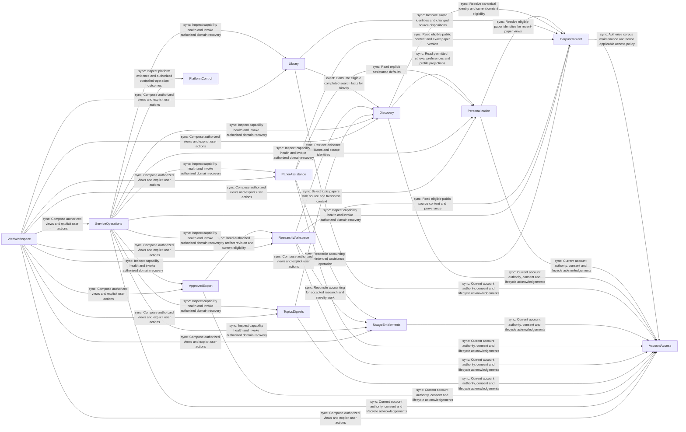

# DocSuri v2 — Logical components and entity ownership

Date: 2026-10-11 (Asia/Seoul). Basis: the [confirmed design summary](domain-design-questions.md), [requirements](../requirements-analysis/requirements.md), approved [interaction specification](../refined-mockups/interaction-spec.md), and the current-reference [architecture](../../../../codekb/DocSuri/architecture.md), [component inventory](../../../../codekb/DocSuri/component-inventory.md) and [dependencies](../../../../codekb/DocSuri/dependencies.md).

This design covers all 20 capability groups through 13 logical code components and 42 entity shapes. These boundaries do not choose deployment units, technologies, physical schemas or migration policy. The catalogue defines one owner per entity; an entity can be a transient context or an aggregate record, not necessarily a database table. Internal links within an owner's entities appear as attribute names; `references` explicitly describes links to another owner. Detailed types, values, cardinality and validation belong to Functional Design.

## Component catalogue

The following YAML is the source of truth for names, ownership, dependencies and the derived views below. Interaction style is a logical invocation relationship: `sync` needs an answer at that boundary, and `event` consumes a recorded fact. It does not select HTTP, a broker or a deployment boundary. References describe data identity; they do not by themselves imply a runtime call.

```yaml
components:
  - name: "AccountAccess"
    summary: "Own identity, sessions, profile, consent and account lifecycle coordination."
    behaviour: "Public registration, verification, credential changes, Google/ORCID linking and administrator MFA preserve verified account identity. Current authority is checked at protected reads and effects. An AccountLifecycleRequest records the applicable policy and required participant manifest; revocation and cleanup completion are distinct. Participants read outstanding lifecycle work and report their own disposition. The coordinator never writes another component's data, omits an unacknowledged participant or promises recovery after erasure."
    responsibilities: ["Identity and linked-provider lifecycle; protected secrets and session revocation","Profile and consent authority; permitted ORCID profile access","Account withdrawal/reactivation request, participant acknowledgements and honest completion"]
    depends_on: []
    external_dependencies:
      - name: "Durable persistence capability (unselected)"
        kind: "database"
        purpose: "Preserve acknowledged domain records and reconcile interrupted writes; provider and physical layout remain open."
      - name: "Google and ORCID integrations"
        kind: "third-party-api"
        purpose: "Retained linking/sign-in and eligible profile access; verify supported behavior and sustainable free terms."
      - name: "Email delivery capability (unselected)"
        kind: "third-party-api"
        purpose: "Verification and recovery delivery with visible failure; a local sink does not prove public delivery."
      - name: "Credential protection capability (unselected)"
        kind: "other"
        purpose: "Protect passwords, session/token material, identity-provider credentials and MFA recovery material."
      - name: "Observation collection capability (unselected)"
        kind: "other"
        purpose: "Emit privacy-aware capability, resource and outcome observations through infrastructure adapters without calling ServiceOperations business logic."
    entities:
      - name: "Account"
        identifier: "accountId"
        attributes: ["accountId","profile","verification","lifecycle","authorityRevision"]
        references: []
      - name: "AuthenticationSession"
        identifier: "sessionId"
        attributes: ["sessionId","accountId","authorityRevision","authenticationContext","revocation"]
        references: []
      - name: "IdentityLink"
        identifier: "identityLinkId"
        attributes: ["identityLinkId","accountId","provider","providerSubject","profileProvenance","credentialReference"]
        references: []
      - name: "IdentityChallenge"
        identifier: "challengeId"
        attributes: ["challengeId","accountId","purpose","verificationBinding","useDisposition","credentialReference"]
        references: []
      - name: "ConsentRecord"
        identifier: "consentId"
        attributes: ["consentId","accountId","purpose","decision","revision","effectiveAt"]
        references: []
      - name: "AccountLifecycleRequest"
        identifier: "lifecycleRequestId"
        attributes: ["lifecycleRequestId","accountId","requestedAction","policyReference","participantManifest","participantDispositions","completionEvidence"]
        references: []
    dependents:
      - component: "CorpusContent"
        interaction: "Authorize corpus maintenance and honor applicable access policy"
      - component: "Personalization"
        interaction: "Current account authority, consent and lifecycle acknowledgements"
      - component: "Discovery"
        interaction: "Current account authority, consent and lifecycle acknowledgements"
      - component: "Library"
        interaction: "Current account authority, consent and lifecycle acknowledgements"
      - component: "UsageEntitlements"
        interaction: "Current account authority, consent and lifecycle acknowledgements"
      - component: "PaperAssistance"
        interaction: "Current account authority, consent and lifecycle acknowledgements"
      - component: "ResearchWorkspace"
        interaction: "Current account authority, consent and lifecycle acknowledgements"
      - component: "TopicsDigests"
        interaction: "Current account authority, consent and lifecycle acknowledgements"
      - component: "ApprovedExport"
        interaction: "Current account authority, consent and lifecycle acknowledgements"
      - component: "ServiceOperations"
        interaction: "Current account authority, consent and lifecycle acknowledgements"
      - component: "WebWorkspace"
        interaction: "Compose authorized views and explicit user actions"
  - name: "CorpusContent"
    summary: "Own canonical public papers, versions, eligible content and corpus maintenance."
    behaviour: "Canonical identity, version and source provenance remain distinct from search projections and personal saves. Eligibility and withdrawal apply before display or processing, including cached/indexed representations. Refresh and rebuild cannot advance progress beyond verified completed work. Interrupted object/control/index effects retain an inspectable reconciliation responsibility. Operational mutation requires appropriate current authority; this does not authorize operations during design."
    responsibilities: ["Public paper identity, canonical mappings and version provenance","Eligible sections/assets and availability/withdrawal disposition","Ingestion, deduplication, refresh/rebuild, watermark and recovery ownership"]
    depends_on:
      - component: "AccountAccess"
        interaction: "Authorize corpus maintenance and honor applicable access policy"
        style: "sync"
    external_dependencies:
      - name: "Durable persistence capability (unselected)"
        kind: "database"
        purpose: "Preserve acknowledged domain records and reconcile interrupted writes; provider and physical layout remain open."
      - name: "Protected artifact storage (unselected)"
        kind: "object-store"
        purpose: "Retain eligible content and artifacts under the owning domain's authority; storage and retention await evidence."
      - name: "Recoverable execution mechanism (unselected)"
        kind: "other"
        purpose: "Carry accepted work to execution and recovery; transport and worker topology are not selected."
      - name: "Permitted corpus-source integrations (unselected)"
        kind: "third-party-api"
        purpose: "Obtain allowed metadata/full text with provenance, version and source limits."
      - name: "Parsing and embedding capabilities (unselected)"
        kind: "other"
        purpose: "Build eligible document and retrieval representations with explicit compatibility evidence."
      - name: "Observation collection capability (unselected)"
        kind: "other"
        purpose: "Emit privacy-aware capability, resource and outcome observations through infrastructure adapters without calling ServiceOperations business logic."
    entities:
      - name: "Paper"
        identifier: "paperId"
        attributes: ["paperId","canonicalReferences","metadata","currentVersionReference","availabilityDisposition"]
        references: []
      - name: "PaperVersion"
        identifier: "paperVersionId"
        attributes: ["paperVersionId","paperId","sourceIdentity","versionLabel","provenance","eligibilityDecision","contentReference"]
        references: []
      - name: "PublicContent"
        identifier: "publicContentId"
        attributes: ["publicContentId","paperVersionId","sections","assetReferences","buildDisposition","eligibilityRevision"]
        references: []
      - name: "CorpusProcessingRun"
        identifier: "corpusRunId"
        attributes: ["corpusRunId","sourceScope","operation","progress","watermark","effectDispositions","recoveryEvidence"]
        references: []
    dependents:
      - component: "Personalization"
        interaction: "Resolve eligible paper identities for recent-paper views"
      - component: "Discovery"
        interaction: "Resolve canonical identity and current content eligibility"
      - component: "Library"
        interaction: "Resolve saved identities and changed source dispositions"
      - component: "PaperAssistance"
        interaction: "Read eligible public content and exact paper version"
      - component: "ResearchWorkspace"
        interaction: "Read eligible public source content and provenance"
      - component: "ServiceOperations"
        interaction: "Inspect capability health and invoke authorized domain recovery"
      - component: "WebWorkspace"
        interaction: "Compose authorized views and explicit user actions"
  - name: "Personalization"
    summary: "Own explicit preferences, onboarding and permitted behavioral projections."
    behaviour: "Explicit defaults and derived profiles remain separate. Opt-out, event deletion and reset cannot erase library records or allow delayed events to recreate prohibited behavior. Processing and recent-paper views use current consent and paper eligibility; absent optional enrichment yields a disclosed usable default. Onboarding completion/skip remains resumable, with ORCID suggestions treated as optional attributable input."
    responsibilities: ["Search/summary defaults and onboarding state","Consent-governed activity, derived profile and recent-paper view"]
    depends_on:
      - component: "AccountAccess"
        interaction: "Current account authority, consent and lifecycle acknowledgements"
        style: "sync"
      - component: "CorpusContent"
        interaction: "Resolve eligible paper identities for recent-paper views"
        style: "sync"
    external_dependencies:
      - name: "Durable persistence capability (unselected)"
        kind: "database"
        purpose: "Preserve acknowledged domain records and reconcile interrupted writes; provider and physical layout remain open."
      - name: "Observation collection capability (unselected)"
        kind: "other"
        purpose: "Emit privacy-aware capability, resource and outcome observations through infrastructure adapters without calling ServiceOperations business logic."
    entities:
      - name: "PersonalSettings"
        identifier: "settingsId"
        attributes: ["settingsId","accountId","searchDefaults","assistanceDefaults","onboarding","revision"]
        references:
          - entity: "Account"
            owned_by: "AccountAccess"
            relationship: "Authenticated owner; current authority is checked independently of the stored reference."
      - name: "BehaviorRecord"
        identifier: "behaviorRecordId"
        attributes: ["behaviorRecordId","accountId","paperVersionId","activity","consentRevision","erasureDisposition"]
        references:
          - entity: "Account"
            owned_by: "AccountAccess"
            relationship: "Authenticated owner; current authority is checked independently of the stored reference."
          - entity: "PaperVersion"
            owned_by: "CorpusContent"
            relationship: "Paper version associated with permitted activity."
      - name: "PersonalProfile"
        identifier: "profileId"
        attributes: ["profileId","accountId","profileRevision","inputBoundary","preferencesProjection","resetDisposition"]
        references:
          - entity: "Account"
            owned_by: "AccountAccess"
            relationship: "Authenticated owner; current authority is checked independently of the stored reference."
    dependents:
      - component: "Discovery"
        interaction: "Read permitted retrieval preferences and profile projections"
      - component: "PaperAssistance"
        interaction: "Read explicit assistance defaults"
      - component: "ServiceOperations"
        interaction: "Inspect capability health and invoke authorized domain recovery"
      - component: "WebWorkspace"
        interaction: "Compose authorized views and explicit user actions"
  - name: "Discovery"
    summary: "Own paper retrieval, result context and citation exploration."
    behaviour: "Queries retain supported filters, lexical/semantic outcomes, stable paper/version identity and truthful partial/error states. Pagination states the search snapshot or freshness boundary. Current content eligibility wins over a stale index. Personalized retrieval uses authorized settings without becoming their owner. Citation traversal is bounded, source-associated and explicit about unknown/stale data. Completed qualifying search outcomes identify the owner, query context and intended history effect; publishing a fact does not write Library data."
    responsibilities: ["Query execution, retrieval context, relevance and disclosed degradation","Citation relationships, traversal boundaries and provider freshness","Completed search facts for personal history"]
    depends_on:
      - component: "AccountAccess"
        interaction: "Current account authority, consent and lifecycle acknowledgements"
        style: "sync"
      - component: "CorpusContent"
        interaction: "Resolve canonical identity and current content eligibility"
        style: "sync"
      - component: "Personalization"
        interaction: "Read permitted retrieval preferences and profile projections"
        style: "sync"
    external_dependencies:
      - name: "Durable persistence capability (unselected)"
        kind: "database"
        purpose: "Preserve acknowledged search outcome facts and their delivery responsibility; provider and physical layout remain open."
      - name: "Retrieval projection/index (unselected)"
        kind: "other"
        purpose: "Serve lexical/semantic retrieval and stable result windows; corpus inputs remain separately authoritative."
      - name: "Free/local embedding capability (unselected)"
        kind: "other"
        purpose: "Support retained semantic outcomes under measured compatibility and capacity."
      - name: "Citation-source integration (unselected)"
        kind: "third-party-api"
        purpose: "Preserve reference relationships, source attribution, limits and degradation."
      - name: "Search outcome delivery capability (unselected)"
        kind: "other"
        purpose: "Make eligible completion facts recoverable for history without requiring mutual component imports."
      - name: "Observation collection capability (unselected)"
        kind: "other"
        purpose: "Emit privacy-aware capability, resource and outcome observations through infrastructure adapters without calling ServiceOperations business logic."
    entities:
      - name: "SearchExecution"
        identifier: "searchExecutionId"
        attributes: ["searchExecutionId","accountId","queryContext","resultWindow","sourceSnapshot","degradation","historyEffectReference"]
        references:
          - entity: "Account"
            owned_by: "AccountAccess"
            relationship: "Authenticated owner; current authority is checked independently of the stored reference."
      - name: "CitationSnapshot"
        identifier: "citationSnapshotId"
        attributes: ["citationSnapshotId","paperVersionId","relationships","sourceProvenance","freshness","coverage"]
        references:
          - entity: "PaperVersion"
            owned_by: "CorpusContent"
            relationship: "Root version whose references or citations are being explored."
    dependents:
      - component: "Library"
        interaction: "Consume eligible completed-search facts for history"
      - component: "ResearchWorkspace"
        interaction: "Retrieve evidence candidates and source identities"
      - component: "TopicsDigests"
        interaction: "Select topic papers with source and freshness context"
      - component: "ServiceOperations"
        interaction: "Inspect capability health and invoke authorized domain recovery"
      - component: "WebWorkspace"
        interaction: "Compose authorized views and explicit user actions"
  - name: "Library"
    summary: "Own saved paper/query references and authenticated search history."
    behaviour: "Saved records and history are owner-isolated and preserve intended identity across retries, canonical changes and withdrawal. History consumes completed authorized search facts with deduplication; a later clear/delete or lifecycle boundary prevents stale facts from recreating cleared work. A rerun reads the saved query and WebWorkspace invokes Discovery. Reference saves do not write corpus identity. Failed saves/removals/clears remain visible as failures."
    responsibilities: ["Saved papers and queries with durable acknowledgement","History ingestion, listing and clear boundaries","Explicit saved-reference disposition after source change"]
    depends_on:
      - component: "AccountAccess"
        interaction: "Current account authority, consent and lifecycle acknowledgements"
        style: "sync"
      - component: "CorpusContent"
        interaction: "Resolve saved identities and changed source dispositions"
        style: "sync"
      - component: "Discovery"
        interaction: "Consume eligible completed-search facts for history"
        style: "event"
    external_dependencies:
      - name: "Durable persistence capability (unselected)"
        kind: "database"
        purpose: "Preserve acknowledged domain records and reconcile interrupted writes; provider and physical layout remain open."
      - name: "Observation collection capability (unselected)"
        kind: "other"
        purpose: "Emit privacy-aware capability, resource and outcome observations through infrastructure adapters without calling ServiceOperations business logic."
    entities:
      - name: "SavedPaper"
        identifier: "savedPaperId"
        attributes: ["savedPaperId","accountId","paperId","paperVersionId","savedMetadata","sourceDisposition"]
        references:
          - entity: "Account"
            owned_by: "AccountAccess"
            relationship: "Authenticated owner; current authority is checked independently of the stored reference."
          - entity: "Paper"
            owned_by: "CorpusContent"
            relationship: "Stable saved public paper identity."
          - entity: "PaperVersion"
            owned_by: "CorpusContent"
            relationship: "Version context to revisit without substitution."
      - name: "SavedSearch"
        identifier: "savedSearchId"
        attributes: ["savedSearchId","accountId","queryContext","label","revision"]
        references:
          - entity: "Account"
            owned_by: "AccountAccess"
            relationship: "Authenticated owner; current authority is checked independently of the stored reference."
      - name: "SearchHistory"
        identifier: "historyId"
        attributes: ["historyId","accountId","searchExecutionId","queryContext","clearBoundary","recordedAt"]
        references:
          - entity: "Account"
            owned_by: "AccountAccess"
            relationship: "Authenticated owner; current authority is checked independently of the stored reference."
          - entity: "SearchExecution"
            owned_by: "Discovery"
            relationship: "The completed eligible search fact represented by this history entry."
    dependents:
      - component: "ServiceOperations"
        interaction: "Inspect capability health and invoke authorized domain recovery"
      - component: "WebWorkspace"
        interaction: "Compose authorized views and explicit user actions"
  - name: "UsageEntitlements"
    summary: "Own administrative allocations and resource accounting."
    behaviour: "Users can inspect truthful allocation/usage and recognizable mock plan presentation. Only currently authorized administrators can grant/revoke entitlements. Protected actions reconcile reservation, consumption and any policy-defined release against the same intended operation, including concurrent retries and period boundaries. Unknown usage is not zero; no entitlement activates spending. Exact protected-action membership, reset and refund semantics must be reconciled before implementation."
    responsibilities: ["Entitlement and quota authority with administrator audit","Idempotent accounting, period/reset and recovery policy application"]
    depends_on:
      - component: "AccountAccess"
        interaction: "Current account authority, consent and lifecycle acknowledgements"
        style: "sync"
    external_dependencies:
      - name: "Durable persistence capability (unselected)"
        kind: "database"
        purpose: "Preserve acknowledged domain records and reconcile interrupted writes; provider and physical layout remain open."
      - name: "Observation collection capability (unselected)"
        kind: "other"
        purpose: "Emit privacy-aware capability, resource and outcome observations through infrastructure adapters without calling ServiceOperations business logic."
    entities:
      - name: "Entitlement"
        identifier: "entitlementId"
        attributes: ["entitlementId","accountId","allocation","assignmentSource","revision","effectivePeriod"]
        references:
          - entity: "Account"
            owned_by: "AccountAccess"
            relationship: "Authenticated owner; current authority is checked independently of the stored reference."
      - name: "UsageRecord"
        identifier: "usageRecordId"
        attributes: ["usageRecordId","accountId","operationOwner","operationReference","periodReference","accountingDisposition","policyReference"]
        references:
          - entity: "Account"
            owned_by: "AccountAccess"
            relationship: "Authenticated owner; current authority is checked independently of the stored reference."
    dependents:
      - component: "PaperAssistance"
        interaction: "Reconcile accounting for the intended assistance operation"
      - component: "ResearchWorkspace"
        interaction: "Reconcile accounting for accepted research and novelty work"
      - component: "ServiceOperations"
        interaction: "Inspect capability health and invoke authorized domain recovery"
      - component: "WebWorkspace"
        interaction: "Compose authorized views and explicit user actions"
  - name: "PaperAssistance"
    summary: "Own paper summary/translation work, prepared results and glossary."
    behaviour: "The owning assistance operation binds owner, paper/version, requested action, language, level and input revision. Acceptance means recoverable execution responsibility, not merely a generated ID. It owns status/progress ordering, result availability and idempotent usage reconciliation. Reads and reconnects never start new work. Unavailable content/model, partial grounding and expired results are truthful. Glossary updates preserve committed values across failed/concurrent writes."
    responsibilities: ["Summary/translation acceptance, authoritative progress, results and recovery","Owner glossary and operation-specific terminology snapshot"]
    depends_on:
      - component: "AccountAccess"
        interaction: "Current account authority, consent and lifecycle acknowledgements"
        style: "sync"
      - component: "CorpusContent"
        interaction: "Read eligible public content and exact paper version"
        style: "sync"
      - component: "Personalization"
        interaction: "Read explicit assistance defaults"
        style: "sync"
      - component: "UsageEntitlements"
        interaction: "Reconcile accounting for the intended assistance operation"
        style: "sync"
    external_dependencies:
      - name: "Durable persistence capability (unselected)"
        kind: "database"
        purpose: "Preserve acknowledged domain records and reconcile interrupted writes; provider and physical layout remain open."
      - name: "Protected artifact storage (unselected)"
        kind: "object-store"
        purpose: "Retain eligible content and artifacts under the owning domain's authority; storage and retention await evidence."
      - name: "Recoverable execution mechanism (unselected)"
        kind: "other"
        purpose: "Carry accepted work to execution and recovery; transport and worker topology are not selected."
      - name: "Free/local language-model capability (unselected)"
        kind: "other"
        purpose: "Generate bounded grounded output within verified resource capacity and source permissions; no paid fallback."
      - name: "Observation collection capability (unselected)"
        kind: "other"
        purpose: "Emit privacy-aware capability, resource and outcome observations through infrastructure adapters without calling ServiceOperations business logic."
    entities:
      - name: "AssistanceJob"
        identifier: "assistanceJobId"
        attributes: ["assistanceJobId","accountId","paperVersionId","requestSnapshot","glossaryRevision","progress","dispatchResponsibility","outcome","usageRecordId"]
        references:
          - entity: "Account"
            owned_by: "AccountAccess"
            relationship: "Authenticated owner; current authority is checked independently of the stored reference."
          - entity: "PaperVersion"
            owned_by: "CorpusContent"
            relationship: "Exact eligible input version."
          - entity: "UsageRecord"
            owned_by: "UsageEntitlements"
            relationship: "Accounting outcome for this intended operation."
      - name: "AssistanceResult"
        identifier: "assistanceResultId"
        attributes: ["assistanceResultId","assistanceJobId","sourceBinding","preparedContent","coverage","availability","provenance"]
        references: []
      - name: "Glossary"
        identifier: "glossaryId"
        attributes: ["glossaryId","accountId","terms","normalizationPolicy","revision"]
        references:
          - entity: "Account"
            owned_by: "AccountAccess"
            relationship: "Authenticated owner; current authority is checked independently of the stored reference."
    dependents:
      - component: "ServiceOperations"
        interaction: "Inspect capability health and invoke authorized domain recovery"
      - component: "WebWorkspace"
        interaction: "Compose authorized views and explicit user actions"
  - name: "ResearchWorkspace"
    summary: "Own research and novelty lifecycles, evidence, private attachments and drafts."
    behaviour: "Research questions and novelty analysis remain distinct internal workflows, with owner/context checks on inputs, messages, jobs, assets and results. Source-grounded claims/quotes carry provenance, coverage and uncertainty; insufficient evidence abstains. Drafts survive restart only for acknowledged owner/context-bound revisions. Acceptance consumes the submitted revision with its intended operation, preserving newer edits; reconciliation prevents lost-response duplicates and restores only unconsumed acknowledged text. Session deletion/tombstones dominate late results and draft saves. Cancellation completion races have an authoritative outcome. Private uploads never resolve through public corpus routes. Retention and storage remain unresolved policy obligations."
    responsibilities: ["Research sessions, committed turns, pending work and grounded evidence","Novelty requests, results/discussion, cancellation and recovery","Private attachments, asset authorization and acknowledged draft revision lifecycle"]
    depends_on:
      - component: "AccountAccess"
        interaction: "Current account authority, consent and lifecycle acknowledgements"
        style: "sync"
      - component: "CorpusContent"
        interaction: "Read eligible public source content and provenance"
        style: "sync"
      - component: "Discovery"
        interaction: "Retrieve evidence candidates and source identities"
        style: "sync"
      - component: "UsageEntitlements"
        interaction: "Reconcile accounting for accepted research and novelty work"
        style: "sync"
    external_dependencies:
      - name: "Durable persistence capability (unselected)"
        kind: "database"
        purpose: "Preserve acknowledged domain records and reconcile interrupted writes; provider and physical layout remain open."
      - name: "Protected artifact storage (unselected)"
        kind: "object-store"
        purpose: "Retain eligible content and artifacts under the owning domain's authority; storage and retention await evidence."
      - name: "Recoverable execution mechanism (unselected)"
        kind: "other"
        purpose: "Carry accepted work to execution and recovery; transport and worker topology are not selected."
      - name: "Free/local language-model capability (unselected)"
        kind: "other"
        purpose: "Generate bounded grounded output within verified resource capacity and source permissions; no paid fallback."
      - name: "Safe attachment extraction and permitted web retrieval (unselected)"
        kind: "other"
        purpose: "Treat extracted/retrieved content as untrusted evidence; enforce owner, size/resource and source-eligibility policies."
      - name: "Observation collection capability (unselected)"
        kind: "other"
        purpose: "Emit privacy-aware capability, resource and outcome observations through infrastructure adapters without calling ServiceOperations business logic."
    entities:
      - name: "ResearchSession"
        identifier: "researchSessionId"
        attributes: ["researchSessionId","accountId","context","committedTurnReferences","deletionBoundary","lifecycleDisposition"]
        references:
          - entity: "Account"
            owned_by: "AccountAccess"
            relationship: "Authenticated owner; current authority is checked independently of the stored reference."
      - name: "ResearchTurn"
        identifier: "researchTurnId"
        attributes: ["researchTurnId","researchSessionId","inputSnapshot","draftRevisionReference","progress","dispatchResponsibility","evidenceReferences","outcome","usageRecordId"]
        references:
          - entity: "UsageRecord"
            owned_by: "UsageEntitlements"
            relationship: "Accounting for the intended research turn."
      - name: "NoveltyAnalysis"
        identifier: "noveltyAnalysisId"
        attributes: ["noveltyAnalysisId","accountId","inputMode","inputSnapshot","draftRevisionReference","progress","dispatchResponsibility","cancellationDisposition","artifactReferences","usageRecordId"]
        references:
          - entity: "Account"
            owned_by: "AccountAccess"
            relationship: "Authenticated owner; current authority is checked independently of the stored reference."
          - entity: "UsageRecord"
            owned_by: "UsageEntitlements"
            relationship: "Accounting for the intended novelty analysis."
      - name: "ResearchArtifact"
        identifier: "researchArtifactId"
        attributes: ["researchArtifactId","contextReference","operationReference","preparedContent","discussion","evidenceReferences","availability"]
        references: []
      - name: "EvidenceRecord"
        identifier: "evidenceId"
        attributes: ["evidenceId","contextReference","sourceIdentity","sourceVersion","location","quoteOrClaim","coverage","provenance"]
        references:
          - entity: "PaperVersion"
            owned_by: "CorpusContent"
            relationship: "Public evidence resolves its exact source version when applicable."
      - name: "PrivateAttachment"
        identifier: "privateAttachmentId"
        attributes: ["privateAttachmentId","accountId","contextReference","contentReference","assetReferences","extractionDisposition","deletionBoundary"]
        references:
          - entity: "Account"
            owned_by: "AccountAccess"
            relationship: "Authenticated owner; current authority is checked independently of the stored reference."
      - name: "DraftRevision"
        identifier: "draftRevisionId"
        attributes: ["draftRevisionId","accountId","contextReference","parentRevision","text","saveAcknowledgement","consumedOperationReference","deletionBoundary"]
        references:
          - entity: "Account"
            owned_by: "AccountAccess"
            relationship: "Authenticated owner; current authority is checked independently of the stored reference."
    dependents:
      - component: "ApprovedExport"
        interaction: "Read authorized novelty artifact revision and current eligibility"
      - component: "ServiceOperations"
        interaction: "Inspect capability health and invoke authorized domain recovery"
      - component: "WebWorkspace"
        interaction: "Compose authorized views and explicit user actions"
  - name: "TopicsDigests"
    summary: "Own topic subscriptions and recoverable digest delivery."
    behaviour: "Follow/configuration changes are owner-isolated and idempotent. Preparation records the intended content/time window, including no-new-content cases. Current subscription and consent are rechecked before delivery, including queued work. Send outcomes and unknown remote effects remain distinguishable; recovery reconciles instead of blindly resending. Public delivery requires a proven sustainable free path."
    responsibilities: ["Topic subscriptions and digest preferences","Digest preparation windows, delivery effects and unsubscribe recovery"]
    depends_on:
      - component: "AccountAccess"
        interaction: "Current account authority, consent and lifecycle acknowledgements"
        style: "sync"
      - component: "Discovery"
        interaction: "Select topic papers with source and freshness context"
        style: "sync"
    external_dependencies:
      - name: "Durable persistence capability (unselected)"
        kind: "database"
        purpose: "Preserve acknowledged domain records and reconcile interrupted writes; provider and physical layout remain open."
      - name: "Recoverable execution mechanism (unselected)"
        kind: "other"
        purpose: "Carry accepted work to execution and recovery; transport and worker topology are not selected."
      - name: "Email delivery capability (unselected)"
        kind: "third-party-api"
        purpose: "Deliver retained digests and reconcile uncertain outcomes within free/local constraints."
      - name: "Observation collection capability (unselected)"
        kind: "other"
        purpose: "Emit privacy-aware capability, resource and outcome observations through infrastructure adapters without calling ServiceOperations business logic."
    entities:
      - name: "TopicSubscription"
        identifier: "topicSubscriptionId"
        attributes: ["topicSubscriptionId","accountId","topic","digestSettings","revision","unsubscribeBoundary"]
        references:
          - entity: "Account"
            owned_by: "AccountAccess"
            relationship: "Authenticated owner; current authority is checked independently of the stored reference."
      - name: "DigestDelivery"
        identifier: "digestDeliveryId"
        attributes: ["digestDeliveryId","topicSubscriptionId","accountId","contentWindow","paperReferences","consentRevision","deliveryDisposition","remoteReference"]
        references:
          - entity: "Account"
            owned_by: "AccountAccess"
            relationship: "Authenticated owner; current authority is checked independently of the stored reference."
          - entity: "Paper"
            owned_by: "CorpusContent"
            relationship: "Public paper identities selected for the recorded digest."
    dependents:
      - component: "ServiceOperations"
        interaction: "Inspect capability health and invoke authorized domain recovery"
      - component: "WebWorkspace"
        interaction: "Compose authorized views and explicit user actions"
  - name: "ApprovedExport"
    summary: "Own Notion connection, approved preview and external export effects."
    behaviour: "An owner-specific connection never exposes its credential to the UI or another owner. A preview binds exact source artifact revision, destination and content; changed inputs invalidate approval. Only explicit current owner approval permits the external write. Unknown outcomes after timeout are reconciled before repeat effects. Reading a result, previewing or canceling does not export. Source deletion/access loss revokes pending eligibility and follows the still-to-be-defined treatment of already published copies."
    responsibilities: ["Owner Notion connection and credential references","Immutable preview and approval binding","External effect, retry and reconciliation authority"]
    depends_on:
      - component: "AccountAccess"
        interaction: "Current account authority, consent and lifecycle acknowledgements"
        style: "sync"
      - component: "ResearchWorkspace"
        interaction: "Read authorized novelty artifact revision and current eligibility"
        style: "sync"
    external_dependencies:
      - name: "Durable persistence capability (unselected)"
        kind: "database"
        purpose: "Preserve acknowledged domain records and reconcile interrupted writes; provider and physical layout remain open."
      - name: "Notion API"
        kind: "third-party-api"
        purpose: "Preserve explicitly approved exports under verified free terms."
      - name: "Protected export credential capability (unselected)"
        kind: "other"
        purpose: "Keep owner connections secret and support revocation and continuity evidence."
      - name: "Observation collection capability (unselected)"
        kind: "other"
        purpose: "Emit privacy-aware capability, resource and outcome observations through infrastructure adapters without calling ServiceOperations business logic."
    entities:
      - name: "ExportConnection"
        identifier: "exportConnectionId"
        attributes: ["exportConnectionId","accountId","destinationScope","credentialReference","revocation"]
        references:
          - entity: "Account"
            owned_by: "AccountAccess"
            relationship: "Authenticated owner; current authority is checked independently of the stored reference."
      - name: "ExportApproval"
        identifier: "exportApprovalId"
        attributes: ["exportApprovalId","accountId","exportConnectionId","researchArtifactId","sourceRevision","previewContent","destination","approvalDisposition"]
        references:
          - entity: "Account"
            owned_by: "AccountAccess"
            relationship: "Authenticated owner; current authority is checked independently of the stored reference."
          - entity: "ResearchArtifact"
            owned_by: "ResearchWorkspace"
            relationship: "Exact authorized novelty artifact revision bound by the approved preview."
      - name: "ExportEffect"
        identifier: "exportEffectId"
        attributes: ["exportEffectId","exportApprovalId","intendedEffect","remoteReference","executionDisposition","reconciliationEvidence"]
        references: []
    dependents:
      - component: "ServiceOperations"
        interaction: "Inspect capability health and invoke authorized domain recovery"
      - component: "WebWorkspace"
        interaction: "Compose authorized views and explicit user actions"
  - name: "PlatformControl"
    summary: "Own platform evidence, independent operator authority and controlled effect receipts."
    behaviour: "Evidence binds the intended actor, target, inputs and preconditions. Stale, mismatched or missing evidence cannot authorize an effect. Controlled operation retries recover the recorded outcome, including uncertain target effects. Application administrator status alone does not grant platform authority. Retained operator protocols and compatibility are reconciled before parity is claimed; no command execution is authorized by this design."
    responsibilities: ["Platform evidence and compatibility assessment","Operator authority/precondition evaluation","Controlled operation receipts and interrupted effect reconciliation"]
    depends_on: []
    external_dependencies:
      - name: "Durable persistence capability (unselected)"
        kind: "database"
        purpose: "Preserve acknowledged domain records and reconcile interrupted writes; provider and physical layout remain open."
      - name: "Local/platform evidence and effect adapters (unselected)"
        kind: "other"
        purpose: "Read or change only an explicitly authorized target; preserve applicable filesystem, key and runtime authority semantics."
      - name: "Observation collection capability (unselected)"
        kind: "other"
        purpose: "Emit privacy-aware capability, resource and outcome observations through infrastructure adapters without calling ServiceOperations business logic."
    entities:
      - name: "PlatformEvidence"
        identifier: "platformEvidenceId"
        attributes: ["platformEvidenceId","targetReference","inputBinding","generation","observations","compatibility"]
        references: []
      - name: "OperatorAuthority"
        identifier: "operatorAuthorityId"
        attributes: ["operatorAuthorityId","actorReference","targetScope","permittedOperation","authorityBinding","revocation"]
        references: []
      - name: "ControlledOperation"
        identifier: "controlledOperationId"
        attributes: ["controlledOperationId","operatorAuthorityId","platformEvidenceId","targetReference","inputBinding","preconditions","effectDisposition"]
        references: []
      - name: "OperationReceipt"
        identifier: "operationReceiptId"
        attributes: ["operationReceiptId","controlledOperationId","targetEffectReference","outcome","reconciliationEvidence"]
        references: []
    dependents:
      - component: "ServiceOperations"
        interaction: "Inspect platform evidence and authorized controlled-operation outcomes"
  - name: "ServiceOperations"
    summary: "Own capability readiness interpretation, incidents and verified recovery records."
    behaviour: "Service readiness aggregates actual capability evidence and distinguishes unknown/stale/degraded/unavailable states from healthy process liveness. Private content and credentials stay out of routine telemetry. Operator recovery invokes the owning domain's authorized procedure and records verification; it does not write its data directly. Platform evidence does not substitute for application journey readiness. Observation failures remain visible and bounded."
    responsibilities: ["Capability readiness and safe operational views","Incident correlation, recovery coordination and verification","Resource/grounding/cost observations with explicit evidence limits"]
    depends_on:
      - component: "AccountAccess"
        interaction: "Current account authority, consent and lifecycle acknowledgements"
        style: "sync"
      - component: "CorpusContent"
        interaction: "Inspect capability health and invoke authorized domain recovery"
        style: "sync"
      - component: "Discovery"
        interaction: "Inspect capability health and invoke authorized domain recovery"
        style: "sync"
      - component: "Library"
        interaction: "Inspect capability health and invoke authorized domain recovery"
        style: "sync"
      - component: "PaperAssistance"
        interaction: "Inspect capability health and invoke authorized domain recovery"
        style: "sync"
      - component: "ResearchWorkspace"
        interaction: "Inspect capability health and invoke authorized domain recovery"
        style: "sync"
      - component: "Personalization"
        interaction: "Inspect capability health and invoke authorized domain recovery"
        style: "sync"
      - component: "TopicsDigests"
        interaction: "Inspect capability health and invoke authorized domain recovery"
        style: "sync"
      - component: "ApprovedExport"
        interaction: "Inspect capability health and invoke authorized domain recovery"
        style: "sync"
      - component: "UsageEntitlements"
        interaction: "Inspect capability health and invoke authorized domain recovery"
        style: "sync"
      - component: "PlatformControl"
        interaction: "Inspect platform evidence and authorized controlled-operation outcomes"
        style: "sync"
    external_dependencies:
      - name: "Durable persistence capability (unselected)"
        kind: "database"
        purpose: "Preserve acknowledged domain records and reconcile interrupted writes; provider and physical layout remain open."
      - name: "Observation collection capability (unselected)"
        kind: "other"
        purpose: "Collect privacy-aware domain observations through adapters; producers do not call ServiceOperations business code."
    entities:
      - name: "CapabilityObservation"
        identifier: "capabilityObservationId"
        attributes: ["capabilityObservationId","capability","observedAt","evidenceReference","availability","limitations"]
        references: []
      - name: "ServiceIncident"
        identifier: "serviceIncidentId"
        attributes: ["serviceIncidentId","affectedCapabilities","correlationReferences","diagnosis","recoveryActions","verificationEvidence"]
        references: []
    dependents:
      - component: "WebWorkspace"
        interaction: "Compose authorized views and explicit user actions"
  - name: "WebWorkspace"
    summary: "Compose the integrated responsive research experience without duplicating domain authority."
    behaviour: "Compose the approved Korean desktop-first and responsive web screens with blue/neutral colors, HIG web adaptations, appearance modes, accessible focus/status feedback and retained navigation/query context. Browser state is untrusted. Server entrypoints enforce current authority and invoke domain contracts; every domain still enforces its own rules. The UI displays acknowledged data, pending/unknown work and failures distinctly, clears account-bound rendering state on switch/logout, and restores only authenticated acknowledged drafts. Presentation reads never create jobs or exports. Operational CLI capabilities remain operational interfaces."
    responsibilities: ["Shared navigation, reading workspace, account and administrative screens","Use-case composition and consistent loading/error/recovery presentation","Accessible responsive interactions and account-switch presentation isolation"]
    depends_on:
      - component: "AccountAccess"
        interaction: "Compose authorized views and explicit user actions"
        style: "sync"
      - component: "CorpusContent"
        interaction: "Compose authorized views and explicit user actions"
        style: "sync"
      - component: "Discovery"
        interaction: "Compose authorized views and explicit user actions"
        style: "sync"
      - component: "Library"
        interaction: "Compose authorized views and explicit user actions"
        style: "sync"
      - component: "PaperAssistance"
        interaction: "Compose authorized views and explicit user actions"
        style: "sync"
      - component: "ResearchWorkspace"
        interaction: "Compose authorized views and explicit user actions"
        style: "sync"
      - component: "Personalization"
        interaction: "Compose authorized views and explicit user actions"
        style: "sync"
      - component: "TopicsDigests"
        interaction: "Compose authorized views and explicit user actions"
        style: "sync"
      - component: "ApprovedExport"
        interaction: "Compose authorized views and explicit user actions"
        style: "sync"
      - component: "UsageEntitlements"
        interaction: "Compose authorized views and explicit user actions"
        style: "sync"
      - component: "ServiceOperations"
        interaction: "Compose authorized views and explicit user actions"
        style: "sync"
    external_dependencies:
      - name: "Browser and web delivery runtime (unselected)"
        kind: "other"
        purpose: "Render accessible responsive views and communicate with authenticated server entrypoints; framework remains open."
      - name: "Observation collection capability (unselected)"
        kind: "other"
        purpose: "Emit privacy-aware capability, resource and outcome observations through infrastructure adapters without calling ServiceOperations business logic."
    entities:
      - name: "NavigationContext"
        identifier: "navigationContextId"
        attributes: ["navigationContextId","view","queryContext","selectedPaperVersion","returnLocation","focusTarget","appearance"]
        references:
          - entity: "PaperVersion"
            owned_by: "CorpusContent"
            relationship: "Selected public paper/version when applicable; presentation state is not access authority."
    dependents: []
```

## Component Diagram



The arrows point from a dependent to the component contract it uses. The following tables are the diagram's text fallback; a component may reference an identity without calling its owner directly.

## Component Summary

| Component | Purpose | Depends On | Dependents | Entities Owned |
|---|---|---|---|---|
| AccountAccess | Own identity, sessions, profile, consent and account lifecycle coordination. | None | CorpusContent, Personalization, Discovery, Library, UsageEntitlements, PaperAssistance, ResearchWorkspace, TopicsDigests, ApprovedExport, ServiceOperations, WebWorkspace | Account, AuthenticationSession, IdentityLink, IdentityChallenge, ConsentRecord, AccountLifecycleRequest |
| CorpusContent | Own canonical public papers, versions, eligible content and corpus maintenance. | AccountAccess | Personalization, Discovery, Library, PaperAssistance, ResearchWorkspace, ServiceOperations, WebWorkspace | Paper, PaperVersion, PublicContent, CorpusProcessingRun |
| Personalization | Own explicit preferences, onboarding and permitted behavioral projections. | AccountAccess, CorpusContent | Discovery, PaperAssistance, ServiceOperations, WebWorkspace | PersonalSettings, BehaviorRecord, PersonalProfile |
| Discovery | Own paper retrieval, result context and citation exploration. | AccountAccess, CorpusContent, Personalization | Library, ResearchWorkspace, TopicsDigests, ServiceOperations, WebWorkspace | SearchExecution, CitationSnapshot |
| Library | Own saved paper/query references and authenticated search history. | AccountAccess, CorpusContent, Discovery | ServiceOperations, WebWorkspace | SavedPaper, SavedSearch, SearchHistory |
| UsageEntitlements | Own administrative allocations and resource accounting. | AccountAccess | PaperAssistance, ResearchWorkspace, ServiceOperations, WebWorkspace | Entitlement, UsageRecord |
| PaperAssistance | Own paper summary/translation work, prepared results and glossary. | AccountAccess, CorpusContent, Personalization, UsageEntitlements | ServiceOperations, WebWorkspace | AssistanceJob, AssistanceResult, Glossary |
| ResearchWorkspace | Own research and novelty lifecycles, evidence, private attachments and drafts. | AccountAccess, CorpusContent, Discovery, UsageEntitlements | ApprovedExport, ServiceOperations, WebWorkspace | ResearchSession, ResearchTurn, NoveltyAnalysis, ResearchArtifact, EvidenceRecord, PrivateAttachment, DraftRevision |
| TopicsDigests | Own topic subscriptions and recoverable digest delivery. | AccountAccess, Discovery | ServiceOperations, WebWorkspace | TopicSubscription, DigestDelivery |
| ApprovedExport | Own Notion connection, approved preview and external export effects. | AccountAccess, ResearchWorkspace | ServiceOperations, WebWorkspace | ExportConnection, ExportApproval, ExportEffect |
| PlatformControl | Own platform evidence, independent operator authority and controlled effect receipts. | None | ServiceOperations | PlatformEvidence, OperatorAuthority, ControlledOperation, OperationReceipt |
| ServiceOperations | Own capability readiness interpretation, incidents and verified recovery records. | AccountAccess, CorpusContent, Discovery, Library, PaperAssistance, ResearchWorkspace, Personalization, TopicsDigests, ApprovedExport, UsageEntitlements, PlatformControl | WebWorkspace | CapabilityObservation, ServiceIncident |
| WebWorkspace | Compose the integrated responsive research experience without duplicating domain authority. | AccountAccess, CorpusContent, Discovery, Library, PaperAssistance, ResearchWorkspace, Personalization, TopicsDigests, ApprovedExport, UsageEntitlements, ServiceOperations | None | NavigationContext |

## Entity Ownership

| Entity | Owning Component | Identifier | Attributes | References |
|---|---|---|---|---|
| Account | AccountAccess | accountId | accountId, profile, verification, lifecycle, authorityRevision | No cross-component reference |
| AuthenticationSession | AccountAccess | sessionId | sessionId, accountId, authorityRevision, authenticationContext, revocation | No cross-component reference |
| IdentityLink | AccountAccess | identityLinkId | identityLinkId, accountId, provider, providerSubject, profileProvenance, credentialReference | No cross-component reference |
| IdentityChallenge | AccountAccess | challengeId | challengeId, accountId, purpose, verificationBinding, useDisposition, credentialReference | No cross-component reference |
| ConsentRecord | AccountAccess | consentId | consentId, accountId, purpose, decision, revision, effectiveAt | No cross-component reference |
| AccountLifecycleRequest | AccountAccess | lifecycleRequestId | lifecycleRequestId, accountId, requestedAction, policyReference, participantManifest, participantDispositions, completionEvidence | No cross-component reference |
| Paper | CorpusContent | paperId | paperId, canonicalReferences, metadata, currentVersionReference, availabilityDisposition | No cross-component reference |
| PaperVersion | CorpusContent | paperVersionId | paperVersionId, paperId, sourceIdentity, versionLabel, provenance, eligibilityDecision, contentReference | No cross-component reference |
| PublicContent | CorpusContent | publicContentId | publicContentId, paperVersionId, sections, assetReferences, buildDisposition, eligibilityRevision | No cross-component reference |
| CorpusProcessingRun | CorpusContent | corpusRunId | corpusRunId, sourceScope, operation, progress, watermark, effectDispositions, recoveryEvidence | No cross-component reference |
| PersonalSettings | Personalization | settingsId | settingsId, accountId, searchDefaults, assistanceDefaults, onboarding, revision | AccountAccess.Account: Authenticated owner; current authority is checked independently of the stored reference. |
| BehaviorRecord | Personalization | behaviorRecordId | behaviorRecordId, accountId, paperVersionId, activity, consentRevision, erasureDisposition | AccountAccess.Account: Authenticated owner; current authority is checked independently of the stored reference.; CorpusContent.PaperVersion: Paper version associated with permitted activity. |
| PersonalProfile | Personalization | profileId | profileId, accountId, profileRevision, inputBoundary, preferencesProjection, resetDisposition | AccountAccess.Account: Authenticated owner; current authority is checked independently of the stored reference. |
| SearchExecution | Discovery | searchExecutionId | searchExecutionId, accountId, queryContext, resultWindow, sourceSnapshot, degradation, historyEffectReference | AccountAccess.Account: Authenticated owner; current authority is checked independently of the stored reference. |
| CitationSnapshot | Discovery | citationSnapshotId | citationSnapshotId, paperVersionId, relationships, sourceProvenance, freshness, coverage | CorpusContent.PaperVersion: Root version whose references or citations are being explored. |
| SavedPaper | Library | savedPaperId | savedPaperId, accountId, paperId, paperVersionId, savedMetadata, sourceDisposition | AccountAccess.Account: Authenticated owner; current authority is checked independently of the stored reference.; CorpusContent.Paper: Stable saved public paper identity.; CorpusContent.PaperVersion: Version context to revisit without substitution. |
| SavedSearch | Library | savedSearchId | savedSearchId, accountId, queryContext, label, revision | AccountAccess.Account: Authenticated owner; current authority is checked independently of the stored reference. |
| SearchHistory | Library | historyId | historyId, accountId, searchExecutionId, queryContext, clearBoundary, recordedAt | AccountAccess.Account: Authenticated owner; current authority is checked independently of the stored reference.; Discovery.SearchExecution: The completed eligible search fact represented by this history entry. |
| Entitlement | UsageEntitlements | entitlementId | entitlementId, accountId, allocation, assignmentSource, revision, effectivePeriod | AccountAccess.Account: Authenticated owner; current authority is checked independently of the stored reference. |
| UsageRecord | UsageEntitlements | usageRecordId | usageRecordId, accountId, operationOwner, operationReference, periodReference, accountingDisposition, policyReference | AccountAccess.Account: Authenticated owner; current authority is checked independently of the stored reference. |
| AssistanceJob | PaperAssistance | assistanceJobId | assistanceJobId, accountId, paperVersionId, requestSnapshot, glossaryRevision, progress, dispatchResponsibility, outcome, usageRecordId | AccountAccess.Account: Authenticated owner; current authority is checked independently of the stored reference.; CorpusContent.PaperVersion: Exact eligible input version.; UsageEntitlements.UsageRecord: Accounting outcome for this intended operation. |
| AssistanceResult | PaperAssistance | assistanceResultId | assistanceResultId, assistanceJobId, sourceBinding, preparedContent, coverage, availability, provenance | No cross-component reference |
| Glossary | PaperAssistance | glossaryId | glossaryId, accountId, terms, normalizationPolicy, revision | AccountAccess.Account: Authenticated owner; current authority is checked independently of the stored reference. |
| ResearchSession | ResearchWorkspace | researchSessionId | researchSessionId, accountId, context, committedTurnReferences, deletionBoundary, lifecycleDisposition | AccountAccess.Account: Authenticated owner; current authority is checked independently of the stored reference. |
| ResearchTurn | ResearchWorkspace | researchTurnId | researchTurnId, researchSessionId, inputSnapshot, draftRevisionReference, progress, dispatchResponsibility, evidenceReferences, outcome, usageRecordId | UsageEntitlements.UsageRecord: Accounting for the intended research turn. |
| NoveltyAnalysis | ResearchWorkspace | noveltyAnalysisId | noveltyAnalysisId, accountId, inputMode, inputSnapshot, draftRevisionReference, progress, dispatchResponsibility, cancellationDisposition, artifactReferences, usageRecordId | AccountAccess.Account: Authenticated owner; current authority is checked independently of the stored reference.; UsageEntitlements.UsageRecord: Accounting for the intended novelty analysis. |
| ResearchArtifact | ResearchWorkspace | researchArtifactId | researchArtifactId, contextReference, operationReference, preparedContent, discussion, evidenceReferences, availability | No cross-component reference |
| EvidenceRecord | ResearchWorkspace | evidenceId | evidenceId, contextReference, sourceIdentity, sourceVersion, location, quoteOrClaim, coverage, provenance | CorpusContent.PaperVersion: Public evidence resolves its exact source version when applicable. |
| PrivateAttachment | ResearchWorkspace | privateAttachmentId | privateAttachmentId, accountId, contextReference, contentReference, assetReferences, extractionDisposition, deletionBoundary | AccountAccess.Account: Authenticated owner; current authority is checked independently of the stored reference. |
| DraftRevision | ResearchWorkspace | draftRevisionId | draftRevisionId, accountId, contextReference, parentRevision, text, saveAcknowledgement, consumedOperationReference, deletionBoundary | AccountAccess.Account: Authenticated owner; current authority is checked independently of the stored reference. |
| TopicSubscription | TopicsDigests | topicSubscriptionId | topicSubscriptionId, accountId, topic, digestSettings, revision, unsubscribeBoundary | AccountAccess.Account: Authenticated owner; current authority is checked independently of the stored reference. |
| DigestDelivery | TopicsDigests | digestDeliveryId | digestDeliveryId, topicSubscriptionId, accountId, contentWindow, paperReferences, consentRevision, deliveryDisposition, remoteReference | AccountAccess.Account: Authenticated owner; current authority is checked independently of the stored reference.; CorpusContent.Paper: Public paper identities selected for the recorded digest. |
| ExportConnection | ApprovedExport | exportConnectionId | exportConnectionId, accountId, destinationScope, credentialReference, revocation | AccountAccess.Account: Authenticated owner; current authority is checked independently of the stored reference. |
| ExportApproval | ApprovedExport | exportApprovalId | exportApprovalId, accountId, exportConnectionId, researchArtifactId, sourceRevision, previewContent, destination, approvalDisposition | AccountAccess.Account: Authenticated owner; current authority is checked independently of the stored reference.; ResearchWorkspace.ResearchArtifact: Exact authorized novelty artifact revision bound by the approved preview. |
| ExportEffect | ApprovedExport | exportEffectId | exportEffectId, exportApprovalId, intendedEffect, remoteReference, executionDisposition, reconciliationEvidence | No cross-component reference |
| PlatformEvidence | PlatformControl | platformEvidenceId | platformEvidenceId, targetReference, inputBinding, generation, observations, compatibility | No cross-component reference |
| OperatorAuthority | PlatformControl | operatorAuthorityId | operatorAuthorityId, actorReference, targetScope, permittedOperation, authorityBinding, revocation | No cross-component reference |
| ControlledOperation | PlatformControl | controlledOperationId | controlledOperationId, operatorAuthorityId, platformEvidenceId, targetReference, inputBinding, preconditions, effectDisposition | No cross-component reference |
| OperationReceipt | PlatformControl | operationReceiptId | operationReceiptId, controlledOperationId, targetEffectReference, outcome, reconciliationEvidence | No cross-component reference |
| CapabilityObservation | ServiceOperations | capabilityObservationId | capabilityObservationId, capability, observedAt, evidenceReference, availability, limitations | No cross-component reference |
| ServiceIncident | ServiceOperations | serviceIncidentId | serviceIncidentId, affectedCapabilities, correlationReferences, diagnosis, recoveryActions, verificationEvidence | No cross-component reference |
| NavigationContext | WebWorkspace | navigationContextId | navigationContextId, view, queryContext, selectedPaperVersion, returnLocation, focusTarget, appearance | CorpusContent.PaperVersion: Selected public paper/version when applicable; presentation state is not access authority. |

## External Dependencies

| Component | Dependency | Kind | Purpose |
|---|---|---|---|
| AccountAccess | Durable persistence capability (unselected) | database | Preserve acknowledged domain records and reconcile interrupted writes; provider and physical layout remain open. |
| AccountAccess | Google and ORCID integrations | third-party-api | Retained linking/sign-in and eligible profile access; verify supported behavior and sustainable free terms. |
| AccountAccess | Email delivery capability (unselected) | third-party-api | Verification and recovery delivery with visible failure; a local sink does not prove public delivery. |
| AccountAccess | Credential protection capability (unselected) | other | Protect passwords, session/token material, identity-provider credentials and MFA recovery material. |
| AccountAccess | Observation collection capability (unselected) | other | Emit privacy-aware capability, resource and outcome observations through infrastructure adapters without calling ServiceOperations business logic. |
| CorpusContent | Durable persistence capability (unselected) | database | Preserve acknowledged domain records and reconcile interrupted writes; provider and physical layout remain open. |
| CorpusContent | Protected artifact storage (unselected) | object-store | Retain eligible content and artifacts under the owning domain's authority; storage and retention await evidence. |
| CorpusContent | Recoverable execution mechanism (unselected) | other | Carry accepted work to execution and recovery; transport and worker topology are not selected. |
| CorpusContent | Permitted corpus-source integrations (unselected) | third-party-api | Obtain allowed metadata/full text with provenance, version and source limits. |
| CorpusContent | Parsing and embedding capabilities (unselected) | other | Build eligible document and retrieval representations with explicit compatibility evidence. |
| CorpusContent | Observation collection capability (unselected) | other | Emit privacy-aware capability, resource and outcome observations through infrastructure adapters without calling ServiceOperations business logic. |
| Personalization | Durable persistence capability (unselected) | database | Preserve acknowledged domain records and reconcile interrupted writes; provider and physical layout remain open. |
| Personalization | Observation collection capability (unselected) | other | Emit privacy-aware capability, resource and outcome observations through infrastructure adapters without calling ServiceOperations business logic. |
| Discovery | Durable persistence capability (unselected) | database | Preserve acknowledged search outcome facts and their delivery responsibility; provider and physical layout remain open. |
| Discovery | Retrieval projection/index (unselected) | other | Serve lexical/semantic retrieval and stable result windows; corpus inputs remain separately authoritative. |
| Discovery | Free/local embedding capability (unselected) | other | Support retained semantic outcomes under measured compatibility and capacity. |
| Discovery | Citation-source integration (unselected) | third-party-api | Preserve reference relationships, source attribution, limits and degradation. |
| Discovery | Search outcome delivery capability (unselected) | other | Make eligible completion facts recoverable for history without requiring mutual component imports. |
| Discovery | Observation collection capability (unselected) | other | Emit privacy-aware capability, resource and outcome observations through infrastructure adapters without calling ServiceOperations business logic. |
| Library | Durable persistence capability (unselected) | database | Preserve acknowledged domain records and reconcile interrupted writes; provider and physical layout remain open. |
| Library | Observation collection capability (unselected) | other | Emit privacy-aware capability, resource and outcome observations through infrastructure adapters without calling ServiceOperations business logic. |
| UsageEntitlements | Durable persistence capability (unselected) | database | Preserve acknowledged domain records and reconcile interrupted writes; provider and physical layout remain open. |
| UsageEntitlements | Observation collection capability (unselected) | other | Emit privacy-aware capability, resource and outcome observations through infrastructure adapters without calling ServiceOperations business logic. |
| PaperAssistance | Durable persistence capability (unselected) | database | Preserve acknowledged domain records and reconcile interrupted writes; provider and physical layout remain open. |
| PaperAssistance | Protected artifact storage (unselected) | object-store | Retain eligible content and artifacts under the owning domain's authority; storage and retention await evidence. |
| PaperAssistance | Recoverable execution mechanism (unselected) | other | Carry accepted work to execution and recovery; transport and worker topology are not selected. |
| PaperAssistance | Free/local language-model capability (unselected) | other | Generate bounded grounded output within verified resource capacity and source permissions; no paid fallback. |
| PaperAssistance | Observation collection capability (unselected) | other | Emit privacy-aware capability, resource and outcome observations through infrastructure adapters without calling ServiceOperations business logic. |
| ResearchWorkspace | Durable persistence capability (unselected) | database | Preserve acknowledged domain records and reconcile interrupted writes; provider and physical layout remain open. |
| ResearchWorkspace | Protected artifact storage (unselected) | object-store | Retain eligible content and artifacts under the owning domain's authority; storage and retention await evidence. |
| ResearchWorkspace | Recoverable execution mechanism (unselected) | other | Carry accepted work to execution and recovery; transport and worker topology are not selected. |
| ResearchWorkspace | Free/local language-model capability (unselected) | other | Generate bounded grounded output within verified resource capacity and source permissions; no paid fallback. |
| ResearchWorkspace | Safe attachment extraction and permitted web retrieval (unselected) | other | Treat extracted/retrieved content as untrusted evidence; enforce owner, size/resource and source-eligibility policies. |
| ResearchWorkspace | Observation collection capability (unselected) | other | Emit privacy-aware capability, resource and outcome observations through infrastructure adapters without calling ServiceOperations business logic. |
| TopicsDigests | Durable persistence capability (unselected) | database | Preserve acknowledged domain records and reconcile interrupted writes; provider and physical layout remain open. |
| TopicsDigests | Recoverable execution mechanism (unselected) | other | Carry accepted work to execution and recovery; transport and worker topology are not selected. |
| TopicsDigests | Email delivery capability (unselected) | third-party-api | Deliver retained digests and reconcile uncertain outcomes within free/local constraints. |
| TopicsDigests | Observation collection capability (unselected) | other | Emit privacy-aware capability, resource and outcome observations through infrastructure adapters without calling ServiceOperations business logic. |
| ApprovedExport | Durable persistence capability (unselected) | database | Preserve acknowledged domain records and reconcile interrupted writes; provider and physical layout remain open. |
| ApprovedExport | Notion API | third-party-api | Preserve explicitly approved exports under verified free terms. |
| ApprovedExport | Protected export credential capability (unselected) | other | Keep owner connections secret and support revocation and continuity evidence. |
| ApprovedExport | Observation collection capability (unselected) | other | Emit privacy-aware capability, resource and outcome observations through infrastructure adapters without calling ServiceOperations business logic. |
| PlatformControl | Durable persistence capability (unselected) | database | Preserve acknowledged domain records and reconcile interrupted writes; provider and physical layout remain open. |
| PlatformControl | Local/platform evidence and effect adapters (unselected) | other | Read or change only an explicitly authorized target; preserve applicable filesystem, key and runtime authority semantics. |
| PlatformControl | Observation collection capability (unselected) | other | Emit privacy-aware capability, resource and outcome observations through infrastructure adapters without calling ServiceOperations business logic. |
| ServiceOperations | Durable persistence capability (unselected) | database | Preserve acknowledged domain records and reconcile interrupted writes; provider and physical layout remain open. |
| ServiceOperations | Observation collection capability (unselected) | other | Collect privacy-aware domain observations through adapters; producers do not call ServiceOperations business code. |
| WebWorkspace | Browser and web delivery runtime (unselected) | other | Render accessible responsive views and communicate with authenticated server entrypoints; framework remains open. |
| WebWorkspace | Observation collection capability (unselected) | other | Emit privacy-aware capability, resource and outcome observations through infrastructure adapters without calling ServiceOperations business logic. |

## Rationale

| Component | Boundary rationale |
|---|---|
| AccountAccess | Identity and revocation change independently from feature data; coordination owns completion evidence, while participants own their records. |
| CorpusContent | Canonical source eligibility and corpus maintenance have a different lifecycle from private work and personal references. |
| Personalization | Consent-governed projections can be reset without erasing explicit library or research work. |
| Discovery | Retrieval and citation freshness belong together; derived results do not own papers, saved work or personalization. |
| Library | An explicit personal save survives search refresh and source changes; history clearing has its own delayed-event boundary. |
| UsageEntitlements | One accounting authority prevents conflicting quota effects across retries and feature modules. |
| PaperAssistance | Paper-bound summary/translation and glossary rules form a cohesive operation/result lifecycle. |
| ResearchWorkspace | Research and novelty share private evidence and drafts but retain separate internal acceptance, cancellation and result rules. |
| TopicsDigests | Subscriptions and external delivery have time-window, unsubscribe and uncertain-send lifecycles. |
| ApprovedExport | Publishing has its own explicit authorization and remote effect, independent of analysis completion. |
| PlatformControl | Controlled platform effects require their own actor/target evidence and receipts, not only application roles. |
| ServiceOperations | Cross-capability diagnosis and readiness are distinct from feature execution and platform authorization. |
| WebWorkspace | One integrated presentation composes domains without becoming a second business-state authority. |

## Interaction and ownership rules

### Integrated web journey

WebWorkspace composes the approved M01–M16 screens and O01 operational view from authoritative domain results. O02 remains the retained controlled operator interface belonging to PlatformControl; it does not acquire a new mobile administration surface. Shared controls, semantic status presentation, navigation/return context, focus restoration and account-switch cleanup keep the paper journey coherent. Component boundaries do not become separate user-facing applications or duplicate design systems. The blue/neutral palette, Apple HIG web adaptations, Korean-facing labels, light/dark/system behavior and WCAG 2.2 AA design target remain governed by the approved mockups.

A typical find → understand → save → revisit flow calls Discovery with authenticated or explicitly permitted visitor context, resolves the selected version through CorpusContent, and starts PaperAssistance only on an explicit action. Library acknowledges the save. A later visit reads Library, CorpusContent and the retained operation/result under current authority. Missing or expired work is stated honestly; viewing or retrying a read cannot silently submit a replacement job. The server remains responsible when the browser closes: WebWorkspace is not the durable job executor or the sole authorization boundary.

### Public identity, private context and projections

CorpusContent alone changes canonical public identity, version provenance, eligibility and withdrawal disposition. Discovery's index and citations are projections/retrieval evidence, not corpus authority. Library owns personal references and their explicitly reported disposition after withdrawal or canonical remapping; it cannot silently point an old save to an unrelated paper.

ResearchWorkspace owns private attachments and assets in their authenticated research/analysis context. Shared extraction mechanics do not merge public and private registries. A private identifier must fail safely on public routes; asset delivery rechecks current owner/context access. EvidenceRecord binds actual read source/version/location and coverage, including private sources, without inventing that optional web references were read. The data-handling investigation determines permitted copying, derivative use, retention and restore behavior before affected implementation.

### Account and consent lifecycle without circular ownership

AccountAccess owns AccountLifecycleRequest and its required participant manifest, policy reference and reported dispositions. Each affected domain depends on AccountAccess to read current authority and outstanding lifecycle requests and to acknowledge its own result. AccountAccess does not import participant implementations, call their data writers or claim their completion by inference. The trusted application composition supplies the participant set; adding a new owner requires updating this set and its completeness check. A missing participant or failed acknowledgement keeps cleanup incomplete and observable.

This is an obligation and dependency direction, not a selected polling, messaging, saga or database implementation. Contract Design must pin request/acknowledgement identity, durable delivery/recovery and participant registration. Revocation must prevent new protected effects while cleanup remains incomplete. A stale session, consent snapshot or queued job cannot defeat current authority. Recheck/version-guard semantics at the actual read, publication, asset delivery and external effect boundary must be designed and tested.

Each owner handles its live records, derived artifacts, local copies and pending work according to the approved policy; the manifest must include required backup/restore dispositions before claiming erasure completion. Reactivation restores only what is still lawfully and technically retained. Retention periods, pending-job treatment and restored-backup enforcement are open evidence-dependent decisions, not arbitrary defaults in this catalogue. PlatformControl's independent operator credentials are not implicitly granted or revoked by an application's administrator role; any association must be explicit in the authority policy.

### One authority for each accepted operation

PaperAssistance owns AssistanceJob/AssistanceResult. ResearchWorkspace owns ResearchTurn and NoveltyAnalysis with their outputs and evidence. CorpusContent owns CorpusProcessingRun; TopicsDigests owns DigestDelivery; ApprovedExport owns ExportEffect; PlatformControl owns ControlledOperation/OperationReceipt. Shared execution adapters can reuse dispatch, attempt handling, progress transport and recovery code, but they do not maintain a competing business job state or result authority.

A recoverable acceptance binds owner/context, intended effect, input revision and accounting responsibility. Lost acknowledgements, redelivery, disconnects and worker restart reconcile that same work. Current content/owner policy is checked when the result or effect is served. Operation owners coordinate accounting with UsageEntitlements; an ambiguous accounting response is reconciled, never reported as a free or successful operation by assumption. The exact reservation/commit/refund protocol and protected-action membership are future contract/policy work; acceptance cannot precede a viable recovery design.

Common progress presentation normalizes domain contracts without flattening their distinct terminal outcomes. Ordering, stream reconnect and prepared-result semantics require integration checks through the mounted browser/service/executor path. This addresses the reference's missing ordering, result-shape mismatch, no-op dispatch and malformed SSE findings without retaining those defects or prescribing their old wire fields.

### Draft, submission, deletion and export races

DraftRevision is not a ResearchTurn, NoveltyAnalysis or saved library entry. Acknowledged owner/context revisions can be recovered after browser restart and authentication. Unsaved or failed revisions are never promised as recoverable. Acceptance associates the submitted draft revision with its intended operation; the same acknowledgement/reconciliation outcome prevents both duplicate work and restoration of an already consumed draft. A newer edit survives consumption of an older revision. Conflict handling never silently overwrites another acknowledged revision.

ResearchSession deletion and PrivateAttachment/DraftRevision deletion boundaries defeat delayed saves, late results and retries. Logout/account switch clears presentation state and blocks unauthenticated recovery without claiming that protected durable data was erased. Storage location, draft retention/deletion, shared-device residual data, cross-device behavior and complete account erasure treatment must be resolved before implementing affected persistence. The approved outcome is restart recovery; cross-device synchronization is not silently added.

ApprovedExport reads an eligible exact novelty artifact revision. ExportApproval binds owner, connection, destination and preview content; ExportEffect owns the external outcome. Changed content/destination or revoked authority invalidates pending execution. An uncertain remote response remains unknown until reconciliation can decide it; blind retries cannot claim exactly-once behavior without provider-supported evidence. Account/source deletion policy must explicitly distinguish pending effects from previously published external copies.

### History, personalization and digests

Library consumes completed eligible Discovery facts; the diagram's Library → Discovery event arrow denotes the consumer's dependency on the fact contract, not a reverse request from Discovery to write library storage. WebWorkspace reads a stored query and reruns it through Discovery. History clear/deletion boundaries prevent delayed facts from recreating cleared entries.

Personalization owns permitted activity and projections separately from explicit saves. Current opt-out/reset/erasure boundaries apply to queued inputs; resetting a profile cannot delete Library records. Discovery reads only an authorized usable projection and reports unsupported degradation truthfully. TopicsDigests records its content window and subscription revision, then checks current subscription/consent again before external delivery. A local email sink proves a local test path only.

### Operations, external dependencies and failure isolation

All observation producers use infrastructure adapters; they do not import ServiceOperations business logic. ServiceOperations reads domain capability evidence and coordinates authorized recovery through the owning component. It distinguishes observed, estimated, unknown and stale values, and records recovery verification rather than treating liveness or platform receipts as complete journey readiness. Failure of observation collection cannot make unknown state healthy or cause unbounded retries.

PlatformControl retains independent authority, preconditions, evidence and receipt reconciliation for its existing operator protocols. The remaining protocol-membership inventory and native-platform semantics need verification; this design neither authorizes executing them nor assumes they can be replaced by generic administration.

External dependency names identify required capabilities or retained integrations. They do not select vendors, store count, broker count, physical layout or deployment topology. Shared physical facilities remain possible with exclusive logical writers. Existing providers are reference evidence: Google, ORCID and Notion integration outcomes are retained, while provider terms/configuration and sustainable free operation still require proof. Credentials, model work, email, search, storage and telemetry must fit the $0 constraint; no paid fallback or silent feature cut is authorized.

## Boundary alternatives and recommendation

The component catalogue uses the recommended grouping so it can be checked coherently. The final domain-design decision remains the user's stage approval.

| Choice | Option A: recommended | Option B: viable alternative | Tradeoff and reversibility |
|---|---|---|---|
| Business components vs screen-sized modules | Cohesive business owners plus one composing WebWorkspace | Separate module per screen/capability group | A centralizes lifecycle invariants and reduces duplicate authority; B can localize screen work but repeats cross-screen state. Named contracts and ownership allow later regrouping. |
| Research and novelty | Shared ResearchWorkspace with distinct internal workflows | Separate research, novelty, attachments and draft components | A keeps draft-consumption/private-evidence changes together for one maintainer; B isolates change rates but adds acceptance and deletion coordination. Extract later only if responsibilities diverge and contracts justify the cost. |
| Public and private material | CorpusContent owns public identity; ResearchWorkspace owns context-bound private attachments | Unified document registry with access partitions | A makes the authority boundary explicit; B can reduce parsing interfaces but makes accidental public resolution easier. Parsing adapters can be shared; merging authoritative identity later requires deliberate migration. |
| Accepted work | Operation-owned business state with shared mechanics | One generic universal job component | A preserves domain cancellation, deletion, retention and result semantics; B centralizes mechanics but becomes a broad state/rules bottleneck. Mechanical libraries are reversible; transferred authority over persisted jobs requires migration evidence. |
| Lifecycle coordination | AccountAccess owns request/completion evidence; participants own data and acknowledge back | AccountAccess directly orchestrates every feature writer | A avoids reciprocal imports and competing writers; B provides an obvious call chain but couples account code to every domain. Delivery/ack contracts must make A diagnosable and complete; implementation mechanism remains open. |
| Export effects | Dedicated ApprovedExport authority | Explicit preview/approval export subflow inside ResearchWorkspace | Both retain owner approval. A narrows credential and remote-effect authority; B reduces interfaces but couples analysis recovery to a broader credential/effect lifecycle. A can remain a code module in any later deployment grouping. |

Alternatives Rejected: for this proposal, the screen-sized decomposition, separate generic draft/job authority components, undifferentiated public/private registry and direct cross-owner data writes are not selected for the reasons above. This is the proposal's tradeoff record, not an assertion of a future human decision. See [decisions.md](decisions.md) for Context, Decision, Consequences and Alternatives Rejected for significant choices. No dependency cycle is intentional.

## Requirement coverage and downstream obligations

[traceability.json](traceability.json) maps every declared parent FR and subrequirement to a catalogue component or entity. All 20 parent groups and 50 subrequirements are included. A mapping proves a named design responsibility, not implemented or tested parity.

| Quality responsibility | Principal boundaries and evidence still required |
|---|---|
| NFR1–2: task correctness and responsiveness | WebWorkspace + domain owners; execute both public-paper tasks and retained-capability tests, then agree measured targets |
| NFR3: recovery | Operation owners + AccountAccess + UsageEntitlements; acceptance/dispatch, accounting, draft-consumption and deletion race checks plus verified restores |
| NFR4–5: isolation and data handling | AccountAccess, CorpusContent, ResearchWorkspace, ApprovedExport, PlatformControl and each domain owner; authorization matrix, source/retention/restore obligations and cross-owner tests |
| NFR6: usability/accessibility | WebWorkspace and domain feedback contracts; real keyboard, assistive-technology, focus, reflow and status checks against the approved design |
| NFR7: repairability | Every owner; explicit contracts, repeatable setup, reproducible failure and one-maintainer repair exercise |
| NFR8: $0 capacity | UsageEntitlements and all resource-owning adapters; sustainable free terms, hardware envelope, bounded queues/retries and truthful overload behavior |
| NFR9: observability | ServiceOperations + privacy-aware producers; trace representative failures and reconcile stale/unknown observations |
| NFR10: contract consistency | All declared edges; mounted browser/service/worker/result checks and executable cross-component identity/recovery contracts |

| Open decision | Closure before affected implementation or release |
|---|---|
| Authoritative users/data and recoverable backups | Inventory, restore evidence and explicit continuity/migration decision; this logical design does not choose a fresh-data start |
| Anonymous and administrator access matrix | Derive retained behavior, then confirm any new policy; define current authority at reads, assets, jobs and effects |
| Retention/erasure/reactivation and draft persistence | Approved obligations and storage/shared-device treatment, participant manifest and restore enforcement; no invented periods |
| Exact behavioral parity | Reconcile shallow reference areas, modes/languages/actions, external consumers and retained operator protocol membership |
| Sustainable public operation at $0 | Measure available hardware and free limits; prove real registration/email/model/export paths and overload recovery |
| Unit grouping, stack and contracts | Subsequent Units Generation, Contract Design and Construction design stages select only evidence-supported choices |
| Numeric quality targets and schedule | Baseline journey/recovery/repair work first, user decision after evidence; no claimed production performance or delivery date |

## Validation scope

Catalogue names, owner uniqueness, identifiers, references, reciprocal dependency listings, acyclicity, diagram parity and all functional-requirement targets are mechanically checkable. The component summary, entity table, external-dependency table and diagram are derived from the YAML. They provide a text fallback for the diagram. Diagram syntax is checked with Mermaid. These checks establish document consistency only; runtime correctness, full capability parity, accessibility conformance and $0 feasibility require later executable evidence.

