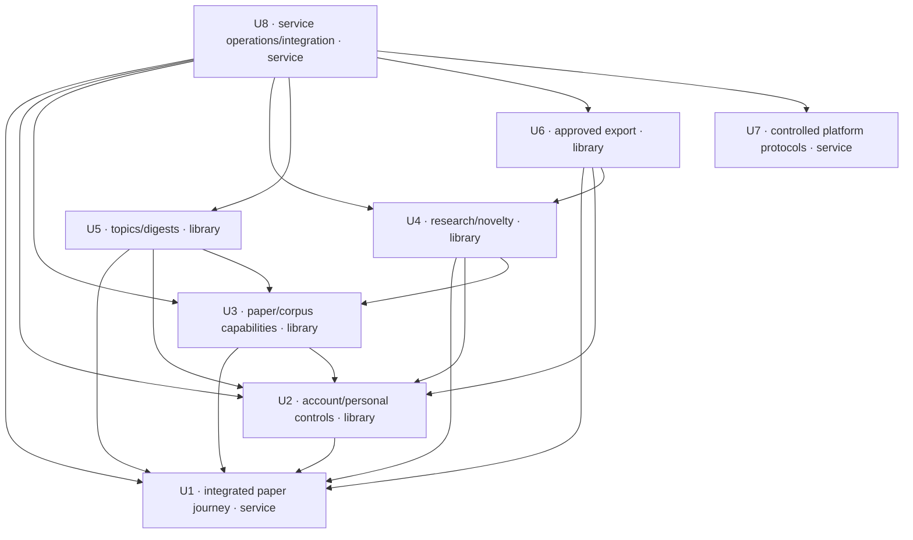

# DocSuri v2 — Unit dependency DAG

Date: 2026-10-11 (Asia/Seoul). This topology follows the approved and confirmed
[unit plan](units-generation-questions.md). It describes required interfaces and
implementation inputs. Delivery Planning chooses economic sequencing, work
batches and schedule; this document selects no critical path or recommended
cross-unit build order.

## Machine-readable unit dependencies

An edge **A → B means A depends on B**. Every name is the construction directory
from [the unit catalogue](unit-of-work.md). The YAML is authoritative for the
unit graph; the diagram and table below mirror it. Direct dependencies include
interfaces consumed directly even when another path also reaches that producer;
this graph is not required to be a transitive reduction.

```yaml
units:
  - name: u1-integrated-paper-journey
    kind: service
    depends_on: []
  - name: u2-account-personal-controls
    kind: library
    depends_on: [u1-integrated-paper-journey]
  - name: u3-paper-corpus-capabilities
    kind: library
    depends_on: [u1-integrated-paper-journey, u2-account-personal-controls]
  - name: u4-research-novelty
    kind: library
    depends_on: [u1-integrated-paper-journey, u2-account-personal-controls, u3-paper-corpus-capabilities]
  - name: u5-topics-digests
    kind: library
    depends_on: [u1-integrated-paper-journey, u2-account-personal-controls, u3-paper-corpus-capabilities]
  - name: u6-approved-export
    kind: library
    depends_on: [u1-integrated-paper-journey, u2-account-personal-controls, u4-research-novelty]
  - name: u7-controlled-platform-protocols
    kind: service
    depends_on: []
  - name: u8-service-operations-integration
    kind: service
    depends_on: [u1-integrated-paper-journey, u2-account-personal-controls, u3-paper-corpus-capabilities, u4-research-novelty, u5-topics-digests, u6-approved-export, u7-controlled-platform-protocols]
```

## Diagram and text fallback



| Unit | Depends on | Direct contract or implementation consumed |
|---|---|---|
| U1 | None | Runnable foundation; no dependency on a future contribution |
| U2 | U1 | Host/presentation interfaces and initial account, personal-library and usage contracts |
| U3 | U1, U2 | Host contracts; completed current-authority, lifecycle, consent, personalization and entitlement interfaces |
| U4 | U1, U2, U3 | Host; private-work authority and lifecycle; eligible content/retrieval and source-change interfaces |
| U5 | U1, U2, U3 | Host; subscription-owner consent/lifecycle; eligible discovery/corpus content-window inputs |
| U6 | U1, U2, U4 | Host; current owner/connection authority; eligible novelty artifact and immutable revision/content identity |
| U7 | None | Independent controlled operator executable and authority |
| U8 | U1, U2, U3, U4, U5, U6, U7 | Complete application contributions, readiness/recovery interfaces and bounded platform evidence |

The text table is the diagram fallback. There are eight nodes and 19 declared
edges. U1 and U7 are independent roots. None is given a false dependency solely
to make a scheduler choose it first.

## Integration points and ownership

| Boundary | Producer responsibility | Consumer responsibility | Contract Design and verification obligations |
|---|---|---|---|
| U1 → contribution consumers U2–U6 | Runnable initial application, contribution/compatibility interfaces, baseline business identities and recoverable anchor behavior | Use the host interfaces and existing component owners; supply a real integration assembly with routes/views/adapters | Contribution identity/version, registration failure behavior, current principal, privacy-safe observation, browser/server error/status consistency; no core import of future module implementations |
| U2 → U3–U6 | Completed AccountAccess lifecycle/consent and UsageEntitlements current-decision/acknowledgement interfaces; permitted Personalization contracts where needed | Recheck authority at reads, assets, jobs and effects; act on owned data and acknowledge participation | Participant manifest completeness, request/ack identity, late-work rejection, consent/usage uncertainty and compatibility; delivery mechanism remains open |
| U3 → U4/U5 | Current eligible paper/version/content and retrieval results, provenance, source-change and availability contracts | Keep source identity, restrictions and partial coverage; do not treat an index snapshot as authority | Projection write/rebuild ownership, publication/withdrawal evidence, source compatibility and degraded results; close upstream R-01 through explicit contract and tests |
| U4 → U6 | Authorized novelty artifact, immutable revision/content identity and eligibility | Bind preview/approval/effect to the exact eligible owner/source/destination; recheck before effect | Close upstream R-02: changed content or destination invalidates approval; ambiguous remote outcome remains unknown until reconciled |
| U1–U6 → U8 | Component-owned capability/readiness, lifecycle participation and authorized recovery interfaces; complete view contributions | Assemble and verify full service behavior without becoming another data writer | Complete registration manifest, cross-feature authorization/deletion/restore, shared UX, workload envelope and safe evidence correlation |
| U7 → U8 | Bounded platform evidence and controlled operation/receipt interface | Validate evidence freshness/scope; invoke an effect only with its separate applicable authority | App roles never substitute for operator authority; platform receipts never substitute for application journey readiness |

The arrows in this integration table indicate **producer to consumer** to name
the supplied interface; the DAG arrows above indicate **consumer depends on
producer**. These are the same relationships expressed from opposite viewpoints.

For shared data, exchange identities, domain results and acknowledged facts
through the authoritative component contract. No unit acquires direct write
access to another owner's records because the runtime or physical store is
shared. Events and execution adapters preserve domain-owned outcome authority.
Transport, endpoint schemas, event delivery and physical storage are decided
later, with compatible test doubles bound to the same contracts.

## Avoiding apparent reverse dependencies

The domain component graph and construction DAG answer different questions.
WebWorkspace and ServiceOperations ultimately consume many components, but
their minimum useful implementations exist in U1. Later units supply additions
through the stable host interfaces; U8 owns complete composition. No required
U1 → U8 or U1 → feature-library import is introduced by this plan.

U2 completes the account/lifecycle/consent/entitlement contracts before consumers
rely on their full semantics. Those consumers implement participant behavior
for their own records. U2 knows the participant interface, not their concrete
implementations. U8 verifies the final participant set. Missing acknowledgements
remain incomplete; this does not defer authority checks until final integration.

Similarly, U2's saved references can implement the current-corpus disposition
contract established with the initial domain interfaces, while U3 completes the
corpus writer/rebuild implementation. U3's real integration checks exercise the
existing Library implementation. This is contract completion and integration,
not a new runtime Library-to-unit backedge or a second saved-data owner.

Each contribution's integration assembly consumes its prerequisites and the
contribution under test. U8's final manifest consumes all completed contributions.
Neither assembly is imported by the underlying core to satisfy its own business
logic. Contract changes must update impacted consumers explicitly. A discovered
genuine reverse prerequisite must be surfaced and the DAG revised through the
normal review path, never concealed by an arbitrary merge order.

## Independent work possibilities

- U7 is independent of U1–U6 in this construction graph. Its reference and native
  platform constraints may be investigated without waiting for application code.
- Once their prerequisites exist, U4 and U5 have no dependency path between
  them. U5 and U6 likewise have no dependency path between them; U6 does depend
  on U4.
- This is dependency independence, not a promise that shared configuration,
  presentation or test files can be edited concurrently without coordination.
  The approved execution remains serial with one human maintainer. Any later
  parallel allocation needs explicit file responsibility and integration checks.

Do not interpret these sets or unit numbering as a preferred economic sequence.
Delivery Planning balances risk, evidence, value and capacity while respecting
this graph. The complete paper journey remains the first product demonstration,
and risk-first discovery prerequisites still apply before affected choices.

## Evidence constraints outside the code DAG

Inventory/continuity, source/privacy obligations, sustainable free/local capacity,
baseline targets and recovery evidence are tracked in
[the approved backlog](../../ideation/scope-definition/intent-backlog.md) and
[unit prerequisites](unit-of-work.md#evidence-prerequisites-and-downstream-work).
They are completion or decision preconditions, not fictitious independently
deployable units. A root with `depends_on: []` is not exempt from them. In
particular U1 cannot prove a journey using content or model processing that has
not been shown permissible, or claim public-service fit from local-only mocks.

The current approved plan does not add a walking-skeleton ceremony. U1 still
has a real complete-journey acceptance obligation. Delivery Planning defines
the demo and verification command under the active workflow, without allowing
a design-only or mocked first product demonstration.

## Verification scope

Check every declared directory/kind against the catalogue and confirmed plan;
ensure all references exist, nodes are unique and no cycle/self-edge occurs;
compare the diagram and text table to YAML; validate Mermaid syntax. Check
requirement mappings against [the story map](unit-of-work-story-map.md) and
[traceability](traceability.json). These document checks do not prove runtime
independence, source compatibility, implementation parity or free/local capacity.
