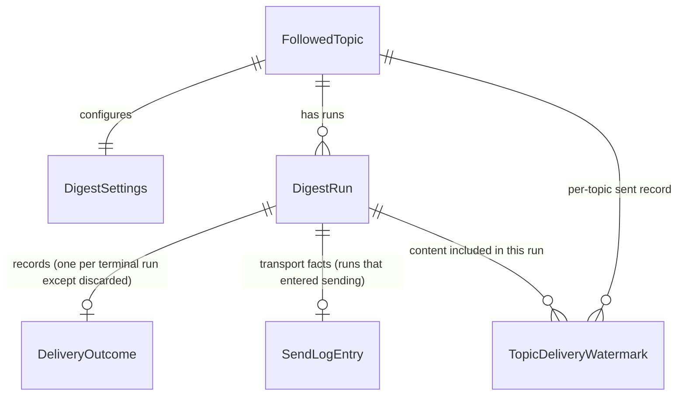

# Functional Specification — U5 topics & digests

Date: 2026-10-17 (Asia/Seoul)
Unit: u5-topics-digests. This file is the **source of truth for workflows and state machines**; `entities.md` owns data shape and `rules.md` owns decision logic. Sources: confirmed [functional-design-questions.md](functional-design-questions.md), [requirements FR1](../../../inception/requirements-analysis/requirements.md), approved [wireframes](../../../ideation/rough-mockups/wireframes.md).

## Workflow 1 — Follow a topic

1. Topics view -> "follow new topic" action (below the followed list, per the approved wireframe) -> the topic is entered/confirmed.
2. System normalizes the topic key and applies **BR1.1**: an existing active subscription is rejected with a duplicate notice; an existing unsubscribed subscription for the same topic is REACTIVATED (same identity, watermark and history preserved — no repeat delivery; settings reset to defaults with a revision bump); otherwise a new FollowedTopic is created active with initial settings derived from the defaults (daily, 08:00 local, 7-day window) and acknowledged.
3. System shows the topic row in the followed list with a last-digest indicator ("none yet" until the first run).
4. Error paths: unauthenticated -> sign-in flow; denied -> plain refusal (BR5.1); duplicate -> notice names the existing subscription.

## Workflow 2 — Configure digest settings

1. Topic row -> "digest settings" -> the settings form opens bound to that topic (cadence, delivery time, content window; language/level shown as inherited).
2. Account edits fields -> inline validation on blur (cadence in {daily, weekly}, time valid, window in {7, 30}) -> save.
3. System acknowledges the saved settings and increments the settings revision (**BR1.3**): in-flight prepared runs are discarded and re-prepared; a sending run finishes its attempt only.
4. Error paths: invalid field -> specific inline message, entered values kept; save failure -> acknowledged-as-not-saved state, retry safe (idempotent by revision).

## Workflow 3 — Scheduled digest preparation and delivery

1. Scheduler evaluates each active topic's cadence + delivery time in the account's timezone (**BR1.2**).
2. Preparation: select eligible corpus content in [windowStart, windowEnd] inclusive (**BR2.1**), excluding the topic's delivery watermark (**BR2.2**); a DigestRun is created in `prepared` with the settings revision stamped; an empty selection records the run `empty` explicitly (**BR2.3**).
3. Send attempt: run moves `prepared -> sending` only if no other run for the topic is sending (**BR3.1**), the topic is active and consented, and the topic has **no unreconciled unknown outcome** (the BR3.2 pause enforced as a guard); the digest is delivered as an email through the email delivery capability the built application owns (local sink in tests; the maintainer-configured free path in real operation, **BR1.4**); the send attempt writes its SendLogEntry (transport receipt, timestamps, pathKind); outcome recorded as sent, failed, or unknown.
4. Reconciliation: an unknown outcome pauses the topic's sends until reconciled (**BR3.2**). The scheduled reconciliation check reads the run's SendLogEntry plus recipient/delivery-path evidence and resolves the outcome; where evidence stays unavailable, the owner explicitly resolves it from the topic's run row — a run-scoped resolve action offering "delivered" (watermark updated) or "not delivered" (failed), with the assumption named; the same action is exposed through the topics API (`POST topics/{id}/runs/{runId}/resolve`). A reconciled `sent` updates the topic watermark exactly as a direct send would. Failed outcomes are never re-sent automatically — the next scheduled window prepares a fresh run (**BR3.3**).
5. Delivered content is recorded in the topic's watermark so later windows do not repeat it.
6. Error paths: no eligible content -> empty digest recorded explicitly (**BR2.3**); selection/infrastructure failure -> run `failed` with a plain-language reason; late firing -> window still delivered.

## Workflow 4 — Unsubscribe / consent / lifecycle

1. Topic row -> "unsubscribe" -> confirmation dialog naming the topic -> confirm.
2. System sets status unsubscribed immediately (**BR4.1**): prepared-but-unsending runs discarded; no send starts after the record; history preserved.
3. Consent withdrawal covering digests (recorded by the account layer) stops delivery the same way (**BR4.2**) until consent is restored.
4. Account withdrawal lifecycle: the digest module registers itself as a lifecycle participant during application assembly (participant id and disposition endpoint under the built coordinator contract); the coordinator requests participant disposition; the digest participant reports its own disposition and marks the account's topics unsubscribed where policy requires, writing only its own tables (**BR4.3**).
5. Error paths: confirmation declined -> nothing changes; coordinator timeout -> participant remains visibly outstanding (never assumed complete).

## State machine — DigestRun

| Current state | Event | Guard | Next state | Actions |
|---|---|---|---|---|
| (none) | schedule reached, settings current | topic active & consented (BR4.1/4.2); settings revision unchanged (BR1.3); no earlier non-terminal window run for the topic (BR2.4 chronological ordering) | prepared | select content (BR2.1/2.2), stamp settings revision, write SendLogEntry skeleton at send time |
| prepared | selection found no eligible content | — | empty | record empty digest explicitly (BR2.3); no send required |
| prepared | send starts | no other sending run for topic (BR3.1); topic active & consented; **no unreconciled unknown outcome for the topic (BR3.2 pause enforced as a guard)** | sending | deliver via configured path; append SendLogEntry with transport receipt |
| prepared | settings revised (BR1.3) | — | discarded | re-prepared on next evaluation with the new revision |
| prepared | unsubscribe or consent stop recorded | — | discarded | queued work dropped (BR4.1/4.2) |
| sending | outcome observed success | — | sent | record outcome; update topic watermark |
| sending | outcome observed failure | — | failed | record outcome + plain reason; no automatic re-send (BR3.3) |
| sending | outcome unobserved | — | unknown | record unknown + SendLogEntry facts; pause the topic's sends (BR3.2) |
| sending | unsubscribe recorded mid-flight | in-flight attempt already started (BR4.1) | sent/failed/unknown (attempt completes) | outcome recorded normally; topic status prevents any further run from starting |
| unknown | reconciliation check finds send-log/recipient evidence | evidence resolves the state | sent or failed | record reconciled state + time; on sent, update the topic watermark exactly as a direct send would |
| unknown | owner explicitly resolves (evidence unavailable) | owner chooses with the assumption named | "resolved as delivered" → sent | watermark updated; the send is assumed to have landed |
| unknown | owner explicitly resolves (evidence unavailable) | owner chooses with the assumption named | "resolved as not delivered" → failed | recorded failed; the window's content is re-delivered by a later window only while inside its bounds (BR2.1/BR3.3) |
| sending | restart/recovery sweep: no outcome recorded, no live process holds the attempt | run in `sending` with no recorded outcome and no live holder — with or without a SendLogEntry (BR3.4) | unknown | SendLogEntry facts preserved when present; their absence recorded as the evidence gap; BR3.2 reconciliation applies |
| failed | next scheduled window | topic active & consented | (new run) prepared | fresh window, watermark applied (BR3.3) |

Terminal states: `sent`, `failed`, `empty`, `discarded` — each run ends in exactly one of them and its row is kept as history; a discarded or failed run is never reused in place. Re-preparation always creates a **new run row**: for a revision-discard (BR1.3) it is a new row for the SAME window (allowed by BR2.4, which excludes discarded runs from window uniqueness); for a failed run it is the next scheduled window (BR3.3). No discarded → prepared transition exists. `failed` runs are complete for their window (the next window is a new run). No state is skipped; every transition is an explicit event. The reconciliation pause is a **guard on entering `sending`**, so a topic with an unreconciled unknown outcome cannot start a new send (BR3.2).

## Derived views

### Entity-relationship diagram (derived from entities.md)

<!-- Text fallback: one FollowedTopic has one DigestSettings, many DigestRuns and many watermark entries; each non-discarded terminal DigestRun has exactly one DeliveryOutcome, each run that entered sending has exactly one SendLogEntry, and each sent run contributed the watermark entries referencing it; Account and corpus content are external references by stable ID only, not owned entities. -->

### Rules summary (derived from rules.md)

Preparation is bounded by eligibility and the watermark; delivery is single-flight per topic with explicit reconciliation of unknown outcomes; unsubscribe and consent are immediate delivery gates; lifecycle participation is self-reporting; every path is owner-isolated. See rules.md for BR1.1–BR5.1.
