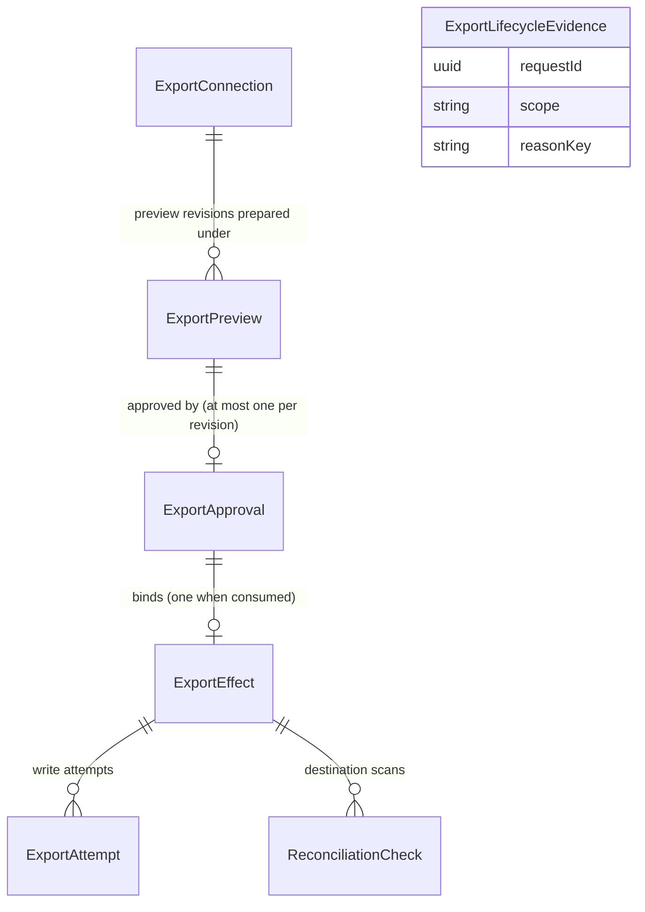

# Functional Specification — U6 approved export

Date: 2026-10-19 (Asia/Seoul)
Unit: u6-approved-export. This file is the **source of truth for workflows and state machines**; `entities.md` owns data shape and `rules.md` owns decision logic. Sources: confirmed [functional-design-questions.md](functional-design-questions.md), [requirements FR2](../../../inception/requirements-analysis/requirements.md), [unit definition](../../../inception/units-generation/unit-of-work.md), approved [wireframes W3/W4](../../../ideation/rough-mockups/wireframes.md) and [user flow 2](../../../ideation/rough-mockups/user-flow.md), the earlier record's mockup M10, interaction spec C11 and export contract C09 (`../../../../261010-docsuri-v2-rebuild/inception/`), and Notion's developer documentation as checked on 2026-10-19.

## Boundaries and integration points

- **ResearchWorkspace (U4)**, read only, through U4's export read. It returns a ready novelty-analysis result at its exact identity, revision and content hash, with its eligibility re-checked under the owner's current authority. U6 never reads U4's records directly and never writes them. The novelty result screen gains one entry action that opens U6's flow with the result's reference (Workflow 3).
- **AccountAccess (U2)**:
  - current owner authority (session, account active) for every operation and for the pre-write check;
  - lifecycle tickets for withdraw, reactivate and erase;
  - nothing in AccountAccess is written by U6 (the cross-unit amendment A8 is AccountAccess's own change).
- **Notion** (through U6's provider adapter only; the latest API version, 2026-03-11, is pinned):
  - identify a token's integration and workspace;
  - list pages shared with the connection;
  - read a page and its children;
  - create one page with its content under a parent page.

  Synthetic profiles use a local fake Notion with the same operations (BR8.1).
- **Application shell**:
  - an `export` capability in the catalog;
  - an "내보내기" navigation entry, owner-bound like the topics entry;
  - the export worker joins the shared control loop.
- **Frozen contract C09.** Operations: configure, read, disconnect, listDestinations, preparePreview, approve, execute, readEffect, cancel, plus the internal reconcile. They are served on C09's `/api/v2/c09/` surface with the frozen shapes. Each operation returns only error codes from its own frozen list. The additive amendments are listed at the end of this file.

## Workflow 1 — Connect Notion

1. Export view → connection panel (not connected) → the owner pastes a Notion internal-integration token into the write-only field and submits.
2. The system checks the token (**BR1.2**):
   - The shape check is minimal: not blank, printable, not absurdly long.
   - It asks Notion which integration the token belongs to.
   - On acceptance it stores the token protected, with the workspace name and the integration identity, sets the connection connected and advances the revision.
   - The token field is cleared in every case (**BR1.1**).
3. The panel shows the connected workspace's name, never the token, and any limitation, for example "synthetic provider only".
4. Error paths:
   - shape → field message, nothing sent;
   - Notion refuses → "토큰을 확인할 수 없습니다", nothing stored;
   - Notion unreachable → "Notion에 연결할 수 없습니다. 잠시 후 다시 시도하세요", nothing stored;
   - credential protection unavailable or policy unresolved → policy notice (**BR8.3**);
   - connection changed meanwhile → "다른 곳에서 연결이 바뀌었습니다", reload (**BR1.3**).

## Workflow 2 — Replace the token or disconnect

1. Connection panel → "토큰 교체" (replace) or "연결 해제" (disconnect). Both act on the owner's single connection (**BR1.3**).
2. Replace follows Workflow 1 under the expected revision.
3. Disconnect opens a confirmation dialog naming its effects:
   - approvals not yet started become invalid;
   - pages already exported stay in Notion;
   - unclear exports can then only be settled by the owner.

   On confirm the token is deleted, the connection becomes disconnected and the revision advances (**BR1.4**).
4. In both cases, in the same step, approved (unconsumed) approvals and accepted effects bound to the older revision become invalidated (connection-changed) (**BR1.4**).
   - An executing export finishes its outstanding request and is recorded.
   - An unknown export stays unknown. It is reconciled against the integration that wrote it when the current connection can read its destination. Otherwise it waits for owner settlement. The replace dialog says so in one line.
5. Notion refusing the token during any later use sets the connection revoked, with the same consequences: "Notion에서 연결이 해제되었습니다. 다시 연결하세요" (**BR1.4**).
6. A protected token that cannot be opened sets the connection unavailable. The revision stays the same, nothing is invalidated, and exports wait (**BR1.6**).

## Workflow 3 — Export a novelty result (approve and export)

1. Novelty result screen → "Notion으로 내보내기". The stepped export flow opens for that exact result. Opening, reading and closing it never export (**BR2.2**).
2. **Connection step:** if not connected, the owner connects first (Workflow 1) and returns.
3. **Destination step** (**BR1.5**):
   - The pages shared with the connection are listed with a refresh action. Each shows its title, or a placeholder when untitled, plus location context to tell same-titled pages apart.
   - A partial, unavailable or empty listing says so. An empty one explains how to share a page with the integration.
   - The chosen page is read directly to confirm the connection can read it. An unreadable page is shown as unusable with the reason.
   - Creation permission is shown only as far as Notion has shown it: "확인 전" (unknown) until the connection's first write, then confirmed or refused.
   - In the real composition only the activation destination is usable (**BR8.2**).
   - The last used destination is preselected only if listed and readable.
4. **Preview step** (**BR2.1**, **BR2.3**, **BR2.4**, **BR2.5**):
   - The system reads the result through U4's export read. The current render policy turns it into a canonical block tree: the derived title, the content, and the marker as the last top-level block. The system checks the tree fits one creation request.
   - It freezes a new preview revision of the export pair, with its tree, the tree's plain-text projection, marker and binding hash. The hash covers the tree itself.
   - The owner sees the result's title and identity and the destination above the read-only rendered page, including the marker line. Earlier exports of the same pair are listed: succeeded ones with date and link, and ones that may exist in Notion.
   - Preview refusals: absent → not found; changed source → "결과가 바뀌었습니다"; not exportable → "이 결과는 내보낼 수 없습니다" with the reason; U4 unreachable → "잠시 후 다시 시도하세요"; too large → plain reason; policy → policy notice.
5. **Action:** "승인하고 내보내기". One press makes two calls carrying the same request key. Keys are scoped per owner and per operation, so each call keeps its own replay record (**BR3.2**).
   - **Approve call** (**BR3.1**, **BR3.2**):
     - A replay returns the original first.
     - Then it checks: an explicit approval of the current exact preview revision; the binding re-derived from current facts (source re-read, destination readable and allowed, connection revision, owner session); and no export of the pair succeeded since the preview was prepared.
     - A mismatch refuses with the call's own codes (CONFLICT, NOT_FOUND, SOURCE_INELIGIBLE, FORBIDDEN, DEPENDENCY_UNAVAILABLE, POLICY_UNRESOLVED) and records nothing. A changed binding leads to "내용이 바뀌었습니다. 미리보기를 다시 확인하세요" and a fresh preview.
   - **Execute call** (**BR3.2**, **BR5.1**, **BR5.2**):
     - A replay, recognised by its key or by the approval already having an effect, returns the original effect.
     - Then it checks: no other export of the owner in flight; no unknown export of the same export pair; the pace limit; and again no newer succeeded export of the pair.
     - It then binds the one effect in state accepted, which consumes the approval.
     - A refusal (CAPACITY_EXHAUSTED, OUTCOME_UNKNOWN, CONFLICT) leaves the approval approved and unconsumed, with a plain notice.
   - **Same preview, two tabs or repeated press:** the same approval and effect come back (**BR3.2**).
   - **Interrupted press:** an approval without an effect shows in the export history with "이어서 내보내기" and "취소" (**BR3.6**, **BR3.7**).
6. **Outcome step:** the flow follows the effect by polling its read (**BR2.2**):
   - "내보내는 중" while accepted or executing; while accepted, a "취소" control (**BR3.6**);
   - "내보냈습니다" with the page link when succeeded (**BR4.7**);
   - "실패했습니다" with the plain reason when failed;
   - "변경되어 내보내지 않았습니다" with the reason and "미리보기 다시 만들기" when invalidated (**BR3.3**);
   - "취소했습니다" when cancelled;
   - "확인 중" with the next check time when unknown. The action stays disabled, and settlement is offered from the history once checks cannot decide (**BR4.4**, **BR4.5**).

   Each change is announced once through a polite live region. Closing the flow after the press does not stop the export; its outcome stays in the history. While the export has not started, the outcome step says that signing out before it starts stops it, because exports run only under the session that approved them (**BR3.3**).
7. Signed out, or another owner's reference → treated as not found (**BR7.1**).

## Workflow 4 — Execute an accepted export (export worker)

1. Each worker pass picks two kinds of effect (**BR4.6**):
   - the oldest accepted effect of an owner with nothing executing;
   - any executing effect whose rate-limit wait has elapsed and that no live worker holds.
2. **Pre-write check** (**BR3.3**). It reads, without trusting any listing:
   - the source, re-read exactly as bound;
   - the bound destination page, read directly;
   - the connection revision;
   - the approving session and the account's active state, as AccountAccess reports them now;
   - in the real composition, the destination allowance.

   Outcomes:
   - **Definite change:** an accepted effect becomes invalidated, and a resumed one becomes failed, with the reason (source-changed, destination-changed, connection-changed, authority-revoked). Nothing is written.
   - **Could not check** (U4 or Notion unreachable, credential unavailable, policy unresolved): nothing is written. The effect waits (`waitingSince`) and is checked again on later passes. Past the wait bound it becomes failed (dependency-unavailable or policy-unresolved).
3. One atomic step moves accepted → executing and records the ExportAttempt (start time, writer identity, connection revision). It is a compare-and-set that fails if the effect changed meanwhile, and it completes before the request leaves. An executing effect therefore always has its attempt (**BR3.3**, **BR4.6**).
4. One page-creation request is sent: the frozen rendered content, ending with the marker (**BR4.1**), under the bound parent page. Its timeout is longer than Notion's server deadline.
5. The response is classified (**BR4.2**):
   - **Created:** either the page is returned, or a "saved but too busy to respond" answer names a page that passes all three read-back checks: it is under the bound destination, it was created by this attempt's writer, and its last top-level block carries the effect's marker. The effect becomes succeeded. The page id and link are recorded (**BR4.7**), `lastDestinationId` updates, and the connection's creation capability becomes confirmed.
   - **Refused:** failed with its reason. An invalid token also revokes the connection (**BR1.4**). A permission refusal sets the connection's creation capability to refused.
   - **Rate-limited:** only Notion's two documented retry answers count: HTTP 429 `rate_limited` not marked as blocked, and HTTP 529 `service_overload`. The effect stays executing with `nextAttemptAt` from the provider's stated wait, and resumes per step 1. When the budget is spent it becomes failed (rate-limit-budget-spent).
   - **Uncertain:** everything else becomes unknown (Workflow 5). That includes other server errors, gateway timeouts, conflicts, client timeouts and busy answers without a fully verified page. The rule is conservative: any doubt means unknown, never a retry.
6. The recovery sweep turns an executing effect, whose latest attempt is outstanding and has no live holder past the orphan threshold, into unknown (**BR4.6**).

## Workflow 5 — Reconcile an unknown export (export worker)

1. After the settling wait defined in **BR4.4**, the worker scans the destination through the current connection, if it can read it:
   - every child page, including pages inside toggles, columns and similar containers;
   - created by the writer identity recorded on the effect's attempts;
   - from the first attempt's start minute less the clock margin.

   It reads each candidate's content for the marker.
2. Each scan is recorded as a ReconciliationCheck with its evidence hash (**BR4.4**):
   - **marker found:** succeeded with that page and link. Any further marked pages are kept as possible duplicates and shown in the history;
   - **complete, none found:** not-found. A second complete scan at least one settling interval later that also finds none makes the effect failed (not-found-after-checks), shown as "Notion에서 찾지 못했습니다";
   - **partial:** listing-incomplete; the effect stays unknown;
   - **cannot read:** listing-unavailable; the effect stays unknown.

   Scans repeat with backoff (`nextCheckAt`) while the scan budget lasts. If the budget is spent with the effect still unknown, whatever the last result, scanning stops (`scanningStoppedAt`) and owner settlement is offered (**BR4.4**, **BR4.5**). No write ever happens for an unknown effect (**BR4.3**).

## Workflow 6 — Owner settles an unknown export

1. Settlement is offered only after the settling wait, in one of three cases (**BR4.5**):
   - the latest scan was incomplete or unavailable;
   - the connection can no longer read the destination;
   - scanning has stopped because the budget is spent.

   Until then the history row shows "확인 중" with the next check time.
2. Export history → the row → "직접 확인" opens a dialog. It names the destination page and the exported title, and asks the owner to look in Notion.
   - "있습니다" records succeeded, settled by the owner, with an optional page link (only a Notion page link is accepted).
   - "없습니다" records failed, settled by the owner. The dialog states the assumption: if the page does exist, a new export makes a second copy.
3. A settled effect cannot be settled again. After "없습니다", a fresh export of the same result lists the earlier one as "Notion에 있을 수 있음" (**BR2.5**).

## Workflow 7 — Cancel or continue before the write

1. **Cancel** (**BR3.6**): from the outcome step while accepted, or from the history row of an approved-but-not-started approval or an accepted effect.
   - An unconsumed approval becomes cancelled. Its compare-and-set expects its preview revision and state approved.
   - An accepted effect becomes cancelled (owner-cancelled), and its approval stays consumed. Its compare-and-set expects the effect revision.
   - An executing effect answers "이미 내보내는 중입니다". An unknown effect points to settlement.
2. **Continue** (**BR3.7**): the history row's "이어서 내보내기" on an approved, unconsumed approval. It is offered only while the approving session is current; otherwise the row offers a fresh preview.
   - If the session is no longer current when the owner continues, the approval becomes invalidated (authority-revoked).
   - Otherwise the binding is re-derived exactly as the approve call does. A definite change invalidates the approval with its reason and offers a fresh preview.
   - If the binding is unchanged, the execute call runs exactly as in Workflow 3 step 5.

## Workflow 8 — Account lifecycle

1. For each ticket, the export participant acts at once on this module's records for that account. It writes evidence once per request and scope, and never defers (**BR6.5**).
2. **Withdraw** (live_records, pending_work; **BR6.1**):
   - In one step it invalidates approved, unconsumed approvals and accepted effects (account-withdrawn), deletes the token and sets the connection disconnected.
   - It records counts: approvals invalidated, effects invalidated, exports still in flight, exports unknown.
   - Executing exports finish on their own. Unknown ones wait for owner settlement after any reactivation.
3. **Reactivate** (**BR6.3**): records evidence and changes nothing; the owner connects again later.
4. **Erase** (**BR6.2**):
   - It applies the withdraw step and records count-only evidence.
   - It then deletes the account's connection, previews, approvals, effects, attempts and checks.
   - A request still outstanding may still create a page. It is counted as a possible external copy.
5. **External copies** (external_copies scope; **BR6.4**):
   - Nothing in Notion is deleted, archived or edited.
   - The evidence records the exported and possibly-created pages under reason key external-copies-retained-by-owner, which AccountAccess reports as retained by policy (A8).

## Workflow 9 — Housekeeping and records

1. On each worker pass, an approved but unconsumed approval is invalidated in two cases (**BR3.4**):
   - its approving session is no longer current (authority-revoked);
   - while the session is current, U4 no longer exports its source (source-changed).
2. On each worker pass the module also trims rendered copies (**BR2.6**):
   - A preview revision that can no longer be approved, and whose bound effect, if any, has settled, loses its rendered text. Its summary stays: identifiers, source and destination titles, hashes, timestamps, outcome and link.
   - An unapproved preview revision is removed entirely after the retention period.

   The history and the earlier-export notice keep working from these summaries.
3. Attempts, scans, lifecycle evidence, logs and errors are recorded with identifiers, states, timestamps and fixed reason categories only. They never contain the token, page content, provider response text or personal data (**BR7.2**).

## State machine — ExportConnection

| Current state | Event | Guard | Next state | Actions |
|---|---|---|---|---|
| (none) | configure | shape passes; Notion identifies the token; protection available (BR1.2) | connected | store protected token, workspace name and integration identity; revision 1 |
| connected | replace | expected revision matches (BR1.3); Notion identifies the token | connected | replace token and identity; revision +1; end older pending work (BR1.4) |
| connected | disconnect | owner confirms | disconnected | delete token; revision +1; end older pending work (BR1.4) |
| connected | Notion refuses the token in any use | — | revoked | delete token; revision +1; end older pending work (BR1.4) |
| connected | protected token cannot be opened | — | unavailable | nothing invalidated; exports wait (BR1.6) |
| unavailable | protected token opens again | — | connected | none (BR1.6) |
| unavailable | disconnect | owner confirms | disconnected | delete token; revision +1 (BR1.4) |
| disconnected or revoked | configure | expected revision matches; Notion identifies the token | connected | store protected token; revision +1 |
| connected, unavailable | account withdraw | lifecycle ticket | disconnected | per BR6.1 |
| any | account erase | lifecycle ticket | (record removed) | per BR6.2 |

## State machine — ExportApproval

| Current state | Event | Guard | Next state | Actions |
|---|---|---|---|---|
| (none) | approve call | not a replay; explicit approval of the current exact preview revision; binding re-derived and unchanged; no newer succeeded export of the pair (BR3.1, BR3.2) | approved | record approval with the approval-validity policy, expiresAt empty (BR3.5) |
| approved | execute call (press, or continue BR3.7) | approving session current (continue); BR5.1 and BR5.2 pass; no newer succeeded export of the pair | consumed | bind the one effect in accepted (BR3.2) |
| approved | owner cancels | expected preview revision, state approved (BR3.6) | cancelled | none |
| approved | definite change (connection change BR1.4, withdrawal BR6.1, continue with stale session or changed binding BR3.7) | — | invalidated | record reason (BR3.4) |
| approved | housekeeping pass | approving session no longer current, or (session current) source no longer exported by U4 (BR3.4) | invalidated | reason authority-revoked or source-changed; rendered copy trimmed (BR2.6) |

Terminal states: consumed, cancelled, invalidated. The frozen expired state is never entered (BR3.5). A consumed approval is never changed; its effect carries the outcome.

## State machine — ExportEffect

| Current state | Event | Guard | Next state | Actions |
|---|---|---|---|---|
| (none) | approval consumed | — | accepted | durable record before any write (BR3.2) |
| accepted | worker pass | pre-write check passes (BR3.3); compare-and-set succeeds | executing | in the same atomic step, record the ExportAttempt with start, writer identity and connection revision (BR3.3, BR4.6) |
| accepted | worker pass | definite change (BR3.3), connection change (BR1.4) or withdrawal (BR6.1) | invalidated | reason source-changed, destination-changed, connection-changed, authority-revoked or account-withdrawn |
| accepted | worker pass | could not check, wait bound not passed (BR3.3) | accepted | set or keep waitingSince |
| accepted | worker pass | could not check, wait bound passed (BR3.3) | failed | reason dependency-unavailable or policy-unresolved |
| accepted | owner cancels | expected effect revision (BR3.6) | cancelled | reason owner-cancelled; approval stays consumed |
| executing | page returned, or busy answer with a verified read-back page | — | succeeded | record page id and link (BR4.2, BR4.7) |
| executing | definite refusal | — | failed | reason per class; an invalid token revokes the connection (BR4.2, BR1.4) |
| executing | rate-limited or overloaded | budget remains | executing | set nextAttemptAt (BR4.2) |
| executing | rate-limit wait elapsed, no live holder | pre-write check passes; budget remains (BR4.6, BR3.3) | executing | next ExportAttempt |
| executing | rate-limit wait elapsed, no live holder | budget spent (BR4.6) | failed | reason rate-limit-budget-spent |
| executing | rate-limit wait elapsed, no live holder | definite change (BR3.3) | failed | reason per change; nothing was written by any attempt |
| executing | rate-limit wait elapsed, no live holder | could not check (BR3.3) | executing | retried on a later pass; failed (dependency-unavailable) once the budget window passes |
| executing | uncertain response, including a busy answer without a verifiable page | — | unknown | settling wait starts (BR4.2) |
| executing | orphan sweep | latest attempt outstanding, no live holder past the threshold (BR4.6) | unknown | evidence gap recorded |
| unknown | scan finds the marker | — | succeeded | page and link from the evidence; other marked pages kept as possible duplicates (BR4.4) |
| unknown | second complete scan finds no marker | an earlier complete scan at least one settling interval before also found none (BR4.4) | failed | reason not-found-after-checks |
| unknown | scan incomplete or unavailable | scan budget remains | unknown | set nextCheckAt (BR4.4) |
| unknown | scan budget spent | whatever the last result (BR4.4) | unknown | record scanningStoppedAt; owner settlement offered (BR4.5) |
| unknown | owner settles | settling wait passed; checks cannot decide, the connection cannot read the destination, or scanning has stopped (BR4.5) | succeeded or failed | settledBy owner; assumption recorded |

Terminal states: succeeded, failed, cancelled, invalidated.

- Unknown never moves back to executing (BR4.3).
- U6 does not use C09's optional failed → accepted retry. Every new attempt starts from a fresh preview revision and approval, so each approval has exactly one outcome.
- Every transition above is one C09 permits.

## Contract amendments and dependencies

| # | Where | Gap | Amendment |
|---|---|---|---|
| A1 | ExportDestination | The listing lacks the identifier the provider messages use and the title the owner chooses by. | `destinationId` and `title` are required on the response records only (ExportDestinations items, ExportPreview.destination), with an optional location `context`. In the prepare request they are optional: the server derives `destinationId` from the parent page and never trusts a client-sent title. |
| A2 | C09 operations | No browser operation lists the owner's exports. | Add a paged history list keyed by approval, newest first. Each entry carries the approval state, its invalidationReason and timestamps, source and destination titles, approvalId, previewRevision and bindingHash (for continue and cancel), and whether it can be continued (the approving session is current). When an effect is bound it also carries the effect's state, revision, link, outcomeReason, settledBy, possible duplicate pages, nextCheckAt and whether settlement is offered. |
| A3 | C09 operations | Owner settlement of an unknown export has no browser operation; `reconcileExportEffect` is internal. | Add a settle operation: effectId, expectedRevision, disposition (`delivered` or `not-delivered`), assumptionAccepted, optional remoteUrl. |
| A4 | ExportEffect | The outcome step polls readEffect but cannot show why an export ended, who settled it, when the next check runs, or whether settlement is offered. | Add optional `outcomeReason`, `settledBy`, `nextCheckAt` and `settlementOffered`. |
| A5 | ExportPreview | The earlier-export list (BR2.5), the export marker and the source title are not carried. | Add optional `earlierExports`, `marker` and `sourceTitle`. |
| A6 | Notion provider messages (execution schema) | The frozen provider profiles cannot carry facts the rules depend on, and C09's "currently permitted destinations" cannot be known in advance from Notion. | **Inspect.** `notion.inspect` adds the workspace name and integration identity, and per destination an optional `readable` and an optional `creationCapability` (unknown, confirmed or refused). The frozen `writable` keeps its plain meaning, "the connection may create pages here as far as is known": false when the destination is unreadable or the connection's creation capability is refused, true otherwise. Notion grants access per shared page but enforces the connection-wide creation permission only when writing, so U6 reads C09's "currently permitted destinations" as shared, readable pages not known to be refused. That reading is recorded here for approval at the U6 checkpoint. **Write.** A rate-limited answer uses the frozen provider outcome `retry_later`, adding its stated wait in seconds, and maps to no committed disposition. A refused answer uses disposition `rejected` with an added refusal class. Every write result adds the provider's request id. **Reconcile.** `effect.reconcile` adds the destination, the first attempt's start and the writer identity. A scan's evidence maps marker-found → committed and every other result → unknown with a scan-complete flag, never definitely-not-committed. **Pure mappings, no schema change:** preview `bindingHash` = provider `previewHash`; `artifactId` → `resultId` with the same revision and hash, and mediaType `application/json`. |
| A7 | ExportConnectionRead, ExportConnection | The browser cannot learn its connectionId after a reload; the workspace name has no field; `destinationScopeIds` is unaddressed. | `connectionId` optional on read, listDestinations and disconnect (absent means the owner's single connection); optional `workspaceName` on ExportConnection; `destinationScopeIds` holds the activation destination in the real composition and is empty otherwise. |
| A9 | ExportApproval | Cancel, approve and execute return approvals whose ending the owner cannot see. | Add optional `invalidationReason`. |
| A8 | AccountAccess (cross-unit, U2) | Its lifecycle projection reports every completed erase scope as erased unless the reason key is the audit-identifier one. That would misreport the owner's Notion pages. Its lifecycle guard also does not know the export participant. | Report reason key `external-copies-retained-by-owner` as retained by policy. Map the export participant in the lifecycle guard. Registration in the shared participant manifest happens at U8. |

Error codes stay within each operation's frozen list. On approve, a malformed approval (missing explicitApproval) is INVALID_ARGUMENT. CAPACITY_EXHAUSTED, OUTCOME_UNKNOWN and APPROVAL_REQUIRED (the approval is no longer approved) are used only on execute.

`OUTCOME_UNKNOWN` and `UNKNOWN_OUTCOME` keep distinct meanings:

- `OUTCOME_UNKNOWN`: the remote export's outcome is unknown.
- `UNKNOWN_OUTCOME`: DocSuri's own commit was lost.

The browser's safe-code list gains `OUTCOME_UNKNOWN`, `INVALID_TOKEN`, `CAPACITY_EXHAUSTED`, `SOURCE_INELIGIBLE`, `APPROVAL_REQUIRED` and `POLICY_UNRESOLVED`, so they are shown in plain Korean rather than as a generic error. ExportCancel's `expectedRevision` carries the preview revision for an unconsumed approval, and the effect revision for a bound effect.

## Notion facts this design relies on

These were checked against Notion's developer documentation and its official SDK on 2026-10-19.

- Page creation has no idempotency key, and repeating a create can create a duplicate. DocSuri therefore records the effect before writing and never re-writes an uncertain one (BR3.2, BR4.3).
- Retries (BR4.2):
  - Notion's request-limits guidance says to retry HTTP 429 (`rate_limited`) and HTTP 529 (`service_overload`) for any request method, except a 429 whose reason is `public_api_request_blocked`, where retrying will not help.
  - The official SDK accordingly retries exactly 429 and 529 for writes. It never retries 409, 502 or 504, and retries 500 and 503 only for reads.
  - Notion says a server error, gateway timeout, client timeout or conflict leaves a write's outcome undefined.
  - A 503 can mean the write was saved, and then names the created page. The server deadline is 60 seconds.
  - U6 retries only the two documented answers and treats everything else as uncertain.
- A page's child listing returns child pages with their creator and creation minute, paged at 100, with no documented delay. Search is neither immediate nor complete, so it only offers destinations, never proves absence. Whether trashed children are listed is undocumented (BR1.5, BR4.4).
- Size limits for one create request are as BR2.4 states.
- Tokens are opaque and validated by asking Notion. Content capabilities are per connection, and creation permission shows only on writing (BR1.2, BR1.5, BR4.2).
- Free workspaces with more than one member have a 1,000-block lifetime limit for integrations (BR4.2, BR8.3).

## Assumptions

- [assumption] Pages created through the connection list the integration as their creator, as Notion's user model implies. The real export (BR8.2) confirms this once in the owner's test workspace before reconciliation relies on it.
- [assumption] The owner moving, renaming or trashing an exported page before reconciliation can make a written page look absent. The "not found after checks" outcome names this, and BR2.5 lists such exports before a repeat.

## Derived views

### Entity-relationship diagram (derived from entities.md)

<!-- Text fallback: one ExportConnection has many ExportPreview revisions; each preview revision has at most one ExportApproval; a consumed approval binds exactly one ExportEffect; each effect has its write attempts and its destination scans. ExportLifecycleEvidence stands alone, one record per lifecycle request and scope. Accounts and research results are external references by stable ID, not owned entities. -->

### Rules summary (derived from rules.md)

- The token is write-only and verified before it is stored.
- A preview revision freezes and shows exactly what will be written, marker included. Only an explicit press on the current revision approves, and its one effect is bound at execute time, under the in-flight and pace limits.
- Every write is preceded by a re-check that tells "changed" from "could not check". Responses are classified, without guessing, as created, refused, rate-limited or uncertain.
- Unknown outcomes are settled by finding the marker by the recorded writer, by two clean scans, or by the owner once checks cannot decide. They are never settled by writing again.
- Lifecycle processing acts at once, removes DocSuri's data and reports the owner's Notion pages as retained. Every path is owner-isolated.

See rules.md for BR1.1–BR8.3.
