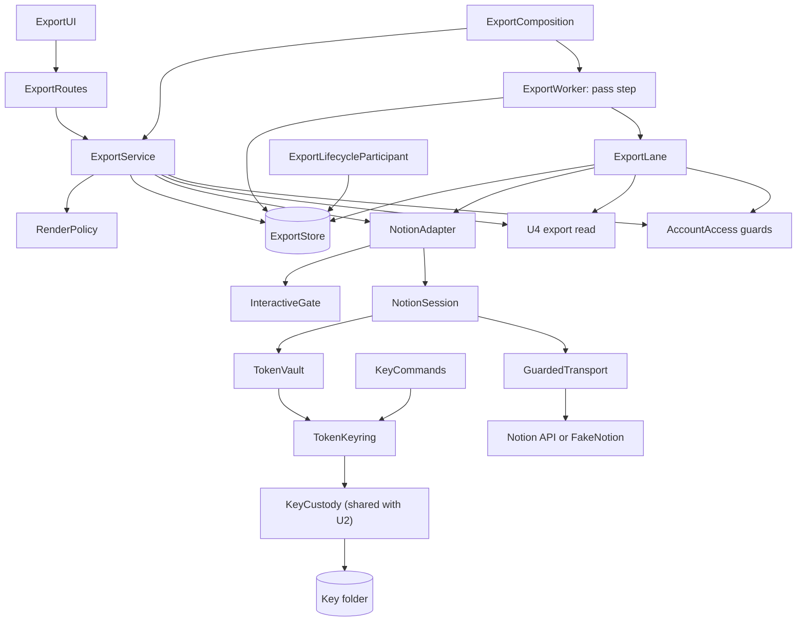

# Logical Components — U6 approved export

Date: 2026-10-20 (Asia/Seoul)
Unit: u6-approved-export (embedded library). Sources:

- [security-design.md](security-design.md) (decisions D1–D14);
- the [functional spec](../functional-design/functional-spec.md) and [frontend components](../functional-design/frontend-components.md);
- the [tech stack decisions](../nfr-requirements/tech-stack-decisions.md);
- the built code, read on 2026-10-20:
  - U5's composition: `backend/u5_host.py`, `backend/u5_policy.py` and `backend/u5_real_delivery.py`;
  - U5's module, `backend/modules/topics/`;
  - the shared runtime: `backend/control_worker.py`, `backend/control_runtime.py`, `backend/local_browser.py`, `backend/transactions.py` and `backend/local_profile.py`;
  - the frontend: `frontend/src/api.ts` and `frontend/src/u5-topics/`.

U6 joins the one shared application as a module, the way U5 did. This file lists U6's logical components: what each owns, which boundary it guards, where its failures stop and which resources it shares.

- Infrastructure design, the next stage, turns the environment-facing parts into concrete setup.
- U8 hosts the library and owns throughput, availability and monitoring.

## 1. Component inventory

```yaml
components:
  - name: ExportRoutes
    kind: route
    location: backend/modules/export/http.py
    responsibility: "C09 operations on /api/v2/c09/, plus history (A2) and settle (A3), behind the browser boundary"
    depends_on: [ExportService]
  - name: ExportService
    kind: service
    location: backend/modules/export/service.py
    responsibility: "Workflows 1-3, 6 and 7: connect, replace, disconnect, destinations, preview, approve, execute, cancel, continue, settle, read, history"
    depends_on: [RenderPolicy, ExportStore, TokenVault, NotionAdapter, "U4 export read", "AccountAccess guards"]
  - name: RenderPolicy
    kind: domain
    location: backend/modules/export/rendering.py
    responsibility: "Pure functions: canonical block tree, derived title, marker block, plain-text projection, size checks, content hash"
    depends_on: []
  - name: ExportStore
    kind: store
    location: "backend/modules/export/repository.py and the u6_*.sql files of schema export"
    responsibility: "U6's records and invariants: tables, transition and immutability triggers, owner-filtered functions, compare-and-set, replay records, the runtime and operator envelope functions, the connection pace record (export.connection_pace) and its slot reservation, key-version counts, status counts"
    depends_on: ["AccountAccess guards"]
  - name: TokenVault
    kind: security
    location: backend/modules/export/token_vault.py
    responsibility: "Seal and open the token envelope with its account, connection and revision binding"
    depends_on: [TokenKeyring, ExportStore]
  - name: TokenKeyring
    kind: security
    location: backend/modules/export/token_keyring.py
    responsibility: "U6's key custody: first key, loss with the database witness, waiting lock, re-sealing rotation, retirement"
    depends_on: [KeyCustody, ExportStore]
  - name: KeyCustody
    kind: shared-security
    location: backend/key_custody.py
    responsibility: "Mechanics extracted unchanged from the built keyring; used by U2's ControlKeyring and U6's TokenKeyring"
    depends_on: []
  - name: NotionAdapter
    kind: adapter
    location: "backend/modules/export/notion_adapter.py and classification.py"
    responsibility: "Identify, list destinations, read a page, create a page, read back, scan; identifier validation; fixed outcome categories; revocation by compare-and-set on the opened revision; pace and budgets"
    depends_on: [NotionSession, InteractiveGate, TokenVault, ExportStore]
  - name: NotionSession
    kind: adapter
    location: backend/modules/export/notion_session.py
    responsibility: "One HTTP client and one SDK client per operation, the dedicated SDK logger, the operation's wall-clock bound and error reduction"
    depends_on: [GuardedTransport, TokenVault]
  - name: GuardedTransport
    kind: adapter
    location: backend/modules/export/notion_session.py
    responsibility: "HTTPX transport wrapper: origin pinning to https://api.notion.com:443, path identifier check, 2 MB streaming cap, no redirects; wraps the network transport or FakeNotion"
    depends_on: ["Notion API"]
  - name: InteractiveGate
    kind: adapter
    location: backend/modules/export/notion_session.py
    responsibility: "In-process caps on interactive Notion operations: two per process and one per connection, failing at once beyond them"
    depends_on: []
  - name: FakeNotion
    kind: adapter
    location: backend/modules/export/fake_notion.py
    responsibility: "HTTP-level stand-in transport under the real SDK for every test and synthetic environment"
    depends_on: []
  - name: ExportWorker
    kind: worker
    location: backend/modules/export/worker.py
    responsibility: "The pass step inside the shared worker pass: housekeeping, orphan sweep and hand-over to the lane, database only"
    depends_on: [ExportStore, ExportLane, "AccountAccess guards"]
  - name: ExportLane
    kind: worker
    location: backend/modules/export/lane.py
    responsibility: "One background thread per process, one item at a time: pre-write checks, claims, writes, resumptions, read-backs and scans, each recorded in its own short transactions"
    depends_on: [ExportStore, NotionAdapter, "U4 export read", "AccountAccess guards"]
  - name: ExportLifecycleParticipant
    kind: lifecycle
    location: backend/modules/export/control_lifecycle.py
    responsibility: "Withdraw, reactivate, erase and external-copies evidence for U6's records"
    depends_on: [ExportStore]
  - name: KeyCommands
    kind: operator
    location: "backend/modules/export/key_commands.py, run as phases of U6's environment tool"
    responsibility: "create-key-after-loss, rotate-key, retire-key and per-version counts, through the administrative path acting as U6's schema owner"
    depends_on: [TokenKeyring, TokenVault, ExportStore]
  - name: ExportComposition
    kind: composition
    location: "backend/u6_policy.py, backend/u6_host.py and backend/u6_real_export.py"
    responsibility: "Policy values, the synthetic and real compositions, the capability row, the routes and the worker contribution"
    depends_on: [ExportService, ExportWorker, ExportLane, NotionAdapter, FakeNotion]
  - name: AccountAccessA8
    kind: cross-unit
    location: "backend/modules/accounts/ (U2's code)"
    responsibility: "Report external-copies-retained-by-owner as retained by policy; map the export participant in the lifecycle guard"
    depends_on: []
  - name: SharedContractAmendments
    kind: shared-contract
    location: "shared/dtos/workspace.schema.json, shared/events/execution.schema.json and the regenerated bindings"
    responsibility: "C09 amendments A1-A7, A9, A10 and the A6 extension, as an additive minor release"
    depends_on: []
  - name: ExportUI
    kind: ui
    location: "frontend/src/u6-export/, plus the entry action in frontend/src/u4-research/"
    responsibility: "Export view, stepped export flow, dialogs, and a typed C09 client on the shared Transport"
    depends_on: [ExportRoutes]
```

U6 relies on these existing parts and does not change them:

- U4's export read, `ResearchService.readNoveltyArtifactForExport`;
- AccountAccess's session guard, `accounts.guard_session` through `transactions.guard`;
- the shared runtime (`ControlLoop`, `ControlAdmission`, `boundary_route`, `OwnerTransactions`);
- the frontend's `Transport`.

## 2. How the components connect



<!-- Text fallback: the export UI calls U6's routes, which call ExportService. ExportService uses RenderPolicy, ExportStore, the NotionAdapter, U4's export read and AccountAccess's guards. ExportWorker's pass step uses the store and hands Notion work to the ExportLane, which uses the same store, adapter, U4 read and guards. The lifecycle participant uses the store. The adapter checks the InteractiveGate for browser-driven operations and runs each operation through a NotionSession, which opens the token through TokenVault (TokenKeyring on the shared KeyCustody helper and the key folder) and reaches Notion, or the fake Notion in tests and synthetic environments, only through GuardedTransport. Operator KeyCommands also use TokenKeyring. ExportComposition assembles the service and the worker. -->

## 3. Boundaries

- **Data ownership.** ExportStore is the only writer of schema `export`. No other unit reads U6's tables. U8 reads only the counts function in §7.
- **The token.**
  - Only TokenVault seals and opens envelopes, and only NotionAdapter asks it to open one.
  - ExportService holds a submitted token only while one configure request is handled: it identifies the token, has TokenVault seal it, and keeps it in no object field.
- **Notion.**
  - Only NotionAdapter calls Notion, and always through GuardedTransport.
  - FakeNotion replaces the network transport underneath in tests and synthetic environments.
- **Background work.** ExportWorker's pass step never calls Notion. The export lane is the only background caller (D9).
- **Interactive work.** Browser-driven Notion operations pass the InteractiveGate: at most two per process and one per connection. Over either cap they answer at once instead of waiting (D15).
- **Operator work.** KeyCommands reach envelopes only through the operator functions, acting as U6's schema owner through the environment tool's administrative path. The runtime login role can execute none of them (D13).
- **Contracts.**
  - Between the browser and the routes: C09 and its amendments.
  - Between U6's core and the adapter: the A6 provider messages, including `contentHash` and `marker`.
- **Compositions.**
  - The synthetic composition (`assemble_u6`) and the operator's real composition are separate entries.
  - The policy decides which transport can be built.

## 4. Failure domains and blast radius

| Failure | Where it stops | What the owner sees | Other units affected |
|---|---|---|---|
| Notion unreachable, slow or rate-limited | NotionAdapter returns could-not-check, rate-limited or uncertain | the listing or preview says to try again, or the listing is partial; exports wait, retry within their window or show "확인 중" | none. Interactive Notion operations are capped at two per process, so at least six of the eight request slots stay free (D15), and the worker pass never waits on Notion (D9) |
| Notion refuses the stored token (401) | the adapter's token-invalid category, revocation by compare-and-set on the opened revision | the connection is revoked: "다시 연결하세요". If the owner has already replaced the token, nothing changes (D16) | none |
| Notion refuses a candidate token at configure or replace | the configure call answers INVALID_TOKEN | "토큰을 확인할 수 없습니다"; nothing is stored, and the existing connection is unchanged (D16) | none |
| Key folder missing or broken | TokenKeyring: protection unavailable | the connection is unavailable, exports wait, and configure shows the policy notice | none; U2 has its own key |
| U4 export read unavailable | ExportService or the lane: could-not-check | previews say to try again; accepted exports wait while the approving session lasts, at most one hour, and are then invalidated (authority-revoked) | none |
| Approving session ended | AccountAccess guard: a definite answer | the approval or accepted export is invalidated (authority-revoked); a fresh preview is offered | none |
| Export lane stops mid-write | the attempt stays outstanding | "확인 중" after the 15-minute orphan sweep, then reconciliation | none |
| A worker pass overruns | the shared loop's 10-second pass cap | nothing directly | every unit's background work; prevented by keeping U6's pass step database-only |
| Database unavailable | every component | errors or not ready | every unit (shared database); no partial write, because each attempt is recorded before its call (D8) |
| Real composition misconfigured | ExportComposition refuses at start | the real export is unavailable, with the policy notice | none; the synthetic composition is unaffected |
| Browser closed during the flow | nothing stops | the outcome stays in the history | none |

## 5. Shared resources and U6's bounds

| Resource | Shared with | U6's bound |
|---|---|---|
| Database connection slots: in managed environments, 5 for the web process and 5 for the worker; transactions of at most 5 s | every unit | short transactions only, and no Notion call inside one (D8); the lane uses one worker connection at a time |
| The worker pass: one at a time, at most 10 s | every unit's background work | U6's pass step is database-only, its batches are bounded by the policy, and Notion work goes to the lane (D9) |
| Request admission: 8 normal and 2 recovery slots, 64 KB bodies, no waiting queue | every route | at most two interactive Notion operations per process, and one per connection, each holding a slot for at most its 30-second budget; any more answer at once (D15) |
| The owner's Notion integration limit, about 3 requests per second | U6 only | 2 requests per second per connection, shared through the database (D6) |
| Key folder | U6 only | separate from U2's keyring folder (D2) |
| Key custody helper | U2 and U6 | U2's tests pass unchanged (D1) |
| Shared contract package | every unit's bindings | an additive minor release; bindings and the consumer inventory are regenerated |

## 6. Isolation strategy

- **Bulkhead.** One export lane per process, one item at a time (D9).
- **Interactive cap.** At most two interactive Notion operations per process, and one per connection, failing at once beyond that (D15).
- **Per-owner limits.** One export in flight and 20 bound per rolling hour, enforced at binding (NFR4.11).
- **Per-connection pace.** 2 requests per second, shared through the database (D6).
- **Budgets and deadlines.** Each read has a wall-clock budget (D5), and each write a 90-second deadline (NFR4.4).
- **Separate keys.** U6 and U2 never share a key or a key folder (D2).
- **Fake transport.** No test or synthetic environment can reach Notion (NFR6.3).

## 7. Composition and what the next stages receive

- **`backend/u6_policy.py`**
  - `ExportPolicy` is frozen. Its values are finite and checked: every operating value of NFR4.10, the read budgets, the interactive caps (two per process, one per connection) and the per-pass batch sizes.
  - `SYNTHETIC_EXPORT` composes the fake Notion only.
  - `REAL_ACTIVATION_EXPORT` requires one activation destination and the free-terms evidence.
- **`backend/u6_host.py`**
  - `export_contribution(...)` returns the service, the routes, and the worker: the inherited worker plus U6's pass step, as `TopicsWorker` does.
  - It also returns the `export` capability row. That row is derived from the bound transport, as U5's is: `synthetic-only` for the fake Notion, `real-bounded` for the operator's real composition, and `degraded` in both cases, because neither is general export.
  - `assemble_u6(profile)` wraps `assemble_u5`, as U5 wraps U4.
- **`backend/u6_real_export.py`.** The operator-only real composition (security design §11).
- **Infrastructure design receives:**
  - the U6 environment: folder `/tmp/docsuri-u6-run`, its listeners, database `docsuri_u6` and its realm;
  - creating `export-keys/` with mode 0700;
  - U6's destructive preservation step: the key file is deleted only after every refusal check has passed, by one unlink as the deciding step (D14; security design §4.6);
  - the operator key commands as phases of U6's environment tool, through its administrative path (security design §4.5);
  - the schema owner and login roles, with the column-level grants of D13;
  - the allowlists in `LocalProfile`, `OwnerTransactions`, `boundary_route` and `read_payload`;
  - the environment verifier with the fake Notion;
  - the `real-export.json` template;
  - the Construction Verification Command for the U6 checkpoint.
- **U8 receives:**
  - the hosting topology: the lane runs wherever the worker runs;
  - the hosted key folder outside `/tmp`;
  - the logger levels (security design §5.4);
  - the error-reporter rules (§5.5);
  - registration of the lifecycle participant;
  - the counts in §8.

## 8. What U6 offers U8 to watch

`export.status_counts()` returns, with no identifiers, titles or content:

- the number of effects in each state: accepted, executing and unknown, plus each terminal state over the last 24 hours;
- the age in seconds of the oldest accepted effect and of the oldest unknown effect;
- the number of connections in each state;
- the export lane's last outcome category and when it happened.

U8 turns these into its health and error-rate metrics.

## 9. UI contribution and accessibility (NFR5.1)

- **Module.** `frontend/src/u6-export/` holds:
  - the export view: connection panel and export history;
  - the stepped export flow;
  - the disconnect and settle dialogs;
  - a typed C09 client on the shared `Transport` (`frontend/src/api.ts`). That client adds the CSRF header and the `Idempotency-Key`, and the press key is reused on a retry.
- **Entry points.**
  - U4's novelty result screen gets the "Notion으로 내보내기" action.
  - The application shell gets the catalog capability and the "내보내기" navigation entry.
- **The token field.**
  - It keeps the token in component state only, and it is cleared after every submit.
  - It is not a password field, so browsers do not offer to save the token.
  - It sets `autocomplete="off"` and `spellcheck="false"`, so no browser spelling service receives the token.
  - The token never enters a URL, browser storage, a log or an error message.
- **Accessibility checks.** The WCAG 2.2 AA criteria of NFR5.1 are verified as follows:
  - **Automated rules.** Playwright with `@axe-core/playwright`, already a frontend development dependency, runs on every U6 view and dialog with the `wcag2a`, `wcag2aa`, `wcag21aa` and `wcag22aa` rule tags. This covers contrast (1.4.3), target size (2.5.8), labels (3.3.2) and structure (1.3.1).
  - **Keyboard journey.** A keyboard-only Playwright journey through connect, export, cancel and settle checks 2.1.1, 2.4.3, 2.4.7 and 2.4.11. It also checks that focus is trapped in dialogs and returns to the trigger.
  - **Reflow.** A 320 CSS px viewport run checks that nothing scrolls in two dimensions (1.4.10).
  - **Component tests** with Testing Library check:
    - every status shows text and an icon, never colour alone (1.4.1);
    - field errors name the problem without echoing the token (3.3.1);
    - each status change goes through the single polite live region (4.1.3).
