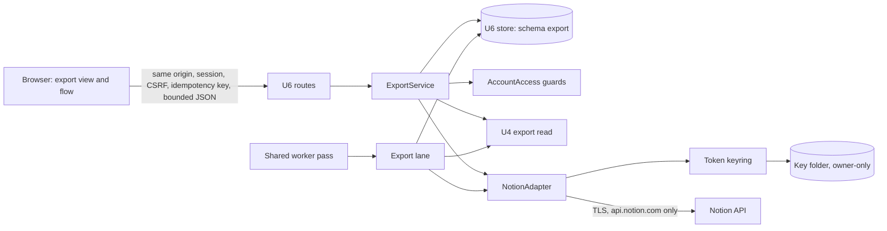
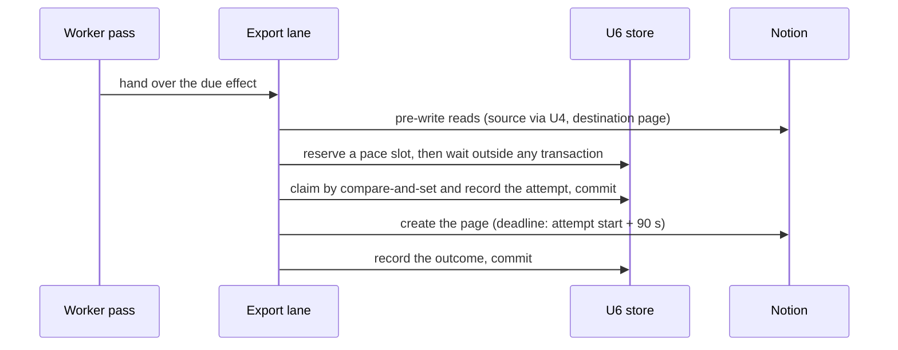

# Security Design — U6 approved export

Date: 2026-10-20 (Asia/Seoul)
Unit: u6-approved-export (embedded library). Sources:

- confirmed [nfr-design-questions.md](nfr-design-questions.md) (Q1–Q7 and the points settled from the records);
- [security-requirements.md](../nfr-requirements/security-requirements.md) (NFR1.1–NFR6.4) and [tech-stack-decisions.md](../nfr-requirements/tech-stack-decisions.md);
- the open points R-12 to R-15 of the [NFR requirements review](../nfr-requirements/reviews/review-02.md);
- the [functional spec](../functional-design/functional-spec.md), [rules](../functional-design/rules.md) and [entities](../functional-design/entities.md);
- the built code, read on 2026-10-20:
  - the keyring and its recovery, `backend/modules/accounts/control_keys.py` and `control_key_recovery.py`;
  - the protected-value envelope, `backend/modules/accounts/services/control_entry.py`;
  - the environment folders, `backend/local_profile.py`;
  - the bounded transactions and the session guard, `backend/transactions.py`;
  - the worker loop and request admission, `backend/control_runtime.py`;
  - the browser boundary, `backend/local_browser.py`;
  - U4's export read, `backend/modules/research/service.py` and `repository.py`;
  - environment preservation, `scripts/verify_docsuri_u5.py`;
- Notion's capability documentation, checked 2026-10-20.

U6 is a library. This file and [logical-components.md](logical-components.md) are its NFR design. Performance, scalability, reliability and observability files are not produced for a library unit: the hosting service (U8) owns those targets. The integrity mechanisms of NFR4 (deadlines, pacing, budgets, reconciliation) are security and integrity requirements, so they are designed here.

## 1. Decisions at a glance

| ID | Decision | Source | Serves |
|---|---|---|---|
| D1 | Key custody in three layers: a shared custody helper, U2's keyring as a thin setting of it, and U6's token keyring on top | Q1 | NFR3.2, NFR3.3 |
| D2 | The composition hands U6 its key folder; in local environments it is `<environment folder>/export-keys/` | Q2 | NFR3.2 |
| D3 | The database is a second witness: a missing key file is a first start only when no sealed token exists | Q3 | NFR3.3 |
| D4 | An unconsumed approval ends with its approving session; approvals have no time-based expiry | Q4 | NFR1.5, NFR4.9 |
| D5 | Each Notion read runs under a fixed wall-clock budget | Q5 | NFR4.6, NFR4.10 |
| D6 | Each connection's request pace is a database record shared by every process | Q6 | NFR4.6, NFR6.4 |
| D7 | The connect help asks for read content and insert content only | Q7 | NFR3.5, NFR3.8 (elevation of privilege) |
| D8 | No Notion call runs inside a database transaction: record, call, record | settled | NFR4.1, NFR4.8 |
| D9 | Notion work runs in an export lane, outside the shared worker pass | built worker loop | NFR4.4, NFR4.6, NFR4.7 |
| D10 | One client per operation, over a guarded transport | requirements | NFR3.5, NFR3.8, NFR3.9 |
| D11 | Every adapter outcome is a fixed category, and no exception leaves the adapter | requirements | NFR3.6, NFR4.3 |
| D12 | The bound content is checked again immediately before every write | requirements | NFR4.2 |
| D13 | The sealed token is reachable only through a few named database functions run with the schema owner's rights; the runtime role cannot read its column | defense in depth | NFR3.4 |
| D14 | Preserving an environment deletes its key file once every other preservation check has passed | built preservation step | NFR3.2, NFR3.3 |
| D15 | At most two interactive Notion operations run at once per process, and one per connection; any more fail at once | built request admission | NFR4.6 |
| D16 | Notion refusing a token revokes only the stored token, and only while the connection is still at the revision the operation opened | rules BR1.2, BR1.4 | NFR3.7 |

D9, D13 to D16 do not answer a question. D9 follows from the built worker loop (`ControlLoop`, `backend/control_runtime.py`):

- it runs one pass at a time;
- each pass is capped at 10 seconds;
- no new pass starts while one is still running.

A 90-second Notion write inside a pass would stall every unit's background work.

D15 follows from the built request admission (`ControlAdmission`): it has eight normal slots and no waiting queue. Without a cap, slow Notion reads could hold every slot and refuse every unit's requests. D16 keeps a refused candidate token, or an old token still in flight, from revoking a connection that has already moved on. D13 and D14 add protection without changing any behaviour the owner sees.

## 2. Trust boundaries



<!-- Text fallback: the browser talks only to U6's routes on the same origin. The routes call ExportService, which uses U6's store, AccountAccess's guards, U4's export read and the NotionAdapter. The shared worker pass hands Notion work to the export lane, which uses the same store, U4 read and adapter. Only the adapter opens tokens, through the token keyring and the owner-only key folder, and only the adapter talks to Notion, over TLS to api.notion.com. -->

| Zone | Holds | Trust |
|---|---|---|
| Browser | the token only between typing and submit | untrusted input |
| Application: web routes, worker, export lane | the plaintext token only while a configure request is handled and inside one adapter operation | trusted code |
| U6 store | the sealed token, never the plaintext | trusted, but not enough on its own |
| Key folder | the keys, never a token | trusted, owner-only |
| Notion | pages and its own answers | external; every answer is untrusted data |
| U4 and AccountAccess | results, sessions, account state | internal modules, reached only through their own functions |

Recovering a token needs both the store and the key folder. Neither one alone is enough (NFR3.1, NFR3.3).

## 3. Authentication and authorization (NFR1.1–NFR1.4)

- **Browser operations (NFR1.1, NFR1.3).**
  - U6's routes use the established browser boundary in `backend/local_browser.py`:
    - `boundary_route` checks the scheme, host and origin;
    - `require_authority` derives the owner's `Authority` (account and session) on the server, never from a browser field;
    - mutations go through `post_context`: same origin, a 64-hex CSRF header and an `Idempotency-Key` UUID.
  - Bodies are read only through `read_payload`: JSON only, bounded, and read within 5 seconds. U6's host joins its allowlist of 64 KB bodies. `ControlAdmission` also bounds every body at 64 KB before routing.
  - The token is accepted only by the configure operation, which also performs a replace.
- **Owner checks (NFR1.1, BR7.1).**
  - U6's store functions run the same session guard as U4: `transactions.guard`, which calls `accounts.guard_session` with the purpose `local-research`, because an export sends a research result. The guard checks that the account is active and verified, that the session is current and not revoked, and that the purpose is consented.
  - Every function takes the account from the `Authority` and filters every connection, preview, approval and effect by it.
  - A foreign identifier and a nonexistent one raise the same `LookupError`. The boundary maps both to its single not-found answer.
  - The owner's explicit approval of each export is the decision to send that result to Notion (BR3.1).
- **Replays (NFR1.3, NFR4.1).** The idempotency key is stored per owner and operation, with the approval or effect it produced. A replay returns the original record.
  - **Configure keeps no token-derived material.** Its receipt stores the owner, the operation key, a digest of the request without its token field (in U4's `digest` form) and the response: connection id, state and revision, or the refusal code. It never stores the token, a digest of it or a salted digest of it.
  - **A reused key.** Reused with a different token, the key returns the original response. Reused with a different expected revision, it gets the same conflict answer as the other receipts.
  - **Lifetime.** The receipt is removed with its connection and on erasure.
- **Background work (NFR1.2).**
  - The worker and the export lane act as the service on one effect or approval at a time.
  - The pre-write check reads the source through U4's existing export read, `ResearchService.readNoveltyArtifactForExport`, with the approving owner's `Authority`: the account and the approving session.
  - U4's repository runs the same session guard first, so a refused session, a revoked consent or an inactive account is a definite authority-revoked answer.
- **Lifecycle (NFR1.4).**
  - The export participant acts under the role AccountAccess maps for it (amendment A8).
  - It writes only U6's records, records evidence once per request and scope, and never defers.

## 4. Token sealing and key custody (NFR3.1–NFR3.3, NFR3.7)

### 4.1 Sealed token (NFR3.1)

The stored value follows the envelope of U2's protected values (`control_entry.protect`). It has its own tag and binds the connection:

```text
envelope = "DSE1" | len(version) | version | nonce (12 random bytes) | AES-256-GCM(token) with its tag
AAD      = "u6-notion-token:" + version + ":" + accountId + ":" + connectionId + ":" + connectionRevision
```

- **Nonce.** A new nonce comes from the operating system's random source on every seal.
- **Binding.** An envelope copied to another row, account or revision fails authentication when it is opened.
- **Configure and replace.** Each seals the new token with the revision it is about to create: 1 for a new connection, otherwise the expected revision plus one. The store function writes the envelope and sets that revision in one step, only while the current revision equals the expected one, or, for a new connection, while none exists. Otherwise nothing is written.
- **Version column.** The key version is also stored in its own column, `token_key_version`, so tokens can be counted per version (§4.5). A check keeps that column equal to the version inside the envelope.
- **End of use (NFR3.7).** Disconnect, revocation, withdrawal and erasure set the envelope and its version to null in the same transaction that ends the connection's use.

### 4.2 Three layers of key custody (D1, Q1; closes R-12)

**Shared custody helper** (`backend/key_custody.py`). It contains only mechanics the built keyring already has, moved with no change to U2's behaviour:

- **The guarded read**, which requires:
  - no symlink followed, and a regular file;
  - owned by the service user, with mode 0600 and at most 4096 bytes;
  - no duplicate JSON fields, and the environment id matching;
  - one to three versions of 32-byte keys, matching the configured version pattern;
  - a `generation` inside the configured range.
- **The exclusive lock.** A lock file created without following links, its owner and mode checked, and a non-blocking `flock`.
- **The staged write.** A temporary file created exclusively with mode 0600, written and synced.
- **Publishing.** An atomic replace, then syncing the folder.
- **The marker.** The initialized marker is created exclusively, then the folder is synced.

The helper is configured by the key folder, the file names, the version pattern, the `generation` range and the environment id. The limits the built read hard-codes become these settings, and each keyring passes its own values. The helper offers no automatic first key, no re-sealing and no retirement.

**U2's keyring** (`backend/modules/accounts/control_keys.py`) becomes a thin setting of the helper, with exactly today's behaviour:

- the folder is pinned to `/tmp/docsuri-u2-run`, and the legacy key must be 32 bytes;
- the file names (`account-control-keyring.json`, `.lock`, `.initialized`), the `u2-(v1|<32 hex>)` versions and the `generation` range of 1 to 3 stay;
- with no key file and no marker, a read returns the legacy in-memory key and creates nothing;
- rotation only adds a key, refuses at three, writes the marker before the key file, and uses the non-blocking lock.

The recovery module (`control_key_recovery.py`) builds a keyring with `ControlKeyring.__new__`, sets `root`, `run_id` and `legacy_key` itself, and then calls `_lock()`, `read()` and `key()`. So:

- U2's configuration stays at class level;
- those three attributes stay the only state each keyring object holds;
- `_lock`, `read`, `key`, `active_version`, `rotate` and `_write` keep their names and behaviour.

U2's existing tests must pass unchanged:

- `tests/u2_account_personal_controls/operations/test_control_keys.py`;
- `test_control_key_recovery.py`;
- `test_recovery_restore.py`.

**U6's token keyring**, in U6's module, is built on the helper. These behaviours are new and have their own tests:

- **Files.** `export-token-keyring.json`, `.lock` and `.initialized`, with versions named `u6-<32 hex>`.
- **Generation.** It starts at 1 and rises by one with every change to the key record: each rotation, and each retirement. It is never reset, and U6's setting accepts any value from 1 to 2,147,483,647. U6 can therefore rotate and retire any number of times. U2's narrower range is untouched.
- **First key.** It is published by linking a synced staging file to the key file's name.
  - The link fails if the name already exists, so two processes can never both create a key. The process that loses reads the winner's file.
  - The staging name is always removed, so the key file keeps a single link, which the preservation check requires.
- **Order of first creation.** The key file comes first, then the marker. A crash between the two leaves a valid key file and no marker. The next read writes the marker (repair), and never treats that state as a loss.
- **Waiting lock.** It retries the helper's non-blocking lock every 100 ms for up to 5 seconds. After that, the operation fails closed as protection unavailable.
- **Cleanup.** Staging files left by a crash are removed under the lock at the next creation or rotation.
- **No cache.** Every seal and every open reads the key file again, as the built keyring does, so the next operation sees a rotation.

### 4.3 Key folder (D2, Q2)

- **Local environments.** The key folder is `<environment folder>/export-keys/`, that is `/tmp/docsuri-u6-run/export-keys/`.
  - Environment setup creates it with mode 0700 (infrastructure design).
  - At every load, U6 checks that it is not a symlink, that it is owned by the service user and that it is closed to everyone else, as `LocalProfile` checks the environment folder.
- **The hosted service.** It is a private data folder outside `/tmp`, chosen at U8 and checked the same way.
- **Who chooses it.** U6 never derives the folder from environment variables or from the repository path; the composition (`backend/u6_host.py`) passes it in.
- **Lifetime.** The key lives as long as the environment and its database, which seal and hold the tokens.

### 4.4 First start, loss and repair (D3, Q3)

The token keyring decides on every read:

| Key file | Marker | Sealed tokens in U6's store | Meaning | Result |
|---|---|---|---|---|
| present and valid | present | any | normal | use it |
| present and valid | absent | any | creation interrupted after the key file | use it; write the marker |
| present but failing any check | any | any | custody broken | protection unavailable; nothing created |
| absent | absent | none | first start | create the first key (§4.2), then the marker |
| absent | absent | one or more | loss: the folder was deleted | protection unavailable; nothing created |
| absent | present | any | loss | protection unavailable; nothing created |

- **The witness.** "Sealed tokens in U6's store" comes from `export.token_key_counts()`. It returns only the number of sealed tokens per key version, with no identifiers, so the decision reveals nothing about any owner.
- **Effect of unavailable protection.** Connections become unavailable (BR1.6). The revision stays the same, nothing is invalidated and exports wait. Configure answers POLICY_UNRESOLVED (BR8.3).

### 4.5 Operator commands (NFR3.3)

**How the commands run.** The operator runs them as the service user, as phases of U6's environment tool. Each runs under the waiting lock.

- They connect through the tool's existing administrative path, using the environment's private migration credentials, as the U5 tool's `connect_admin` does. They then act as U6's schema owner role (`SET ROLE`).
- Only the schema owner may execute the two operator functions:
  - `export.token_envelopes_for_reseal(version, limit)` lists, a page at a time, the connections whose envelope is under a given version;
  - `export.reseal_token(connection_id, expected_envelope_sha256, new_envelope, new_version)` replaces one envelope by compare-and-set.
- The runtime login role is never granted these functions (§5.3).
- In the hosted service, U8 provides the equivalent administrative path.

**The commands:**

- **`create-key-after-loss`**
  - It refuses unless §4.4 says loss. A key file that exists but fails a check is a custody problem to fix, never to replace.
  - It creates a fresh key, linked into place, and creates the marker only if it is absent.
  - It reports how many connections keep tokens sealed under versions that no longer exist. Those connections stay unavailable until their owners disconnect and connect again, through the existing transitions: unavailable, then disconnected, then connected.
- **`rotate-key`**
  - With three versions present, it first retires the oldest, but only when no token is sealed under it. Otherwise it refuses and shows the counts.
  - It adds a new version as the active one, published by atomic replace.
  - It re-seals every token whose version exists in the key file but is not the active one, one row at a time, through `export.reseal_token`. The compare-and-set on the row's current envelope means a concurrent replace is never overwritten.
  - A token sealed under a version the key file no longer holds, after a loss, cannot be opened. Rotation skips it and reports it, and it stays unavailable until its owner connects again.
  - It reports the count of tokens under each version. A token sealed by a configure that raced the rotation keeps its old version and shows in the count. Running `rotate-key` again re-seals it.
- **`retire-key --version <v>`**
  - It removes a version only when it is not the active one and its count is zero at that moment, both checked under the lock.

### 4.6 No recovery copy, no preserved keys (D14)

- **No recovery copy.** U2 keeps a same-disk recovery copy of its keys (`control_key_recovery.py`), because its protected material cannot be obtained again. U6 keeps none: an owner can always enter a Notion token again, and a copy would only add exposure.
- **Preservation.** The built preservation step renames an idle environment folder and keeps its stopped database (`archive_owned` in `scripts/verify_docsuri_u5.py`). That routine deletes no file. U6's preservation is a new, explicitly destructive step, written in U6's environment tooling by infrastructure design. Its order is:
  1. **Every check first.** It runs every check the built routine runs and can refuse on:
     - the environment's identity and resources;
     - that the application has stopped;
     - that no process holds files open in the environment folder;
     - file custody;
     - the database's identity, and that no other clients are connected;
     - that the destination name is free;
     - an acknowledged database stop.
  2. **Then the key file, as the single deciding step.** Leftover staging files are removed, and then the key file itself is removed with one unlink, followed by syncing the folder.
     - If that unlink fails, the key is untouched, and the step refuses with the environment stopped and intact.
     - Once it succeeds, the preserved sealed tokens can never be opened.
  3. **Then the rest of the key folder.** The marker, the lock file and the folder are removed. A failure here leaves only files that hold no key material, and the step goes on.
  4. **Last, the environment folder is renamed**, as the built routine does. If the rename fails, the environment stays stopped under its original name without its key. Restarting it would report a loss (§4.4), with nothing exposed.

  A refused preservation, at any check of step 1, leaves the key folder intact.
- **Never stored elsewhere.** No U6 key is ever in a database, a database dump, a log or the repository.

## 5. Token exposure controls (NFR3.4, NFR3.6, NFR3.9)

### 5.1 Where a plaintext token exists

1. **In the browser's connect form**, in memory only. The form is cleared after every submit (BR1.1). The token is never put in browser storage, a URL or a log.
2. **In the configure request**: same origin, TLS, in a JSON body.
3. **In the server**, only while the configure request is handled until the token is checked and sealed, and inside one adapter operation (§6.1): the opened value, the SDK client's `Authorization` header and the request being sent.

Nowhere else. In particular:

- no response returns the token;
- no record, evidence, log or error message holds it;
- no Notion error text is relayed (§7).

### 5.2 Server boundary

- The configure route reads its body only through `read_payload`, under `boundary_route`.
- A validation failure becomes the fixed `INVALID_ARGUMENT` answer, with no input echoed; that is the boundary's mapping of `ValidationError`. FastAPI's default validation response, which repeats the input, is never used.
- No layer logs request bodies, and the configure route stays excluded from any body logging added later.

### 5.3 Sealed column access (D13)

- U6's runtime login role (`docsuri_export`, used by the web routes and the worker) has no privilege on the `sealed_token` and `token_key_version` columns of `export.connection`. It has column-level grants on every other column.
- Envelopes are reached only through functions that run with the schema owner's rights:
  - **For the runtime role, three functions, each scoped to one owner's connection:**
    - store an envelope under the expected revision (§4.1);
    - return the envelope, revision and version to the adapter;
    - clear it.
  - **For the operator only, two functions**, executable by the schema owner role alone (§4.5): `export.token_envelopes_for_reseal` and `export.reseal_token`.
  - **For both, `export.token_key_counts()`.** It returns only a count per key version, so it is granted to the runtime role for the first-start decision (§4.4) and to the operator.
- No listing, history or status read can select an envelope, even through a faulty query.

### 5.4 Logging (NFR3.9)

- The SDK always receives a dedicated logger, `docsuri.export.notion_sdk`, with a `NullHandler`. It does not propagate, and its level is WARNING.
- The composition keeps the `httpx` and `httpcore` loggers at WARNING or above. The hosting service (U8) must not lower them.
- U6's own logs and records carry only identifiers, states, timestamps and fixed reason keys (BR7.2).

### 5.5 Error reporting (NFR3.6)

No error reporter is active today: the frontend lists `@sentry/nextjs` but never starts it, and the backend has none. U6 adds none. A reporter added later must meet these rules:

- **On the server:** send no local variables, no default personal data and no request bodies, and drop or scrub frames from U6's adapter module. For Sentry, that means `include_local_variables=False`, `send_default_pii=False`, `max_request_body_size="never"` and a `before_send` filter.
- **In the browser:** never capture input values or request bodies. With session replay, every input is masked.

## 6. The Notion boundary (NFR3.5, NFR3.8)

### 6.1 One client per operation (D10)

```python
async def notion_operation(connection, budget, work):
    http = None
    try:
        async with asyncio.timeout(budget.seconds):          # the operation's own wall clock
            token = vault.open(connection)                   # custody failures are reduced too
            http = httpx.AsyncClient(transport=GuardedTransport(), follow_redirects=False, trust_env=False)
            sdk = notion_client.AsyncClient(client=http, auth=token, notion_version=VERSION, retry=False,
                                            timeout_ms=budget.per_request_ms, logger=SDK_LOGGER)
            return classify(await work(sdk))
    except Exception as error:                               # includes the deadline's TimeoutError
        return reduce(error)                                 # fixed category; error dropped
    finally:
        if http is not None:
            await http.aclose()                              # client, headers and token go together
```

The snippet shows the shape only; code generation writes the real version.

- **What is reduced.** Opening the token, building the clients and the call itself are all inside the reduced region. The operation's own deadline arrives as `TimeoutError`, an ordinary exception, and is reduced like any other.
- **What is not reduced.** Cancellation from outside (`asyncio.CancelledError`), `KeyboardInterrupt` and `SystemExit` are not caught, so a stopping process is never held up. The lane's top level lets them pass without logging the exception object.
- **A write cut short from outside** leaves its attempt outstanding, and the orphan sweep recovers it (§8.6).

- **One operation** is a validation, a listing, a page read, a write, a read-back or a whole scan.
- **Never shared.** The SDK writes the token into the injected client's default headers. So every operation creates its own client, and no client is pooled or reused across operations, owners or tokens.
- **Never entered.** The SDK client is never entered with `with` or `async with`.
- **Asynchronous client.** The asynchronous SDK client is used so that the wall-clock bound can cancel a request in flight. Callers that are not asynchronous run each operation in its own event loop.
- **No pagination helpers.** The SDK's pagination helpers are never used.
- **Settings.** As the tech stack decisions require: `retry=False` as a boolean, and Notion-Version `2026-03-11`.

### 6.2 Guarded transport

`GuardedTransport` wraps HTTPX's transport. TLS verification stays on, and the transport adds no retries.

- **Origin.** It refuses, before connecting, any request whose scheme, host or port is not exactly `https://api.notion.com:443`.
- **Identifiers.** It refuses a request whose path carries an identifier that fails §6.3, repeating the adapter's own check.
- **Size cap.** It streams every response body and aborts with a `ResponseTooLarge` error past 2 MB, or at once when the declared length is larger.
- **No redirects.** Redirects are not followed (`follow_redirects=False`), and a redirect is an unexpected answer.
- **No environment settings.** No proxy or certificate settings come from the environment (`trust_env=False`).
- **Fake Notion (§11).** In every test and synthetic composition, the fake Notion transport replaces the network transport underneath, behind the same guards.

### 6.3 Identifier validation

- Every page and block identifier is normalised before any request path is built. Hyphens of the 8-4-4-4-12 form are removed, and exactly 32 lowercase hexadecimal digits must remain.
- A browser value is never used as an identifier. Destinations are chosen from the current listing by `destinationId`, and the server derives the parent page itself (A1).

### 6.4 Least-privilege integration (D7, Q7)

The connect help text tells the owner to create an internal integration with:

- read content and insert content allowed;
- update content not allowed;
- comment access not allowed;
- no user information;
- only the intended destination pages shared with it.

Checked against Notion's capability documentation on 2026-10-20:

- creating a page needs only insert content;
- reading pages and their children needs read content;
- retrieving the token's own bot user needs no user capability.

A leaked token can then read the shared pages and add content, but cannot edit, move, trash or delete existing content. The refusal hint for a missing insert capability stays (BR4.2).

## 7. Outcome classification (D11; NFR3.6, NFR4.3)

Every adapter call returns one fixed category. Exceptions are caught at the adapter boundary and reduced. That covers every ordinary exception:

- the SDK's `HTTPResponseError` and `RequestTimeoutError`;
- every HTTPX error, and `ResponseTooLarge`;
- JSON and decoding errors;
- custody failures from opening the token;
- the operation's own deadline (`TimeoutError`);
- anything unexpected.

Cancellation from outside, `KeyboardInterrupt` and `SystemExit` are deliberately not reduced (§6.1).

How an error is reduced:

- The reduced error carries no message text, and the original is not chained (`raise ... from None`).
- The error object is never logged, stored or returned.
- The SDK does not recognise 529, so classification reads the HTTP status and the body's `code` from `json.loads(error.body)`.

**Writes (rules BR4.2):**

| Notion's answer | Category | Effect |
|---|---|---|
| page created (200), its parent equal to the bound destination | created | succeeded |
| "saved but busy" (503) naming a page that passes the read-back (§8.3) | created | succeeded |
| "saved but busy" naming no page, or the read-back fails or cannot finish | uncertain | unknown |
| 401 `unauthorized` | refused: token-invalid | failed; the connection is revoked under the revocation rule below (BR1.4) |
| 404 `object_not_found` | refused: destination-missing | failed |
| 403 `restricted_resource` whose `additional_data.block_limit` is `block_creation` | refused: workspace-block-limit | failed |
| any other 403 `restricted_resource` | refused: no-access | failed; the creation capability becomes refused |
| 400 `validation_error`, or the content-binding check (§8.4) | refused: content-rejected | failed |
| 429 `rate_limited` marked `public_api_request_blocked` | refused: provider-blocked | failed |
| 429 `rate_limited` not blocked, or 529 `service_overload` | rate-limited, with Notion's stated wait | stays executing (§8.5) |
| anything else | uncertain | unknown |

"Anything else" covers:

- 409, 500, 502 and 504, and a 503 without a page;
- a timeout and the expired deadline;
- a transport error at any stage;
- an over-cap, truncated or unparsable answer, and a redirect.

A transport error is never inspected for whether the request left the machine. Any doubt means unknown, never a retry (BR4.3).

A write cancelled from outside is not classified here. Its attempt stays outstanding, and the orphan sweep makes the export unknown (§8.6).

**Reads:**

| Notion's answer | Category |
|---|---|
| 200, parsed within the cap | ok |
| 429 not blocked, or 529 | retried after the stated wait, within the budget (§9.3) |
| 401 | refused: token-invalid; the connection is revoked under the revocation rule below (BR1.4) |
| 403 or 404 on the destination | refused: not readable (BR1.5) |
| anything else, or the budget spent | could-not-check; a scan records listing-incomplete |

**The block-limit signal** follows Notion's workspace block limits documentation, checked 2026-10-20: a blocked write answers HTTP 403 `restricted_resource` with `additional_data.block_limit` set to `block_creation`. The classification reads that field from the SDK error's `additional_data`, or from the parsed body, and never from message text. The fake Notion answers the same way.

**Revocation (D16; BR1.2, BR1.4).** Notion refusing a token (401) means different things depending on which token was used:

- **A candidate token.** On configure or replace, the token being checked has not been stored. Its 401 makes the call answer INVALID_TOKEN. Nothing is stored, and the existing connection stays exactly as it was (BR1.2).
- **The stored token.** Every other operation opens the stored envelope at a known connection revision. Its 401 revokes the connection by compare-and-set on that revision, which sets the state to revoked, clears the envelope, advances the revision and ends older pending work (BR1.4), all in one step.
  - If the revision has already moved on, for example because the owner replaced the token while a scan with the old one was running, the revocation is discarded.
  - The operation still keeps its own outcome: could-not-check for a read, and token-invalid for that write's effect.

## 8. Write execution (NFR4.1, NFR4.2, NFR4.4, NFR4.5, NFR4.8)

### 8.1 The export lane (D9)

- **The worker pass.** Each shared worker pass, capped at 10 seconds, runs only U6's database steps:
  - housekeeping (§10) and the orphan sweep (§8.6), on bounded batches;
  - when the export lane is idle, handing it the next due item. Due items are taken in this order:
    1. an executing effect whose rate-limit wait has passed;
    2. the oldest accepted effect of an owner with nothing executing;
    3. an unknown effect whose next check is due.
- **The export lane.** One background thread per process that hosts U6's worker, taking one item at a time (a bulkhead).
  - It runs the item's Notion operations under their own deadlines and budgets.
  - It records progress in short transactions of its own, under a work budget it sets itself rather than the pass's.
  - It keeps no state outside the database. A lane that stops, in a restart or a crash, leaves only database records, and the orphan sweep and the next due time recover them.
- **Shutdown.** The lane stops taking items and waits for the item in hand, up to its deadline. The hosting service's outer deadline may cut that short; recovery is then the same as after a crash.

### 8.2 One write, step by step (D8)



<!-- Text fallback: the pass hands the due effect to the lane. The lane makes the pre-write reads, reserves and waits for a pace slot, then claims the effect and records its attempt in one committed transaction. Only then does it send the page creation, under a deadline of the attempt start plus 90 seconds. It records the outcome in a second transaction. No transaction is open while Notion is called. -->

1. **Pre-write check (BR3.3)**, with no transaction open:
   - the source, read through U4 with the approving owner's authority;
   - the bound destination page, read directly, under the read budget;
   - in the real composition, the destination allowance.
2. **Pace.** The lane reserves a pace slot (§9.2) and waits for it before claiming. The attempt's 90 seconds are then spent only on the request.
3. **Claim**, in one transaction (NFR4.8).
   - The effect moves from accepted to executing, or resumes from a passed rate-limit wait, by compare-and-set. The guard checks:
     - the effect revision;
     - that the connection revision equals the bound one;
     - that the approving session and the account are current (AccountAccess);
     - that the owner has nothing else executing.
   - The same transaction inserts the ExportAttempt: start, writer identity, connection revision, `deadlineAt` (start plus 90 s) and outstanding. It then commits.
   - A definite change found here or in step 1 ends the effect as the state machine says, and nothing is written.
4. **Write**, with no transaction open (§6.1, §8.4). The page is created under the bound parent. `asyncio.timeout` runs until `deadlineAt`, measured from the recorded start.
5. **Record**, in one transaction: the attempt's outcome class, Notion's request id (A6), the effect's next state and its fixed reason.
6. **Read-back** after a "saved but busy" answer that names a page. This is a separate operation with its own budget (§8.3). Its result is recorded by the same rules as step 5.

If the process stops between steps 3 and 5, the attempt stays outstanding and the orphan sweep finds it.

### 8.3 Read-back of a "saved but busy" answer

The named page counts as created only when it passes all three checks of BR4.2:

- it is under the bound destination;
- it was created by this attempt's writer identity;
- its last top-level block carries the effect's marker.

The read-back has its own 60-second budget (D5). A failed check, or a spent budget, makes the outcome uncertain.

### 8.4 The bound content (D12; NFR4.2)

- **The canonical tree** is the object `{"properties": {"title": …}, "children": […]}`, exactly as it is sent.
- **Its hash.** `renderedContentHash` is the SHA-256 of the tree's canonical JSON, in the form of U4's `digest` (`backend/modules/research/repository.py`): sorted keys, compact separators, UTF-8 without escaping.
- **Frozen.** When the preview revision is prepared, the tree, its hash and the marker are frozen. A database trigger refuses any later change to them.
- **Checked before every write.** The adapter takes the tree through U6's internal port, keyed by the effect, and checks that:
  - the recomputed hash equals the bound `renderedContentHash`;
  - the last top-level block is the effect's marker;
  - the parent is the bound destination.
- **On a mismatch** nothing is sent. The attempt is recorded as refused before sending, and the effect fails with content-rejected. No new reason value is needed.
- **Provider messages.** The write message carries `contentHash` and `marker`, and the reconcile message carries `marker` (the A6 extension).
- **Fake Notion.** It computes the same hash over the body it receives. A test scenario can name an expected hash, and a mismatch is answered as Notion's validation refusal.

### 8.5 Rate-limit window (NFR4.5)

- **The window.** It starts at the effect's first rate-limited answer, lasts 10 minutes and allows at most 4 attempts.
- **Waiting.** After a rate-limited answer, the effect stays executing, with `nextAttemptAt` taken from Notion's stated wait. A due resumption repeats the pre-write check and claims a new attempt (§8.2).
- **Failing.** The effect fails with rate-limit-budget-spent only while its latest attempt carries a rate-limited answer and no attempt is outstanding. Then:
  - it fails when the window has passed, the attempts are spent, or Notion's stated wait would end after the window;
  - if a pre-write check could not complete, it fails with dependency-unavailable instead.

### 8.6 Orphan sweep (BR4.6)

- **Orphans.** An attempt still outstanding 15 minutes after its start has no live holder; the lane's own deadline is 90 seconds.
- **What the sweep does.** It moves the attempt's effect to unknown and records the evidence gap.
- **Settling wait.** It counts from the attempt's `deadlineAt` (NFR4.4).

## 9. Reads, pace and budgets (NFR4.6, NFR4.7)

### 9.1 Budgets (D5, Q5)

| Read | Budget (wall clock) | When it runs out |
|---|---|---|
| Checking a token (configure, replace) | 30 s | "Notion에 연결할 수 없습니다"; nothing stored |
| Listing shared pages | 30 s | the listing is shown as partial, with refresh |
| Reading one page (destination check, pre-write check) | 30 s | could-not-check |
| Read-back after a "saved but busy" answer | 60 s | the write's outcome is uncertain |
| One reconciliation scan | 5 min | listing-incomplete; the effect stays unknown |

- **Scope.** Each budget covers the pace waits, the retries and the requests, and the operation's own `asyncio.timeout` enforces it (§6.1).
- **One request.** A single request still has the 30-second request timeout (NFR4.10), so one hanging request can use a whole 30-second budget.
- **Admission (D15).** An interactive read holds one of the eight normal request admission slots (`ControlAdmission`, which has no waiting queue) for up to its budget. U6 therefore caps interactive Notion operations, meaning those run by a browser request (checking a token, listing, reading a destination, preview and approve checks):
  - at most two at once per process, and one at once per connection;
  - a request over either cap does not wait. It answers at once with that operation's could-not-check result: DEPENDENCY_UNAVAILABLE, or an unavailable listing with refresh;
  - at least six of the eight slots therefore stay free for every other route, even while Notion hangs;
  - both caps are values of `ExportPolicy`;
  - the export lane is not interactive and has its own bulkhead (§8.1).

### 9.2 Pace (D6, Q6)

Each connection has one pace record, `export.connection_pace(connection_id, next_slot_at)`. Before every Notion request, from the web routes or the lane, the caller reserves the next slot in one short statement on the database clock:

```sql
UPDATE export.connection_pace
   SET next_slot_at = greatest(next_slot_at, clock_timestamp()) + interval '500 milliseconds'
 WHERE connection_id = $1
RETURNING next_slot_at - interval '500 milliseconds' AS slot_at, clock_timestamp() AS now;
```

- **Waiting.** The caller waits `slot_at - now` outside any transaction. If the slot lies beyond the operation's remaining budget, the operation ends at once with that budget's outcome. That reserved slot is deliberately left used: an abandoned operation costs at most one 500 ms slot, which only makes the pace more conservative.
- **Contention.** The reservation runs under the shared transaction runner, which uses serializable transactions and retries a serialization failure up to three times. A reservation that still fails, which the runner reports as busy, ends the operation with its could-not-check outcome. It is never retried in a loop.
- **Rate.** Slots are 500 ms apart: 2 requests per second, below Notion's average of 3. Writes take a slot too.
- **Sharing.** Every process and worker shares the pace, because the record and its clock live in the database. A slot that is reserved but never used is simply lost.
- **Setup and ownership.** The pace record is created with its connection and is keyed by it. Only U6's functions reserve slots. A missing record counts as could-not-check.

### 9.3 Retries

- A read is retried after a 429 that is not blocked, or a 529.
- Before retrying, it waits for the later of Notion's stated wait and the next pace slot.
- It is retried at most 3 times, all within its budget.
- If the stated wait would end beyond the budget, the read stops with the budget's outcome.

### 9.4 Reconciliation scans (NFR4.7)

- **Paging.** A scan pages manually (`page_size=100`, `start_cursor`) through the destination's children. It descends into every block that has children, except child pages and child databases. So it finds pages inside toggles, columns and similar containers.
- **Candidates.** A candidate is a child page created by the writer identity recorded on the effect's attempts, at or after the first attempt's start minute minus the 5-minute clock margin.
- **Marker check.** For each candidate, the scan reads to the last top-level block and compares it with the marker.
- **Results.** A scan ends in one of four ways:
  - marker found;
  - complete, with none found;
  - partial: the budget or the retries were spent, or an answer was over the cap or unparsable;
  - unavailable: the destination is not readable.
- **No duplicate scans.** At hand-over, the pass moves the effect's `nextCheckAt` forward by the scan budget plus one minute, so a second worker does not start the same scan. The result is recorded with a compare-and-set on the effect revision.
- **Not found.** Two complete scans with no marker, at least one settling interval (3 minutes) apart, make the effect fail with not-found-after-checks (BR4.4).

## 10. Retention, housekeeping and lifecycle (NFR1.4, NFR1.5, NFR3.7, NFR4.9, NFR4.11)

- **Unapproved previews.** A preview revision that was never approved is removed entirely 7 days after it was prepared.
- **Unconsumed approvals (D4, Q4).**
  - An approval has no time-based expiry. BR3.5 stands, and the contract's expired state is never entered.
  - On each pass, housekeeping asks AccountAccess whether the approving session is still current.
    - If it is not, the approval is invalidated (authority-revoked) and its rendered text is trimmed, in the same transaction.
    - If the session is current but U4 says the source is no longer exported, the approval is invalidated (source-changed) and trimmed.
    - A check that cannot complete leaves the approval approved, to be checked again on a later pass (NFR4.9).
  - Sessions last at most one hour and are never extended (`accounts.session.expires_at`; the account-controls policy uses 15 minutes). So an unconsumed approval and its copy last at most one hour plus one pass.
- **Accepted exports that cannot be checked.** An accepted export whose pre-write check cannot complete waits (BR3.3), but in practice the approving session ends first, at most one hour later.
  - When the session ends, the next check gets a definite authority-revoked answer from AccountAccess, and the export is invalidated, not failed.
  - The 24-hour could-not-check bound of NFR4.10 stays as a backstop for any later, longer session policy.
  - A protection problem never invalidates an export on its own (BR1.6); the session's end is a separate, definite answer.
- **Settled exports.** A preview revision that can no longer be approved, and whose effect has settled, loses its rendered text. Its summary stays (BR2.6).
- **Workspace name.** It is removed with its connection.
- **Limits (NFR4.11).** The per-owner limits apply only when an effect is bound: 1 in flight, and 20 bound per rolling hour. A refusal leaves the approval unconsumed.
- **Lifecycle (NFR1.4, NFR3.7).**
  - **Withdraw** runs in one transaction. It invalidates approved approvals and accepted effects (account-withdrawn), clears the envelope (§4.1), sets the connection disconnected and records counts.
  - **Erase** applies the withdraw step, deletes every U6 record of the account and keeps count-only evidence.
    - Exported and possibly created pages are reported under `external-copies-retained-by-owner` (A8).
    - A write still in flight in the lane finds its effect gone and records nothing; erase has already counted it as a possible external copy.
  - **Read-back after withdrawal.** A read-back cannot open the token after withdrawal. The outcome is uncertain and waits for the owner to settle it (BR6.1).

## 11. $0 operation and the real composition (NFR6.1–NFR6.4)

- **The policy.** `backend/u6_policy.py` holds a frozen `ExportPolicy`, following U5's pattern. It carries every operating value of NFR4.10 and the budgets of §9.1, each checked to be finite and positive.
  - `SYNTHETIC_EXPORT` composes only the fake Notion and has no activation destination.
  - `REAL_ACTIVATION_EXPORT` requires one activation destination and a free-terms evidence reference.
- **The fake Notion (NFR6.3).** Every test, CI run and synthetic environment uses the fake transport under the real SDK. A synthetic composition cannot build the network transport.
- **The real composition (BR8.2, BR8.3, NFR6.2).** It is an operator-only entry, `backend/u6_real_export.py`, separate from `assemble_u6`, like `backend/u5_real_delivery.py`.
  - Its non-secret settings come from the environment's private, run-bound `real-export.json`:
    - the activation destination;
    - the free-terms evidence: the plan, the member count, the date checked and the published limits that apply.
  - A missing or invalid value refuses with POLICY_UNRESOLVED. There is no fallback.
  - The token is not in that file: the owner enters it through the connect form, and it is stored sealed.
  - The single real export follows the owner's explicit approval of its exact content.
- **$0 (NFR6.1, NFR6.4).** `notion-client` is MIT-licensed. The pace and the per-owner limits keep usage well inside the free integration limits.

## 12. Threats and controls

| Threat | Example | Controls |
|---|---|---|
| Spoofing | a forged cross-site export; another owner's identifiers | §3: origin, CSRF, idempotency, owner filter, a single not-found answer |
| Tampering | content changed between preview and write; an envelope moved to another row; a key file swapped through a symlink; a stored tree altered | §8.4, §4.1, §4.2 and the trigger of D12 |
| Repudiation | disputing who approved, continued or settled | approval and effect records with request keys and timestamps; owner settlement records the stated assumption (BR4.5) |
| Information disclosure | the token in logs, validation echoes, exception chains, reporter frames, shared clients, redirects, a listing query or a preserved environment | §5, §6, D13, D14 |
| Denial of service | export floods; slow, rate-limited or oversized answers; a long write stalling the worker; slow Notion reads exhausting the request slots; a refused token revoking the wrong connection | §8.1, §8.5, §9, D15, D16, the NFR4.11 limits, the response cap |
| Elevation of privilege | the token used beyond U6's operations, sent to another origin, or used to edit or delete pages | §6.1, §6.2, §6.4 |

## 13. Required verification

Code generation proves these with tests that run against the fake Notion and the real SDK.

**Key custody**

- U2's keyring tests pass unchanged after the extraction, and the recovery module still builds and uses a keyring through `ControlKeyring.__new__` (D1).
- Two processes starting together create one key, and the key file keeps a single link (§4.2).
- Each row of the decision table in §4.4 gives its stated result. A deleted key folder with sealed tokens left gives unavailable, not a new key (D3).
- Rotation re-seals and reports counts, and retirement refuses while a count is above zero (§4.5).
- Rotate and retire, repeated more than three times, still leave a key file that reads, and U2's range stays 1 to 3 (§4.2).
- Rotation after a loss skips and reports tokens under a missing version (§4.5).
- A completed preservation leaves no key file behind. A preservation refused at any check leaves the key folder intact (D14).

**Token exposure**

- Two consecutive operations with different tokens never send each other's `Authorization` header (§6.1).
- After forced failures of every kind, no token appears in the output of any logger at DEBUG level, in exception text, in a stored record or in a response (§5, §7).
- A configure body that fails validation answers `INVALID_ARGUMENT` without echoing it (§5.2).
- The configure receipt holds no token, token digest or salted digest (§3).
- The runtime login role cannot select the envelope column and cannot execute the operator functions (D13).

**Revocation**

- A bad candidate token on configure, while a connection exists, answers INVALID_TOKEN and leaves the connection unchanged (D16).
- A 401 from a scan holding the old token, after a replace, does not revoke the new connection (D16).

**Transport and SDK**

- A request to any other origin, or with a malformed identifier, is refused before it leaves (§6.2, §6.3).
- `retry=False` makes exactly one attempt.
- A 529 is classified as rate-limited, and a blocked 429 as provider-blocked.
- A 403 carrying `block_limit: block_creation` is classified as workspace-block-limit, and any other 403 as no-access.
- An over-cap response is aborted.
- A response lost after the page was created leads to unknown, never to a second page (§7).

**Write path**

- The written body hashes to the bound value, and a mismatch sends nothing (§8.4).
- No database transaction is open while the fake Notion answers a write (D8).
- A worker pass returns within its deadline while the lane runs a slow write (D9).
- The 90-second deadline makes the attempt uncertain, and the settling wait counts from `deadlineAt` (§8.2, §8.6).

**Reads and pace**

- Two transaction pools sharing one connection stay at or below 2 requests per second at the fake (D6).
- Each spent budget gives its stated outcome (D5).
- With the fake Notion hanging, a third interactive Notion request in one process answers at once, and the other routes still get admission slots (D15).

**Approvals**

- An approval whose session has ended is invalidated and trimmed on the next pass (D4).

## 14. Requirement wording settled here

| Approved wording | Design | Why |
|---|---|---|
| NFR1.5: "An unconsumed approval keeps its copy at most 7 days, and after that it can no longer be continued" | Dropped. The approving session bounds the approval and its copy (§10). The 7 days stay for unapproved previews. | Q4; closes R-13 (BR3.5 stands) |
| NFR4.10 row "Rendered copy retention": "unapproved previews and unconsumed approvals: 7 days" | Unapproved previews: 7 days. Unconsumed approvals: until the approving session ends (§10). | Q4, as for NFR1.5 |
| NFR4.10 row "Could-not-check wait for an accepted export": 24 h | Kept as a backstop. In practice the approving session's end, at most one hour, comes first and invalidates the export (§10). | follows from D4 and the built session lifetimes |
| NFR3.2: "The built keyring's guarantees therefore apply" | Replaced by the inherited mechanics and the separately tested U6 behaviours of §4.2 | Q1; closes R-12 |
| NFR3.2: atomic creation by "linking it into place" | U6's layer links the first key into place; rotation and retirement publish by atomic replace | Q1; closes R-12(e) |
| NFR3.3: "A missing file without the marker is a first start" | A first start also needs U6's store to hold no sealed token (§4.4) | Q3 |
| NFR4.6 and NFR4.10: "within the operation's own time budget", and a pace "per connection" | The budgets of §9.1. The pace is a database record per connection, never part of a client (§9.2). | Q5, Q6; closes R-14 |
| NFR4.10 row "Could-not-check wait for an accepted export", serving "NFR4.4 (BR3.3)" | It serves NFR4.9 and BR3.3 | closes R-15 |
| Tech stack worker row: the shared control loop "runs the export worker ... and enforces each write attempt's wall-clock deadline" | The loop drives the export work; the export lane makes the Notion calls and enforces their deadlines (§8.1) | the built 10-second pass cap (D9) |
