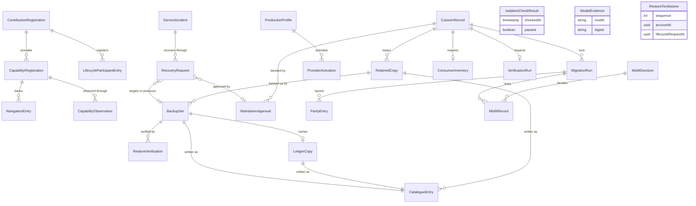

# Functional Specification — U8 complete service operations and integration

Date: 2026-10-21 (Asia/Seoul)
Unit: u8-service-operations-integration. This file is the **source of truth for workflows and state machines**; `entities.md` owns data shape and storage placement, and `rules.md` owns decision logic. Sources: confirmed [functional-design-questions.md](functional-design-questions.md) (Q1–Q16 and the settled items), the [NFR Requirements answers](../nfr-requirements/nfr-requirements-questions.md) Q14–Q19 that reopened this design (backup volume, accounts and runtime arrangement), [requirements FR3, FR4 and NFR1–NFR6](../../../inception/requirements-analysis/requirements.md) (`requirements.md`), the [unit definition](../../../inception/units-generation/unit-of-work.md) (`unit-of-work.md`) and [story map](../../../inception/units-generation/unit-of-work-story-map.md) (`unit-of-work-story-map.md`), the earlier record's U8 definition, the approved components (`components.md`), the frozen contracts C01, C02, C10, C11 and C13 with the common authority rules (`contract-summary.md`), the earlier record's interaction spec C01 and mockups M16, O01 and O02 (all under `../../../../261010-docsuri-v2-rebuild/inception/`), the U5 and U6 handoffs, and the current code (§ "What this design relies on").

## Boundaries and integration points

U8 assembles the application every unit has been building, completes ServiceOperations and the host composition, and brings the result into real operation. It adds no product feature and no business owner.

- **The owners (U1–U6)**, each through its own operations only (BR1.6):
  - AccountAccess (U1, U2): sessions and authority for every request; the lifecycle coordinator and worker; the reconciling migration (BR1.5); imports of accounts and identity links; first sign-in after migration (BR8.6); real Google and ORCID sign-in and real account mail (BR7.1); restore evaluation against tombstones (BR4.6); the verifier-key replacement command (BR6.2).
  - CorpusContent, DiscoveryCitations, PaperAssistance (U1, U3): paper import with content conversion and artifact reuse (BR8.7, BR8.8); the local model executor and query embedder (BR7.1, BR7.7).
  - Library, Personalization, UsageEntitlements (U1, U2): saved-paper and settings imports; their routes mounted in the composed realm.
  - ResearchWorkspace (U4): its lifecycle participant (BR2.3) and the owner job list read (amendment A2).
  - TopicsDigests (U5) and ApprovedExport (U6): participant registration (BR2.4), status counts (BR3.6), and their real-mode bounds lifting in live production (BR7.6). U6's key rules stay as U6 designed them (BR4.8).
- **PlatformControl (U7)**, the separately authorized operator tool:
  - read-only status and evidence (BR3.5);
  - new bound operations: database backup, restore, recreate and remove; the backup agent's operations on the backup volume; service control; tunnel routing; profile mode, admission and backup volume; retained-copy disposal; v1 lifecycle application; and decision recording, which is the only way your decisions are recorded (BR4.2, BR4.3, BR9.10, BR9.12–BR9.15, BR9.17, amendment A6).

  It is never mounted as an application route.
- **v1**, read only until the switch: copies of its database, search index and object store are the migration source (BR8.11, BR8.12). Its launch agents, its data plane in OrbStack, its tunnel route and its own backup job keep running until the switch (BR9.1); before the first dry run, its model runtime and tunnel move to their own accounts at the same addresses (BR6.11). Before the switch it must run from a fixed checkout with a rehearsed restart (BR9.16). Its own account code (deletion records, purge and sessions) is used only by a rollback, through PlatformControl's v1 lifecycle operation (BR9.13).
- **External providers**: Google, ORCID, Resend, the local model runtime and Notion, each behind its owner's adapter (BR7.1–BR7.8).
- **The operating environment**:
  - the production profile root and its operations ledger (BR6.1, BR6.10);
  - v2's own PostgreSQL instance, holding the production, rehearsal, scratch and import databases, separate from v1's data plane (BR6.3, BR6.11);
  - the tunnel and the model runtime that v1 and v2 share, each a system launch job of its own account, and the static maintenance server (BR6.4, BR6.11, BR9.10);
  - the packet filter, which lets each of v2's local addresses be served only by its own account (BR6.11);
  - the production checkout (BR6.5);
  - the retained copies and their disposal (BR9.12, BR9.17);
  - the encrypted backup volume on the external drive, where only U8's backup agent, running as the dedicated backup account, writes, reads back and deletes, using the existing tool's archive write (BR4.3, BR9.17);
  - seven OS accounts (BR4.2, BR6.1, BR6.11):
    - the non-login service account v2 runs as, which owns the profile root and holds only a read-only evidence reader;
    - your operator account, which runs the operator tool, with every grant into another account behind interactive authentication;
    - the non-login scheduler account, which runs the standing authority and alone holds the unattended grants;
    - the backup account;
    - the non-login database, models and tunnel accounts, each running one system launch job and nothing else.

## Requirements corrections

### RC1 — migration of v1 data

- **Origin.** The requirements exclude "data-migration or continuity commitments beyond evidence" (Out of Scope, [requirements.md](../../../inception/requirements-analysis/requirements.md)). In this stage you chose to migrate v1 data (Q4 B), in this release, owned by U8 (Q12 A), with the shape set by Q13–Q16.
- **Correction.** The finished service carries v1's accounts, preferences, saved papers and papers into v2 with verified parity. Pass/fail criterion: the final run's parity report reconciles for every in-scope kind (BR8.10), every misfit kind and reason has your recorded decision, and any new in the final run your explicit approval of its default (BR8.9), and your decision approves the report before the switch continues (BR8.12, BR9.14).
- **Where it lives.** It is recorded here, in U8's design, and traced under FR4.1 ("real accounts and real papers"). The out-of-scope line is lifted for this migration only. The approved requirements file stays as approved.

### RC2 — retiring the Next.js frontend

- **Origin.** The requirements' constraints retain "the existing local stack (Python backend, Next.js frontend, local model runtimes, synthetic verification realms)". In this stage you chose the v2 workspace as the product, with the Next.js application retiring with v1 at the switch (Q2 A).
- **Correction.** After the switch, the v2 workspace served by the v2 host is the only browser application. The Next.js application stops at the switch and is retired at settlement (BR5.7, BR9.8). Pass/fail criterion: after admission opens, the public address serves only the v2 workspace, and `/privacy` and `/terms` stay reachable (BR5.6).
- **Where it lives.** It is recorded here and traced under FR3.1 ("one application with coherent navigation"). The rest of that constraint (Python backend, local model runtimes, synthetic realms) stands. The approved requirements file stays as approved.

## Capability registry (BR3.11)

| Capability | Owner and producer | Required | Degraded means | Backs navigation |
|---|---|---|---|---|
| account.entry | AccountAccess (accounts probe) | yes | named in readiness | sign-in |
| account.controls | AccountAccess (accounts probe) | yes | named in readiness | 계정 |
| library.saved-work | Library (library probe) | yes | named in readiness | 내 서재 |
| personalization.settings | Personalization (personalization probe) | yes | named in readiness | 설정 |
| usage.wallet | UsageEntitlements (usage probe) | yes | named in readiness | 사용량 |
| corpus.content | CorpusContent (corpus probe) | yes | named in readiness | 논문 |
| discovery.search | DiscoveryCitations (discovery probe) | yes | lexical search only, limitation semantic-search-unavailable | 검색 |
| research | ResearchWorkspace (research probe) | yes | new turns wait for the model runtime | 연구, 작업 |
| novelty | ResearchWorkspace (research probe) | yes | new analyses wait for the model runtime | 참신성 분석 |
| topics.digest | TopicsDigests (topics probe and delivery counts) | yes | oldest pending delivery past its bound | 주제 구독 |
| export | ApprovedExport (export status counts) | yes | oldest unknown or accepted effect past its bound | 내보내기 |
| operations.ledger | ServiceOperations (ledger check) | yes | never; damaged means unavailable | 운영 |
| storage.capacity | ServiceOperations (capacity footprint; the service's own view of the backup volume; the backup agent's status check, pulled read-only through PlatformControl) | yes | approaching the budget, or the internal disk low (unavailable below its critical floor); the backup volume unavailable, low on space, under the earlier tool's cleanup marker, with a damaged catalogue, or not the volume the profile names (backup-volume-mismatch) (BR6.6); the last good backup held past its retention (BR9.17) | — |
| background.work | ServiceOperations (control loop) | yes | a lane behind its deadline | — |
| assistance.summary, assistance.translation | PaperAssistance (assistance probe) | no | pending until its readiness evidence is recorded (BR7.7); runtime unavailable | inside 논문 |
| platform.status | PlatformControl (read-only pull) | no | informational only | — |
| platform.isolation | PlatformControl (the runtime isolation check, BR6.12, pulled read-only) | no | never; unavailable when the check fails (runtime-isolation-lapsed, with the failed items as limitations) | — |
| operations.cutover | ServiceOperations (cutover check against PlatformControl's read-only routing and service evidence) | no | never; unavailable when an effect's outcome is unknown, or the public address or a named service is not where the CutoverRecord says | — |
| provider.google, provider.orcid | AccountAccess adapters | no | held as sign-in-unverified, or unreachable | sign-in buttons |
| provider.resend | AccountAccess and TopicsDigests adapter | no | held as first-effect-pending, or allowance exhausted | mail-dependent flows |
| provider.models | local model runtime adapter | no | runtime unreachable; a model whose digest differs from the release's pin (ModelEvidence), or that the release does not pin, makes it unavailable (model-evidence-mismatch, BR6.11) | assistance, research, semantic search |
| provider.notion | ApprovedExport adapter | no | held as first-effect-pending, or unreachable | export flow |
| public.static | host | always available while the host serves | — | 개인정보 처리방침, 이용약관 |

Readiness is defined in BR3.1. The switch's opening gate is stricter: every required capability must be available, every configured provider active, and no incident open (BR9.4).

## Workflow 1 — Assemble and start the complete application

1. The production profile's system launch jobs start v2 as the service account, at boot or when the operator starts them, or a runner starts the composed synthetic realm, through the complete assembly's own entrypoint (**BR1.7**, **BR6.1**). At boot the packet filter's rules load, the backup volume is unlocked, and v2's PostgreSQL instance, the model runtime and the tunnel start as their own accounts; nobody needs to log in (**BR6.11**).
2. Profile checks:
   - the root exists, lies outside `/tmp`, is not a link and is owner-only, owned by the service account (**BR6.1**);
   - no production restore of the live environment is active without its start authorization (startAuthorizedAt); otherwise the start refuses, whether service control or a launch job at boot started it (**BR4.7**, **BR6.1**);
   - the release runs from the production checkout's system folder, with its Python runtime and dependencies inside it (**BR6.5**, **BR6.11**);
   - the operations ledger's chain reaches its head (**BR6.10**);
   - the key folders are present, and none is missing while accounts exist (**BR6.2**);
   - the service's own secrets are present (**BR6.7**);
   - v2's instance answers at the profile's address, the connection authenticated through SCRAM, which v2's client demands, and the database identity matches the profile (**BR6.3**, **BR6.11**);
   - the backup volume the manifest names is mounted and encrypted, as far as the service account can see; if not, the start continues and storage.capacity shows degraded (**BR6.1**, **BR6.6**);
   - the running release tag and commit are recorded (**BR6.5**).
3. Schema check: the database must be at the expected migration set. Nothing is migrated at start (**BR1.5**).
4. Registration, in dependency order. For each contribution the host compares revision and schema digest with the manifest and activates it or marks it unavailable with a reason (**BR1.1**, **BR1.2**). It registers each capability from the registry (**BR3.11**) and configures the lifecycle manifest with AccountAccess (**BR2.1**, **BR2.7**).
5. Workers and the control loop start, and every producer begins its periodic observations (**BR3.3**).
6. The service is ready under **BR3.1**. Until then the health route names what is missing.
7. Error paths:
   - root, ledger or key check fails → the start refuses, naming the check;
   - v2's instance does not answer yet, for example at boot → the host stays live and not ready and retries; it neither refuses nor restarts in a loop, and the start completes once the instance answers (**BR3.1**, **BR6.11**);
   - a provider secret is missing → that provider is unconfigured and the rest starts (**BR6.7**, **BR7.2**);
   - a contribution is incompatible → its capabilities are unavailable, readiness stays false, and an incident opens after the tolerance (**BR1.2**, **BR3.7**);
   - schema not at the expected set → the start refuses, naming the difference.

## Workflow 2 — Resolve navigation and render the shell

1. The browser loads the v2 workspace and asks the server to resolve navigation for the current session or the anonymous context (C01 host.resolveNavigation).
2. The server evaluates every navigation entry: the caller against its access rule, and the capability's derived state (**BR3.2**). It returns each entry with available, a reason key and its placement (**BR5.1**, amendment A1). The legal entries are always available (**BR5.6**).
3. The browser renders:
   - the primary entries in order, plus 운영 for administrators (**BR5.3**);
   - the footer links (**BR5.6**);
   - each entry's state and Korean reason (**BR5.2**).

   논문 opens from search, library, digest and job results, keeping their return context (**BR5.3**).
4. On sign-in, sign-out, account switch or expiry, navigation is resolved again and private rendering state is cleared (**BR5.5**). Signed-out callers read only the public capability projection (**BR5.9**).
5. Error path: if resolution fails, the browser shows only the public entries, says that the other destinations could not be checked, and offers a retry. It never enables an entry the server has not confirmed.

## Workflow 3 — Observe capabilities and report readiness

1. Each producer observes its capability every renewal interval (**BR3.3**):
   - owners' probes;
   - export and digest counts (**BR3.6**);
   - the capacity footprint (**BR6.6**);
   - the ledger check (**BR6.10**);
   - each provider's reachability, allowance and hold, and for the model runtime each model's digest against the release's pin (ModelEvidence) (**BR7.2**–**BR7.4**, **BR7.8**, **BR6.11**);
   - PlatformControl's status, read only (**BR3.5**), including the backup agent's latest status check (**BR6.6**);
   - the runtime isolation check's latest result, read only, as platform.isolation (**BR3.5**, **BR6.12**);
   - the cutover check: whether every effect is settled and the public address and named services are where the CutoverRecord says (**BR3.7**).
2. ServiceOperations admits or refuses each observation (**BR3.4**). Observations are kept in the running environment's database (entities.md § Storage placement).
3. On every read, each capability's state is derived from its latest observation and its age (**BR3.2**).
4. The health route reports liveness and capability readiness (**BR3.1**). The dashboard shows administrators every capability with its state, age and limitations, and the ledger's incidents, backups and recovery requests (**BR3.8**).
5. Error paths:
   - a producer fails → unknown with its reason;
   - the observation store is unavailable → bounded buffering, with dropped observations counted.

   Neither ever changes a domain outcome (**BR3.4**).

## Workflow 4 — Handle an incident

1. A required capability stays outside available past its tolerance, the cutover check or the runtime isolation check stays unavailable past its tolerance, the isolation check stays unknown or stale past it, a job failure is correlated to a required capability, a switch aborts, or a rollback's database copy cannot be completed. An incident opens in the ledger for the current environment, or the signal attaches to the open one. An abort's incident and a rollback's copy-pending incident name operations.cutover in the live environment; when one is already open there, the abort or the rollback takes it over as its own (**BR3.7**, **BR9.5**, **BR9.7**).
2. An administrator with current MFA opens it from the dashboard (**BR3.8**). The incident moves to investigating and records a diagnosis key.
3. If backup or restore is needed, the administrator requests it (Workflows 5–7), and the incident moves to recovering.
4. The incident resolves only with evidence, recorded as its resolution kind (**BR3.7**):
   - capability-available: the capability is available again and, where a recovery ran, its verification passed;
   - abort-reviewed, for an abort's incident only: every abort effect is settled, v1 answers at the public address, the production database was recreated, and your review of the abort is recorded (**BR9.5**, **BR9.14**);
   - rollback-copy-settled, for a rollback's copy-pending incident only: the stopped production database's copy is recorded or your decision waived it, and the database was recreated, on those receipts and with no observation, since v2 is stopped (**BR9.7**);
   - environment-stopped: any other live incident still open when an abort or a rollback stops v2, with the stop's receipt, listed for your review.

   Because incidents live in the ledger, a production restore never erases the incident that caused it.
5. Error paths:
   - a failed recovery returns the incident to investigating;
   - an unknown platform outcome is reconciled first (**BR4.4**).

## Workflow 5 — Back up an environment's database

1. A backup starts in one of two ways (**BR4.1**–**BR4.3**):
   - the daily schedule (policy), which creates a backup.create request with origin schedule under the standing operator authority;
   - an administrator's backup.create request, which carries a new submissionId (**BR4.9**).
2. The request is recorded in the ledger as requested. It is admitted to awaiting-operator once no conflicting request is active in its environment and no switch, abort or rollback holds that environment. Until then it waits and holds nothing, and it expires if it is not admitted within the start bound (**BR4.4**).
3. PlatformControl runs the database backup operation. It binds actor, target and input before the effect and has the backup agent dump the database itself (database only, **BR4.8**), write it onto the backup volume and check its integrity, by Workflow 19 (**BR4.3**). A ledger copy goes onto the volume beside it the same way (**BR6.10**).
4. The BackupSet is recorded in the ledger with its revision and integrity result. A passed live set lets the backups scope give evidence (**BR2.5**).
5. Error paths:
   - integrity fails → the set is kept as evidence and an incident opens;
   - the backup agent's volume check fails → the request fails with that reason, anything the agent staged for it is removed (Workflow 19), and an incident opens on storage.capacity (**BR4.3**, **BR6.6**);
   - a known failure → failed;
   - the outcome is unknown → it is reconciled before any other production-affecting operation (**BR4.4**).

## Workflow 6 — Verify a restore

1. A restore.verify request is created in one of three ways (**BR2.6**):
   - by an administrator, for a passed set;
   - by the schedule (policy);
   - when an erase request is waiting, which makes a verification due within the erasure verification bound.
2. The standing authority first checks the internal disk: its free space, less the size the source database had when the set was dumped, must stay above the threshold, or the request is refused with internal-disk-low (**BR6.6**). The register head (sequence and digest) is read and recorded. The operator's standing authority, running as the scheduler account, runs the database restore operation into a scratch target, never production: the backup agent's unattended verify command restores the set into a new scratch database itself, so no file leaves the agent, and the checks below read that database through the scheduler account's database login, which also drops it at the end. It checks integrity, replays every tombstone up to that head, checks every tombstoned owner absent, and then removes the scratch target (**BR4.5**, **BR4.6**).
3. The RestoreVerification is recorded in the ledger with the time the scratch target was removed; the request succeeds only once that removal is confirmed. A verified live result gives restore_enforcement evidence to every erase request whose tombstone sequence it covers (**BR2.6**).
4. Error paths:
   - an erased owner surviving, or an integrity failure, makes the result failed and opens an incident;
   - a damaged register blocks the verification (**BR4.6**);
   - the internal disk has too little room → the request is refused with internal-disk-low, and the next scheduled verification tries again (**BR6.6**);
   - a scratch target that cannot be removed fails the verification and is recorded as a retained copy until the operator removes it (**BR9.12**).

## Workflow 7 — Restore production

1. An administrator requests restore.production for one live backup set (**BR4.1**). It stays requested, holding nothing, until your decision approving the exact backup and target is recorded through the operator tool (**BR4.7**, **BR9.14**). It is then admitted once no other production-affecting request is active (**BR4.4**), and it expires if it is not admitted within the start bound.
2. The operator, in person, runs the restore through bound operations (**BR9.10**). The request stays active, and so holds the live environment's exclusion, until it ends; the disposal pass therefore cannot run meanwhile (**BR4.4**, **BR9.17**):
   - the tunnel routes to the maintenance server;
   - v2's services stop through service control, so nothing writes any more;
   - a pre-restore backup of the current database is taken onto the backup volume as a step of this request, and its integrity must pass. A successor restore skips this step: its database was already recreated by the held request it replaces, whose pre-restore set stays its fallback;
   - the database is recreated, once, and only at this step: while the request is running, after the maintenance route, the v2 stop and, without a predecessor, the passed pre-restore set. Live mode with admission open allows nothing else (**BR9.10**). It is then restored from the chosen set, which the backup agent streams back through its in-person command;
   - every tombstone newer than the chosen set is replayed through AccountAccess's restore evaluation (**BR4.6**);
   - integrity is checked;
   - a post-restore backup of the restored database is taken as a step of this request, and its integrity must pass;
   - as the request's own last steps, it records its start authorization (startAuthorizedAt), v2 starts through service control, readiness is re-established (**BR3.1**), and the tunnel routes back to v2. v2's own start check refuses every start while a production restore is active without that authorization, including a start by a launch job at boot, so v2 stays stopped through post-restore-pending and held (**BR4.7**, **BR6.1**).

   The key folders are untouched (**BR4.8**).
3. Every receipt and the evidence are recorded on the request in the ledger, and the related incident can resolve.
4. Error paths:
   - a step before the recreate begins fails (the route to the maintenance server, stopping v2, or the pre-restore backup) → nothing is restored. The request ends failed first; then the operator starts v2 again on the untouched database and routes the tunnel back through plain service control, which v2's start check allows because no restore is active any more. The maintenance notice stays until the route back succeeds;
   - the post-restore backup fails → the request moves to post-restore-pending and stays active with the maintenance notice up. Under this same request and its receipt, needing no new decision, the operator retries the backup once the volume check passes, or retires a volume lost for good and takes the backup on the replacement (**BR4.10**). The request then finishes as in step 2;
   - v2's start, its readiness or the route back fails after the start authorization → the request stays verifying, still active with the maintenance notice up, and the operator retries those last steps under it (**BR4.7**);
   - a step fails once the recreate has begun (the recreate itself, the restore, the tombstone replay or the integrity check) → the request moves to held and stays active with the maintenance notice up, and v2 stays stopped. The way back is a successor: a new production restore of the pre-restore set or another passed set, whose decision names the held request as well as the backup and target. Your decision admits it in the held request's place, but the held request keeps its hold, and the exclusion, until the successor starts running. Only then does the held request end failed, naming its successor, which takes the exclusion over without a gap. A successor cancelled, refused or expired before it runs leaves the held request held, and only one successor waits at a time. A successor takes no pre-restore backup; any failure of it before its restore, replay and integrity check have passed leaves it held in turn, never starting v2, and a failed post-restore backup moves it to post-restore-pending like any restore (**BR4.4**, **BR4.7**). If the backup volume is lost while a restore is held, your decision can retire it (**BR4.10**). Your decision can abandon the held restore, typically when no restorable passed set survives, after seeing what will be lost and every passed set that remains. Abandoning while a restorable set remains is a deliberate, recorded choice. It is refused while a successor waits, which must be cancelled first. The production database is then recreated empty under the still-held request, as its step bound to your decision's receipt, so nothing erased comes back. Only once the recreate's receipt is recorded does the request end failed. The same decision then authorizes the start: the operator starts v2 on the empty database and routes the tunnel back through service control, and the maintenance notice comes down when the route back succeeds. A recreate that fails leaves the request held and may be retried under the same decision; an unknown outcome leaves it unknown. Either way v2 stays stopped (**BR4.7**, **BR9.10**);
   - an unknown outcome → reconciled first (**BR4.4**).

## Workflow 8 — Account lifecycle across every participant

1. An owner asks to withdraw, reactivate or erase through AccountAccess's existing flows, with reauthentication (C02).
2. AccountAccess records the request with the manifest revision, plus one scope row per manifest pair: 21 in all (**BR2.1**, **BR2.7**).
3. The control worker claims each scope for its participant's adapter:
   - AccountAccess, Library, Personalization, UsageEntitlements, PaperAssistance and DiscoveryCitations, as built;
   - ResearchWorkspace (**BR2.3**);
   - TopicsDigests and ApprovedExport (**BR2.4**);
   - ServiceOperations.

   For an erase request, ServiceOperations appends the tombstone when restore_enforcement is first claimed (**BR4.6**). That makes a verification due (Workflow 6). The backups scope gives its evidence, with the latest disposal date, once a live backup exists (**BR2.5**).
4. Each adapter acts only on its own data and acknowledges with evidence. The request completes only when every scope has evidence (**BR2.2**), which for an erasure includes a verification covering its tombstone (**BR2.6**).
5. Error path: a scope without evidence stays blocked, and the owner sees honest per-scope progress, including the retained-by-policy date (**BR2.2**, **BR2.5**).

## Workflow 9 — Migration dry run

1. You give the go-ahead to copy v1, as your decision (**BR9.14**). A new rehearsal database is created for this run in v2's PostgreSQL instance with the composed realm's schema and recorded as a retained copy (**BR1.5**, **BR6.3**, **BR8.11**). A dry run starts only while the runtime arrangement is installed (Workflow 20) and the latest runtime isolation evidence, which the tool always reads directly from the isolation evidence folder, passed within its freshness bound. The tool reads it again at every phase boundary and during long phases, and a lapse interrupts the run (**BR6.12**, **BR8.11**).
2. The migration tool, run by the operator, records the copy as a retained copy with every location it will occupy, then takes a read-only copy of v1 onto the backup volume by Workflow 19, through the backup agent's in-person snapshot command: the agent dumps v1's database itself, through its read-only login in v1's data plane, and the tool streams the search index's documents, and the object store's manifest with the objects the migration reads, to the agent as tar archives. It records the copy's checksums when the copy completes (**BR4.3**, **BR8.11**, **BR9.12**). The run records the digest of the decisions current at its start (**BR8.9**).
   Before the import restore and again before each import phase, the tool checks the internal disk: its free space, less what the run still has to write (its import database and the rehearsal database it builds, less what they already hold), must stay above the threshold, or the run is interrupted with internal-disk-low (**BR6.6**). It then records an import database as a retained copy and restores the snapshot's database dump into it, in v2's instance, streamed back by the agent's in-person command; the import reads v1's records from there. The import database is removed when the run ends, whatever its outcome (**BR8.11**, **BR9.12**).
3. The tool imports through the owners' import operations (**BR8.2**), in dependency order (**BR8.4**), with deterministic identities (**BR8.3**), applying your current decisions (**BR8.9**):
   - accounts and credentials (**BR8.5**, **BR8.13**, **BR8.14**);
   - identity links and preferences;
   - papers with their content (**BR8.7**) and embeddings (**BR8.8**);
   - saved papers.

   Kinds outside Q13 are counted, not imported (**BR8.1**).
4. In verifying, the tool builds the parity report (**BR8.10**). It then runs the idempotency pass over the same snapshot, which must report nothing imported or updated (**BR8.3**).
5. You accept or reject the report as your decision through the operator tool (**BR9.14**). An accepted dry run becomes the cutover's accepted dry run, and its rehearsal database becomes the soak's database. The operator, in person, sets the profile's rehearsal database to it. If the soak is already running, the rehearsal v2 stops before the change and starts again on the new database right after; otherwise it first starts when the soak starts, once the complete verification has passed on the release (**BR8.11**, **BR9.3**, **BR9.15**). Once the run ends, its copy of v1 is disposed. Once it is accepted, the previously accepted run's rehearsal database is removed, now that the profile no longer names it, and only then are its backup sets disposed. A rejected run's rehearsal database is disposed with its copy (**BR9.12**, **BR9.17**).
6. Error paths:
   - the copy fails → the run fails, nothing is written to v1 or production, and its copies, complete or not, are disposed through their records;
   - the run is interrupted → it resumes only its recorded phase, against a re-verified snapshot; a copy cut short is disposed through its record and taken again under a new one; or you abandon the run, which fails it and disposes of its copies (**BR8.15**);
   - an owner refuses a record → it becomes a misfit with the owner's reason (**BR8.2**).

## Workflow 10 — Decide misfits

1. The tool lists each misfit kind and reason from the latest run, with counts and source identifiers only.
2. You decide each one, as your decision through the operator tool (**BR9.14**):
   - map, with its stated rule;
   - archive-only;
   - drop.

   For kinds outside Q13, archive-only is proposed (**BR8.9**).
3. Decisions apply from the next dry run onward. A final run needs every kind and reason decided that the accepted dry run met, or that an earlier final run met before its freeze ended. It freezes the decisions current at its start. Anything a final run meets for the first time takes archive-only and needs your explicit approval in its report. A rejected or failed final run, or an abort or rollback after it started, even once its report was accepted, ends the freeze, so you can change decisions before the next final run (**BR8.9**). A decision changed after the latest accepted dry run started needs a new dry run under the current decisions, accepted, before the switch can start, so no decision reaches the production import untried (**BR8.9**, **BR9.2**).

The kinds the current v1 schema already shows are listed below with a proposed decision. **Every proposal is yours to accept or change. Nothing is decided until you record it.**

| Kind | Reason | What v1 holds | Proposed decision |
|---|---|---|---|
| account | required-field-without-source | v1 has no display name; v2 requires one | map: the ORCID name when linked, otherwise the part of the email before @ |
| account | unverified-in-v1 | sign-ups that never verified (status PENDING) | archive-only |
| account | locked-in-v1 | accounts locked after failed attempts | map: import as reset-required |
| account | closed-in-v1 | deactivated accounts and pending deletions | archive-only |
| account | no-email | ORCID-only sign-ups without an email | archive-only (v2 needs an email and has no provider sign-up) |
| account | email-case-conflict | emails differing only in letter case | archive-only |
| identity-link | unconfirmed-link | links still pending confirmation | drop (the owner can link again) |
| identity-link | duplicate-provider-link | a second link to the same provider | archive-only |
| preferences | no-v2-home | interest weights | archive-only |
| paper | exceeds-v2-limit | papers above v2's chunk or content limits | archive-only |
| paper | ineligible-in-v2 | papers the corpus rules refuse | archive-only |
| paper-content | content-shape-unconvertible | parsed documents the owner cannot convert | archive-only |
| paper-embedding | embedding-provenance-unproven | vectors not proven to match the pinned model | map: re-embed locally with the pinned model ($0) |
| paper-figure | no-v2-home | figure and table captions, positions and images | archive-only |
| saved-paper | duplicate-by-version | the same paper saved under two version suffixes | collapse into one (rule BR8.14), reported |
| followed-topic, digest-settings, glossary, saved-search, search-history, behavior-event, plan-record, private-upload, research-history, novelty-history, summary | not-in-scope | personal data that Q13 did not name | archive-only (default) |

Archive-only data, like every v1 record that is not imported, stays only in the retained v1 copies until their disposal dates (**BR9.12**).

## Workflow 11 — Take the consumer inventory

1. Over the observation window (policy), v1's route use is recorded by client: user agent and route family only, no personal data. Known integrations are added (**BR9.11**).
2. Every consumer gets the disposition your decision approves (**BR9.14**):
   - moves with v2;
   - retired with v1;
   - informed;
   - accepted to break.
3. A complete inventory is a switch precondition (**BR9.2**). Settlement follows its dispositions (**BR9.8**).

## Workflow 12 — Rehearse: the soak

1. The release starts on the production profile in rehearsal mode, on the accepted dry run's rehearsal database (**BR9.3**). This happens once a dry run is accepted and the complete verification has passed on the release. The soak runs on the runtime arrangement, which Workflow 20 installed before the first dry run. An isolation lapse, or an isolation check that stays unknown or stale past its tolerance, opens an incident that the soak's clean rule counts (**BR3.7**, **BR9.3**).
2. Real providers serve under the pre-switch recipient bound: only you receive anything (**BR7.5**).
3. The scheduled backups and at least one restore verification of the rehearsal database run during the soak, recorded in the ledger (**BR4.3**, **BR4.5**). Incidents are recorded in the ledger as in production (**BR3.7**).
4. At the end of the soak period, the ledger evidence decides whether the soak was clean (**BR9.3**). A new release tag restarts the soak. A clean result stays valid for its release tag after an abort (**BR9.5**).
5. Within the restart rehearsal window before the switch, and on your decision, the operator rehearses v1's restart (**BR9.16**):
   - v1 must already run from a fixed checkout at a recorded commit;
   - the public address routes to the maintenance server;
   - the model runtime and the tunnel already run as their own accounts (**BR6.11**);
   - every v1 named service stops and starts again from that checkout;
   - v1's health and a signed-out page answer through the public address;
   - the receipts and v1's commit are recorded on the CutoverRecord.

   Any later change to v1's checkout or services voids the rehearsal.

## Workflow 13 — The switch

This runs in the Deployment Execution stage, with your decisions (**BR9.9**, **BR9.14**). Every effect is a bound operation whose receipt is added to the CutoverRecord, and the switch holds the live environment's exclusion throughout, so no backup or restore request is admitted meanwhile (**BR9.10**, **BR4.4**).

1. Every precondition of **BR9.2** holds, and your decision approves the start. The switch time bound starts (policy).
2. The tunnel routes the public address to the maintenance server. v1's services and scheduled jobs stop, and the rehearsal v2 stops. v1 writes are now stopped.
3. The production database is recreated empty. The final snapshot is recorded as a retained copy and taken onto the backup volume by Workflow 19, as a dry run's is, and the final run imports under the frozen decisions through its own import database (**BR8.12**). Your decision approves its parity report, including any new-in-final items (**BR8.9**).
4. The profile changes to live with admission maintainer-only (**BR9.15**), and v2 starts on the production database (**BR6.4**). The first live backup is taken, and its integrity must pass (**BR4.3**).
5. The tunnel routes the public address to v2. In the maintainer-only window:
   - you sign in;
   - you verify Google and ORCID sign-in with your own identities and record each verification (**BR7.8**);
   - you approve each outward provider's first effect from its recorded preview: an email to yourself, and an export to your own Notion page (**BR7.3**).
6. Every required capability is available, every configured provider is active (or your opening decision accepts it unavailable), and no incident is open (**BR9.4**). Your decision approves opening, and the profile's admission opens (**BR9.15**): the cutover is switched.
7. Right after opening, v1's stopped stores are recorded as a retained copy. The profile's rehearsal database is cleared, then the rehearsal databases are removed, and only then are their backup sets disposed (**BR9.12**, **BR9.15**, **BR9.17**). v1 stays stopped but installed.
8. Error path: any failed or declined step, an interrupted final run past its bound (**BR8.15**), or the switch time bound passing before admission opens aborts the switch (Workflow 14).

## Workflow 14 — Abort, rollback, settlement and disposal

1. **Abort, before admission opens** (**BR9.5**). v1 serves again before anything of v2's is removed:
   1. The cutover moves to aborting, and the abort's incident opens (operations.cutover, live environment). If one is already open there, the abort takes it over as its own.
   2. The tunnel routes to the maintenance server, and v2 stops.
   3. v1's services and scheduled jobs start. Once v1's health answers locally, the tunnel routes back to v1.
   4. Only then does the profile return to rehearsal mode with admission maintainer-only (**BR9.15**), and the production database is recreated empty. Every outward and sign-in provider's approval is cleared, so the next switch verifies each again (**BR7.3**, **BR7.8**).
   5. The other unresolved live incidents resolve as environment-stopped and are listed in the abort's incident (**BR3.7**). A final run that was not yet accepted ends failed, and the decisions unfreeze either way (**BR8.9**).
   6. The cutover returns to rehearsing, and the rehearsal v2 starts again on the accepted dry run's database. A completed final snapshot stays as a retained copy; one whose copy never completed is disposed through its record (**BR9.12**). The accepted dry run and the soak's clean result stay valid for the same release.
   7. You review the abort. Your recorded review resolves the abort's incident, which **BR9.2** needs before another switch.
   8. If v1 does not start, the cutover stays aborting with the maintenance notice up, the incident records v1-restart-failed, and the operator repairs v1 from its fixed checkout (**BR9.16**). Nothing routes to v1 until its health answers locally.
2. **Rollback, within the window after opening** (**BR9.7**). v1 serves again before anything of v2's is removed:
   1. Your decision starts the rollback, and the cutover moves to rolling-back.
   2. The tunnel routes to the maintenance server, and v2 stops.
   3. v1's services and scheduled jobs start, with the public address still on the maintenance server.
   4. v2's lifecycle outcomes are applied to v1 through v1's own account code, and every v1 session ends (**BR9.13**).
   5. The tunnel routes to v1, and v1's health answers through it; rollbackV1ServingAt is recorded. At this same step the v1-stores copy is marked returned to service, the profile returns to rehearsal mode with admission maintainer-only (**BR9.15**), provider approvals are cleared, and the decisions unfreeze (**BR7.3**, **BR7.8**, **BR8.9**).
   6. Only after that step is the stopped production database copied onto the backup volume by Workflow 19, as a retained copy with the disposal date your rollback decision approved. It is recreated empty only once that copy's checksum is recorded.
   7. Unresolved live incidents resolve as environment-stopped. Accounts and writes created in v2 are reported per kind. The cutover is rolled-back.
   8. If the copy cannot be completed for any reason (the backup volume missing, locked or full, a digest that differs, an integrity check that fails, or a stream that breaks), the cutover stays rolling-back with v1 serving and records rollbackCopyPendingSince. Step 5's effects stay in place: the profile is in rehearsal mode, provider approvals stay cleared, and decisions can be changed. The production database stays stopped and untouched, an incident opens on operations.cutover, and no dry run, rehearsal or switch starts. The wait ends in one of three ways (**BR9.7**):
      - the operator retries the copy, once the volume check passes when the volume was the cause;
      - your decision retires a volume lost for good and names its replacement (**BR4.10**), and the copy is written there;
      - your decision waives the copy, after you are shown the per-kind count of accounts and writes made in v2 since the switch that will be lost; the database is then recreated without a copy.

      Once the database is recreated, that incident (CutoverRecord.rollbackCopyIncidentId) resolves first, as rollback-copy-settled on the receipts of the copy or the waiver and of the recreate, with no observation needed (**BR3.7**); then the rollback finishes as in step 7, where the other live incidents resolve as environment-stopped.
   9. If v1 does not start, or a step fails before rollbackV1ServingAt is recorded, your decision can cancel: v1 stops, v2 starts again on its untouched database, the tunnel routes back to v2, and the cutover returns to switched.
3. **Settlement, after the window closes without rollback, on your decision** (**BR9.8**):
   - v1's routes and the Next.js application are retired through the release path, under the inventory's dispositions;
   - v1's stores stay as their retained copy until its disposal date.
4. **Disposal** (**BR9.12**, **BR9.17**). Each retained copy is disposed at its point:
   - a dry run's copy of v1, when its run ends;
   - an import database, when its run ends;
   - a rehearsal database with its backup sets, when a newer dry run is accepted, when its own run fails or is rejected, or right after admission opens;
   - a scratch restore left by a failed verification, when the operator removes it;
   - the v1 final snapshot, v1's stores and a rolled-back v2 database, at the date your decision approved;
   - any copy, at its backstop date at the latest.

   Backup sets and ledger copies go at their retainUntil, except the newest passed set of a database that still exists and the newest verified ledger copy, which the retention floor keeps until a newer one passes (an incident shows while it does). Each place has one deletion path (**BR9.17**):
   - **On the backup volume**, only the backup agent deletes, on its own catalogue's terms (Workflow 19). The earlier tool's age-based cleanup never reaches U8's folder.
   - **Databases** (rehearsal, scratch and import) go through PlatformControl's database remove, which refuses the production database and the rehearsal database the profile names as current. Unattended, it runs through the scheduler account's database login, which can drop only databases owned by the disposable-databases role, as scratch, import and rehearsal databases alone are; the operation itself refuses the current rehearsal database, which it reads from the latest profile receipt in the ledger. For a rehearsal database the order is fixed: the profile is repointed or cleared first; the removal waits until no backup or restore verification of the rehearsal environment is active, admitting none meanwhile; then the database is removed; and only then are its backup sets disposed. A rehearsal database the soak still uses at its backstop date sends the cutover back to preparing, and an incident shows until the operator, in person, stops the rehearsal v2, clears the profile's rehearsal database and removes it.
   - **v1's stores** are deleted only by the operator in person, at the date your decision approved.

   The disposal pass runs under the standing authority after each scheduled backup and whenever the volume check passes again, but never while a switch, an abort, a rollback or a production restore holds the live environment's exclusion. It has the agent delete what its catalogue shows due and records each disposal time from the agent's receipt. If a disposal cannot complete, the record stays undisposed and counted in erasure evidence, the next pass retries it, and an incident opens once a backstop date has passed. A volume lost for good is retired on your decision (**BR4.10**).

## Workflow 15 — First sign-in after the switch

1. A returning user sees that DocSuri moved to the new version and that they need to sign in once (**BR9.6**).
2. They sign in with the same password, carried unchanged (**BR8.5**), or through their linked Google or ORCID identity (**BR7.1**).
3. A reset-required account requests a reset email. The screen says whether it was accepted for sending, or why it could not be sent (**BR8.6**, **BR7.2**).
4. Before any personal feature runs, the account gives v2's consents (**BR8.6**). An administrator enrols MFA before any administrator action.
5. Their saved papers and preferences are there. Kinds decided archive-only are not, and the moved-notice says where to ask about them.
6. Error paths:
   - a sign-in provider is unavailable → a plain message, and password sign-in where the account has one (**BR7.2**);
   - the email allowance is exhausted → a plain message to try again later (**BR7.4**).

## Workflow 16 — Activate an outward or sign-in provider

1. In live mode with admission maintainer-only, each outward provider is held (first-effect-pending) and each sign-in provider is held (sign-in-unverified) (**BR7.3**, **BR7.8**).
2. For sign-in providers, you complete a real sign-in with your own linked identity through the public address and record the verification as your decision. For outward providers, you trigger the first effect, addressed to yourself; the owning module holds it and records its exact content as a preview in the evidence folder, and you approve that content through the operator tool (**BR9.14**).
3. Once your decision is in the ledger, the held effect is sent and the provider becomes active. For Notion and Resend, U6's and U5's bounds then lift (**BR7.6**).
4. Error paths:
   - you decline, or the verification fails → the provider stays held or unavailable, and you choose to abort or to open without it (**BR9.4**);
   - a later provider failure → degraded (**BR7.2**).

## Workflow 17 — Whole-application verification

1. From a clean checkout, the new runner provisions the one composed synthetic realm (**BR10.1**), migrates it, and loads the fixtures: two synthetic owners and a synthetic v1 dataset covering every misfit reason.
2. It runs the journeys of **BR10.3** through real HTTP and a real browser (**BR10.2**), plus the accessibility checks (**BR10.6**).
3. It records the VerificationRun for the commit (**BR10.5**). Its CI lane runs on every change to develop (**BR10.4**). The runner's own phases tear the realm down or archive it.

## Workflow 18 — Record your decision

1. A step that needs you (**BR9.14**) shows its subject in the operator tool: the report, the misfit and its mapping rule, the consumer's disposition, the first effect's recorded preview, the backup and target, the disposal date, or the facts for the step, such as which providers an opening accepts unavailable.
2. You approve or decline. PlatformControl's decision operation binds you as the operator, the step, the subject and the digest of exactly what you were shown, and leaves a receipt.
3. The operator tool appends the MaintainerApproval to the ledger through ServiceOperations' ledger component, which admits it only with a valid receipt and works while v2 is stopped (**BR6.10**). The waiting step proceeds only on an approved decision for the same digest. The web application can show decisions but never records one.
4. Error paths:
   - the subject changed after you saw it → the decision is refused, and the new subject is shown;
   - an unknown outcome → reconciled before anything relies on it (**BR9.10**).

## Workflow 19 — The backup volume: write, read back and delete

Every file copy U8 makes takes this one path: a backup set, a ledger copy, a dry-run copy of v1, the v1 final snapshot, and a rolled-back database's copy (**BR4.3**). Only the backup agent touches U8's folder (`docsuri-v2` at the volume's top level, holding the archives folder, the staging folder and the agent's catalogue). Its unattended commands are granted without a password to the scheduler account alone. The operator account may run any command, but only in person. The service account v2 runs as may run none:

| Command | Who runs it | Does |
|---|---|---|
| status | scheduler account, unattended (every renewal interval); PlatformControl before each operation | the volume check (step 1) |
| backup | scheduler account, unattended; operator account in person inside a production restore and the switch | dumps the production database or the current rehearsal database into a live or rehearsal set |
| ledger-copy | scheduler account, unattended | receives the ledger component's stream as a ledger copy |
| verify | scheduler account, unattended | restores a passed set into a new scratch database itself, for a restore verification (Workflow 6) |
| dispose-due | scheduler account, unattended | the disposal pass (step 8) and the staging sweep |
| snapshot | operator account, in person | dumps v1's database and receives the index and object archives, as a dry-run or final snapshot |
| rollback-copy | operator account, in person | dumps the stopped production database as a rolled-back database's copy |
| stream-back | operator account, in person | streams one file to a production restore, an import or a ledger repair |
| dispose-event, set-date, dispose-mismatch, rebuild-catalogue, prepare-volume, configure | operator account, in person | step 10, and BR4.10 for a replacement volume |

In person means after the operator authenticates interactively at this Mac. The agent trusts no caller: a copy's kind comes from the command and the source database, and a file is deleted only on the terms the agent recorded when it wrote the file.

**Writing**
1. The agent's status check passes: the backup account owns the volume, which enforces ownership, and can write U8's folder, free space is above the backup floor, the catalogue verifies, and no folder from U8's folder up to the filesystem root carries the earlier tool's cleanup marker (**BR6.6**).
2. The copy's record (BackupSet, LedgerCopy or RetainedCopy) is written to the ledger with its staging and final locations. The agent then enters the file in its catalogue as writing (**BR4.3**, **BR9.12**).
3. The bytes reach the agent's staging folder on the volume:
   - a database the agent dumps itself, in PostgreSQL's custom format. It dumps only the databases its own configuration names: the production database and the rehearsal databases by their fixed name pattern, in v2's instance, and v1's database, in v1's data plane. Scratch and import databases have patterns of their own and are never dumped. Its logins are one in v2's instance, which can read the databases it dumps there and can create and restore into only databases under the scratch name pattern (for the verify command), and a read-only one in v1's data plane that only the snapshot command uses. The kind follows from the command and the source (table above), never from what a caller says;
   - anything else arrives as a stream from the operation that can read the source, with that operation's digest of what it sent. A ledger copy comes from the ledger component, run as the service account through its fixed command. A directory tree, such as the search index's documents or the selected objects with their manifest, comes with its snapshot as a tar archive carrying a manifest of its members' checksums.
4. The agent writes the staged file into the archives folder with the earlier tool's archive write. That write never replaces an existing file, and it checks the volume is encrypted by asking about the volume's mount point. The written file's digest must equal the staged file's and, for a stream, the sender's.
5. The agent checks integrity itself. A dump's table of contents must list every table the agent saw in that database when it dumped. A ledger copy's chain must verify up to the head it records (**BR6.10**).
6. The agent removes the staging file and completes the catalogue entry with the size, the digest, the database incarnation for a dump, the integrity result and the earliest disposal time. That time is:
   - retainUntil from the agent's own retention policy, for a set or ledger copy;
   - for the v1 final snapshot or a rolled-back database's copy, the date your decision approved. PlatformControl checks that date against the decision's receipt and subject digest before the in-person command runs. The agent refuses a date earlier than its own minimum for the kind, and records the decision's receipt with the entry;
   - the backstop date, for the rest.

   Its receipt carries the same facts, and the ledger record repeats them (stagingRemovedAt, checksum, retainUntil or disposeAfter).

**Reading back**
7. A restore verification uses the unattended verify command: the agent restores the passed set into a new scratch database itself, and no file leaves it. A production restore, an import or a ledger repair uses the in-person stream-back command; the caller checks the digest against the record, and a tar archive's member checksums against its manifest, before use. A dump that an import reads is restored into the run's import database first (Workflow 9). No application route or code reads the volume, and the service account can start no command (**BR9.12**).

**Deleting** (**BR9.17**)
8. The disposal pass asks the agent which files its catalogue shows due. The agent deletes a file only if all of these hold:
   - it is a regular file inside U8's folder that the catalogue lists for that record;
   - it is reached without following any link, and it is not a directory;
   - its digest still matches the catalogue's;
   - its earliest disposal time has passed, or the operator, in person, asks for it on its event (a dry-run snapshot when its run ends, a rehearsal set once its rehearsal database has been removed);
   - the retention floor does not hold it (the newest passed set of each database incarnation that still exists, and the newest verified ledger copy).
9. The agent's receipt sets disposedAt on the record. A due file the ledger has no record of is deleted all the same and opens an incident. A ledger record claiming a disposal point the catalogue does not show is refused and opens an incident.
10. The in-person commands are the only way to:
    - delete a copy on its event (dispose-event);
    - bring a disposal time forward on your disposal-date decision (set-date);
    - delete a file whose digest no longer matches, after you are shown the mismatch (dispose-mismatch);
    - rebuild a catalogue that does not verify, from the files present and their ledger records, keeping each file's later disposal time (rebuild-catalogue);
    - prepare a replacement volume and point the agent's configuration at it (prepare-volume, configure; **BR4.10**).

**Error paths**
- The status check fails → nothing is written, and nothing is deleted unless low free space is the only failure, since deleting is what frees space. Requests fail with the reason, storage.capacity shows degraded with that reason (**BR6.6**), and an incident opens on storage.capacity.
- A write fails or a digest differs → the agent removes the staging file and any partial archive and marks their catalogue entries disposed, the request fails with the reason, and an incident opens on storage.capacity. A file the agent cannot remove because the volume went away is removed by the first disposal pass once the volume is back; at each pass the agent sweeps staging files older than the one-day staging backstop. Until then the file is counted in erasure evidence (**BR2.5**, **BR9.17**).
- A disposal that cannot complete → the record keeps disposalPendingSince and stays counted in erasure evidence. The next pass retries it, and an incident opens once a backstop date has passed (**BR9.17**).
- A rollback's copy that cannot be completed for any reason → the rollback waits as **BR9.7** states (Workflow 14 step 2.8); a post-restore backup that cannot be completed → the restore waits as **BR4.7** states (Workflow 7).

## Workflow 20 — Install the runtime arrangement

You run this once, in person, as an administrator of this Mac, before the first dry run (**BR6.11**). It is an administrator procedure, not a PlatformControl operation; only step 9's stops run through PlatformControl's service control, like every stop. Each step's output goes into an installation log in the profile's evidence folder, which never records a password, passphrase, token or certificate content: a step that handles one logs only that it ran. The isolation check that ends the procedure is its evidence. v1 keeps serving at the public address except during step 10's restart, and its model calls pause only while step 5 switches the runtime.

1. Create the service, scheduler, database, models and tunnel accounts, each non-login, with no shell and no home. The backup account already exists.
2. Install the root-owned copies of PostgreSQL 16, the model runtime and the tunnel, and the release with its Python runtime and dependencies. For each, compare its checksum with its publisher's, and confirm with `otool -L` that its programs and libraries load only from its own folder and system paths (**BR6.5**, **BR6.11**).
3. Create the folders with their owners and modes. As root, exclude `/Library/DocSuri/` as a whole and OrbStack's data folder from Time Machine, so no Time Machine backup holds v2's keys, credentials, database, ledger or logs, or v1's data (**BR6.11**). Install and start the database job, which initialises v2's PostgreSQL instance as the database account: SCRAM logins only, the loopback address only, its socket folder private. Then create its roles: each owner's roles, the disposable-databases role, and the scheduler's, the backup agent's and the operator tool's logins. Each password is generated for production and stored only with the account that uses it (**BR6.3**).
4. Install the root-owned files the jobs and fixed commands read: the packet filter's rules, not yet enabled; the tunnel's three registered configurations, each naming the new tunnel by a name chosen here that no existing tunnel uses, and its credentials by their fixed path in the tunnel account's folder, and each keeping today's `ssh.rvnnt.dev` route; the system launch jobs' definitions; and the fixed-command rules (**BR6.11**).
5. Move the model runtime without leaving v1 without its models:
   - as root, clone every file of each model the release pins (ModelEvidence) from your home folder's copy into the models folder, and give the clones to the models account. APFS clones share disk blocks, so they take no extra space, and a later change to either copy never reaches the other;
   - verify the clones before use: each model's manifest must hash to the release's pin, which is also the hash of the manifest the model registry serves for that tag, and every file the manifest lists must match its digest. A file that fails is refused, whatever its source (**BR6.11**);
   - stop your login account's `homebrew.mxcl.ollama`, keeping its definition, and start the model runtime's system launch job at the usual address. The job sets the runtime's home to a state folder the models account owns, where the runtime keeps its identity key;
   - once the runtime reports every pinned digest at the usual address and v1's model calls answer there, remove the login account's job definition. v1's model calls pause only while the runtime switches.

   Your home folder keeps its copy: the repository's local model runner, a development tool, clones its models from there, and Homebrew's Ollama program stays installed for it.
6. Move the tunnel without a gap:
   - first confirm that your other project's tunnel runs without the certificate: move the certificate aside, restart `dev.rvnnt.tunnel` and check that it connects, since it runs by name with its credentials file set in its configuration. If it does not, change that job to run by its tunnel ID before going on;
   - in Cloudflare's dashboard, revoke the account certificate your login account holds by deleting its API token, so every copy of it stops working. Before deleting its file, confirm that a read-only tunnel listing made with it is refused;
   - as root, issue a new certificate into a folder only root can read, create the new tunnel under the name the registered configurations use, with its credentials written straight to their fixed path in the tunnel account's folder, and start it with v1 web as its active configuration;
   - move the hostnames' routes (`docsuri.rvnnt.dev` and `ssh.rvnnt.dev`) to the new tunnel;
   - once it serves, stop and remove your login account's `dev.docsuri.tunnel`, and delete the old tunnel at Cloudflare, so its credentials stop working. Confirm with a tunnel listing made with the new certificate that the old tunnel is gone;
   - revoke the new certificate the same way, confirm that a listing made with it is refused, and only then delete it, so no certificate stays valid. Delete the old certificate and the old tunnel's files from `~/.cloudflared`, leaving another project's files and jobs there as they are;
   - finally, confirm in the dashboard that neither certificate's API token remains. Each confirmation logs only whether it was refused or passed, never certificate content.

   From here the tunnel is one of service control's named services. v1's control script is left unchanged, so v1's code stays as the restart rehearsal will find it. Its status reports no tunnel configured, and its `tunnel` role has no job to act on; the tunnel's state shows on 운영 instead (**BR9.1**, **BR9.10**).
7. Enable the packet filter: install and run its boot job, which loads DocSuri's rules. The model runtime and the tunnel already run as their own accounts, so the rules block only a stand-in (**BR6.11**).
8. Change the backup volume's passphrase. Store the new one in the System keychain and in your password manager, delete the login keychain's item, and install the job that unlocks the volume at boot, when it appears and every minute while it is present but locked (**BR6.11**).
9. Install the remaining system launch jobs: v2's host, workers and scheduler, the maintenance server, and the scheduler account's jobs. The maintenance server starts now, because step 10 and v1's restart rehearsal route to it. v2's host, workers and scheduler are stopped through PlatformControl's service-control operation, run by the operator in person: PlatformControl binds the receipt before the stop and keeps it, the stop serves no other record, and each job's stop record cites that receipt. They stay stopped across restarts until the soak, and you renew these stops in person before their bound passes (**BR6.12**, **BR9.3**, **BR9.10**).
10. Route the public address to the maintenance server, and restart the Mac with an authorized restart. Every job of the arrangement must come back, and the backup volume must unlock, before anyone logs in. Then log in: v1's launch agents and OrbStack start, and once v1's health answers locally, the public address routes back to v1. The maintenance notice shows from the restart until then.
11. Run the isolation check (**BR6.12**). The arrangement counts as installed only when steps 1–10 are done and every item passes; only then can a dry run start (**BR8.11**). v1's restart rehearsal, which comes later, runs on this arrangement (**BR9.16**).

Error paths:
- a runtime whose programs load anything from a folder another account can write → it is not used, and another root-owned source replaces it;
- a cloned file fails verification → the clones are deleted and nothing else changes; the model is pulled again into your home folder before step 5 is repeated (a new digest for the same tag needs a new release, BR6.5);
- the model runtime's job does not serve at the usual address, or reports a digest other than the pin → it is stopped, and your login account's runtime starts again from its kept definition, so v1 gets its models back; step 5 is repeated once the cause is known;
- a step fails before the hostnames' routes move → the old tunnel still serves v1, and the step is repeated;
- the routes move but the new tunnel does not serve → they move back to the old tunnel, which is deleted only once the new one serves;
- v1 does not answer after step 10 → the maintenance notice stays, and you repair v1 from its checkout before routing back.

## State machine — CutoverRecord

| Current state | Event | Guard | Next state | Actions |
|---|---|---|---|---|
| (none) | U8 starts building the release | — | preparing | record the release tag |
| preparing | a dry run is accepted | — | preparing | the profile's rehearsal database is set to its database, then any previous accepted run's rehearsal database is removed and its sets disposed (BR9.15, BR9.17); the rehearsal v2 does not start yet |
| preparing | an accepted dry run exists and the complete verification passes on the release, in either order | both hold (BR10.5) | rehearsing | the rehearsal v2 starts on the profile's rehearsal database; the soak starts (BR9.3) |
| rehearsing | a newer dry run is accepted | — | rehearsing | the rehearsal v2 stops; the profile is repointed to the new database; the rehearsal v2 starts again on it; then the old rehearsal database is removed and its sets disposed (BR9.15, BR9.17); the soak continues, and its restore verification must now be of the new database (BR9.3) |
| rehearsing | a new release tag | — | rehearsing | the soak's clean period resets and soakStartedAt is cleared; the soak starts again only once the complete verification passes on the new tag (BR9.3, BR10.5) |
| rehearsing | the preconditions are checked again (the soak ends clean, an incident resolves, a restart rehearsal passes, the backup volume check passes, the runtime isolation check passes) | BR9.2 (1)–(9) hold | ready-to-switch | — |
| rehearsing, ready-to-switch | the accepted dry run's rehearsal database reaches its backstop date | — | preparing | an incident opens on storage.capacity until the operator, in person, stops the rehearsal v2, clears the profile's rehearsal database, removes the database and then disposes its backup sets (BR9.15, BR9.17); a new dry run is needed |
| ready-to-switch | a precondition lapses (new release, new accepted dry run, a misfit decision changed since the accepted dry run started, open incident, failed verification, inventory change, a void or expired v1 restart rehearsal, a failed runtime isolation check) | — | rehearsing | a changed decision needs a new accepted dry run (BR8.9); a newer accepted dry run moves the soak onto its database as in the rehearsing row for it (BR9.3, BR9.15, BR9.17) |
| ready-to-switch | your decision approves the start | BR9.2 holds | switching | start the switch time bound; hold the live environment's exclusion; maintenance; stop v1 and the rehearsal v2 (BR9.4) |
| switching | your decision approves opening | final report approved; first live backup passed; providers verified or accepted unavailable; every required capability available; no open incident (BR9.4) | switched | open admission (BR9.15); record admissionOpenedAt; the rollback window opens; record the v1-stores copy; clear the profile's rehearsal database, then remove the rehearsal databases, then dispose of their backup sets (BR9.12, BR9.15, BR9.17) |
| switching | a step fails, you decline, an interrupted final run passes its bound, or the switch time bound passes | — | aborting | open the abort's incident, or take over the live operations.cutover incident already open; maintenance; stop v2; start v1 (BR9.5) |
| aborting | v1 answers at the public address again | — | rehearsing | profile back to rehearsal (BR9.15); production database recreated; provider approvals cleared (BR7.3, BR7.8); other live incidents resolved as environment-stopped; a final run not yet accepted ends failed; decisions unfreeze even after an accepted final report (BR8.9); the rehearsal v2 starts again |
| aborting | v1 does not start | — | aborting | the abort's incident records v1-restart-failed; the operator repairs v1 from its fixed checkout (BR9.16) |
| switched | your rollback decision within the window | — | rolling-back | hold the live environment's exclusion; maintenance; stop v2; start v1 unrouted (BR9.7) |
| rolling-back | v1 answers at the public address | v2's lifecycle outcomes applied to v1 and every v1 session ended (BR9.13) | rolling-back | record rollbackV1ServingAt; v1-stores returned to service; profile back to rehearsal with admission maintainer-only (BR9.15); provider approvals cleared (BR7.3, BR7.8); decisions unfreeze (BR8.9); the stopped production database's copy starts (Workflow 19) |
| rolling-back | the copy's checksum is recorded | rollbackV1ServingAt recorded | rolled-back | the production database recreated empty; live incidents resolved as environment-stopped; accounts and writes made in v2 reported per kind (BR9.7) |
| rolling-back | the copy cannot be completed, for any reason (backup volume missing, locked or full; a digest that differs; a failed integrity check; a broken stream) | rollbackV1ServingAt recorded | rolling-back | record rollbackCopyPendingSince; the serving step's effects stay (rehearsal mode, approvals cleared, decisions changeable); the production database stays stopped and untouched; open the incident on operations.cutover, or take over the live operations.cutover incident already open, and record it as rollbackCopyIncidentId; it resolves first, as rollback-copy-settled, when the rollback ends (BR3.7); no dry run, rehearsal or switch starts; the operator retries the copy, once the volume check passes when the volume was the cause (BR9.7) |
| rolling-back | your decision retires a volume lost for good and names its replacement | rollbackCopyPendingSince recorded; the replacement passes the volume check (BR4.10) | rolling-back | the copy is written to the replacement (Workflow 19) |
| rolling-back | your decision waives the copy | rollbackCopyPendingSince recorded | rolled-back | the production database recreated empty without a copy, the waiver's receipt on the incident; live incidents resolved as environment-stopped; accounts and writes made in v2 reported per kind (BR9.7) |
| rolling-back | your decision cancels, because v1 does not start or a step fails before v1 serves | rollbackV1ServingAt not recorded | switched | v1 stops; v2 starts again on its untouched database; the tunnel routes back to v2; the rollback window keeps counting from admission opening |
| switched | the window closed and your decision confirms settlement | the inventory's dispositions are ready (BR9.11) | settled | BR9.8 |
| rolled-back | a dry run is accepted | rollbackCopyPendingSince clear | rolled-back | the profile's rehearsal database is set to its database, then any previous accepted run's rehearsal database is removed and its sets disposed (BR9.15, BR9.17); the rehearsal v2 does not start yet |
| rolled-back | an accepted dry run exists and the complete verification passes on the release, in either order | both hold (BR10.5) | rehearsing | the rehearsal v2 starts on the profile's rehearsal database; the soak starts (BR9.3) |

Terminal state: settled. The record lives in the ledger and is never deleted.

## State machine — MigrationRun

| Current state | Event | Guard | Next state | Actions |
|---|---|---|---|---|
| (none) | start | no other active run; dry: your go-ahead to copy v1, no switch, abort or rollback running, and the runtime arrangement installed, its latest isolation evidence passed within its freshness bound (BR6.12, BR8.11); final: the cutover is switching, every (kind, reason) BR8.9 requires is decided, and the latest accepted dry run used the decisions current now (BR8.9, BR8.12) | preparing | record decisionsDigest; final: freeze decisions |
| preparing | target ready | dry: a new rehearsal database created and recorded as a retained copy; final: the production database recreated empty (BR6.3) | copying | record the snapshot as a retained copy (dry-run-snapshot or v1-final-snapshot) with every location it will occupy, before anything is copied (BR9.12) |
| copying | snapshot complete | checksums and completedAt recorded on the snapshot's retained copy | importing | record the import database as a retained copy (import-database), then restore the snapshot's database dump into it, streamed back by the backup agent (BR8.11) |
| importing | every kind processed | the snapshot's checksums were re-verified before importing began | verifying | — |
| verifying | report computed | dry: the idempotency pass reported zero imported and zero updated (BR8.3) | reported | — |
| reported | your decision accepts | every in-scope kind reconciles (BR8.10); final: newInFinal items explicitly approved (BR8.9) | accepted | dry: becomes the accepted dry run; the profile's rehearsal database is set to this run's database, with the rehearsal v2 restarted on it only if the soak is running (CutoverRecord); then the previous accepted run's rehearsal database is removed and its sets disposed, and this run's copy of v1 is disposed (BR9.15, BR9.17); final: the switch continues |
| reported | your decision rejects | — | rejected | dry: its copies disposed through their records (BR9.12); final: abort (BR9.5), decisions unfreeze |
| preparing, copying, importing, verifying | error | — | failed | dry: its copies, complete or not, disposed through their records; final: a v1-final-snapshot whose copy never completed is disposed through its record, a completed one stays under its disposal date; abort (BR9.5, BR9.12) |
| preparing, copying, importing, verifying | process stops, or (a dry run) the latest isolation evidence fails or grows older than its freshness bound (BR8.11), or the internal-disk guard refuses its next restore or import phase (BR6.6) | — | interrupted | record interruptedPhase (BR8.15) |
| interrupted | run again | the same target, and the same completed snapshot unless copying is what resumes; a dry run also needs its latest isolation evidence passed within its freshness bound (BR8.11) | interruptedPhase | preparing: create or recreate the target again; copying: dispose of the partial copy through its record, then copy again under a new record; importing: re-verify the snapshot's checksums first |
| interrupted | you abandon a dry run | — | failed | its copies, complete or not, disposed through their records (BR9.12) |
| interrupted | final run not reported within the switch time bound | — | failed | an incomplete v1-final-snapshot is disposed through its record; abort (BR9.5, BR9.12) |

Terminal states: accepted, rejected, failed. Whenever a run reaches one, its import database, recorded as a retained copy before the snapshot's database dump was restored into it, is removed through its record (BR8.11, BR9.12).

## State machine — RecoveryRequest

| Current state | Event | Guard | Next state | Actions |
|---|---|---|---|---|
| (none) | request | origin administrator: administrator with current MFA and the grant (BR3.8); origin schedule: backup.create or restore.verify only (BR4.2); operation offered (BR4.1); identity per BR4.9 | requested | recorded in the ledger |
| requested | admitted | no conflicting request active in the environment, except a held restore.production of the same environment that this restore replaces, and no switch, abort or rollback holding it (BR4.4); restore.production: your decision approving the exact backup and target recorded, which for a successor also names the held request it replaces (BR4.7, BR9.14) | awaiting-operator | the request is now active; a successor records predecessorRequestId, and only one successor waits for a held request at a time; the held request keeps its hold and the exclusion until the successor starts running (row "held") |
| requested | preconditions refused (your decision declines the restore, or the chosen set did not pass) | — | refused | — |
| requested | not admitted within the start bound (policy) | — | expired | — |
| requested, awaiting-operator | administrator cancels | — | cancelled | — |
| awaiting-operator | operator starts | operator authority (the operator in person for restore.production); an administrator requester's MFA still current (BR4.2) | running | receipt bound before effect |
| awaiting-operator | an administrator requester's MFA no longer current at operator start | — | refused | — |
| awaiting-operator | the internal-disk guard refuses at operator start | restore.verify (BR6.6) | refused | reason internal-disk-low; the next scheduled verification makes a new request |
| awaiting-operator | not started within the start bound (policy) | — | expired | — |
| running | effect complete | restore.production: for a request without a predecessor, the pre-restore backup passed before the recreate began; for every one, the recreate, the restore, the tombstone replay and the integrity check passed (BR4.7) | verifying | restore.production: the post-restore backup is taken |
| running | known failure | not a restore.production whose database recreate has begun, by itself or by its predecessor | failed | incident opens or stays; restore.production that failed before its recreate began (route, stop or pre-restore backup): nothing restored; once it has ended, the operator starts v2 again and routes back through service control, with the maintenance notice up until then (BR4.7) |
| running | known failure | restore.production whose database recreate has begun, by itself or by its predecessor (the recreate itself, the restore, the tombstone replay or the integrity check failed, or anything failed in a successor) | held | the maintenance notice stays, v2 stays stopped and the request stays active; incident opens or stays; the way back is a successor restore on your decision (BR4.7) |
| running, verifying | outcome unknown | — | unknown | stays active and blocks conflicting requests (BR4.4); v2 stays stopped unless startAuthorizedAt was already recorded |
| unknown | receipt and evidence settle it | — | verifying, post-restore-pending, held or failed | as the matching running, verifying or held row |
| verifying | evidence passes | restore.verify: the scratch target removed (BR4.5); restore.production: the post-restore backup passed, startAuthorizedAt recorded, then v2 started through service control, answered readiness and the tunnel routed back, as the request's own last steps (BR4.7) | succeeded | BackupSet or RestoreVerification recorded |
| verifying | v2's start, its readiness or the route back fails after startAuthorizedAt | restore.production | verifying | the maintenance notice stays and the request stays active; the operator retries those last steps under this request (BR4.7) |
| verifying | the post-restore backup fails | restore.production | post-restore-pending | the maintenance notice stays and the request stays active; v2 is not started; incident on storage.capacity (BR4.7) |
| post-restore-pending | the operator retries the post-restore backup under this request and its receipt, with no new decision, once the volume check passes, or on a replacement volume after your retirement decision (BR4.10) | — | verifying | — |
| verifying | evidence fails | restore.verify | failed | incident opens or stays; an unremoved scratch target recorded as a retained copy |
| held | the successor your decision admitted in this request's place starts running | — | failed | record successorRequestId; the successor takes the exclusion over without a gap (BR4.4, BR4.7) |
| held | that successor is cancelled, refused or expires before it runs | — | held | nothing changes: this request keeps the exclusion, v2 stays stopped, and another successor can be admitted (BR4.7) |
| held | your decision abandons it, typically because no restorable passed set survives a lost volume | no successor waiting for it; the decision's subject lists every passed set that remains | held | record abandonmentApprovalId; the production database is recreated empty under this request, as its step bound to the decision's receipt (BR9.10); v2 stays stopped and the request keeps the exclusion (BR4.7, BR9.14) |
| held | the abandonment's recreate receipt is recorded | abandonmentApprovalId recorded | failed | record abandonmentRecreateReceiptRef, abandonedAt and lossReportRef; the database is empty, so nothing erased comes back; the abandonment decision authorizes the start: the operator starts v2 and routes back through service control, and the maintenance notice comes down when the route back succeeds (BR4.7) |
| held | the abandonment's recreate fails | abandonmentApprovalId recorded | held | v2 stays stopped; the recreate may be retried under the same decision, and the other exits remain (BR4.7) |
| held | the abandonment's recreate outcome is unknown | — | unknown | stays active, v2 stays stopped; settled as the matching held row (BR4.4) |

Terminal states: succeeded, failed, cancelled, refused, expired.

## State machine — ServiceIncident

| Current state | Event | Guard | Next state | Actions |
|---|---|---|---|---|
| (none) | tolerance exceeded, the cutover check or the runtime isolation check unavailable past its tolerance, the isolation check unknown or stale past it, job failure correlated, switch aborted, or operator opens | no non-resolved incident for (environment, capability) | open | recorded in the ledger; a switch abort names operations.cutover in the live environment and becomes the abort's incident |
| open, investigating, recovering | a switch aborts | live environment; capability operations.cutover | (same) | the abort takes this incident over as its own: CutoverRecord.abortIncidentId names it, the abort's signal attaches, and it resolves only as abort-reviewed (BR9.5) |
| open, investigating, recovering | a rollback's database copy cannot be completed | live environment; capability operations.cutover | (same) | the rollback takes this incident over as its copy-pending incident: CutoverRecord.rollbackCopyIncidentId names it, the rollback's signal attaches, and it resolves only as rollback-copy-settled (BR9.7) |
| open, investigating, recovering | a new signal for the capability | — | (same) | attach correlation |
| open | administrator begins diagnosis | — | investigating | record diagnosis key |
| investigating | recovery requested | — | recovering | link the request |
| recovering | recovery failed | — | investigating | — |
| open, investigating, recovering | evidence: available again, and any recovery verified (BR3.7) | not the abort's incident and not a rollback's copy-pending incident | resolved | resolution kind capability-available |
| open, investigating, recovering | the abort settled, v1 answering at the public address, the production database recreated, and your review recorded (BR9.5, BR9.14) | the abort's incident | resolved | resolution kind abort-reviewed |
| open, investigating, recovering | the rollback's database copy recorded or waived, and the production database recreated (BR9.7) | the rollback's copy-pending incident (CutoverRecord.rollbackCopyIncidentId) | resolved | resolution kind rollback-copy-settled, on the receipts of the copy or the waiver and of the recreate, with no observation needed; before the other live incidents resolve as environment-stopped |
| open, investigating, recovering | an abort or a rollback stops v2 | live environment; not the abort's incident and not a rollback's copy-pending incident | resolved | resolution kind environment-stopped, with the stop's receipt; listed for your review |

Terminal state: resolved.

## State machine — ProviderActivation

| Current state | Event | Guard | Next state | Actions |
|---|---|---|---|---|
| (none) | profile start | secret missing | unconfigured | capability unavailable (BR6.7) |
| unconfigured | restart with the secret present | — | (evaluated as a profile start) | — |
| (none) | profile start | configured; models, or rehearsal mode | active | rehearsal: outward effects bound to you (BR7.5) |
| (none) | profile start | configured; live mode; outward or sign-in provider; nothing recorded in approvedAt | held | degraded: first-effect-pending or sign-in-unverified |
| (none) | profile start | configured; live mode; outward or sign-in provider; approvedAt recorded | active | — |
| active | the profile switches to live mode | outward or sign-in provider; nothing recorded in approvedAt | held | — |
| held | your decision approving the first effect's preview, or recording your real sign-in (BR7.3, BR7.8, BR9.14) | — | active | record approvalId and approvedAt; the held effect is sent; unit bounds lift (BR7.6) |
| held | verification fails | — | unavailable | you abort or open without it (BR9.4) |
| active | a later decision of yours declines it | outward or sign-in provider | held | — |
| any | an abort or a rollback returns the profile to rehearsal | outward or sign-in provider | (evaluated at the next profile start, in rehearsal mode) | clear approvedAt and approvalId, so the next switch verifies the provider again in its own window (BR7.3, BR7.8) |
| active | unreachable, refusing or over limit | — | degraded or unavailable | reason recorded (BR7.2) |
| degraded, unavailable | serves again | — | active | — |

## Capability state derivation (BR3.2)

| Condition, checked in order | Displayed state | Effect on readiness (BR3.1) |
|---|---|---|
| public.static | available | — |
| contribution unavailable | unavailable | a required capability makes the service unready |
| no observation | unknown | a required capability makes the service unready |
| latest observation older than the freshness bound | stale | a required capability makes the service unready |
| latest observation available | available | — |
| latest observation degraded | degraded, with limitations | named in readiness, not unready by itself; an incident opens past the tolerance (BR3.7) |
| latest observation unavailable or unknown | that state, with its reason | a required capability makes the service unready |

## Contract amendments and dependencies

| # | Where | Amendment | Affected consumers | Compatibility tests | Kind |
|---|---|---|---|---|---|
| A1 | C01 host (WebWorkspace) | Implement registerContribution, inspectManifest and listCapabilities with the frozen HostContribution types. HostNavigationItem gains an optional placement (primary, contextual, footer). The reason-key vocabulary adds nav.capabilityDegraded, nav.capabilityUnavailable, nav.capabilityStale, nav.capabilityUnknown and nav.administratorOnly. The public capability projection is defined (BR5.9). The browser's own owner-bound list is removed. | the v2 workspace; each contribution's assembly | each earlier assembly boots alone; the complete assembly rejects a changed digest and a missing contribution; the workspace renders every reason key | additive response field and display vocabulary; coordinated in one release |
| A2 | C07 (ResearchWorkspace, in U4's module) | Add listResearchJobs: owner-scoped, paged, newest first. Each item has jobId, kind (research or novelty), label, state, created and updated times, and whether a result is available. Read-only, with a cursor bound per common rule 6. | the v2 workspace (작업) | owner isolation, cursor tampering, a read that never starts work | additive operation |
| A3 | C02 (AccountAccess) | Final manifest revision (BR2.1). The guard maps ResearchWorkspace, TopicsDigests and ApprovedExport. External-copies reason key (U6 A8). A consent-pending session purpose limited to giving consents (BR8.6). A reset-required marker. A verifier-key replacement command that ends every session and outstanding proof (BR6.2). | every owner's guard calls; U2's lifecycle coordinator and worker; the workspace's sign-in flow | every guard denies the new purpose for anything but consent; U2's suite on the reconciled schema; an erase completes only with all 21 scopes | new authority state: a major revision for C02's guard consumers, released together in the one application (CS ownership rules); unknown purposes stay denied (common rule 7) |
| A4 | AccountAccess, Personalization, CorpusContent, Library | Internal import operations under trusted composition authority, never browser-reachable: importAccount, importIdentityLink, importSettings, importPaper and importSavedPaper. Each returns imported, unchanged, updated or refused with a reason, plus a digest of the stored normalized fields. A parity read per owner. CorpusContent first settles one canonical version-identity format. | the U8 migration tool only | idempotent re-import; owner refusals; parity digests equal across source and target | additive internal operations |
| A5 | C11 (ServiceOperations) | readDashboard items gain optional derived freshness (current or stale) and ageSeconds. requestRecovery operations are limited to backup.create, restore.verify and restore.production, and gain origin and submissionId. Incidents gain resolutionKind. Incidents, backups, verifications, requests and your decisions are read from the ledger; decisions are never writable through C11. A recovery status read. | the workspace's 운영 view | administrator-and-MFA denial; idempotent replay; a conflict on stale revisions; no route accepts a decision | additive fields and operation; the narrowed operation vocabulary is a policy, not a schema break |
| A6 | C10 (PlatformControl inventory) | Add retained-local operations, each bound to fixed targets with input hash, receipts and reconciliation: platform.database.backup, platform.database.restore, platform.database.recreate, platform.database.remove (rehearsal, scratch and import databases by their fixed name pattern only, never the production database or the current rehearsal database, BR9.17), platform.service.control (the named services: v1's launch agents under the operator account; v2's host, workers and scheduler and the maintenance server, which are system launch jobs of the service account; and v2's PostgreSQL instance, the model runtime and the tunnel, which are system launch jobs of their own accounts; each system launch job is reached only through one fixed command per label with administrator rights, in person), platform.tunnel.route (the three registered origins: a fixed command, run as root, that takes only the origin's name, makes that root-owned registered configuration the active one and restarts the tunnel's job, BR6.11), platform.isolation.check (the read-only runtime isolation check, BR6.12: one fixed command run as root, taking no argument, granted to the scheduler account without a password as part of the standing authority), platform.profile.mode, platform.profile.admission, platform.profile.rehearsal-database and platform.profile.backup-volume (BR4.10, BR9.15), platform.copy.dispose (a RetainedCopy's, BackupSet's or LedgerCopy's locations, each through its place's one path, BR9.17), platform.v1.lifecycle.apply (BR9.13) and platform.decision.record (BR9.14). A standing authority covers only scheduled backup with its ledger copy, scratch restore, the disposal pass and the read-only runtime isolation check. Every operation on the backup volume goes through the backup agent, which runs as the dedicated backup account and offers fixed commands only, never granted to the service account: the unattended status, backup, ledger-copy, verify and dispose-due commands, granted without a password to the scheduler account alone for the standing authority, and every command, including the in-person ones (snapshot, rollback-copy, stream-back, dispose-event, set-date, dispose-mismatch, rebuild-catalogue, prepare-volume, configure), granted to the operator account to run only after the operator authenticates at this Mac (Workflow 19). A copy's kind follows from the command and the source database, and a decided disposal date is checked against its decision's receipt and subject digest before the in-person command runs (BR4.3, BR6.6, BR9.17). The operator account reaches the profile root only through the ledger component's and the production environment tool's fixed commands run as the service account, in person; the scheduler account only through the ledger component's, unattended (BR6.1). | the operator, ServiceOperations' schedule, Deployment Execution, and ServiceOperations, which reads their receipts and decisions | wrong actor or target refused; interrupted effect reconciled without duplication; recreate refused while live with admission open, except as a bound step of an active production restore or a restore abandonment, so a restore's recreate succeeds at its step while an unrelated recreate is still refused; a recreate bound to an awaiting-operator, verifying or post-restore-pending restore is refused, so is one before the pre-restore set has passed, and so is a second one under the restore exception in the same request; an abandonment's recreate is admitted after any earlier recreate and repeats only as a retry after a failed one; an abandonment's decision subject lists every passed set that remains, and an abandonment chosen while one remains proceeds only on that decision; profile changes refused outside their step; disposal refused before its point; a forged or altered ledger record cannot make the agent delete a file early, outside U8's folder, through a link, with a changed digest or past the retention floor; a forged RetainedCopy with a past disposeAfter does not bring a rolled-back database's copy forward; a decided date that differs from its decision or falls below the kind's minimum is refused; the service account is refused every agent command, every operator command and every service-control command; the scheduler account is refused every in-person and service-control command; the operator account's grants into other accounts refuse to run without interactive authentication; each service-control command reaches only its own label; a failed post-restore backup leaves the restore active (post-restore-pending), the disposal pass cannot run before the retry passes, and the retry needs no new decision; a held restore hands its exclusion to its successor only when the successor starts running, without a gap; cancelling, refusing or expiring a successor before it runs leaves the predecessor held, v2 still unable to start and the disposal pass still blocked; a successor whose first step fails stays held and v2 does not start; abandoning a held restore recreates the production database empty under the still-held request, which ends only after the recreate receipt, so v2 cannot start between the decision and that receipt; an abandonment is refused while a successor waits; while a production restore is active, a volume retirement takes only a ledger copy on the replacement; v2 refuses to start, through service control or at boot, while a production restore is active without its start authorization; a rehearsal database's removal waits for an active rehearsal backup or verification and admits none meanwhile; the scheduler account's database login, a member only of the disposable-databases role, cannot drop the production database or v1's; database remove refuses the current rehearsal database by the latest profile receipt in the ledger; a database remove refuses the production and current rehearsal databases; each rehearsal-database disposal (a newer dry run accepted, admission opening, the backstop date) completes, in the order profile, database, sets; a decision bound to its exact digest; the operator account cannot read v2's PostgreSQL data folder, the models folder or the tunnel's credentials, and reaches v2's instance only with credentials released in person; a listener of another account on the local address of v2's host, the maintenance server, the model runtime or v2's instance receives no connection, even while that service is stopped; a program or library that a non-login account runs, found outside a root-owned folder or writable by another account, fails the runtime isolation check; after an authorized restart the backup volume is unlocked and every job is running before anyone logs in; the isolation check counts a job as stopped only while a valid stop record covers it (root-owned, in its fixed format, within its bound and citing a service-control receipt); a disabled packet filter, a registered tunnel configuration another account can write, a present but locked backup volume and a job not set to start at boot each fail their item; a fixed command refuses any argument outside its closed set and runs with a cleaned environment; a service-control stop survives a restart and a start re-enables the job; a stop record that is malformed, not owned by root or past its bound counts as a lapse; a dry run's import is interrupted when the latest isolation evidence fails or grows stale; a restore verification or import that would take the internal disk below its threshold is refused, and below the critical floor storage admission closes and imports stop; a v2 database connection that did not authenticate through SCRAM fails the start; a model whose reported digest differs from the release's pin, or that the release does not pin, is never used; after the installation, the old tunnel's credentials no longer connect, no Cloudflare certificate is valid, and the old volume passphrase no longer unlocks the volume; a failed runtime isolation check makes platform.isolation unavailable and opens an incident past its tolerance; native fixture execution per operation (C10 checks) | inventory revision with its own compatibility and authority check (CS ownership rules) |
| A7 | C12 provider profiles | Real Google and ORCID adapters behind AccountAccess's identity flow; a Resend adapter for account mail as well as digests; the local model executor and query embedder, which use a model only while the runtime reports the digest the release pins for it (ModelEvidence, BR6.11); the executor serves assistance only after its readiness evidence is recorded (BR7.7). Each has its evidence gate. | AccountAccess, TopicsDigests, PaperAssistance, DiscoveryCitations | each adapter against its recorded provider specification; degradation paths (BR7.2); a model whose digest differs from the release's pin, or that the release does not pin, is refused (BR6.11) | additive adapters |
| A8 | C13 (browser contract) | Public /privacy and /terms, also served as static copies by the maintenance server; C11 admin routes mounted; the jobs list route; the maintenance notice served by the maintenance server; v1 routes retired at settlement under the inventory's dispositions. | browsers; consumers in the inventory | signed-out reachability of the legal pages; administrator-only admin routes | additive routes; v1 removal follows the inventory (BR9.11) |
| A9 | Profile and transactions (implementation, not a contract) | The profile loader, owner transactions, artifact roots, browser route class and local transport accept the production profile (root, ledger, v2's PostgreSQL instance with its database pair, port, public origin, admission) beside the synthetic ones, under the same ownership and mode checks (BR6.1–BR6.4, BR6.10). | every contribution's assembly | synthetic profiles unchanged; production checks refuse /tmp, links and loose modes | implementation change |
| A10 | Capacity footprint (ServiceOperations) | One definition: the current database's size plus the WAL of v2's PostgreSQL instance, against the production budget (BR6.6). | the control loop's admission | WAL counted for any database name | replaces three conflicting definitions through a reconciling migration (BR1.5) |

Error codes stay within each operation's frozen list. The new browser reason keys are display vocabulary.

## What this design relies on

Facts read from the current code on 2026-10-21. Paths are relative to the repository root.

**Compositions and manifests**
- Each composition is hard-coded: `backend/local_host.py`, `backend/u3_host.py`, `u4_host.py`, `u5_host.py` and `u6_host.py`. No composition holds U1–U7.
- The only installed lifecycle manifest is in the U2 realm (`local_host.py:513-528`, 13 pairs). Its ServiceOperations scopes have no adapter, so no request there can complete.
- TopicsDigests' adapter exists (`backend/control_worker.py:183`) but is not in the manifest. ApprovedExport's participant is used only by tests. ResearchWorkspace has none.

**Schema conflicts**
- Both `u2_controls.sql` and `u3_session_authority.sql` add `accounts.session.purpose`, with different values, and both replace `accounts.guard_session`.
- U2 and U5 both create the lifecycle tables.
- Three files define the capacity function. The last counts WAL only in `docsuri_u4`.

**Readiness**
- Observations are recorded only at assembly and on readiness re-probes, with no stale label.
- Incidents are only counted.
- `export.status_counts` has no caller outside tests.
- Capacity admission uses a synthetic threshold (`backend/control_runtime.py:81-101`).

**Navigation**
- `frontend/src/App.tsx` keeps its own owner-bound list, which disagrees with the server on 계정.
- 논문 and 작업 have no handlers.
- The usage router is mounted only in the U1 and U2 compositions, and the settings router only in U5 and U6.
- The legal pages exist only in the Next.js app (`frontend/app/privacy`, `frontend/app/terms`).

**Profiles and keys**
- Every v2 profile is `/tmp`-only, synthetic and expires after 24 hours (`backend/local_profile.py`).
- U2's keyring folder is hard-coded to `/tmp/docsuri-u2-run`.
- U6's keyring is `profile.root/export-keys`. U6's security design keeps its keys out of every dump and keeps no recovery copy.

**v1 data**
- Accounts have no display name and no verified flag (verification moves status from PENDING to ACTIVE).
- Emails may be empty for ORCID sign-ups.
- Passwords are Argon2id from the same hasher v2 uses.
- Sessions live in Redis.
- Account deletion is a soft delete: the account becomes DEACTIVATED with a deletion record whose purge time is 30 days ahead by default (`backend/modules/accounts/services/account_deletion.py`). The owner can reactivate during that grace period. v1's purge job (`backend/modules/accounts/purge_worker.py`) then deletes the account with its owned data and objects. Requesting deletion through the route needs the current password and ends every session.
- Collections, notes and API keys do not exist.
- v1 holds followed topics, a glossary, saved searches, search history, behavior events, plan records, private uploads, and research, novelty and evidence history.
- Paper metadata and 1024-dimension embeddings live only in the search index. The producing model cannot be told from the code.
- v2 search uses a vector only under `bge-m3-1024-pinned-1`.

**Providers**
- Google and ORCID exist in v2 only as test stand-ins in the U2 realm.
- v2 account mail goes to a local mailbox.
- The real digest and export paths are each bounded to one approved test.
- No assembled composition calls the local model runtime.

**Operator tool**
- PlatformControl's inventory has eight operations, none for backup, restore, service control, routing, profiles, disposal, v1 or decisions.
- A U2-only restore rehearsal exists (`ops/src/docsuri_ops/u2_restore.py`).
- v1's database is backed up daily by a launch agent outside the repository.
- An encrypted backup volume already exists: `DocSuri_Backup` on the external 2 TB USB SSD (731 GiB free in its container on 2026-10-21), owned by `_docsuri_r1t_backup` with owner-only access. It was set up for the earlier platform-integrity work.
- That account is the backup role (UID 607) of the earlier work's test realm. It is a non-login account (shell `/usr/bin/false`, home `/var/empty`), and a process takes it on only through a launch job or command granted by root. The production realm's accounts (`_docsuri_r1_*`) do not exist (its operator handoff, commit 851bdd25). That work's daily 03:00 backup was decided but never installed: on 2026-10-21 its only launch jobs on this Mac are clock and receipt jobs. The profile names the backup account, so a dedicated production account can replace this one without changing this design.
- The earlier work's archive tool (`ops/src/docsuri_ops/adapters/backup.py`) has `write_archive`, which copies one existing regular file, opened as the calling account, to `<folder>/<name>.archive`. It refuses an existing destination and returns the written file's digest. Before writing, `available()` checks that the folder is a directory writable by the caller with the minimum free space, and that `diskutil info` reports FileVault for it. U8 asks that check about the volume's mount point, because for a folder inside a volume `diskutil info` answers "Could not find disk" (checked on this Mac). The archives rely on the volume's own encryption; the tool adds no second key.
- The tool's only deletion is `gc` (`ops/src/docsuri_ops/backup_evidence.py`). It lists only the direct entries of its `--root` and removes an entry by age (14 days ordinary, 90 critical) when the entry, or any folder above it, holds the `.docsuri-rem1-managed` marker (`ManagedPath.is_managed`). The marker is created only where a caller passes `--managed-root`, and the tool's usage text names the volume itself as both its archive root and its `gc` root.
- So U8 never passes a managed root and never creates the marker. It keeps its files in `docsuri-v2` at the volume's top level, where a marker on the volume itself would make them collectable, so the backup agent's status check fails closed if a marker sits in that folder or anywhere above it (**BR6.6**). U8 deletes there only through its own agent, on the agent's catalogue's terms (**BR9.17**).
- FileVault is on for this Mac's internal disk, so after a power cut the Mac waits at the disk-unlock screen until someone unlocks it.

**Production today**
- Production runs v1 from the development working tree (`ops/server/run.sh`).
- v1's launch jobs, including its own backup job (`dev.docsuri.backup`), are launch agents under your login account (`~/Library/LaunchAgents`, checked 2026-10-21). v2 does not follow that: it runs as its own service account (**BR6.1**), and its databases, the model runtime and the tunnel run as their own accounts (**BR6.11**).
- The tunnel routes `docsuri.rvnnt.dev` to the Next.js server on 127.0.0.1:3000.
- The API currently refuses to start: v1's migration ledger check, added on develop on 2026-09-30, reports NEEDS_RECONCILIATION after production restarted on this tree. BR6.5 removes that exposure for v2. Restoring v1 in the meantime is your decision and outside this design.
- So v1 does not yet meet BR9.16: it runs from a working tree that changes, and it does not start. The switch cannot begin until v1 runs from a fixed checkout and passes the restart rehearsal.

**Runtimes and restarts** (checked 2026-10-21)
- OrbStack (with v1's PostgreSQL 16, Redis, OpenSearch and MinIO containers), the model runtime (Ollama 0.40.6, from Homebrew) and the tunnel (cloudflared 2026.10.1, from Homebrew) all run as your login account and start only when you log in. `~/.cloudflared` holds the Cloudflare account certificate (`cert.pem`), the tunnel configuration and the credentials of two tunnels, one of them another project's.
- PostgreSQL is not installed outside OrbStack.
- Your login account runs `dev.docsuri.tunnel` (cloudflared for `docsuri.rvnnt.dev`) and `homebrew.mxcl.ollama` as launch agents, beside another project's `dev.rvnnt.tunnel` and `dev.rvnnt.blog`. v1's control script (`ops/server/docsurictl`) lists `tunnel` among its roles and reads `~/.cloudflared/config.yml` for its status. That file routes `docsuri.rvnnt.dev` to 127.0.0.1:3000 and `ssh.rvnnt.dev` to this Mac's SSH service (`ssh://localhost:22`).
- macOS loads the packet filter's main ruleset at startup but does not enable the filter; each component that uses it enables it for itself (the header of `/etc/pf.conf`).
- The backend's database driver, psycopg 3.3.6 from its binary package, bundles libpq 18.0.6, which supports `require_auth`.
- `DocSuri_Backup` mounts with ownership enforced (`Owners: Enabled`).
- Cloudflare's account certificate carries an API token. Deleting that token in Cloudflare's dashboard revokes the certificate and every copy of it, while running tunnels keep running on their own credentials (Cloudflare's tunnel permissions documentation, read 2026-10-21).
- Your other project's `dev.rvnnt.tunnel` runs `cloudflared --config ~/.cloudflared/obsidian-blog.yml tunnel run obsidian-blog`, and that configuration names its tunnel ID and credentials file. cloudflared can run a tunnel by name from its credentials file alone (cloudflared change TUN-3581); Workflow 20 step 6 confirms this on this Mac before the certificate is revoked.
- Homebrew's prefix (`/opt/homebrew`) belongs to your login account. Homebrew's cloudflared and Ollama programs link only system libraries, but Homebrew's Ollama loads its MLX libraries from that prefix (checked with `otool -L`). So the runtime arrangement never runs a program from Homebrew's prefix (**BR6.11**).
- The repository's local model runner, a development tool for the synthetic environment, already pins `qwen3:8b` and `bge-m3:latest` to the manifest digests the runtime reports, and refuses a runtime whose models differ (`MODEL_PINS` in `ops/src/docsuri_ops/local_models.py`). It clones its models from `~/.ollama/models` and runs Homebrew's Ollama program on its own port. ModelEvidence keeps the same kind of pin in the release (**BR6.11**).
- On 2026-10-22 the manifests the model registry serves for both tags hashed (SHA-256) to exactly these pins, as did the copies in your home folder, and your home folder and the system folders are on the same APFS volume, so a clone between them shares disk blocks. The registry sends no digest header, so the digest it publishes is that hash. Ollama keeps an identity key in its home folder (`~/.ollama/id_ed25519` exists for your login account).
- No migration or schema file in the repository creates a PostgreSQL extension, so a plain PostgreSQL 16 can hold v1's dump in an import database; the first dry run confirms it on the real dump.
- The backup volume's password is in your login keychain and not in the System keychain, so today the volume unlocks only when you log in (**BR6.11** moves it).
- An authorized restart (`fdesetup authrestart`, which this Mac supports) skips only the FileVault unlock. The Mac then stops at the login window, so a job of your login account waits for you to log in while system launch jobs start; a macOS update can still stop at the unlock screen (the `fdesetup` manual; Macworld's and Twocanoes' FileVault notes, read 2026-10-21). The Mac restarts by itself after a power failure (`autorestart` on) and then waits at the unlock screen.
- macOS's packet filter can match a connection to the account that owns the listening socket (`user` in `pf.conf`), which BR6.11 relies on. Without it, any local account can listen on a free loopback port, for example while a service restarts.
- PostgreSQL's SCRAM authentication also proves the server to the client, so a program listening in place of v2's instance could not complete a login.
- Time Machine's automatic backups are on, to a disk named "무제" that did not mount on 2026-10-22. Its backups include `/Library` and OrbStack's data folder, and its hourly local snapshots keep deleted data on the internal disk for 24 hours (checked 2026-10-22). BR6.11 (8) keeps `/Library/DocSuri/` and OrbStack's data out of its backups.

**Releases**
- `main` exists only on the upstream repository, at v1.19.0 (2026-07-10). This fork has no `main` yet.
- The production checkout pins the first release the release path cuts for U8: develop → main, an annotated tag, and a MAJOR version for the breaking v2 contracts (CONVENTIONS.md).

## Assumptions and items for your confirmation

- [assumption] v1 holds few real accounts, since production registration is closed and social sign-in is off. The first dry run's report gives the real counts.
- [assumption] Resend's free tier and the local model runtime stay available (feasibility RAID A1).
- [assumption] The internal disk has room for v2's PostgreSQL instance (the production database with up to two rehearsal databases, an import database and a scratch restore) and the models folder, and the backup volume for the backup sets and file copies. This is measured at NFR Requirements.
- [for your confirmation] Q19's option said v2's PostgreSQL would be installed with Homebrew. Homebrew's folder belongs to your login account, so a program installed there could be swapped by any program you run, which is what Q19 was meant to stop. BR6.11 instead takes every runtime from a root-owned copy, and Workflow 20's first installation verifies each runtime's library closure, PostgreSQL's included. The installation also revokes the Cloudflare certificate, replaces the tunnel's credentials and the backup volume's passphrase, and retires v1's login-account jobs for the tunnel and the model runtime. Approving this design records these changes.
- [for your confirmation] The new tunnel keeps today's `ssh.rvnnt.dev` route to this Mac's SSH service in all three registered configurations, so SSH through the tunnel works as before; say if you would rather drop it. v1's control script stays unchanged: after the move, its status reports no tunnel configured and its `tunnel` role has no job, and the tunnel's state shows on 운영 instead. Revoking the Cloudflare certificate also stops your other project from creating tunnels or DNS routes until you issue a new certificate in person. Its tunnel keeps running on its own credentials file, which Workflow 20 step 6 checks before the revocation.
- [for your confirmation] BR3.10 reads the project rule to integrate an error reporter as belonging to the earlier Phase 7 frontend work, so this release keeps no external error reporter. Approving this design records that decision. Requesting changes can reverse it.
- [for your confirmation] At a rollback, a v2 withdrawal reaches v1 as v1's own withdrawal, a deletion with v1's 30-day grace period that ends in v1's purge unless the owner reactivates in v1 (BR9.13). v1 has no state that keeps an account withdrawn indefinitely, so this is the closest faithful mapping. Approving this design records it.

## Carried to NFR Requirements

These policy values are fixed there:
- the soak period, the switch time bound and the rollback window;
- each capability's renewal interval, freshness bound and incident tolerance;
- the backup schedule and retention, the restore-verification cadence and the erasure verification bound;
- the recovery start bound;
- the production storage budget, and the backup floor (the least free space on the backup volume before storage shows degraded);
- the staging backstop (one day is the design's starting point), the backstop for an import database, and the ledger copies' retention, which follows the daily sets;
- the backup agent's minimum disposal time for a v1 final snapshot and for a rolled-back database's copy;
- the service and scheduler accounts' names, the fixed labels of v2's system launch jobs and of the scheduler's job, and the system folders for the profile root and the production checkout. Your decision to run v2 under its own account replaces the earlier tech-stack answer (launch agents under your login account, checkout in `~/Services/docsuri`) with system launch jobs under the service account and a checkout in a system folder;
- the database, models and tunnel accounts' names, their system launch jobs' labels, v2's PostgreSQL instance's port and data folder, the models folder and the tunnel's configuration folder; the source and folder of each runtime's root-owned copy; platform.isolation's renewal interval, freshness bound and incident tolerance, and how long its evidence is kept; the write-ahead log's maximum size, the budget's warning share, the internal disk's free-space threshold and its critical floor; the bound of a service-control stop record;
- the email allowance;
- the embedding sample size and tolerance;
- the production account admission policy;
- the export and digest age bounds;
- the consumer observation window;
- the disposal dates you approve for the v1 and rolled-back copies, and the backstop date for each kind of retained copy;
- the v1 restart rehearsal window.

## Derived views

### Entity-relationship diagram (derived from entities.md)

<!-- Text fallback: a contribution provides capabilities and registers lifecycle participants; each capability backs navigation entries and is observed through observations. An incident recovers through recovery requests, which target or produce backup sets; a production restore is approved by one of your decisions; each set has restore verifications and carries a ledger copy (a ledger copy can also stand alone on a day without a set), and a rehearsal database's retained copy is backed up by rehearsal sets. Every file of a set, a ledger copy or a retained copy on the backup volume is written as one entry in the backup agent's catalogue, which lives on that volume. The production profile activates providers. The single cutover record runs migration runs, keeps retained copies, is decided by your decisions, and requires a consumer inventory and a verification run; each migration run reports parity entries and finds misfit records, which misfit decisions decide. Restore tombstones stand alone in the register, and isolation check results stand alone in the root-owned isolation evidence folder. Each model's evidence, the digest the release pins for it, stands alone in the release. Everything except observations, the catalogue, the isolation check's results, the release's model pins, the manifest and the profile lives in the operations ledger. Accounts, papers and every other owner's records are external references by stable ID. -->

### Rules summary (derived from rules.md)

- One versioned registration manifest assembles one application against one database. Each contribution is verified before activation, and every state comes from evidence.
- Ten lifecycle participants answer 21 scopes. An erasure completes only after a verification that covered its tombstone, and with every retained copy and backup set disclosed with the date the last one is gone.
- A capability registry decides what readiness requires; providers, the cutover check and the runtime isolation check never block it, and the two checks open incidents instead. Incidents, backups, verifications, requests and your decisions live in an append-only ledger that no restore or emptying touches, and every incident resolves on evidence of a stated kind.
- Administrators and the schedule request backup and restore; operator authority performs them through bound operations. A waiting request holds nothing. A production restore needs your decision, is never scheduled, takes its own backup after writes stop, and backs up the restored database before v2 reopens. Keys are never backed up. On the encrypted backup volume only the backup agent writes, reads back and deletes: it dumps databases itself, stages nothing on the internal disk, takes a copy's kind from its command and source and a decided date only with its decision's receipt, deletes only on its own catalogue's terms, and never deletes the last good backup. A dedicated scheduler account runs its unattended commands; your operator account may run any command, but only in person; v2's service account may run none. A production restore stays active, holding the environment, until its post-restore backup has passed or a successor restore takes over. A volume lost for good is retired and replaced only on your decision.
- v2 runs as its own non-login service account, which is granted nothing but a read-only evidence reader; only you, in person, start and stop its jobs, and nothing your login account holds works unattended. v2's databases live in its own PostgreSQL instance, which runs, like the model runtime and the tunnel, as its own non-login account at a local address no other account can serve, so the service comes back after an authorized restart without a login. A read-only root check confirms that arrangement every renewal interval, and installing it replaces every credential your login account held. The production profile is durable, private and outside `/tmp`, runs from its own release checkout in a system folder, changes mode, admission, rehearsal database and backup volume only at their steps, and uses real providers that degrade honestly. You verify sign-in and approve each outward provider's first effect in a maintainer-only window before anyone else is admitted.
- Your decisions are recorded only through the operator tool, bound to exactly what you were shown.
- v1 data moves through the owners' own imports, idempotently. Misfits get your decisions, which an abort unfreezes. Before the switch come a soak, a consumer inventory and a rehearsed v1 restart. Until admission opens the switch can abort to v1, and a rollback first applies v2's withdrawals and erasures to v1 through v1's own code; in both, v1 serves again before anything of v2's is removed, and a rollback copies v2's database before emptying it unless your decision waives the copy. Every retained copy of personal data has a disposal point and a backstop date, and each place a copy lives has one bounded deletion path.
- The whole application, including its acceptance boundaries, is verified in one composed realm through real boundaries, for the exact commit any claim names.

See rules.md for BR1.1–BR10.7, including BR4.10, BR6.11, BR6.12 and BR9.17.
