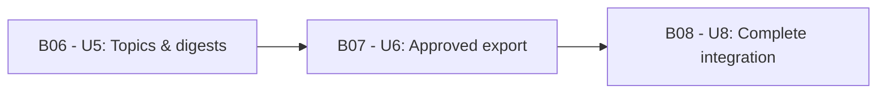

# Delivery Plan — Finish the DocSuri v2 rebuild

Date: 2026-10-17 (Asia/Seoul)
Workflow: 261016-finish-v2-rebuild. A **Bolt** is one build pass over a piece of work, ending in something that runs and merges. Basis: confirmed answers in [delivery-planning-questions.md](delivery-planning-questions.md), the [unit catalogue](../units-generation/unit-of-work.md), [dependency DAG](../units-generation/unit-of-work-dependency.md) and [requirements](../requirements-analysis/requirements.md) of this workflow; Bolt numbering continues the closed record's plan (B06–B08) for continuity.

## Work streams and release boundary

Three Bolts complete the v2 plan. Each Bolt completes one approved unit's bounded contribution with its applicable designs, implementation, real integration and completion evidence. The first finished Bolt does not reduce the release to itself: the release boundary is the complete application at production level (the new release bar from scope definition).

All Bolts are executed by coding agents from this session coordinated by the delivery lead; the human maintainer remains the sole approver.

| Bolt | Unit | Construction directory | Kind / grouping | Complexity | Satisfied prerequisites |
|---|---|---|---|---|---|
| B06 | U5 | u5-topics-digests | library / embedded | M | U1–U3 (built, merged) |
| B07 | U6 | u6-approved-export | library / embedded | M | U1, U2, U4 (built, merged; U4 via PR #51) |
| B08 | U8 | u8-service-operations-integration | service / shared | XL | U1–U7 (built) + U5, U6 |

## Implementation sequence and workflow visualization

Execute B06 → B07 → B08, serially. One build pass at a time; no concurrency (single reviewer, single session).

Text fallback: first prove topics and digest delivery end to end; then the approved Notion export; then assemble the complete application and redo the tail evidence over it.

## Common definition of done

Each Bolt must satisfy these conditions for its implemented scope:

- Its requirements are reconciled against the closed record's capability reference; retained variants, evidence and remaining contributors stay in the ledger; omissions need a human scope decision.
- The contribution runs with actual applicable prerequisites and persistence, including its UI. Isolated tests, mocks and screenshots supplement a working demonstration; they do not replace it.
- Exercise success, denied access, failed/unknown writes, interruption, retry and duplicate outcomes relevant to the contribution; distinguish acknowledged settings, queued work, sent effects and reconciled outcomes.
- Meet resolved policy and evidence prerequisites before affected decisions; never invent retention, migration, free-service limits or user data.
- Supply repeatable setup, fixtures, commands, observed results and limits. Measure task success, responsiveness and interruption recovery against human-agreed targets once those exist; no result implies targets are already agreed.
- Preserve the Korean responsive shared workspace, inherited colors, Apple HIG adaptations, light/dark/system appearance and the WCAG 2.2 AA target where applicable.
- Update affected producer/consumer contracts and executable checks coherently; shared files keep one editing owner per change; component data writers keep their approved authority.
- Reach the human completion checkpoint with the approved verification command and evidence (command approval is a mandatory stop per Bolt). Then merge the completed branch through a PR to develop under CONVENTIONS.md, remove it, and start a fresh branch for the next Bolt.

## Bolt definitions

### B06 — U5 topics & digests

**Owner:** coding agents (aidlc-developer-agent role) with the delivery lead coordinating. **Prerequisites:** U1–U3 merged; content-source licensing terms checked for digest selection; local model availability confirmed.

**Definition of done:** persisted follow/unfollow; per-topic digest settings (cadence, delivery time in the owner's timezone, content window, inherited language/level); content selection from eligible corpus; delivery outcomes recorded with unknown-outcome reconciliation before any further effect; unsubscribe honored despite queued work (nothing sends after it); lifecycle participation registered so account withdrawal stops digests. Exercise success, denied access, no-eligible-content, delivery failure/unknown outcome, unsubscribe-after-queueing and consent-change paths through real boundaries. Real delivery evidence is required even when fault tests use a local sink.

**Confidence hypothesis:** scheduled digests honor current consent despite delayed execution and uncertain sends.
**Expected demo:** follow a topic, set its digest, prepare and deliver an authorized test digest, unsubscribe during queued work, and reconcile a simulated lost acknowledgement without an unexplained duplicate send.

### B07 — U6 approved export

**Owner:** coding agents with the delivery lead coordinating. **Prerequisites:** U4 merged (done, PR #51); Notion token configuration verified and sustainable terms checked; source/destination identity agreement.

**Definition of done:** owner Notion connection with a protected token; read-only inspection and preview that never exports; one explicit approve-and-export action bound to the exact U4 artifact revision and chosen destination; sent/failed/unknown outcomes with reconciliation and no silent duplicate; approval invalidation on artifact/destination change or revoked authority. Exercise wrong owner, protected token handling, duplicate execution, disconnect, timeout after remote success and unknown outcome. No OAuth introduction; no waiver of effect approval.

**Confidence hypothesis:** approved exports reach the intended destination exactly once, or expose uncertainty that resolves without silent duplication.
**Expected demo:** inspect a prepared artifact, preview it read-only, approve a specific test destination, export, reconcile a lost response, then reject an obsolete approval after a revision or destination change.

### B08 — U8 complete integration and honest tail

**Owner:** coding agents with the delivery lead coordinating; every business component retains authority.

**Definition of done:** assemble all views, contributions and lifecycle participants; verify every retained requirement cumulatively through actual boundaries; exercise public/private isolation, current authority, late effects, source withdrawal, acknowledged settings, jobs, exports and controlled restore. Verify coherent Korean navigation, focus/status and appearance across responsive layouts; collect keyboard, assistive-technology and contrast evidence. Demonstrate diagnosis and repair of a representative defect from a clean checkout. Then the honest tail redo: build/CI plus all seven operation stages produce real evidence over the complete application in its real operating mode — a continuously running local service on real accounts and real papers. Missing mandatory evidence prevents readiness claims.

**Confidence hypothesis:** the complete application remains understandable, recoverable and maintainable as one experience within verified free/local limits, and runs as the maintainer's real daily service.
**Expected demo:** the full journey plus every capability ledger working together, a maintainer repair exercise, real continuous operation evidence, and truthful readiness output.

## Verification, stage configuration and completion evidence

The construction verification command remains **unset by choice**: the first unit completion checkpoint will present the exact command for separate human approval once U5's real check exists. No document validator, legacy CI command or placeholder is authorized by this plan.

Construction runs unit by unit (one Unit through all its stages before the next), with completion checkpoints enabled and serial execution — the recorded defaults. Staffing is solo (this session).

Record at each checkpoint the source commit, completed unit contributions, contract/policy revisions, configuration, fixture eligibility, actual commands and outcomes, pending cross-unit acceptance, resource observations and unresolved conditions. The [external dependency map](external-dependency-map.md) names affected work and closure evidence. The phase check ([phase-check-inception.md](../../verification/phase-check-inception.md)) verifies planning traceability only.
